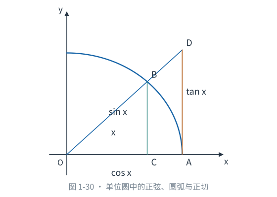
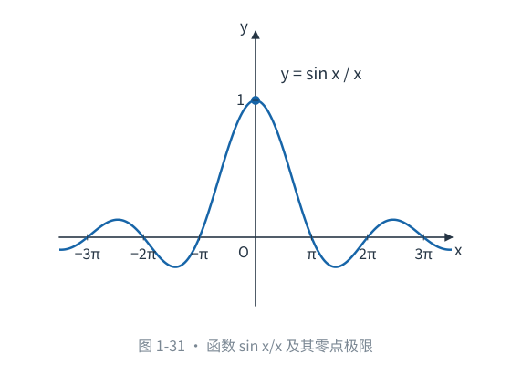
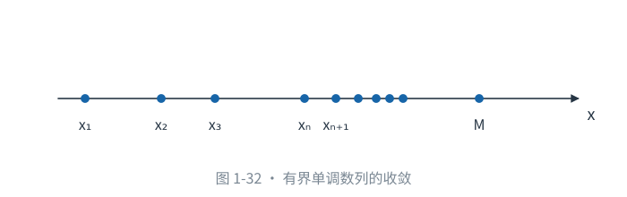

# 1-6 极限存在准则　两个重要极限

## 自学入口：一个函数一直抖动，也能有极限吗？

> [!info] 本次新增讲解
> 可直接读下面这一步，也可跳到“教材转写与已有批注”。想继续抠一个细节时，可以停在这里；练习和复盘均为可选。

**卡在符号或前提时再回看**：[[1-5-极限运算法则]]。

**可以先写这一行**：对 $x\sin(1/x)$（$x\ne0$），先写 $|\sin(1/x)|\le1$。

**为什么这样开始**：乘上非负的 $|x|$，得 $|x\sin(1/x)|\le|x|$。右边趋于零，误差被压到零，故原式趋于零。这就是夹逼的作用：不需要知道振荡的每一个细节，只要能控制它的幅度。重要极限 $\sin u/u\to1$ 则处理另一种结构，使用时要确认 $u\to0$，角度用弧度。

**条件与边界**：递推数列不能只设极限并解方程就宣布收敛；需先证明收敛，例如单调且有界。

> [!question]- 愿意时试一个小变化
> 求 $\lim_{x\to0}\sin(3x)/x$。

> [!tip]- 展开看启动线索与解答
> 写成 $3\sin(3x)/(3x)$；$3x\to0$，故极限为 $3$。

**继续读**：下面的教材正文 ｜ [[自学入口与探索约定#卡住时怎样继续|卡住时的提示方式]] ｜ [[🧭 学习路线图|寻找关联问题]]。

## 教材转写与已有批注

> 下方保留现有转写、页标、题号和锚点；其中可能含先前批注及转换误差，未逐页对照扫描图校订。新增示范均在上方，不作为原书例题引用。

## 第六节 极限存在准则 两个重要极限

下面讲判定极限存在的两个准则以及作为应用准则的例子，讨论两个重要极限：

$\lim_{x\to 0}\frac{\sin x}{x} = 1$ 及 $\lim_{x\to \infty}\left(1 + \frac{1}{x}\right)^x = e.$

准则 I 如果数列 $\{x_{n}\}, \{y_{n}\}$ 及 $\{z_{n}\}$ 满足下列条件：

(1) 从某项起，即 $\exists n_{0} \in \mathbb{N}_{+}$，当 $n > n_{0}$ 时，有

$$
y_{n} \leqslant x_{n} \leqslant z_{n};
$$

(2) $\lim_{n\to \infty}y_n = a,\lim_{n\to \infty}z_n = a,$

那么数列 $\{x_{n}\}$ 的极限存在，且 $\lim_{n\to \infty}x_n = a.$

**证** 因 $y_{n} \to a, z_{n} \to a$，所以根据数列极限的定义，$\forall \varepsilon > 0, \exists$ 正整数 $N_{1}$，当 $n > N_{1}$ 时，有 $|y_{n} - a| < \varepsilon$；又 $\exists$ 正整数 $N_{2}$，当 $n > N_{2}$ 时，有 $|z_{n} - a| < \varepsilon$。现在取 $N = \max \{n_{0}, N_{1}, N_{2}\}$，则当 $n > N$ 时，有

$$
\left| y _ {n} - a \right| <  \varepsilon , \quad \left| z _ {n} - a \right| <  \varepsilon
$$

同时成立，即

$$
a - \varepsilon <  y _ {n} <  a + \varepsilon , \quad a - \varepsilon <  z _ {n} <  a + \varepsilon
$$

同时成立.又因当 $n > N$ 时，$x_{n}$ 介于 $y_{n}$ 和 $z_{n}$ 之间，从而有

$$
a - \varepsilon <  y _ {n} \leqslant x _ {n} \leqslant z _ {n} <  a + \varepsilon ,
$$

即

$$
|x_{n}-a|<\varepsilon
$$

成立.这就证明了$\lim_{n\to\infty}x_{n}=a$.

上述数列极限存在准则可以推广到函数的极限.

准则 I' 如果

(1) 当 $x \in \mathring{U}(x_0, r)$ （或 $|x| > M$）时，

$$
g(x) \leqslant f(x) \leqslant h(x);
$$

(2) 

$$
\begin{array}{l} \lim _ {x \rightarrow x _ {0}} g (x) = A, \lim _ {x \rightarrow x _ {0}} h (x) = A, \\ (x \rightarrow \infty) \quad (x \rightarrow \infty) \\ \end{array}
$$

<!--PG:62-->

那么 $\lim_{x\to 0}f(x)$ 存在，且等于 $A.$

$(x\to\infty)$

准则 I 及准则 I'称为夹逼准则.

作为准则 I'的应用，下面讨论一个重要的极限

$$
\lim_{x \to 0} \frac{\sin x}{x}.
$$

首先注意到，函数 $\frac{\sin x}{x}$ 对于一切 $x \neq 0$ 都有定义.

在图 1-30 所示的四分之一的单位圆中，设圆心角 $\angle AOB = x$ ($0 < x < \frac{\pi}{2}$)，点 $A$ 处的切线与 $OB$ 的延长线相交于 $D$，又 $BC \perp OA$，则

**图1-30**  ^fig1_30

<!-- original-figure: up-062 1-30 -->

> 原书核对：[扫描第 62 页](../原书页面/up-062.png)。

<!-- /original-figure -->

$\sin x = CB, x = \widehat{AB}, \tan x = AD.$

因为

$\triangle AOB$ 的面积 $< \text{扇形 } AOB$ 的面积 $< \triangle AOD$ 的面积，

所以

$$
\frac {1}{2} \sin x < \frac {1}{2} x < \frac {1}{2} \tan x,
$$

即

$$
\sin x < x < \tan x.
$$

不等号各边都除以 $\sin x$，就有

或

$$
1 < \frac{x}{\sin x} < \frac{1}{\cos x},
$$

$$
\cos x < \frac{\sin x}{x} < 1. \tag{6-1}
$$

因为当 $x$ 用 $-x$ 代替时，$\cos x$ 与 $\frac{\sin x}{x}$ 都不变，所以上面的不等式对于开区间 $\left(-\frac{\pi}{2},0\right)$ 内的一切 $x$ 也是成立的.

为了对(6-1)式应用准则 I'，下面来证 $\lim_{x\to0}\cos x=1$。

事实上，当 $0 < |x| < \frac{\pi}{2}$ 时，

$$
0 < | \cos x - 1 | = 1 - \cos x = 2 \sin^ {2} \frac {x}{2} <  2 \left(\frac {x}{2}\right) ^ {2} = \frac {x ^ {2}}{2},
$$

<!--PG:63-->

$0 < 1 - \cos x < \frac{x^2}{2}.$

当 $x \to 0$ 时，$\frac{x^2}{2} \to 0$，由准则 $I'$ 有 $\lim_{x \to 0} (1 - \cos x) = 0$，所以

$$
\lim_{x \to 0} \cos x = 1.
$$

由于 $\lim_{x \to 0} \cos x = 1$，$\lim_{x \to 0} 1 = 1$，由不等式（6-1）及准则 $I'$，即得

$$
\lim_{x \to 0} \frac{\sin x}{x} = 1. \tag{6-2}
$$

从图 1-31 也可以看出这个重要极限.

**图1-31**  ^fig1_31

<!-- original-figure: up-063 1-31 -->

> 原书核对：[扫描第 63 页](../原书页面/up-063.png)。

<!-- /original-figure -->

**例1** 求 $\lim_{x \to 0} \frac{\tan x}{x}$. ^e1-6-1

**解** $\lim_{x \to 0} \frac{\tan x}{x} = \lim_{x \to 0} \left( \frac{\sin x}{x} \cdot \frac{1}{\cos x} \right) = \lim_{x \to 0} \frac{\sin x}{x} \cdot \lim_{x \to 0} \frac{1}{\cos x} = 1.$

**例2** 求 $\lim_{x \to 0} \frac{1 - \cos x}{x^2}$. ^e1-6-2

**解** $\lim_{x \to 0} \frac{1 - \cos x}{x^2} = \lim_{x \to 0} \left( \frac{\sin^2 x}{x^2} \cdot \frac{1}{1 + \cos x} \right) = \lim_{x \to 0} \left( \frac{\sin x}{x} \right)^2 \cdot \lim_{x \to 0} \frac{1}{1 + \cos x} = \frac{1}{2}.$

**例3** 求 $\lim_{x \to 0} \frac{\arcsin x}{x}$. ^e1-6-3

**解** 令 $t = \arcsin x$，则 $x = \sin t$，当 $x \to 0$ 时，有 $t \to 0$。于是由复合函数的极限运算法则得

$$
\lim_{x \to 0} \frac{\arcsin x}{x} = \lim_{t \to 0} \frac{t}{\sin t} = 1.
$$

准则Ⅱ 单调有界数列必有极限.

如果数列 $\{x_{n}\}$ 满足条件

$$
x _ {1} \leqslant x _ {2} \leqslant x _ {3} \leqslant \dots \leqslant x _ {n} \leqslant x _ {n + 1} \leqslant \dots ,
$$

就称数列 $\{x_{n}\}$ 是单调增加的；如果数列 $\{x_{n}\}$ 满足条件

$$
x _ {1} \geqslant x _ {2} \geqslant x _ {3} \geqslant \dots \geqslant x _ {n} \geqslant x _ {n + 1} \geqslant \dots ,
$$

就称数列 $\{x_{n}\}$ 是单调减少的.单调增加和单调减少的数列统称为单调数列①.

在第二节中曾证明：收敛的数列一定有界。但那时也曾指出：有界的数列不一定收敛。现在准则Ⅱ表明：如果数列不仅有界，并且是单调的，那么这个数列的极限必定存

① 这里的单调数列是广义的，就是说，在条件中也包括相等的情形。以后称单调数列都是指这种广义的单调数列。

<!--PG:64-->

在，也就是这数列一定收敛.

对准则Ⅱ我们不作证明，而给出如下的几何解释：

从数轴上看，对应于单调数列的点 $x_n$ 只可能向一个方向移动，所以只有两种可能情形：或者点 $x_n$ 沿数轴移向无穷远 $(x_n \rightarrow +\infty$ 或 $x_n \rightarrow -\infty)$，或者点 $x_n$ 无限趋于某一个定点 A（图 1-32），也就是数列 $\{x_n\}$ 趋于一个极限.但现在假定数列是有界的，而有界数列的点 $x_n$ 都落在数轴上某一个区间 $[-M, M]$ 内，那么上述第一种情形就不可能发生了.这就表示这个数列趋于一个极限，并且这个极限的绝对值不超过 $M$.

**图1-32**  ^fig1_32

<!-- original-figure: up-064 1-32 -->

> 原书核对：[扫描第 64 页](../原书页面/up-064.png)。

<!-- /original-figure -->

作为准则Ⅱ的应用，我们讨论另一个重要极限

$$
\lim_{x \to \infty} \left( 1 + \frac{1}{x} \right)^x.
$$

下面考虑 $x$ 取正整数 $n$ 而趋于 $+\infty$ 的情形.

设 $x_n = \left( 1 + \frac{1}{n} \right)^n$，我们来证数列 $\{x_n\}$ 单调增加并且有界. 按牛顿二项公式，有

$$
\begin{array}{l} x _ {n} = \left(1 + \frac {1}{n}\right) ^ {n} \\ = 1 + \frac {n}{1 !} \cdot \frac {1}{n} + \frac {n (n - 1)}{2 !} \cdot \frac {1}{n ^ {2}} + \frac {n (n - 1) (n - 2)}{3 !} \cdot \frac {1}{n ^ {3}} + \dots + \frac {n (n - 1) \cdots (n - n + 1)}{n !} \cdot \frac {1}{n ^ {n}} \\ = 1 + 1 + \frac {1}{2 !} \left(1 - \frac {1}{n}\right) + \frac {1}{3 !} \left(1 - \frac {1}{n}\right) \left(1 - \frac {2}{n}\right) + \dots + \frac {1}{n !} \left(1 - \frac {1}{n}\right) \left(1 - \frac {2}{n}\right) \dots \left(1 - \frac {n - 1}{n}\right), \\ \end{array}
$$

类似地，

$$
\begin{array}{l} x _ {n + 1} = 1 + 1 + \frac {1}{2 !} \left(1 - \frac {1}{n + 1}\right) + \frac {1}{3 !} \left(1 - \frac {1}{n + 1}\right) \left(1 - \frac {2}{n + 1}\right) + \dots + \\ \frac {1}{n !} \left(1 - \frac {1}{n + 1}\right) \left(1 - \frac {2}{n + 1}\right) \dots \left(1 - \frac {n - 1}{n + 1}\right) + \frac {1}{(n + 1) !} \left(1 - \frac {1}{n + 1}\right) \left(1 - \frac {2}{n + 1}\right) \dots \left(1 - \frac {n}{n + 1}\right). \\ \end{array}
$$

比较 $x_{n}, x_{n+1}$ 的展开式，可以看到除前两项外，$x_{n}$ 的每一项都小于 $x_{n+1}$ 的对应项，并且 $x_{n+1}$ 还多了最后的一项，其值大于 0，因此

$$
x _ {n} <  x _ {n + 1},
$$

这就说明数列 $\{x_{n}\}$ 是单调增加的. 这个数列同时还是有界的. 因为, 如果 $x_{n}$ 的展开式中各项括号内的数用较大的数 1 代替, 得

$$
x _ {n} \leqslant 1 + \left(1 + \frac {1}{2 !} + \frac {1}{3 !} + \dots + \frac {1}{n !}\right) \leqslant 1 + \left(1 + \frac {1}{2} + \frac {1}{2 ^ {2}} + \dots + \frac {1}{2 ^ {n - 1}}\right)
$$

<!--PG:65-->

$$
= 1 + \frac{1 - \frac{1}{2^n}}{1 - \frac{1}{2}} = 3 - \frac{1}{2^{n-1}} < 3,
$$

这就说明数列 $\{x_{n}\}$ 是有界的.根据极限存在准则Ⅱ,这个数列 $\{x_{n}\}$ 的极限存在,通常用字母 e 来表示它,即

$$
\lim _ {n \rightarrow \infty} \left(1 + \frac {1}{n}\right) ^ {n} = e.
$$

可以证明，当 $x$ 取实数而趋于 $+\infty$ 或 $-\infty$ 时，函数 $\left(1+\frac{1}{x}\right)^{x}$ 的极限都存在且都等于 e①. 因此②，

$$
\lim _ {x \rightarrow \infty} \left(1 + \frac {1}{x}\right) ^ {x} = e. \tag {6-3}
$$

这个数 e 是无理数，它的值是

$$
e = 2. 7 1 8 2 8 1 8 2 8 4 5 9 0 4 5 \dots .
$$

在第一节中提到的指数函数 $y = e^{x}$ 以及自然对数 $y = \ln x$ 中的底 $e$ 就是这个常数。

利用复合函数的极限运算法则，可把(6-3)式写成另一形式.在 $(1 + z)^{\frac{1}{z}}$ 中作代换

① 设 $n \leqslant x < n + 1$，则

$$
\left(1 + \frac {1}{n + 1}\right) ^ {n} <  \left(1 + \frac {1}{x}\right) ^ {x} <  \left(1 + \frac {1}{n}\right) ^ {n + 1},
$$

且 $n$ 与 $x$ 同时趋于 $+\infty$ ，因为

$$
\lim _ {n \rightarrow \infty} \left(1 + \frac {1}{n + 1}\right) ^ {n} = \lim _ {n \rightarrow \infty} \frac {\left(1 + \frac {1}{n + 1}\right) ^ {n + 1}}{1 + \frac {1}{n + 1}} = e,
$$

$$
\lim _ {n \rightarrow \infty} \left(1 + \frac {1}{n}\right) ^ {n + 1} = \lim _ {n \rightarrow \infty} \left[ \left(1 + \frac {1}{n}\right) ^ {n} \cdot \left(1 + \frac {1}{n}\right) \right] = e,
$$

应用夹逼准则，即得

$$
\lim _ {x \rightarrow + \infty} \left(1 + \frac {1}{x}\right) ^ {x} = e.
$$

令 $x = -(t + 1)$，则 $x \to -\infty$ 时，$t \to +\infty$。从而

$$
\begin{array}{l} \lim _ {x \rightarrow - \infty} \left(1 + \frac {1}{x}\right) ^ {x} = \lim _ {t \rightarrow + \infty} \left(1 - \frac {1}{t + 1}\right) ^ {- (t + 1)} = \lim _ {t \rightarrow + \infty} \left(\frac {t}{t + 1}\right) ^ {- (t + 1)} \\ = \lim _ {t \rightarrow + \infty} \left(1 + \frac {1}{t}\right) ^ {t + 1} = \lim _ {t \rightarrow + \infty} \left[ \left(1 + \frac {1}{t}\right) ^ {t} \cdot \left(1 + \frac {1}{t}\right) \right] = e. \\ \end{array}
$$

② 参阅习题1-3第10题.

<!--PG:66-->

$x=\frac{1}{z}$，得 $\left(1+\frac{1}{x}\right)^{x}$. 又当 $z\to 0$ 时 $x\to\infty$. 因此由复合函数的极限运算法则得

$$
\lim _{z \rightarrow 0}(1+z)^{\frac{1}{z}}=\lim _{x \rightarrow \infty}\left(1+\frac{1}{x}\right)^{x}=e.
$$

下面的例4也是用代换方法来做的，实质上还是用到了复合函数的极限运算法则.

**例4** 求 $\lim_{x\to \infty}\left(1-\frac{1}{x}\right)^{x}$. ^e1-6-4

**解** 令 $t=-x$，则当 $x\to\infty$ 时，$t\to\infty$。于是

$$
\lim _{x\rightarrow\infty}\left(1-\frac{1}{x}\right)^{x}=\lim _{t\rightarrow\infty}\left(1+\frac{1}{t}\right)^{-t}=\lim _{t\rightarrow\infty}\frac{1}{\left(1+\frac{1}{t}\right)^{t}}=\frac{1}{e}.
$$

相应于单调有界数列必有极限的准则Ⅱ，函数极限也有类似的准则。对于自变量的不同变化过程 $(x\to x_0^-, x\to x_0^+, x\to -\infty, x\to +\infty)$，准则有不同的形式。现以 $x\to x_0^-$ 为例，将相应的准则叙述如下：

准则Ⅱ' 设函数 $f(x)$ 在点 $x_{0}$ 的某个左邻域内单调并且有界，则 $f(x)$ 在 $x_{0}$ 的左极限 $f(x_{0}^{-})$ 必定存在.

### 柯西（Cauchy）①极限存在准则

在第二节例1及例2中，我们看到收敛数列不一定是单调的。因此，准则Ⅱ所给出的单调有界这条件，是数列收敛的充分条件，而不是必要的。当然，其中有界这一条件对数列的收敛性来说是必要的。下面叙述的柯西极限存在准则，它给出了数列收敛的充分必要条件。

柯西极限存在准则 数列$\{x_{n}\}$收敛的充分必要条件是：对于任意给定的正数$\varepsilon$，存在正整数N，使得当$m>N,n>N$时，有

$$
\left| x _ {n} - x _ {m} \right| <  \varepsilon .
$$

**证** 必要性 设 $\lim_{n\to\infty}x_n=a.\forall\varepsilon>0$，由数列极限的定义，$\exists$ 正整数 $N$，当 $n>N$ 时，有

$$
\left| x _ {n} - a \right| <  \frac {\varepsilon}{2};
$$

同样，当 $m > N$ 时，也有

$$
|x_{m}-a|<\frac{\varepsilon}{2}.
$$

① 柯西(Augustin-Louis Cauchy,1789—1857)，法国数学家，他出版了《分析教程》(1821)、《无穷小分析教程概论》(1823)、《微积分在几何中的应用》(1826—1828)这几部划时代的著作，给出了分析学一系列基本概念的严格定义，将微积分理论完整而严密地奠基于极限的基础之上，从而使他成为严格微积分学的奠基者。

<!--PG:67-->

因此，当 $m>N, n>N$ 时，有

$$
\left|x_{n}-x_{m}\right|=\left|\left(x_{n}-a\right)-\left(x_{m}-a\right)\right|\leqslant\left|x_{n}-a\right|+\left|x_{m}-a\right|<\frac{\varepsilon}{2}+\frac{\varepsilon}{2}=\varepsilon,
$$

充分性这里不予证明.

这准则的几何意义表示，数列 $\{x_{n}\}$ 收敛的充分必要条件是：对于任意给定的正数 $\varepsilon$，在数轴上一切具有足够大序号的点 $x_{n}$ 中，任意两点间的距离小于 $\varepsilon$.

柯西极限存在准则有时也叫做$\underline{\text{柯西审敛原理}}$.

## 习题1-6

> [!tip]- 新增：这组习题的逐题详解
> [[习题1-6-详细解答|打开详细解答（6 道大题）]]。包含推导、适用条件，以及必要处可展开的注释。解答按扫描原题核对，发现的转写差异在对应题目旁说明。
> 想先自己试时，可以暂不展开；全部入口见 [[课后习题详细解答]]。
1. 计算下列极限：

(1) $\lim_{x\to 0}\frac{\sin\omega x}{x}$; (2) $\lim_{x\to 0}\frac{\tan3x}{x}$; (3) $\lim_{x\to 0}\frac{\sin2x}{x\sin5x}$;

(4) $\lim_{x\to 0}x\cot x$; (5) $\lim_{x\to 0}\frac{1-\cos2x}{x\sin x}$; (6) $\lim_{n\to \infty}2^n\frac{\sin\frac{x}{2^n}}{2^n}$ （$x$ 为不等于零的常数，$n\in \mathbb{N}_+$）.

2. 计算下列极限：

(1)  $\lim_{x\to0}(1-x)^{\frac{1}{x}};$ 

(2)  $\lim_{x\to0}(1+2x)^{\frac{1}{x}};$ 

(3)  $\lim_{x\to\infty}\left(\frac{1+x}{x}\right)^{2x};$ 

(4)  $\lim_{x\to\infty}\left(1-\frac{1}{x}\right)^{\frac{kx}{x}}$  (k为正整数).

*3. 根据函数极限的定义，证明极限存在的准则 I'.

4. 利用极限存在准则证明：

(1) $\lim_{n\to \infty}\sqrt{1 + \frac{1}{n}} = 1;$ (2) $\lim_{n\to \infty}n\left(\frac{1}{n^2 + \pi} +\frac{1}{n^2 + 2\pi} +\dots +\frac{1}{n^2 + n\pi}\right) = 1;$ (3) $\lim_{x\to 0}\sqrt[3]{1 + x} = 1;$ (4) $\lim_{x\to 0^{+}}x\left[\frac{1}{x}\right] = 1.$

5. 设数列 $\{x_{n}\}$ 满足：$x_{1}=\sqrt{2}, x_{n+1}=\sqrt{2+x_{n}}$ ($n\in\mathbb{N}_{+}$)。证明 $\lim_{n\to\infty}x_{n}$ 存在，并求此极限。

6. 设数列 $\{x_{n}\}$ 满足：$x_{1} \in (0, \pi), x_{n+1} = \sin x_{n}$ ($n \in \mathbb{N}_{+}$)。证明 $\lim_{n \to \infty} x_{n}$ 存在，并求此极限。

> [!pdf]- 📄 本节原书页面（PDF 61–67 / 书页 44–50）
> ![[up-061.png]]
> ![[up-062.png]]
> ![[up-063.png]]
> ![[up-064.png]]
> ![[up-065.png]]
> ![[up-066.png]]
> ![[up-067.png]]

---
⬅️ [[1-5-极限运算法则|极限运算法则]] ｜ 📑 [[第一章-函数与极限|本章目录]] ｜ ➡️ [[1-7-无穷小的比较|无穷小的比较]]
