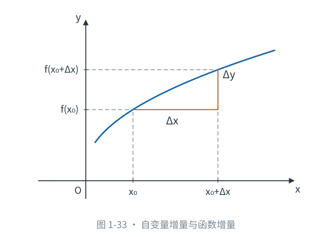
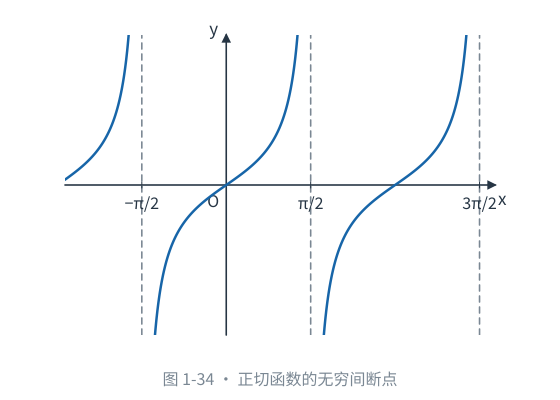
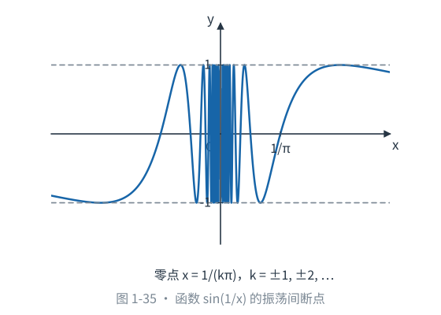
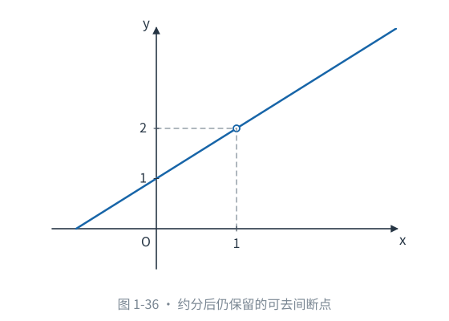
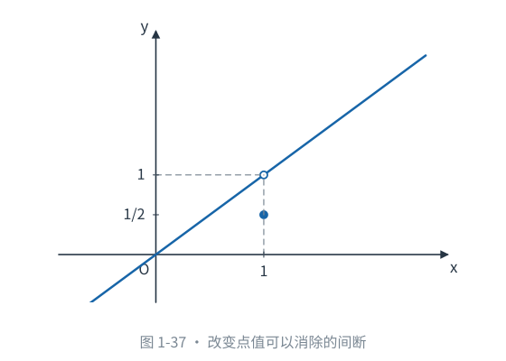
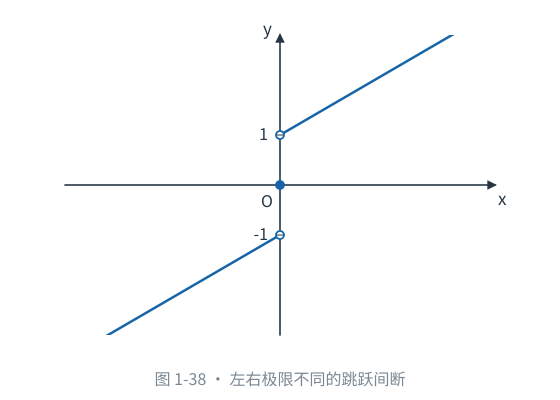
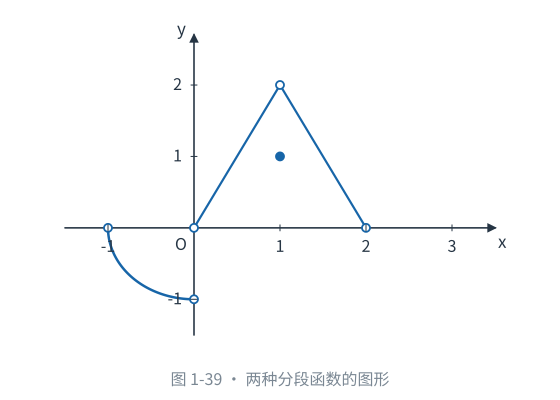

# 1-8 函数的连续性与间断点

## 自学入口：极限存在和连续究竟差在哪一步？

> [!info] 本次新增讲解
> 可直接读下面这一步，也可跳到“教材转写与已有批注”。想继续抠一个细节时，可以停在这里；练习和复盘均为可选。

**卡在符号或前提时再回看**：[[1-3-函数的极限]]。

**可以先写这一行**：设 $f(x)=x+1$（$x\ne0$），$f(0)=5$。先分开写 $\lim_{x\to0}f(x)$ 与 $f(0)$。

**为什么这样开始**：前者等于 $1$，后者等于 $5$。连续要求这两个数相等，还要求该点有定义。把问题拆开，就不会因“左右都靠近同一个数”而忽略点上的取值。若把 $f(0)$ 改为 $1$，就补上了这个可去间断点。

**条件与边界**：连续是相对于定义域讨论的；闭区间端点采用相应的单侧连续。间断点分类需分别查看左右极限。

> [!question]- 愿意时试一个小变化
> $f(x)=|x|$ 在零点连续吗？这就能保证可导吗？

> [!tip]- 展开看启动线索与解答
> 连续，因为极限与函数值都为零；不能保证可导，其左右差商分别趋于 $-1$ 和 $1$，详见 [[2-1-导数概念]]。

**继续读**：下面的教材正文 ｜ [[自学入口与探索约定#卡住时怎样继续|卡住时的提示方式]] ｜ [[🧭 学习路线图|寻找关联问题]]。

## 教材转写与已有批注

> 下方保留现有转写、页标、题号和锚点；其中可能含先前批注及转换误差，未逐页对照扫描图校订。新增示范均在上方，不作为原书例题引用。

## 第八节 函数的连续性与间断点

### 一、函数的连续性

自然界中有许多现象，如气温的变化、河水的流动、植物的生长等都是连续地变化着的。这种现象在函数关系上的反映，就是函数的连续性。例如就气温的变化来看，当时间变动很微小时，气温的变化也很微小，这种特点就是所谓连续性。下面我们先引入增量的概念，然后来描述连续性，并引出函数的连续性的定义。

设变量 $u$ 从它的一个初值 $u_1$ 变到终值 $u_2$，终值与初值的差 $u_2 - u_1$ 就叫做变量 $u$ 的增量，记作 $\Delta u$，即

$$
\Delta u = u_2 - u_1.
$$

增量 $\Delta u$ 可以是正的，也可以是负的。在 $\Delta u$ 为正的情形，变量 $u$ 从 $u_1$ 变到 $u_2 = u_1 + \Delta u$ 时是增大的；当 $\Delta u$ 为负时，变量 $u$ 是减小的。

应该注意到：记号 $\Delta u$ 并不表示某个量 $\Delta$ 与变量 $u$ 的乘积，而是一个整体不可分割的记号。

现在假定函数 $y=f(x)$ 在点 $x_{0}$ 的某一个邻域内是有定义的。当自变量 $x$ 在这邻域内从 $x_{0}$ 变到 $x_{0}+\Delta x$ 时，函数值或因变量 $f(x)$ 相应地从 $f(x_{0})$ 变到 $f(x_{0}+\Delta x)$，因此函数值或因变量 $f(x)$ 的对应增量为

$$
\Delta y = f(x_0 + \Delta x) - f(x_0).
$$

习惯上也称 $\Delta y$ 为函数的增量，函数增量的几何解释如图 1-33 所示。

<!-- original-figure: up-071 1-33 -->
**图 1-33** ^fig1_33

> 原书核对：[扫描第 71 页](../原书页面/up-071.png)。

<!-- /original-figure -->

假如保持 $x_{0}$ 不变而让自变量的增量 $\Delta x$ 变动，一般说来，函数的增量 $\Delta y$ 也要随着变动。现在我们对连续性的概念可以这样描述：如

<!--PG:72-->

果当$\Delta x$趋于零时，函数的对应增量$\Delta y$也趋于零，即

$$
\lim_{\Delta x \to 0} \Delta y = 0 \tag{8-1}
$$

或

$$
\lim_{\Delta x \to 0} [f(x_0 + \Delta x) - f(x_0)] = 0,
$$

那么就称函数 $y = f(x)$ 在点 $x_0$ 处是连续的，即有下述定义：

> [!definition]+ 定义
> 设函数 $y = f(x)$ 在点 $x_0$ 的某一邻域内有定义，如果
> $$
> \lim_{\Delta x \to 0} \Delta y = \lim_{\Delta x \to 0} [f(x_0 + \Delta x) - f(x_0)] = 0,
> $$
> 那么就称函数 $y = f(x)$ 在点 $x_0$ 连续.
> ^d1-8-1

为了应用方便起见，下面把函数 $y = f(x)$ 在点 $x_0$ 连续的定义用不同的方式来叙述。

设 $x = x_0 + \Delta x$，则 $\Delta x \to 0$ 就是 $x \to x_0$。又由于

$$
\Delta y = f(x_0 + \Delta x) - f(x_0) = f(x) - f(x_0),
$$

即

$$
f(x) = f(x_0) + \Delta y,
$$

可见 $\Delta y \to 0$ 就是 $f(x) \to f(x_0)$，因此 (8-1) 式与

$$
\lim_{x \to x_0} f(x) = f(x_0)
$$

相当.所以，函数 $y = f(x)$ 在点 $x_0$ 连续的定义又可叙述如下：

设函数 $y = f(x)$ 在点 $x_0$ 的某一邻域内有定义，如果

$$
\lim_{x \to x_0} f(x) = f(x_0), \tag{8-2}
$$

那么就称函数 $f(x)$ 在点 $x_0$ 连续.

由函数 $f(x)$ 当 $x \to x_0$ 时的极限的定义可知，上述定义也可用“$\varepsilon-\delta$”语言表达如下：

$f(x)$ 在点 $x_0$ 连续 $\Leftrightarrow \forall \varepsilon > 0, \exists \delta > 0$，当 $|x - x_0| < \delta$ 时，有 $|f(x) - f(x_0)| < \varepsilon$.

下面说明左连续及右连续的概念.

如果 $\lim_{x \to x_0} f(x) = f(x_0^-)$ 存在且等于 $f(x_0^-)$，即

$$
f(x_0^-) = f(x_0),
$$

那么就说函数 $f(x)$ 在点 $x_0$ 左连续. 如果 $\lim_{x \to x_0^+} f(x) = f(x_0^+)$ 存在且等于 $f(x_0^+)$，即

$$
f(x_0^+) = f(x_0),
$$

那么就说函数 $f(x)$ 在点 $x_0$ 右连续.

在区间上每一点都连续的函数，叫做在该区间上的连续函数，或者说函数在该区间上连续. 如果区间包括端点，那么函数在右端点连续是指左连续，在左端点连续是指右连续.

连续函数的图形是一条连续而不间断的曲线.

在第五节中，我们曾经证明：如果$f(x)$是有理整函数（多项式），那么对于任意的

<!--PG:73-->

实数 $x_{0}$，都有 $\lim_{x\to x_{0}}f(x)=f(x_{0})$，因此有理整函数在区间 $(- \infty,+\infty)$ 内是连续的.对于有理分式函数 $F(x)=\frac{P(x)}{Q(x)}$，只要 $Q(x_{0}) \neq 0$，就有 $\lim_{x\to x_{0}}F(x)=F(x_{0})$，因此有理分式函数在其定义域内的每一点都是连续的.

由第三节例 5 可知，函数 $f(x)=\sqrt{x}$ 在 $(0,+\infty)$ 内是连续的.

作为例子，我们来证明，函数 $y=\sin x$ 在区间 $(- \infty,+\infty)$ 内是连续的.

设 $x$ 是区间 $(- \infty,+\infty)$ 内任意取定的一点.当 $x$ 有增量 $\Delta x$ 时，对应的函数的增量为

$$
\Delta y=\sin (x+\Delta x)-\sin x,
$$

由三角公式有

$$
\sin (x + \Delta x) - \sin x = 2 \sin \frac {\Delta x}{2} \cos \left(x + \frac {\Delta x}{2}\right),
$$

注意到

$$
\left| \cos \left(x + \frac {\Delta x}{2}\right) \right| \leqslant 1,
$$

就推得

$$
\left| \Delta y \right| = \left| \sin (x + \Delta x) - \sin x \right| \leqslant 2 \left| \sin \frac {\Delta x}{2} \right|.
$$

因为对于任意的角 $\alpha$，当 $\alpha \neq 0$ 时有 $|\sin \alpha| < |\alpha|$，所以

$$
0 \leqslant | \Delta y | = | \sin (x + \Delta x) - \sin x | <  | \Delta x |.
$$

因此，当 $\Delta x \to 0$ 时，由夹逼准则得 $|\Delta y| \to 0$，这就证明了 $y = \sin x$ 对于任一 $x \in (-\infty, +\infty)$ 是连续的.

类似地可以证明，函数 $y=\cos x$ 在区间 $(-\infty,+\infty)$ 内是连续的.

### 二、函数的间断点

设函数 $f(x)$ 在点 $x_{0}$ 的某去心邻域内有定义. 在此前提下，如果函数 $f(x)$ 有下列三种情形之一：

(1) 在  $x=x_{0}$  没有定义；

(2) 虽在  $x=x_{0}$  有定义，但  $\lim_{x\to x_{0}}f(x)$  不存在；

(3) 虽在 $x = x_0$ 有定义，且 $\lim_{x \to x_0} f(x)$ 存在，但 $\lim_{x \to x_0} f(x) \neq f(x_0)$，

那么函数 $f(x)$ 在点 $x_0$ 为不连续，而点 $x_0$ 称为函数 $f(x)$ 的不连续点或间断点.

下面举例来说明函数间断点的几种常见类型.

---

**例1** 正切函数 $y = \tan x$ 在 $x = \frac{\pi}{2}$ 处没有定义，所以点 $x = \frac{\pi}{2}$ 是函数 $\tan x$ 的间断 ^e1-8-1

<!--PG:74-->

点.因

 $\lim_{x\rightarrow \frac{\pi}{2}}\tan x=\infty$ ,

我们称 $x=\frac{\pi}{2}$ 为函数 $\tan x$ 的无穷间断点（图1-34）.

**例2** 函数 $y=\sin \frac{1}{x}$ 在点 $x=0$ 没有定义；当 $x \rightarrow 0$ 时，函数值在 $-1$ 与 $1$ 之间变动无限多次（图 1-35），所以点 $x=0$ 称为函数 $\sin \frac{1}{x}$ 的振荡间断点. ^e1-8-2

**图1-34**  ^fig1_34

<!-- original-figure: up-074 1-34,1-35 -->

> 原书核对：[扫描第 74 页](../原书页面/up-074.png)。

<!-- /original-figure -->

**图1-35**  ^fig1_35

**例3** 函数 $y=\frac{x^{2}-1}{x-1}$ 在点 $x=1$ 没有定义，所以函数在点 $x=1$ 不连续（图 1-36）.但这里 ^e1-8-3

 $\lim_{x\to1}\frac{x^{2}-1}{x-1}=\lim_{x\to1}(x+1)=2.$ 

如果补充定义：令 x=1 时 y=2，那么所给函数在 x=1 成为连续. 所以 x=1 称为该函数的**可去间断点**.

**图1-36**  ^fig1_36

<!-- original-figure: up-074 1-36 -->

> 原书核对：[扫描第 74 页](../原书页面/up-074.png)。

<!-- /original-figure -->

**例4** 函数 ^e1-8-4

$$
y = f (x) = \left\{ \begin{array}{l l} x, & x \neq 1, \\ \frac {1}{2}, & x = 1. \end{array} \right.
$$

这里 $\lim_{x\to 1}f(x) = \lim_{x\to 1}x = 1$ ，但 $f(1) = \frac{1}{2}$ ，所以

$$
\lim _ {x \to 1} f (x) \neq f (1).
$$

因此，点 $x=1$ 是函数 $f(x)$ 的间断点（图 1-37）。但如果改变函数 $f(x)$ 在 $x=1$ 处的定义：令 $f(1)=1$，那么 $f(x)$ 在 $x=1$ 成为连续。所以 $x=1$ 也称为该函数的可去间断点。

**例5** 函数 ^e1-8-5

<!--PG:75-->

**图1-38**  ^fig1_38

<!-- original-figure: up-075 1-37,1-38 -->

> 原书核对：[扫描第 75 页](../原书页面/up-075.png)。

<!-- /original-figure -->

**图1-37**  ^fig1_37

上面举了一些间断点的例子.通常把间断点分成两类：如果 $x_{0}$ 是函数 $f(x)$ 的间断点，但左极限 $f(x_{0}^{-})$ 及右极限 $f(x_{0}^{+})$ 都存在，那么 $x_{0}$ 称为函数 $f(x)$ 的第一类间断点.不是第一类间断点的任何间断点，称为第二类间断点.在第一类间断点中，左、右极限相等者称为可去间断点，不相等者称为跳跃间断点.**无穷间断点和振荡间断点显然是第二类间断点**.

## 习题1-8

> [!tip]- 新增：这组习题的逐题详解
> [[习题1-8-详细解答|打开详细解答（8 道大题）]]。包含推导、适用条件，以及必要处可展开的注释。解答按扫描原题核对，发现的转写差异在对应题目旁说明。
> 想先自己试时，可以暂不展开；全部入口见 [[课后习题详细解答]]。
1. 设 $y=f(x)$ 的图形如图 1-39 所示，试指出 $f(x)$ 的全部间断点，并对可去间断点补充或修改函数值的定义，使它成为连续点.

2. 研究下列函数的连续性，并画出函数的图形：

(1) $f(x)=\begin{cases}x^{2}, & 0 \leqslant x \leqslant 1, \\ 2-x, & 1 < x \leqslant 2;\end{cases}$

(2) $f(x)=\begin{cases}x, & -1 \leqslant x \leqslant 1, \\ 1, & x<-1 \text{ 或 } x>1.\end{cases}$

**图1-39**  ^fig1_39

<!-- original-figure: up-075 1-39 -->

> 原书核对：[扫描第 75 页](../原书页面/up-075.png)。

<!-- /original-figure -->

> **📖 补录习题**（原书跨页，此前转录缺失）：

3. 下列函数在指出的点处间断，说明这些间断点属于哪一类。如果是可去间断点，那么补充或改变函数的定义使它连续：

(1) $y=\frac{x^{2}-1}{x^{2}-3x+2},x=1,x=2;$

(2) $y=\frac{x}{\tan x},x=k\pi,x=k\pi+\frac{\pi}{2}$ $(k=0,\pm1,\pm2,\cdots);$

(3) $y=\cos^{2}\frac{1}{x},x=0;$

(4) $y=\begin{cases} x-1,&x\leqslant1,\\ 3-x,&x>1,\end{cases}\quad x=1.$

4. 讨论函数 $f(x)=\lim_{n\to\infty}\frac{1-x^{2n}}{1+x^{2n}}x$ ($n\in\mathbb{N}_{*}$) 的连续性，若有间断点，则判别其类型。

5. 下列陈述中，哪些是对的，哪些是错的？如果是对的，说明理由；如果是错的，试给出一个反例。

(1) 如果函数 $f(x)$ 在 $a$ 连续，那么 $|f(x)|$ 也在 $a$ 连续；

(2) 如果函数 $|f(x)|$ 在 $a$ 连续，那么 $f(x)$ 也在 $a$ 连续。

6. 证明：若函数 $f(x)$ 在点 $x_0$ 连续且 $f(x_0)\neq0$，则存在 $x_0$ 的某一邻域 $U(x_0)$，当 $x\in U(x_0)$ 时，$f(x)\neq0$.

7. 设

$$
f(x)=\begin{cases} x,&x\in\mathbf{Q},\\ 0,&x\in\mathbf{R}\backslash\mathbf{Q}, \end{cases}
$$

证明：

(1) $f(x)$ 在 $x=0$ 连续；

(2) $f(x)$ 在非零的 x 处都不连续.

8. 设 $f(x)$ 对任意实数 $x, y$，有 $f(x+y)=f(x)+f(y)$，且 $f(x)$ 在 $x=0$ 连续，证明：$f(x)$ 在 $\mathbb{R}$ 上连续.

> [!pdf]- 📄 本节原书页面（PDF 71–75 / 书页 54–58）
> ![[up-071.png]]
> ![[up-072.png]]
> ![[up-073.png]]
> ![[up-074.png]]
> ![[up-075.png]]

---
⬅️ [[1-7-无穷小的比较|无穷小的比较]] ｜ 📑 [[第一章-函数与极限|本章目录]] ｜ ➡️ [[1-9-连续函数的运算与初等函数的连续性|连续函数的运算与初等函数的连续性]]
