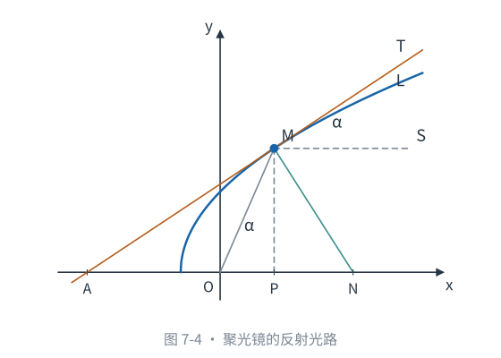

# 7-3 齐次方程

## 自学入口：看到 $y/x$ 时，换成一个变量有什么用？

> [!info] 本次新增讲解
> 可直接读下面这一步，也可跳到“教材转写与已有批注”。想继续抠一个细节时，可以停在这里；练习和复盘均为可选。

**卡在符号或前提时再回看**：[[7-2-可分离变量的微分方程]]。

**可以先写这一行**：对 $y'=1+y/x$（$x\ne0$），先令 $u=y/x$，于是 $y=xu$。

**为什么这样开始**：由乘积求导，$y'=u+xu'$；代入得到 $u+xu'=1+u$，消去 $u$ 后为 $u'=1/x$。所以 $u=\ln|x|+C$，$y=x(\ln|x|+C)$。换元把比值依赖改成了可分离关系。

**条件与边界**：本节的一阶“齐次方程”与线性方程的“齐次”是不同用法。解的区间不能跨过 $x=0$。

> [!question]- 愿意时试一个小变化
> 若方程改为 $y'=y/x$，换元后发生什么？

> [!tip]- 展开看启动线索与解答
> $u+xu'=u$，故 $u'=0$，解为 $y=Cx$，仍在不跨零的区间上讨论原式。

**继续读**：下面的教材正文 ｜ [[自学入口与探索约定#卡住时怎样继续|卡住时的提示方式]] ｜ [[🧭 学习路线图|寻找关联问题]]。

## 教材转写与已有批注

> 下方保留现有转写、页标、题号和锚点；其中可能含先前批注及转换误差，未逐页对照扫描图校订。新增示范均在上方，不作为原书例题引用。

<!--PG:318-->

## 第三节 齐次方程

## 一、齐次方程

如果一阶微分方程可化成

$$
\frac{\mathrm{d}y}{\mathrm{d}x} = \varphi \left( \frac{y}{x} \right) \tag{3-1}
$$

的形式，那么就称这方程为齐次方程，例如

$$
(xy-y^2)\mathrm{d}x - (x^2 - 2xy)\mathrm{d}y = 0
$$

是齐次方程，因为它可化成

$$
\frac{\mathrm{d}y}{\mathrm{d}x} = \frac{xy - y^2}{x^2 - 2xy}
$$

即

$$
\frac{\mathrm{d}y}{\mathrm{d}x} = \frac{\frac{y}{x} - \left(\frac{y}{x}\right)^2}{1 - 2\left(\frac{y}{x}\right)}.
$$

在齐次方程

$$
\frac{\mathrm{d}y}{\mathrm{d}x} = \varphi\left(\frac{y}{x}\right)
$$

中，引进新的未知函数

$$
u = \frac{y}{x}, \tag{3-2}
$$

就可把它化为可分离变量的方程。因为由(3-2)有

$$
y = ux, \quad \frac{\mathrm{d}y}{\mathrm{d}x} = u + x \frac{\mathrm{d}u}{\mathrm{d}x},
$$

代入方程(3-1)，便得方程

$$
u+x\frac{\mathrm{d}u}{\mathrm{d}x}=\varphi(u),
$$

即

$$
x\frac{\mathrm{d}u}{\mathrm{d}x}=\varphi(u)-u.
$$

分离变量，得

<!--PG:319-->

$$
\frac {\mathrm{d} u}{\varphi (u) - u} = \frac {\mathrm{d} x}{x}.
$$

两端积分，得

$$
\int \frac {\mathrm{d} u}{\varphi (u) - u} = \int \frac {\mathrm{d} x}{x}.
$$

求出积分后，再以 $\frac{y}{x}$ 代替 u，便得所给齐次方程的通解.

**例1** 解方程 ^e7-3-1

$$
y ^ {2} + x ^ {2} \frac {\mathrm{d} y}{\mathrm{d} x} = x y \frac {\mathrm{d} y}{\mathrm{d} x},
$$

解 原方程可写成

$$
\frac {\mathrm{d} y}{\mathrm{d} x} = \frac {- y ^ {2}}{x y - x ^ {2}} = \frac {\left(\frac {y}{x}\right) ^ {2}}{\frac {y}{x} - 1},
$$

因此是齐次方程. 令 $\frac{y}{x} = u$ ，则

$$
y = x u, \quad \frac {\mathrm{d} y}{\mathrm{d} x} = u + x \frac {\mathrm{d} u}{\mathrm{d} x},
$$

于是原方程变为

$$
u + x \frac {\mathrm{d} u}{\mathrm{d} x} = \frac {u ^ {2}}{u - 1},
$$

即

$$
x \frac {\mathrm{d} u}{\mathrm{d} x} = \frac {u}{u - 1}.
$$

分离变量，得

$$
\left(1 - \frac {1}{u}\right) \mathrm{d} u = \frac {\mathrm{d} x}{x}.
$$

两端积分，得

$$
u - \ln | u | + C _ {1} = \ln | x |,
$$

或写为

$$
\ln | x u | = u + C _ {1}.
$$

以 $\frac{y}{x}$ 代上式中的 $u$，便得所给方程的通解为

$$
\ln | y | = \frac {y}{x} + C _ {1} \quad \text {或} \quad y = C e ^ {\frac {x}{x}} (C = \pm e ^ {C _ {1}}).
$$

<!--PG:320-->

**例2** 探照灯的聚光镜的镜面是一张旋转曲面，它的形状由 $xOy$ 坐标面上的一条曲线 $L$ 绕 $x$ 轴旋转而成。按聚光镜性能的要求，在其旋转轴 $(x$ 轴) 上一点 $O$ 处发出的一切光线，经它反射后都与旋转轴平行. 求曲线 $L$ 的方程. ^e7-3-2

解 将光源所在之 $O$ 点取作坐标原点（图 7-4），且曲线 $L$ 位于 $y \geqslant 0$ 范围内.

**图7-4**  ^fig7_4

<!-- original-figure: up-320 7-4 -->

> 原书核对：[扫描第 320 页](../原书页面/up-320.png)。

<!-- /original-figure -->

设点 $M(x, y)$ 为 $L$ 上的任一点，点 $O$ 发出的某条光线经点 $M$ 反射后是一条与 $x$ 轴平行的直线 $MS$. 又设过点 $M$ 的切线 $AT$ 与 $x$ 轴的夹角为 $\alpha$. 根据题意，$\angle SMT=\alpha$. 另一方面，$\angle OMA$ 是入射角的余角，$\angle SMT$ 是反射角的余角，于是由光学中的反射定律有 $\angle OMA=\angle SMT=\alpha$. 从而 $AO=OM$，但 $AO=AP-OP=$

$PM\cot \alpha-OP=\frac{y}{y^{\prime}}-x$，而 $OM=\sqrt{x^{2}+y^{2}}$. 于是得微分方程

$$
\frac {y}{y ^ {\prime}} - x = \sqrt {x ^ {2} + y ^ {2}}.
$$

把 $x$ 看作因变量，$y$ 看作自变量，当 $y>0$ 时，上式即为

$$
\frac {\mathrm{d} x}{\mathrm{d} y} = \frac {x}{y} + \sqrt {\left(\frac {x}{y}\right) ^ {2} + 1},
$$

这是齐次方程. 令 $\frac{x}{y}=v$，则 $x=yv$，$\frac{\mathrm{d}x}{\mathrm{d}y}=v+y\frac{\mathrm{d}v}{\mathrm{d}y}$，代入上式，得

$$
v + y \frac {\mathrm{d} v}{\mathrm{d} y} = v + \sqrt {v ^ {2} + 1},
$$

即

$$
y \frac {\mathrm{d} v}{\mathrm{d} y} = \sqrt {v ^ {2} + 1}.
$$

分离变量，得

$$
\frac {\mathrm{d} v}{\sqrt {v ^ {2} + 1}} = \frac {\mathrm{d} y}{y}.
$$

积分，得

$$
\ln (v + \sqrt {v ^ {2} + 1}) = \ln y - \ln C,
$$

或

$$
v + \sqrt {v ^ {2} + 1} = \frac {y}{C}.
$$

由

<!--PG:321-->

得

$$
\frac {y ^ {2}}{C ^ {2}} - \frac {2 y v}{C} = 1,
$$

以 $yv=x$ 代入上式，得

$$
y ^ {2} = 2 C \left(x + \frac {C}{2}\right).
$$

这是以 x 轴为对称轴、焦点在原点的抛物线。

## 二、可化为齐次的方程

方程

$$
\frac {\mathrm{d} y}{\mathrm{d} x} = \frac {a x + b y + c}{a _ {1} x + b _ {1} y + c _ {1}} \tag{3-3}
$$

当 $c=c_{1}=0$ 时是齐次的，否则不是齐次的。在非齐次的情形，可用下列变换把它化为齐次方程：令

$$
x = X + h, \quad y = Y + k,
$$

其中 h 及 k 是待定的常数.于是

$$
\mathrm{d} x = \mathrm{d} X, \quad \mathrm{d} y = \mathrm{d} Y,
$$

从而方程(3-3)成为

$$
\frac {\mathrm{d} Y}{\mathrm{d} X} = \frac {a X + b Y + a h + b k + c}{a _ {1} X + b _ {1} Y + a _ {1} h + b _ {1} k + c _ {1}}.
$$

如果方程组

$$
\left\{ \begin{array}{l} a h + b k + c = 0, \\ a _ {1} h + b _ {1} k + c _ {1} = 0 \end{array} \right.
$$

的系数行列式 $\left| \begin{array}{cc}a & b\\ a_1 & b_1 \end{array} \right| \neq 0$ ，即 $\frac{a_1}{a}\neq \frac{b_1}{b}$ ，那么可以定出 $h$ 及 $k$ 使它们满足上述方程组。这样，方程（3-3）便化为齐次方程

$$
\frac {\mathrm{d} Y}{\mathrm{d} X} = \frac {a X + b Y}{a _ {1} X + b _ {1} Y}.
$$

求出这齐次方程的通解后，在通解中以 $x - h$ 代 $X, y - k$ 代 $Y$，便得方程(3-3)的通解。

当 $\frac{a_{1}}{a}=\frac{b_{1}}{b}$ 时，h 及 k 无法求得，因此上述方法不能应用。但这时令 $\frac{a_{1}}{a}=\frac{b_{1}}{b}=\lambda$，从而方程(3-3)可写成

$$
\frac {\mathrm{d} y}{\mathrm{d} x} = \frac {a x + b y + c}{\lambda (a x + b y) + c _ {1}}.
$$

引入新变量  $v=ax+by$ ，则

<!--PG:322-->

$$
\frac{\mathrm{d}v}{\mathrm{d}x} = a + b \frac{\mathrm{d}y}{\mathrm{d}x} \quad \text{或} \quad \frac{\mathrm{d}y}{\mathrm{d}x} = \frac{1}{b} \left( \frac{\mathrm{d}v}{\mathrm{d}x} - a \right).
$$

于是方程(3-3)成为

$$
\frac{1}{b}\left(\frac{\mathrm{d}v}{\mathrm{d}x}-a\right)=\frac{v+c}{\lambda v+c_1},
$$

这是可分离变量的方程。

以上所介绍的方法可以应用于更一般的方程

$$
\frac{\mathrm{d}y}{\mathrm{d}x} = f \left( \frac{ax + by + c}{a_1 x + b_1 y + c_1} \right).
$$

**例3** 解方程 ^e7-3-3

$$
(2x+y-4)\,\mathrm{d}x + (x+y-1)\,\mathrm{d}y = 0.
$$

解 所给方程属方程(3-3)的类型. 令 $x=X+h, y=Y+k$，则 $\mathrm{d}x=\mathrm{d}X, \mathrm{d}y=\mathrm{d}Y$，代入原方程得

$$
(2X+Y+2h+k-4)\,\mathrm{d}X + (X+Y+h+k-1)\,\mathrm{d}Y = 0.
$$

解方程组

$$
\left\{
\begin{array}{l}
2h+k-4=0, \\
h+k-1=0
\end{array}
\right.
$$

得 $h=3, k=-2$。令 $x=X+3, y=Y-2$，原方程成为

$$
(2X+Y)\,\mathrm{d}X + (X+Y)\,\mathrm{d}Y = 0,
$$

或

$$
\frac{\mathrm{d}Y}{\mathrm{d}X} = -\frac{2X + Y}{X + Y} = -\frac{2 + \frac{Y}{X}}{1 + \frac{Y}{X}},
$$

这是齐次方程.

令 $\frac{Y}{X} = u$ ，则 $Y = Xu, \frac{\mathrm{d}Y}{\mathrm{d}X} = u + X\frac{\mathrm{d}u}{\mathrm{d}X}$ ，于是方程变为

$$
u + X \frac{\mathrm{d}u}{\mathrm{d}X} = -\frac{2 + u}{1 + u},
$$

或

$$
X \frac{\mathrm{d}u}{\mathrm{d}X} = -\frac{2 + 2u + u^2}{1 + u}.
$$

分离变量得

$$
-\frac{u+1}{u^2+2u+2}\mathrm{d}u=\frac{\mathrm{d}X}{X}.
$$

<!--PG:323-->

积分得

$$
\ln C _ {1} - \frac {1}{2} \ln (u ^ {2} + 2 u + 2) = \ln | X |,
$$

于是

$$
\frac {C _ {1}}{\sqrt {u ^ {2} + 2 u + 2}} = | X |,
$$

或

$$
C _ {2} = X ^ {2} (u ^ {2} + 2 u + 2) \quad (C _ {2} = C _ {1} ^ {2}),
$$

即

$$
Y ^ {2} + 2 X Y + 2 X ^ {2} = C _ {2}.
$$

以 $X=x-3,Y=y+2$ 代入上式并化简，得

$$
2 x ^ {2} + 2 x y + y ^ {2} - 8 x - 2 y = C \quad (C = C _ {2} - 1 0).
$$

### 习题7-3

> [!tip]- 新增：这组习题的逐题详解
> [[习题7-3-详细解答|打开详细解答（4 道大题）]]。包含推导、适用条件，以及必要处可展开的注释。解答按扫描原题核对，发现的转写差异在对应题目旁说明。
> 想先自己试时，可以暂不展开；全部入口见 [[课后习题详细解答]]。

1. 求下列齐次方程的通解：

(1) 

$$
x y ^ {\prime} - y - \sqrt {y ^ {2} - x ^ {2}} = 0;
$$

(2) 

$$
x \frac {\mathrm{d} y}{\mathrm{d} x} = y \ln \frac {y}{x};
$$

(3) 

$$
(x ^ {2} + y ^ {2}) \mathrm{d} x - x y \mathrm{d} y = 0;
$$

(4) 

$$
\left(x ^ {3} + y ^ {3}\right) \mathrm{d} x - 3 x y ^ {2} \mathrm{d} y = 0;
$$

(5) 

$$
\left(2 x \sin \frac {y}{x} + 3 y \cos \frac {y}{x}\right) \mathrm{d} x - 3 x \cos \frac {y}{x} \mathrm{d} y = 0;
$$

(6) 

$$
(1 + 2 \mathrm{e} ^ {x / y}) \mathrm{d} x + 2 \mathrm{e} ^ {x / y} \left(1 - \frac {x}{y}\right) \mathrm{d} y = 0.
$$

2. 求下列齐次方程满足所给初值条件的特解：

(1) 

$$
(y ^ {2} - 3 x ^ {2}) \mathrm{d} y + 2 x y \mathrm{d} x = 0, y \mid_ {x = 0} = 1;
$$

(2) 

$$
y ^ {\prime} = \frac {x}{y} + \frac {y}{x}, y \mid_ {x = 1} = 2;
$$

(3) 

$$
\left(x ^ {2} + 2 x y - y ^ {2}\right) \mathrm{d} x + \left(y ^ {2} + 2 x y - x ^ {2}\right) \mathrm{d} y = 0, y \mid_ {x = 1} = 1;
$$

(4) 

$$
x \frac {\mathrm{d} y}{\mathrm{d} x} = y + x \sec \frac {y}{x}, y \mid_ {x = 1} = \frac {\pi}{4}.
$$

3. 设有连接点 $O(0,0)$ 和 $A(1,1)$ 的一段向上凸的曲线弧 $\widehat{OA}$，对于 $\widehat{OA}$ 上任一点 $P(x,y)$，曲线弧 $\widehat{OP}$ 与直线段 $\widehat{OP}$ 所围图形的面积为 $x^{2}$，求曲线弧 $\widehat{OA}$ 的方程.

4. 化下列方程为齐次方程，并求出通解：

(1) 

$$
(2 x - 5 y + 3) \mathrm{d} x - (2 x + 4 y - 6) \mathrm{d} y = 0;
$$

(2) 

$$
(x - y - 1) \mathrm{d} x + (4 y + x - 1) \mathrm{d} y = 0;
$$

(3) 

$$
(3 y - 7 x + 7) \mathrm{d} x + (7 y - 3 x + 3) \mathrm{d} y = 0;
$$

(4) 

$$
(x + y) \mathrm{d} x + (3 x + 3 y - 4) \mathrm{d} y = 0.
$$

> [!pdf]- 📄 本节原书页面（PDF 318–323 / 书页 301–306）
> ![[up-318.png]]
> ![[up-319.png]]
> ![[up-320.png]]
> ![[up-321.png]]
> ![[up-322.png]]
> ![[up-323.png]]

---
⬅️ [[7-2-可分离变量的微分方程|可分离变量的微分方程]] ｜ 📑 [[第七章-微分方程|本章目录]] ｜ ➡️ [[7-4-一阶线性微分方程|一阶线性微分方程]]
