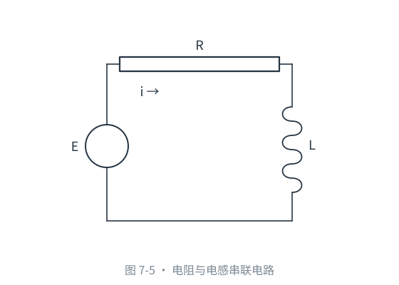

# 7-4 一阶线性微分方程

## 自学入口：一阶线性方程的积分因子，为什么这样选？

> [!info] 本次新增讲解
> 可直接读下面这一步，也可跳到“教材转写与已有批注”。想继续抠一个细节时，可以停在这里；练习和复盘均为可选。

**卡在符号或前提时再回看**：[[7-2-可分离变量的微分方程]]。

**可以先写这一行**：对 $y'+2y=e^x$，先寻找 $\mu$ 使乘上后左边成为 $(\mu y)'$。

**为什么这样开始**：乘积求导给出 $\mu y'+\mu' y$，因此需要 $\mu'=2\mu$，可取 $\mu=e^{2x}$。方程化为 $(e^{2x}y)'=e^{3x}$，积分后得 $y=e^x/3+Ce^{-2x}$。积分因子不是凭空背出的，它负责凑成乘积的导数。

**条件与边界**：先化为 $y'+P(x)y=Q(x)$ 的标准形；若原来 $y'$ 前系数为零，该点必须另外处理。

> [!question]- 愿意时试一个小变化
> 再给 $y(0)=0$，常数如何确定？

> [!tip]- 展开看启动线索与解答
> $0=1/3+C$，所以 $C=-1/3$。

**继续读**：下面的教材正文 ｜ [[自学入口与探索约定#卡住时怎样继续|卡住时的提示方式]] ｜ [[🧭 学习路线图|寻找关联问题]]。

## 教材转写与已有批注

> 下方保留现有转写、页标、题号和锚点；其中可能含先前批注及转换误差，未逐页对照扫描图校订。新增示范均在上方，不作为原书例题引用。

<!--PG:324-->

第四节 一阶线性微分方程

一、线性方程

方程

$$
\frac{\mathrm{d}y}{\mathrm{d}x} + P(x)y = Q(x) \tag{4-1}
$$

叫做**一阶线性微分方程**，因为它对于未知函数 $y$ 及其导数是一次方程。如果 $Q(x) \equiv 0$，那么方程 (4-1) 称为 **齐次的**；如果 $Q(x) \neq 0$，那么方程 (4-1) 称为 **非齐次的**。

设 (4-1) 为非齐次线性方程。为了求出非齐次线性方程 (4-1) 的解，我们先把 $Q(x)$ 换成零而写出方程

$$
\frac{\mathrm{d}y}{\mathrm{d}x} + P(x)y = 0. \tag{4-2}
$$

方程 (4-2) 叫做对应于非齐次线性方程 (4-1) 的 **齐次线性方程**。方程 (4-2) 是可分离变量的，分离变量后得

$$
\frac{\mathrm{d}y}{y} = -P(x) \, \mathrm{d}x,
$$

两端积分，得

$$
\ln |y| = -\int P(x) \, \mathrm{d}x + C_{1},
$$

或

$$
y = C \mathrm{e}^{-\int P(x) \, \mathrm{d}x} \quad (C = \pm \mathrm{e}^{C_{1}}),
$$

这是对应的齐次线性方程 (4-2) 的通解①。

现在我们使用所谓**常数变易法**来求非齐次线性方程(4-1)的通解。这方法是把(4-2)的通解中的C换成x的未知函数$u(x)$，即作变换

$$
y = u \mathrm{e}^{-\int P(x) \, \mathrm{d}x}, \tag{4-3}
$$

于是

$$
\frac{\mathrm{d}y}{\mathrm{d}x} = u' \mathrm{e}^{-\int P(x) \, \mathrm{d}x} - u P(x) \mathrm{e}^{-\int P(x) \, \mathrm{d}x}. \tag{4-4}
$$

将(4-3)和(4-4)代入方程(4-1)得

① 这里记号 $\int P(x) \, dx$ 表示 $P(x)$ 的某个确定的原函数.

<!--PG:325-->

$$
u^{\prime}e^{-\int P(x)dx}-uP(x)e^{-\int P(x)dx}+P(x)ue^{-\int P(x)dx}=Q(x),
$$

即

$$
u^{\prime}e^{-\int P(x)dx}=Q(x), \ u^{\prime}=Q(x)e^{\int P(x)dx}.
$$

两端积分，得

$$
u = \int Q(x) e^{\int P(x) dx} dx + C.
$$

把上式代入(4-3)，便得非齐次线性方程(4-1)的通解

$$
y = \mathrm{e}^{-\int P(x)\mathrm{d}x} \left[ \int Q(x) \mathrm{e}^{\int P(x)\mathrm{d}x} \mathrm{d}x + C \right]. \tag{4-5}
$$

将(4-5)式改写成两项之和

$$
y = C \mathrm{e}^{-\int P(x) \, \mathrm{d}x} + \mathrm{e}^{-\int P(x) \, \mathrm{d}x} \int Q(x) \, \mathrm{e}^{\int P(x) \, \mathrm{d}x} \, \mathrm{d}x,
$$

上式右端第一项是对应的齐次线性方程(4-2)的通解，第二项是非齐次线性方程(4-1)的一个特解(在(4-1)的通解(4-5)中取 $C=0$ 便得到这个特解). 由此可知，一阶非齐次线性方程的通解等于对应的齐次方程的通解与非齐次方程的一个特解之和.

**例1** 求方程 ^e7-4-1

$$
\frac{\mathrm{d} y}{\mathrm{d} x} - \frac{2 y}{x + 1} = (x + 1)^{\frac{5}{2}}
$$

的通解.

解 这是一个非齐次线性方程.先求对应的齐次方程的通解.

$$
\begin{array}{l} \frac {\mathrm{d} y}{\mathrm{d} x} - \frac {2}{x + 1} y = 0, \\ \frac {\mathrm{d} y}{y} = \frac {2 \mathrm{d} x}{x + 1}, \\ \ln | y | = 2 \ln | x + 1 | + C _ {1}, \\ y = C (x + 1) ^ {2} (C = \pm \mathrm{e} ^ {C _ {1}}). \end{array}
$$

用常数变易法，把 C 换成 u，即令

$$
y = u (x + 1) ^ {2}, \tag{4-6}
$$

那么

$$
\frac {\mathrm{d} y}{\mathrm{d} x} = u ^ {\prime} (x + 1) ^ {2} + 2 u (x + 1),
$$

代入所给非齐次方程，得

$$
u^{\prime}=(x+1)^{\frac{1}{2}}.
$$

两端积分，得

<!--PG:326-->

$$
u = \frac {2}{3} (x + 1) ^ {\frac {3}{2}} + C.
$$

再把上式代入(4-6)式，即得所求方程的通解为

$$
y = (x + 1) ^ {2} \left[ \frac {2}{3} (x + 1) ^ {\frac {3}{2}} + C \right].
$$

**例2** 有一个电路如图7-5所示，其中电源电动势为 $E = E_{\mathrm{m}} \sin \omega t$ （$E_{\mathrm{m}}, \omega$ 都是常量），电阻 $R$ 和电感 $L$ 都是常量. 求电流 $i(t)$. ^e7-4-2

解（i）列方程 由电学知道，当电流变化时，

$L$ 上有感应电动势 $-L \frac{\mathrm{d}i}{\mathrm{d}t}$ 由回路电压定律得出

$$
E - L \frac {\mathrm{d} i}{\mathrm{d} t} - i R = 0,
$$

**图7-5**  ^fig7_5

<!-- original-figure: up-326 7-5 -->

> 原书核对：[扫描第 326 页](../原书页面/up-326.png)。

<!-- /original-figure -->

即

$$
\frac {\mathrm{d} i}{\mathrm{d} t} + \frac {R}{L} i = \frac {E}{L}.
$$

把 $E=E_{m}\sin \omega t$ 代入上式，得

$$
\frac {\mathrm{d} i}{\mathrm{d} t} + \frac {R}{L} i = \frac {E _ {\mathrm{m}}}{L} \sin \omega t. \tag{4-7}
$$

未知函数 $i(t)$ 应满足方程(4-7).此外,设开关 S 闭合的时刻为 $t=0$,这时 $i(t)$ 还应该满足初值条件

$$
i \mid_ {t = 0} = 0. \tag{4-8}
$$

（ii）解方程 方程(4-7)是一个非齐次线性方程.可以先求出对应的齐次方程的通解,然后用常数变易法求非齐次方程的通解.但是,也可以直接应用通解公式(4-5)来求解.这里 $P(t)=\frac{R}{L}, Q(t)=\frac{E_{\mathrm{m}}}{L}\sin \omega t$, 代入公式(4-5), 得

$$
i (t) = \mathrm{e} ^ {- \frac {R}{L} t} \left(\int \frac {E _ {\mathrm{m}}}{L} \mathrm{e} ^ {\frac {R}{L} t} \sin \omega t \mathrm{d} t + C\right).
$$

应用分部积分法，得

$$
\int \mathrm{e} ^ {\frac {R}{L} t} \sin \omega t \mathrm{d} t = \frac {\mathrm{e} ^ {\frac {R}{L} t}}{R ^ {2} + \omega^ {2} L ^ {2}} (R L \sin \omega t - \omega L ^ {2} \cos \omega t),
$$

将上式代入前式并化简，得方程(4-7)的通解

$$
i (t) = \frac {E _ {\mathrm{m}}}{R ^ {2} + \omega^ {2} L ^ {2}} (R \sin \omega t - \omega L \cos \omega t) + C \mathrm{e} ^ {- \frac {R}{L} t},
$$

其中 C 为任意常数.

将初值条件(4-8)代入上式,得

<!--PG:327-->

$$
C = \frac{\omega LE_{\mathrm{m}}}{R^{2} + \omega^{2}L^{2}},
$$

因此，所求函数 $i(t)$ 为

$$
i(t) = \frac{\omega LE_{\mathrm{m}}}{R^{2} + \omega^{2} L^{2}} \mathrm{e}^{-\frac{R}{L} t} + \frac{E_{\mathrm{m}}}{R^{2} + \omega^{2} L^{2}} (R \sin \omega t - \omega L \cos \omega t). \tag{4-9}
$$

为了便于说明(4-9)式所反映的物理现象，下面把 $i(t)$ 中第二项的形式稍加改变。令

$$
\cos \varphi = \frac{R}{\sqrt{R^2 + \omega^2 L^2}}, \quad \sin \varphi = \frac{\omega L}{\sqrt{R^2 + \omega^2 L^2}},
$$

于是(4-9)式可写成

$$
i(t) = \frac{\omega L E_{\mathrm{m}}}{R^2 + \omega^2 L^2} \mathrm{e}^{-\frac{R}{L} t} + \frac{E_{\mathrm{m}}}{\sqrt{R^2 + \omega^2 L^2}} \sin(\omega t - \varphi),
$$

其中

$$
\varphi = \arctan \frac {\omega L}{R}.
$$

当 $t$ 增大时，上式右端第一项（叫做暂态电流）逐渐衰减而趋于零；第二项（叫做稳态电流）是正弦函数，它的周期和电动势的周期相同而相角落后 $\varphi$。

在上节中，对于齐次方程 $y' = f\left(\frac{y}{x}\right)$，我们通过变量代换 $y = xu$，把它化为变量可分离的方程，然后分离变量，经积分求得通解。在本节中，对于一阶非齐次线性方程

$$
y^{\prime} + P(x)y = Q(x),
$$

我们通过解对应的齐次线性方程找到变量代换

$$
y = u \mathrm{e}^{-\int P(x) \mathrm{d}x},
$$

利用这一代换，把非齐次线性方程化为变量可分离的方程，然后经积分求得通解。

利用变量代换（因变量的变量代换或自变量的变量代换）把一个微分方程化为变量可分离的方程，或化为已经知其求解步骤的方程，这是解微分方程最常用的方法。下面再举一个例子。

**例3** 解方程 $\frac{\mathrm{d}y}{\mathrm{d}x} = \frac{1}{x + y}$ ^e7-4-3

解 若把所给方程变形为

$$
\frac{\mathrm{d}x}{\mathrm{d}y} = x + y,
$$

即为一阶线性方程，则按一阶线性方程的解法可求得通解。

也可用变量代换来解所给方程. 令 $x + y = u$，则 $y = u - x, \frac{\mathrm{d}y}{\mathrm{d}x} = \frac{\mathrm{d}u}{\mathrm{d}x} - 1$. 代入原方程，得

<!--PG:328-->

分离变量得

$$
\frac{u}{u+1} \mathrm{d} u = \mathrm{d} x,
$$

两端积分得

$$
u - \ln |u+1| = x + C_1.
$$

以 $u=x+y$ 代入上式，即得

$$
y - \ln |x + y + 1| = C_1,
$$

或

$$
x = C e^{y} - y - 1 \quad (C = \pm e^{-C_1}).
$$

在以上求解过程中，假定了 $u+1 \neq 0$，即 $x+y+1 \neq 0$。事实上，$x+y+1=0$ 也是方程的解。为了补充这个失去的解，在 $C=\pm e^{C_1} \neq 0$ 中，补充 $C=0$，即

$$
x=C e^y - y - 1,
$$

其中 $C$ 为任意常数.

## *二、伯努利方程

方程

$$
\frac{\mathrm{d}y}{\mathrm{d}x} + P(x)y = Q(x)y^n \quad (n \neq 0, 1) \tag{4-10}
$$

叫做伯努利(Bernoulli)方程. 当 $n=0$ 或 $n=1$ 时, 这是线性微分方程. 当 $n \neq 0$, 且 $n \neq 1$ 时, 这方程不是线性的, 但是通过变量的代换, 便可把它化为线性的. 事实上, 以 $y^n$ 除方程 (4-10) 的两端, 得

$$
y^{-n} \frac{\mathrm{d} y}{\mathrm{d} x} + P(x) y^{1-n} = Q(x). \tag{4-11}
$$

容易看出，上式左端第一项与 $\frac{\mathrm{d}}{\mathrm{d}x}(y^{1-n})$ 只差一个常数因子 $1-n$，因此我们引入新的因变量

$$
z = y^{1-n},
$$

那么

$$
\frac{\mathrm{d}z}{\mathrm{d}x} = (1-n)y^{-n}\frac{\mathrm{d}y}{\mathrm{d}x}.
$$

用(1-n)乘方程(4-11)的两端，再通过上述代换便得线性方程

$$
\frac{\mathrm{d}z}{\mathrm{d}x} + (1-n)P(x)z = (1-n)Q(x).
$$

<!--PG:329-->

求出这方程的通解后，以 $y^{1-n}$ 代换 $z$ 便得到伯努利方程的通解.

**例4** 求方程 ^e7-4-4

$$
\frac{dy}{dx} + \frac{y}{x} = a(\ln x)y^2
$$

的通解.

解 以 $y^2$ 除方程的两端，得

$$
y^{-2}\frac{dy}{dx} + \frac{1}{x}y^{-1} = a \ln x,
$$

即

$$
-\frac{d(y^{-1})}{dx} + \frac{1}{x}y^{-1} = a \ln x.
$$

令 $z = y^{-1}$，则上述方程成为

$$
\frac{dz}{dx} - \frac{1}{x}z = -a \ln x.
$$

这是一个线性方程，它的通解为

$$
z = x \left[ C - \frac{a}{2} (\ln x)^2 \right].
$$

以 $y^{-1}$ 代 $z$，得所求方程的通解为

$$
yx\left[C - \frac{a}{2}(\ln x)^2\right] = 1.
$$

## 习题7-4

> [!tip]- 新增：这组习题的逐题详解
> [[习题7-4-详细解答|打开详细解答（8 道大题）]]。包含推导、适用条件，以及必要处可展开的注释。解答按扫描原题核对，发现的转写差异在对应题目旁说明。
> 想先自己试时，可以暂不展开；全部入口见 [[课后习题详细解答]]。

1. 求下列微分方程的通解：

(1) $\frac{dy}{dx} + y = e^{-x}$;

(2) $xy' + y = x^2 + 3x + 2$;

(3) $y' + y \cos x = e^{-\sin x}$;

(4) $y' + y \tan x = \sin 2x$;

(5) $(x^{2}-1)y'+2xy-\cos x=0$;

(6) $\frac{d\rho}{d\theta}+3\rho=2$;

(7) $\frac{dy}{dx} + 2xy = 4x$;

(8) $y \ln y \, dx + (x - \ln y) \, dy = 0$;

(9) $(x - 2)\frac{dy}{dx} = y + 2(x - 2)^3$;

(10) $(y^2 - 6x)\frac{dy}{dx} + 2y = 0.$

2. 求下列微分方程满足所给初值条件的特解：

(1) $\frac{dy}{dx} - y\tan x = \sec x, y \bigg|_{x=0} = 0;$

(2) $\frac{dy}{dx} + \frac{y}{x} = \frac{\sin x}{x}, y \bigg|_{x = n} = 1;$

(3) $\frac{dy}{dx} + y\cot x = 5e^{\cos x}, y \bigg|_{x=\frac{\pi}{2}} = -4;$
3. 若曲线通过原点，并且它在点 $(x,y)$ 处的切线斜率等于 $2x+y$，求这曲线的方程.

4. 设有一质量为 m 的质点做直线运动. 从速度等于零的时刻起，有一个与运动方向一致、大小与时间成正比（比例系数为 $k_{1}$）的力作用于它，此外还受一与速度成正比（比例系数为 $k_{2}$）的阻力作用. 求质点运动的速度与时间的函数关系.

5. 设有一个由电阻 $R=10 \Omega$、电感 $L=2 \mathrm{~H}$ 和电源电压 $E=20 \sin 5t \mathrm{~V}$ 串联组成的电路. 开关 S 合上后，电路中有电流通过. 求电流 i 与时间 t 的函数关系.

6. 验证形如 $y f(xy) dx + xg(xy) dy = 0$ 的微分方程可经变量代换 v=xy 化为可分离变量的方程，并求其通解.

7. 用适当的变量代换将下列方程化为可分离变量的方程，然后求出通解：

(1) $\frac{dy}{dx} = (x+y)^2$; (2) $\frac{dy}{dx} = \frac{1}{x-y} + 1$;

(3) $xy'+y = y(\ln x + \ln y)$; (4) $y' = y^2 + 2(\sin x - 1)y + \sin^2 x - 2\sin x - \cos x + 1$;

(5) $y(xy+1) dx + x(1 + xy + x^2y^2) dy = 0.$

8. 求下列伯努利方程的通解：

(1) $\frac{dy}{dx} + y = y^2 (\cos x - \sin x)$; (2) $\frac{dy}{dx} - 3xy = xy^2$;

(3) $\frac{dy}{dx} + \frac{1}{3} y = \frac{1}{3}(1 - 2x)y^4$; (4) $\frac{dy}{dx} - y = xy^5$;

(5) $xdy - [y + xy^3(1 + \ln x)] dx = 0.$

> [!pdf]- 📄 本节原书页面（PDF 324–329 / 书页 307–312）
> ![[up-324.png]]
> ![[up-325.png]]
> ![[up-326.png]]
> ![[up-327.png]]
> ![[up-328.png]]
> ![[up-329.png]]

---
⬅️ [[7-3-齐次方程|齐次方程]] ｜ 📑 [[第七章-微分方程|本章目录]] ｜ ➡️ [[7-5-可降阶的高阶微分方程|可降阶的高阶微分方程]]
