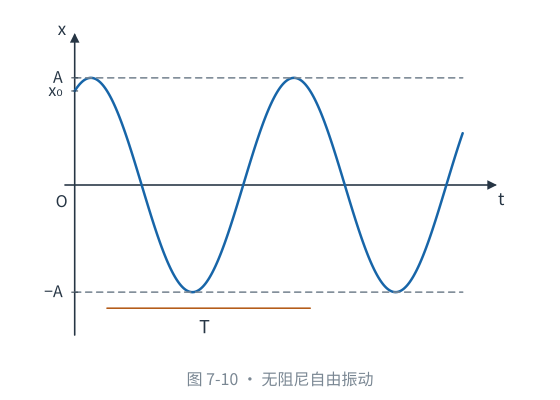
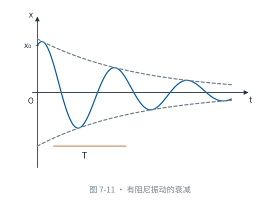
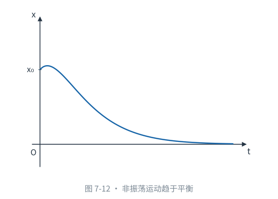
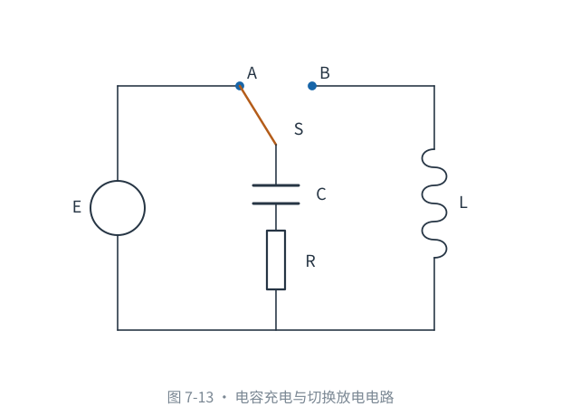

# 7-7 常系数齐次线性微分方程

## 自学入口：为什么把 $e^{rx}$ 代入微分方程就变成代数方程？

> [!info] 本次新增讲解
> 可直接读下面这一步，也可跳到“教材转写与已有批注”。想继续抠一个细节时，可以停在这里；练习和复盘均为可选。

**卡在符号或前提时再回看**：[[7-6-高阶线性微分方程]]。

**可以先写这一行**：对 $y''-3y'+2y=0$，先试 $y=e^{rx}$。

**为什么这样开始**：每次求导只多乘一个 $r$，代入得 $(r^2-3r+2)e^{rx}=0$。由于指数不为零，解特征方程得 $r=1,2$，于是通解为 $C_1e^x+C_2e^{2x}$。这个试探利用的是指数求导保持原形。

**条件与边界**：重根不能把同一个指数解写两遍当作独立解；二重根 $r$ 需配上 $xe^{rx}$。复根对应实数形式的正余弦解。

> [!question]- 愿意时试一个小变化
> $y''-2y'+y=0$ 的通解是什么？

> [!tip]- 展开看启动线索与解答
> 特征根 $r=1$ 为二重根，通解为 $(C_1+C_2x)e^x$。

**继续读**：下面的教材正文 ｜ [[自学入口与探索约定#卡住时怎样继续|卡住时的提示方式]] ｜ [[🧭 学习路线图|寻找关联问题]]。

## 教材转写与已有批注

> 下方保留现有转写、页标、题号和锚点；其中可能含先前批注及转换误差，未逐页对照扫描图校订。新增示范均在上方，不作为原书例题引用。

## 第七节 常系数齐次线性微分方程

先讨论二阶常系数齐次线性微分方程的解法，再把二阶方程的解法推广到$n$阶方程.

在二阶齐次线性微分方程

$$
y'' + P(x)y' + Q(x)y = 0 \tag{7-1}
$$

中，如果 $y'$, $y$ 的系数 $P(x)$, $Q(x)$ 均为常数，即 (7-1) 式成为

$$
y'' + py' + qy = 0, \tag{7-2}
$$

其中 $p, q$ 是常数，那么称 (7-2) 为二阶常系数齐次线性微分方程。如果 $p, q$ 不全为常数，称 (7-1) 为二阶变系数齐次线性微分方程。

由上节讨论可知，要找微分方程(7-2)的通解，可以先求出它的两个解 $y_{1}, y_{2}$，如果它们之比不为常数，即 $y_{1}$ 与 $y_{2}$ 线性无关，那么 $y = C_{1}y_{1} + C_{2}y_{2}$ 就是方程(7-2)的通解.

当 $r$ 为常数时，指数函数 $y = e^{rx}$ 和它的各阶导数都只相差一个常数因子。由于指数函数有这个特点，因此我们用 $y = e^{rx}$ 来尝试，看能否选取适当的常数 $r$，使 $y = e^{rx}$ 满足方程 (7-2)。

将  $y = e^{rx}$  求导①，得到

$$
y ^ {\prime} = r e ^ {r x}, \quad y ^ {\prime \prime} = r ^ {2} e ^ {r x}
$$

把 $y, y'$ 和 $y''$ 代入方程(7-2)，得

$$
(r ^ {2} + p r + q) \mathrm{e} ^ {r x} = 0.
$$

由于 $e^{rx} \neq 0$，所以

$$
r^{2} + pr + q = 0. \tag{7-3}
$$

① 当 $r$ 为复数 $a+bi, x$ 为实变量时，导数公式 $\frac{\mathrm{d}}{\mathrm{d}x}\mathrm{e}^{rx}=re^{rx}$ 仍成立。事实上，对欧拉公式

$$
\mathrm{e}^{(a+bi)x} = \mathrm{e}^{ax} (\cos bx + i \sin bx)
$$

两端求导，得

$$
\begin{array}{l} \frac {\mathrm {d}}{\mathrm {d} x} \mathrm {e} ^ {(a + b i) x} = a \mathrm {e} ^ {a x} (\cos b x + \mathrm {i} \sin b x) + \mathrm {e} ^ {a x} (- b \sin b x + \mathrm {i} b \cos b x) \\ = (a + b i) \mathrm {e} ^ {a x} (\cos b x + \mathrm {i} \sin b x) = (a + b i) \mathrm {e} ^ {(a + b i) x}. \\ \end{array}
$$

<!--PG:348-->

由此可见，只要 $r$ 满足代数方程 (7-3)，函数 $y = e^{r x}$ 就是微分方程 (7-2) 的解，我们把代数方程 (7-3) 叫做微分方程 (7-2) 的特征方程.

特征方程 (7-3) 是一个二次代数方程，其中 $r^2, r$ 的系数及常数项恰好依次是微分方程 (7-2) 中 $y'' , y'$ 及 $y$ 的系数.

特征方程 (7-3) 的两个根 $r_1, r_2$ 可以用公式

$$
r_{1,2} = \frac{-p \pm \sqrt{p^2 - 4q}}{2}
$$

求出.它们有三种不同的情形：

(i) 当 $p^2 - 4q > 0$ 时，$r_1, r_2$ 是两个不相等的实根

$$
r_1 = \frac{-p + \sqrt{p^2 - 4q}}{2}, \quad r_2 = \frac{-p - \sqrt{p^2 - 4q}}{2};
$$

(ii) 当 $p^{2}-4q=0$ 时，$r_{1}, r_{2}$ 是两个相等的实根

$$
r_{1}=r_{2}=-\frac{p}{2};
$$

（iii）当 $p^{2}-4q<0$ 时，$r_{1}, r_{2}$ 是一对共轭复根

$$
r _ {1} = \alpha + \beta \mathrm{i}, \quad r _ {2} = \alpha - \beta \mathrm{i},
$$

其中

$$
\alpha = - \frac {p}{2}, \quad \beta = \frac {\sqrt {4 q - p ^ {2}}}{2}.
$$

相应地,微分方程(7-2)的通解也有三种不同的情形.分别讨论如下:

(i) 特征方程有两个不相等的实根：$r_{1} \neq r_{2}$

由上面的讨论知道， $y_{1} = e^{r_{1}x},y_{2} = e^{r_{2}x}$ 是微分方程(7-2)的两个解，并且 $\frac{y_2}{y_1} = \frac{e^{r_2x}}{e^{r_1x}} = e^{(r_2 - r_1)x}$ 不是常数，因此微分方程(7-2)的通解为

$$
y = C _ {1} \mathrm{e} ^ {r _ {1} x} + C _ {2} \mathrm{e} ^ {r _ {2} x}.
$$

（ii）特征方程有两个相等的实根：$r_{1}=r_{2}$

这时，只得到微分方程(7-2)的一个解

$$
y _ {1} = \mathrm{e} ^ {r _ {1} x}.
$$

为了得出微分方程(7-2)的通解，还需求出另一个解 $y_{2}$，并且要求 $\frac{y_{2}}{y_{1}}$ 不是常数. 设 $\frac{y_{2}}{y_{1}} = u(x)$，即 $y_{2} = \mathrm{e}^{r_{2}x}u(x)$. 下面来求 $u(x)$. 将 $y_{2}$ 求导，得

$$
y _ {2} ^ {\prime} = \mathrm{e} ^ {r _ {2} x} (u ^ {\prime} + r _ {1} u),
$$

$$
y _ {2} ^ {\prime \prime} = \mathrm{e} ^ {r _ {2} x} (u ^ {\prime \prime} + 2 r _ {1} u ^ {\prime} + r _ {1} ^ {2} u),
$$

<!--PG:349-->

将 $y_{2}, y_{2}^{\prime}$ 和 $y_{2}^{\prime\prime}$ 代入微分方程 (7-2)，得

$$
e^{r^{1x}} \left[ (u^{\prime\prime} + 2r_{1}u^{\prime} + r_{1}^{2}u) + p(u^{\prime} + r_{1}u) + qu \right] = 0,
$$

约去 $e^{r^{1x}}$，并合并同类项，得

$$
u^{\prime\prime} + (2r_{1} + p)u^{\prime} + (r_{1}^{2} + pr_{1} + q)u = 0.
$$

由于 $r_{1}$ 是特征方程 (7-3) 的二重根。因此 $r_{1}^{2} + pr_{1} + q = 0$，且 $2r_{1} + p = 0$，于是得

$$
u^{\prime\prime} = 0.
$$

因为这里只要得到一个不为常数的解，所以不妨选取 $u = x$，由此得到微分方程 (7-2) 的另一个解

$$
y_{2} = x e^{r_{1} x}.
$$

从而微分方程 (7-2) 的通解为

$$
y = C_{1} e^{r_{1} x} + C_{2} x e^{r_{1} x},
$$

即

$$
y = (C_{1} + C_{2} x) e^{r_{1} x}.
$$

（iii）特征方程有一对共轭复根：$r_{1} = \alpha + \beta i, r_{2} = \alpha - \beta i (\beta \neq 0)$

这时，$y_{1} = e^{(\alpha + \beta i)x}, y_{2} = e^{(-\alpha - \beta i)x}$ 是微分方程 (7-2) 的两个解，但它们是复值函数形式。为了得出实值函数形式的解，先利用欧拉公式 $e^{i\theta} = \cos \theta + i \sin \theta$ 把 $y_{1}, y_{2}$ 改写为

$$
y_{1} = e^{(\alpha + \beta i)x} = e^{\alpha x} \cdot e^{\beta i x} = e^{\alpha x} (\cos \beta x + i \sin \beta x),
$$

$$
y_{2} = e^{(-\alpha - \beta i)x} = e^{\alpha x} \cdot e^{-\beta i x} = e^{\alpha x} (\cos \beta x - i \sin \beta x).
$$

由于复值函数 $y_{1}$ 与 $y_{2}$ 之间成共轭关系，因此，取它们的和除以2就得到它们的实部，取它们的差除以2i就得到它们的虚部。由于方程（7-2）的解符合叠加原理，所以实值函数

$$
\overline{y}_{1} = \frac{1}{2}(y_{1} + y_{2}) = e^{\alpha x} \cos \beta x, \quad \overline{y}_{2} = \frac{1}{2i}(y_{1} - y_{2}) = e^{\alpha x} \sin \beta x
$$

还是微分方程(7-2)的解，且 $\frac{\overline{y}_{1}}{\overline{y}_{2}} = \frac{e^{\alpha x} \cos \beta x}{e^{\alpha x} \sin \beta x} = \cot \beta x$ 不是常数，所以微分方程(7-2)的通解为

$$
y = e^{\alpha x}(C_1 \cos \beta x + C_2 \sin \beta x).
$$

综上所述，求二阶常系数齐次线性微分方程

$$
y^{\prime\prime} + p y^{\prime} + q y = 0 \tag{7-2}
$$

的通解的步骤如下：

第一步 写出微分方程(7-2)的特征方程

$$
r^{2} + pr + q = 0. \tag{7-3}
$$

第二步 求出特征方程(7-3)的两个根 $r_{1}, r_{2}$.

<!--PG:350-->

第三步 根据特征方程(7-3)的两个根的不同情形，按照下列表格写出微分方程(7-2)的通解：

| 特征方程 $r^2 + pr + q = 0$ 的两个根 $r_1, r_2$ | 微分方程 $y'' + py' + qy = 0$ 的通解 |
|---|---|
| 两个不相等的实根 $r_1, r_2$ | $y = C_1 e^{r_1 x} + C_2 e^{r_2 x}$ |
| 两个相等的实根 $r_1 = r_2$ | $y = (C_1 + C_2 x) e^{r_1 x}$ |
| 一对共轭复根 $r_{1,2} = \alpha \pm \beta i$ | $y = e^{\alpha x} (C_1 \cos \beta x + C_2 \sin \beta x)$ |

**例1** 求微分方程 $y'' - 2y' - 3y = 0$ 的通解. ^e7-7-1

解 所给微分方程的特征方程为

$$
r ^ {2} - 2 r - 3 = 0,
$$

其根 $r_1=-1, r_2=3$ 是两个不相等的实根，因此所求通解为

$$
y = C _ {1} \mathrm{e} ^ {- x} + C _ {2} \mathrm{e} ^ {3 x}.
$$

**例2** 求方程 $\frac{\mathrm{d}^2s}{\mathrm{d}t^2} + 2\frac{\mathrm{d}s}{\mathrm{d}t} + s = 0$ 满足初值条件 $s|_{t=0} = 4, s'|_{t=0} = -2$ 的特解. ^e7-7-2

解 所给方程的特征方程为

$$
r ^ {2} + 2 r + 1 = 0,
$$

其根 $r_1 = r_2 = -1$ 是两个相等的实根，因此所求微分方程的通解为

$$
s = \left(C _ {1} + C _ {2} t\right) \mathrm{e} ^ {- t}.
$$

将条件 $s|_{t=0}=4$ 代入通解，得 $C_{1}=4$，从而

$$
s = (4 + C _ {2} t) \mathrm{e} ^ {- t}.
$$

将上式对 t 求导，得

$$
s ^ {\prime} = \left(C _ {2} - 4 - C _ {2} t\right) \mathrm{e} ^ {- t}.
$$

再把条件 $s'|_{t=0}=-2$ 代入上式，得 $C_2=2$ 。于是所求特解为

$$
s = (4 + 2 t) \mathrm{e} ^ {- t}.
$$

**例3** 求微分方程 $y'' - 2y' + 5y = 0$ 的通解. ^e7-7-3

解 所给方程的特征方程为

$$
r ^ {2} - 2 r + 5 = 0,
$$

其根 $r_{1,2}=1\pm2i$ 为一对共轭复根. 因此所求通解为

$$
y = \mathrm{e} ^ {x} (C _ {1} \cos 2 x + C _ {2} \sin 2 x).
$$

**例4** 在第六节例1中，设物体只受弹性恢复力$f$的作用，且在初始时刻$t=0$的位置为$x=x_{0}$，初始速度为$\left.\frac{\mathrm{d}x}{\mathrm{d}t}\right|_{t=0}=v_{0}$.求反映物体运动规律的函数$x=x(t)$. ^e7-7-4

解 由于不计阻力 $R$，即假设 $-\mu \frac{\mathrm{d}x}{\mathrm{d}t}=0$，所以方程（6-1）成为

<!--PG:351-->

$$
\frac{\mathrm{d}^{2}x}{\mathrm{d}t^{2}}+k^{2}x=0,
$$

方程(7-4)叫做无阻尼自由振动的微分方程.

反映物体运动规律的函数 $x=x(t)$ 是满足微分方程(7-4)及初值条件

$$
x \mid_{t=0}=x_{0}, \left.\frac{\mathrm{d}x}{\mathrm{d}t}\right|_{t=0}=v_{0}
$$

的特解.

方程(7-4)的特征方程为 $r^{2}+k^{2}=0$，其根 $r=\pm ki$ 是一对共轭复根，所以方程(7-4)的通解为

$$
x = C _ {1} \cos k t + C _ {2} \sin k t.
$$

应用初值条件，定出 $C_{1}=x_{0}, C_{2}=\frac{v_{0}}{k}$. 因此，所求的特解为

$$
x = x _ {0} \cos k t + \frac {v _ {0}}{k} \sin k t. \tag{7-5}
$$

为了便于说明特解所反映的振动现象，我们令

$$
x _ {0} = A \sin \varphi , \quad \frac {v _ {0}}{k} = A \cos \varphi \quad (0 \leqslant \varphi <  2 \pi),
$$

于是(7-5)式成为

$$
x = A \sin (k t + \varphi), \tag{7-6}
$$

其中

$$
A = \sqrt {x _ {0} ^ {2} + \frac {v _ {0} ^ {2}}{k ^ {2}}}, \quad \tan \varphi = \frac {k x _ {0}}{v _ {0}}.
$$

函数(7-6)的图形如图7-10所示(图中假定$x_{0}>0, v_{0}>0$).

**图7-10**  ^fig7_10

<!-- original-figure: up-351 7-10 -->

> 原书核对：[扫描第 351 页](../原书页面/up-351.png)。

<!-- /original-figure -->

函数(7-6)所反映的运动就是简谐振动。这个振动的振幅为 A，初相为 $\varphi$，周期为 $T=\frac{2\pi}{k}$，角频率为 k。由于 $k=\sqrt{\frac{c}{m}}$（见第六节例 1），它与初值条件无关，而完全由振动系统（在本例中就是弹簧和物体所组成的系统）本身所确定。因此，k 又叫做系统的固有频率。固有频率是反映振动系统特性的一个重要参数。

<!--PG:352-->

**例5** 在第六节例1中，设物体受弹簧的恢复力$f$和阻力$R$的作用，且在初始时刻$t=0$的位置$x=x_{0}$，初始速度$\left.\frac{\mathrm{d}x}{\mathrm{d}t}\right|_{t=0}=v_{0}$，求反映物体运动规律的函数$x=x(t)$. ^e7-7-5

解 这就是要找满足有阻尼的自由振动方程

$$
\frac{\mathrm{d}^{2}x}{\mathrm{d}t^{2}}+2n\frac{\mathrm{d}x}{\mathrm{d}t}+k^{2}x=0 \tag{7-7}
$$

及初值条件

$$
x\mid_{t=0}=x_{0},\quad\left.\frac{\mathrm{d}x}{\mathrm{d}t}\right|_{t=0}=v_{0}
$$

的特解.

方程(7-7)的特征方程为 $r^{2}+2nr+k^{2}=0$ ，其根为

$$
r = \frac{-2n \pm \sqrt{4n^2 - 4k^2}}{2} = -n \pm \sqrt{n^2 - k^2}.
$$

以下按 $n<k, n>k$ 及 $n=k$ 三种不同情形分别进行讨论.

(i) 小阻尼情形：$n<k$

特征方程的根 $r = -n \pm \omega i$ ($\omega = \sqrt{k^2 - n^2}$) 是一对共轭复根，所以方程 (7-7) 的通解为

$$
x = \mathrm{e}^{-ni} (C_1 \cos \omega t + C_2 \sin \omega t).
$$

应用初值条件定出 $C_{1}=x_{0}, C_{2}=\frac{v_{0}+nx_{0}}{\omega}$，因此所求特解为

$$
x = \mathrm{e}^{-ni} \left( x_0 \cos \omega t + \frac{v_0 + nx_0}{\omega} \sin \omega t \right). \tag{7-8}
$$

如例4中所做的那样，令

$$
x_{0}=A \sin \varphi, \quad \frac{v_{0}+nx_{0}}{\omega}=A \cos \varphi \quad (0 \leqslant \varphi < 2\pi), \tag{7-9}
$$

那么(7-8)式又可写成

$$
x = A \mathrm{e}^{-ni} \sin(\omega t + \varphi), \tag{7-10}
$$

其中

$$
\omega = \sqrt{k^2 - n^2}, \quad A = \sqrt{x_0^2 + \frac{(v_0 + nx_0)^2}{\omega^2}}, \quad \tan \varphi = \frac{x_0 \omega}{v_0 + nx_0}.
$$

从(7-10)式看出，物体的运动是周期为 $T=\frac{2\pi}{\omega}$ 的振动.但与简谐振动不同，它的振幅 $Ae^{-\omega t}$ 随时间 $t$ 的增大而逐渐减小.因此，物体随时间 $t$ 的增大而趋于平衡位置.

函数(7-10)的图形如图7-11所示(图中假定 $x_{0}=0,v_{0}>0$).

（ii）大阻尼情形：$n>k$

<!--PG:353-->

特征方程的根 $r_{1}=-n+\sqrt{n^{2}-k^{2}}$，$r_{2}=-n-\sqrt{n^{2}-k^{2}}$ 是两个不相等的负实根，所以方程（7-7）的通解为

$$
x=C_{1}e^{-(n-\sqrt{n^{2}-k^{2}})t}+C_{2}e^{-(n+\sqrt{n^{2}-k^{2}})t}, \tag{7-11}
$$

其中任意常数 $C_{1}$，$C_{2}$ 可以由初值条件来确定.

从（7-11）式看出，使 $x=0$ 的 $t$ 值最多只有一个，即物体最多越过平衡位置一次，因此物体已不再有振动现象.又当 $t \rightarrow +\infty$ 时，$x \rightarrow 0$.因此，物体随时间 $t$ 的增大而趋于平衡位置.

函数（7-11）的图形如图 7-12 所示（图中假定 $x_{0}>0,v_{0}>0$）.

**图7-11** ^fig7_11

<!-- original-figure: up-353 7-11,7-12 -->

> 原书核对：[扫描第 353 页](../原书页面/up-353.png)。

<!-- /original-figure -->

**图7-12** ^fig7_12

（iii）临界阻尼情形：$n=k$

特征方程的根 $r_{1}=r_{2}=-n$ 是两个相等的实根，所以方程（7-7）的通解为

$$
x=e^{-nt}(C_{1}+C_{2}t),
$$

其中任意常数 $C_{1}$ 及 $C_{2}$ 可由初值条件来确定.由上式可看出，在临界阻尼情形使 $x=0$ 的 $t$ 值也最多只有一个，因此物体也不再有振动现象.又由于

$$
\lim _{t \rightarrow+\infty} t e^{-nt}=\lim _{t \rightarrow+\infty} \frac{t}{e^{nt}}=\lim _{t \rightarrow+\infty} \frac{1}{n e^{nt}}=0,
$$

从而可以看出，当 $t \rightarrow +\infty$ 时，$x \rightarrow 0$。因此，在临界阻尼情形，物体也随时间 $t$ 的增大而趋于平衡位置。

上面讨论二阶常系数齐次线性微分方程所用的方法以及方程的通解的形式，可推广到 $n$ 阶常系数齐次线性微分方程上去，对此我们不再详细讨论，只简单地叙述于下：

$n$ 阶常系数齐次线性微分方程的一般形式是

$$
y^{(n)} + p_{1} y^{(n-1)} + p_{2} y^{(n-2)} + \cdots + p_{n-1} y^{\prime} + p_{n} y = 0, \tag{7-12}
$$

其中 $p_{1}, p_{2}, \cdots, p_{n-1}, p_{n}$ 都是常数.

有时我们用记号 D（叫做微分算子）表示对 x 求导的运算 $\frac{d}{dx}$，把 $\frac{dy}{dx}$ 记作 Dy，把 $\frac{d^{n}y}{dx^{n}}$ 记作 $D^{n}y$，并把方程（7-12）记作

<!--PG:354-->

记

$$
\left(\mathrm{D} ^ {n} + p _ {1} \mathrm{D} ^ {n - 1} + \dots + p _ {n - 1} \mathrm{D} + p _ {n}\right) y = 0. \tag{7-13}
$$

$L(\mathrm{D}) = \mathrm{D}^{n} + p_{1}\mathrm{D}^{n-1} + \cdots + p_{n-1}\mathrm{D} + p_{n}$,

$L(\mathrm{D})$叫做微分算子D的$n$次多项式.于是方程(7-13)可记作

$$
L(\mathrm{D})y = 0.
$$

如同讨论二阶常系数齐次线性微分方程那样，令 $y = e^{rx}$。由于 $\mathrm{De}^{rx} = re^{rx}, \cdots, D^n e^{rx} = r^n e^{rx}$，故 $L(\mathrm{D}) e^{rx} = L(r) e^{rx}$。因此把 $y = e^{rx}$ 代入方程 (7-13)，得

$$
L(r)e^{rx} = 0.
$$

由此可见，如果选取 $r$ 是 $n$ 次代数方程 $L(r)=0$ 即

$$
r^{n} + p_{1}r^{n-1} + p_{2}r^{n-2} + \cdots + p_{n-1}r + p_{n} = 0 \tag{7-14}
$$

的根，那么作出的函数 $y = e^{rx}$ 就是方程(7-13)的一个解。

方程(7-14)叫做方程(7-13)的特征方程。

根据特征方程的根，可以写出其对应的微分方程的解如下：

| 特征方程的根 | 微分方程通解中的对应项 |
|---|---|
| 单实根 $r$ | 给出一项:$Ce^{rx}$ |
| 一对单复根 $r_{1,2}=\alpha\pm\beta i$ | 给出两项:$e^{rx}(C_{1}\cos \beta x+C_{2}\sin \beta x)$ |
| $k$重实根 $r$ | 给出 $k$ 项:$e^{rx}(C_{1}+C_{2}x+\cdots+C_{k}x^{k-1})$ |
| 一对 $k$ 重复根 $r_{1,2}=\alpha\pm\beta i$ | 给出 $2k$ 项:$e^{rx}[(C_{1}+C_{2}x+\cdots+C_{k}x^{k-1})\cos \beta x+(D_{1}+D_{2}x+\cdots+D_{k}x^{k-1})\sin \beta x]$ |

从代数学知道，n次代数方程有n个根（重根按重数计算），而特征方程的每一个根都对应着通解中的一项，且每项各含一个任意常数，这样就得到n阶常系数齐次线性微分方程的通解

$$
y = C_{1}y_{1} + C_{2}y_{2} + \cdots + C_{n}y_{n}.
$$

**例6** 求方程 $y^{(4)} - 2y''' + 5y'' = 0$ 的通解. ^e7-7-6

解 这里的特征方程为

$$
r^{4}-2r^{3}+5r^{2}=0,
$$

即

$$
r^{2}(r^{2}-2r+5)=0.
$$

它的根是 $r_1 = r_2 = 0$ 和 $r_{3,4} = 1 \pm 2i$。因此所给微分方程的通解为

$$
y = C_1 + C_2 x + e^x \left(C_3 \cos 2x + C_4 \sin 2x\right).
$$

**例7** 求方程 $\frac{\mathrm{d}^{4}w}{\mathrm{d}x^{4}} + \beta^{4}w = 0$ 的通解，其中 $\beta > 0$. ^e7-7-7

<!--PG:355-->

解 这里的特征方程为

$$
r ^ {4} + \beta^ {4} = 0.
$$

由于

$$
r ^ {4} + \beta^ {4} = r ^ {4} + 2 r ^ {2} \beta^ {2} + \beta^ {4} - 2 r ^ {2} \beta^ {2} = (r ^ {2} + \beta^ {2}) ^ {2} - 2 r ^ {2} \beta^ {2} = (r ^ {2} - \sqrt {2} \beta r + \beta^ {2}) (r ^ {2} + \sqrt {2} \beta r + \beta^ {2}),
$$

所以特征方程可以写为

$$
(r ^ {2} - \sqrt {2} \beta r + \beta^ {2}) (r ^ {2} + \sqrt {2} \beta r + \beta^ {2}) = 0.
$$

它的根为 $r_{1,2}=\frac{\beta}{\sqrt{2}}(1\pm i)$，$r_{3,4}=-\frac{\beta}{\sqrt{2}}(1\pm i)$，因此所给方程的通解为

$$
w = e ^ {\frac {\beta}{\sqrt {2}} x} \left(C _ {1} \cos \frac {\beta}{\sqrt {2}} x + C _ {2} \sin \frac {\beta}{\sqrt {2}} x\right) + e ^ {- \frac {\beta}{\sqrt {2}} x} \left(C _ {3} \cos \frac {\beta}{\sqrt {2}} x + C _ {4} \sin \frac {\beta}{\sqrt {2}} x\right).
$$

## 习题7-7

> [!tip]- 新增：这组习题的逐题详解
> [[习题7-7-详细解答|打开详细解答（6 道大题）]]。包含推导、适用条件，以及必要处可展开的注释。解答按扫描原题核对，发现的转写差异在对应题目旁说明。
> 想先自己试时，可以暂不展开；全部入口见 [[课后习题详细解答]]。

1. 下题中给出了四个结论，从中选一个正确的结论：

在下列微分方程中，以 $y = C_{1}e^{-x} + C_{2}\cos x + C_{3}\sin x$ ($C_{1}, C_{2}, C_{3}$ 为任意常数) 为通解的常系数齐次线性微分方程是（）.

(A) $y''' + y'' - y' - y = 0$ (B) $y''' + y'' + y' + y = 0$

(C) $y''' - y'' - y' + y = 0$ (D) $y''' - y'' - y' - y = 0$

2. 求下列微分方程的通解：

(1) $y'' + y' - 2y = 0$;

(2) $y'' - 4y' = 0$;

(3) $y'' + y = 0$;

(4) $y'' + 6y' + 13y = 0$;

(5) $4\frac{d^2x}{dt^2} - 20\frac{dx}{dt} + 25x = 0$;

(6) $y'' - 4y' + 5y = 0$;

(7) $y^{(4)} - y = 0$;

(8) $y^{(4)} + 2y'' + y = 0$;

(9) $y^{(4)} - 2y''' + y'' = 0$;

(10) $y^{(4)} + 5y'' - 36y = 0$.

3. 求下列微分方程满足所给初值条件的特解：

(1) $y''-4y'+3y=0, y \mid_{x=0}=6, y' \mid_{x=0}=10;$

(2) $4y''+4y'+y=0, y \mid_{x=0}=2, y' \mid_{x=0}=0;$

(3) $y''-3y'-4y=0, y \mid_{x=0}=0, y' \mid_{x=0}=-5;$

(4) $y''+4y'+29y=0, y \mid_{x=0}=0, y' \mid_{x=0}=15;$

(5) $y''+25y=0, y \mid_{x=0}=2, y' \mid_{x=0}=5;$

(6) $y''-4y'+13y=0, y \mid_{x=0}=0, y' \mid_{x=0}=3.$

<!--PG:356-->

4. 一个单位质量的质点在数轴上运动，开始时质点在原点O处且速度为 $v_{0}$，在运动过程中，它受到一个力的作用，这个力的大小与质点到原点的距离成正比（比例系数 $k_{1} > 0$）而方向与初速度一致。又介质的阻力与速度成正比（比例系数 $k_{2} > 0$）。求反映这质点的运动规律的函数。

5. 在图7-13所示的电路中先将开关S拨向A，达到稳定状态后再将开关S拨向B，求电压 $u_{C}(t)$ 及电流 $i(t)$。已知 $E = 20 \text{ V}$，$C = 0.5 \times 10^{-6} \text{ F}$，$L = 0.1 \text{ H}$，$R = 2000 \Omega$。

**图7-13** ^fig7_13

<!-- original-figure: up-356 7-13 -->

> 原书核对：[扫描第 356 页](../原书页面/up-356.png)。

<!-- /original-figure -->

6. 设圆柱形浮筒的底面直径为0.5 m，将它铅直放在水中，当稍向下压后突然放开，浮筒在水中上下振动的周期为2 s，求浮筒的质量。

> [!pdf]- 📄 本节原书页面（PDF 347–356 / 书页 330–339）
> ![[up-347.png]]
> ![[up-348.png]]
> ![[up-349.png]]
> ![[up-350.png]]
> ![[up-351.png]]
> ![[up-352.png]]
> ![[up-353.png]]
> ![[up-354.png]]
> ![[up-355.png]]
> ![[up-356.png]]

---
⬅️ [[7-6-高阶线性微分方程|高阶线性微分方程]] ｜ 📑 [[第七章-微分方程|本章目录]] ｜ ➡️ [[7-8-常系数非齐次线性微分方程|常系数非齐次线性微分方程]]
