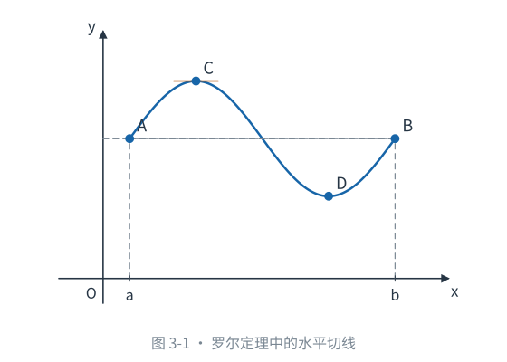
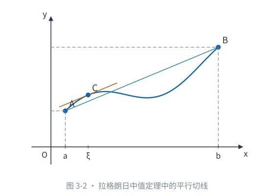

# 3-1 微分中值定理

## 自学入口：区间两端的变化，怎样与某一点的导数连起来？

> [!info] 本次新增讲解
> 可直接读下面这一步，也可跳到“教材转写与已有批注”。想继续抠一个细节时，可以停在这里；练习和复盘均为可选。

**卡在符号或前提时再回看**：[[2-1-导数概念]] ｜ [[1-10-闭区间上连续函数的性质]]。

**可以先写这一行**：对 $f(x)=x^2$ 在 $[1,3]$，先算两端平均变化率 $(9-1)/(3-1)=4$。

**为什么这样开始**：函数在闭区间连续、开区间可导，拉格朗日中值定理保证存在 $\xi\in(1,3)$，使 $f'(\xi)=4$。这里 $2\xi=4$，所以 $\xi=2$。先算两端斜率，是因为它正是定理右边可直接得到的量。罗尔定理对应两端函数值相等的情形。

**条件与边界**：定理只保证存在，不自动保证唯一。使用前逐项核对区间及连续、可导条件。

> [!question]- 愿意时试一个小变化
> 为什么不能对 $|x|$ 在 $[-1,1]$ 直接用罗尔定理？

> [!tip]- 展开看启动线索与解答
> 虽然闭区间连续且端点函数值相等，但在内部的零点不可导，缺少一个必要假设。

**继续读**：下面的教材正文 ｜ [[自学入口与探索约定#卡住时怎样继续|卡住时的提示方式]] ｜ [[🧭 学习路线图|寻找关联问题]]。

## 教材转写与已有批注

> 下方保留现有转写、页标、题号和锚点；其中可能含先前批注及转换误差，未逐页对照扫描图校订。新增示范均在上方，不作为原书例题引用。

<!--PG:139-->

上一章里，从分析实际问题中因变量相对于自变量的变化快慢出发，引进了导数概念，并讨论了导数的计算方法。本章中，我们将应用导数来研究函数以及曲线的某些性态，并利用这些知识解决一些实际问题。为此，先要介绍微分学的几个中值定理，它们是导数应用的理论基础。

第一节 微分中值定理

我们先讲罗尔(Rolle)定理，然后根据它推出拉格朗日(Lagrange)中值定理和柯西(Cauchy)中值定理。

一、罗尔定理

首先，我们观察图3-1.设曲线弧$\widehat{AB}$是函数$y = f(x)$（$x \in [a, b]$）的图形。这是一条连续的曲线弧，除端点外处处有不垂直于$x$轴的切线，且两个端点的纵坐标相等，即$f(a) = f(b)$。可以发现在曲线弧的最高点$C$处或最低点$D$处，曲线有水平的切线。如果记点$C$的横坐标为$\xi$，那么就有$f'(\xi) = 0$。现在用分析语言把这个几何现象描述出来，就可得下面的罗尔定理。为了应用方便，先介绍费马(Fermat)引理。

**图3-1**  ^fig3_1

<!-- original-figure: up-139 3-1 -->

> 原书核对：[扫描第 139 页](../原书页面/up-139.png)。

<!-- /original-figure -->

费马引理 设函数$f(x)$在点$x_0$的某邻域$U(x_0)$内有定义，并且在$x_0$处可导，如果对任意的$x \in U(x_0)$，有

$$
f(x) \leqslant f(x_0) \quad (\text{或} \; f(x) \geqslant f(x_0))
$$

<!--PG:140-->

那么 $f^{\prime}(x_{0})=0$。

证 不妨设 $x\in U(x_{0})$ 时，$f(x)\leqslant f(x_{0})$（如果 $f(x)\geqslant f(x_{0})$，可以类似地证明）.于是，对于 $x_{0}+\Delta x\in U(x_{0})$，有

$$
f(x_{0}+\Delta x)\leqslant f(x_{0}),
$$

从而当 $\Delta x>0$ 时，

$$
\frac{f(x_{0}+\Delta x)-f(x_{0})}{\Delta x}\leqslant 0;
$$

当 $\Delta x < 0$ 时，

$$
\frac {f (x _ {0} + \Delta x) - f (x _ {0})}{\Delta x} \geqslant 0.
$$

根据函数 $f(x)$ 在 $x_0$ 可导的条件及极限的保号性，便得到

$$
f ^ {\prime} (x _ {0}) = f _ {+} ^ {\prime} (x _ {0}) = \lim _ {\Delta x \rightarrow 0 ^ {+}} \frac {f (x _ {0} + \Delta x) - f (x _ {0})}{\Delta x} \leqslant 0,
$$

$$
f ^ {\prime} (x _ {0}) = f _ {-} ^ {\prime} (x _ {0}) = \lim _ {\Delta x \rightarrow 0 ^ {-}} \frac {f (x _ {0} + \Delta x) - f (x _ {0})}{\Delta x} \geqslant 0.
$$

所以，$f'(x_0) = 0$。证毕。

通常称导数等于零的点为函数的驻点（或稳定点，临界点）。

罗尔定理 如果函数 $f(x)$ 满足

(1) 在闭区间 $[a, b]$ 上连续；

(2) 在开区间 $(a, b)$ 内可导；

(3) 在区间端点处的函数值相等，即 $f(a)=f(b)$，

那么在 $(a,b)$ 内至少有一点 $\xi (a<\xi<b)$，使得 $f^{\prime}(\xi)=0$。

证 由于 $f(x)$ 在闭区间 $[a,b]$ 上连续，根据闭区间上连续函数的最大值最小值定理，$f(x)$ 在闭区间 $[a,b]$ 上必定取得它的最大值 $M$ 和最小值 $m$。这样，只有两种可能情形：

(1) $M = m$. 这时 $f(x)$ 在区间 $[a, b]$ 上必然取相同的数值 $M; f(x) = M$. 由此，$\forall x \in (a, b)$，有 $f'(x) = 0$。因此，任取 $\xi \in (a, b)$，有 $f'(\xi) = 0$。

(2) $M > m$. 因为 $f(a) = f(b)$，所以 $M$ 和 $m$ 这两个数中至少有一个不等于 $f(x)$ 在区间 $[a, b]$ 的端点处的函数值. 为确定起见，不妨设 $M \neq f(a)$（如果设 $m \neq f(a)$，证法完全类似），那么必定在开区间 $(a, b)$ 内有一点 $\xi$ 使 $f(\xi) = M$. 因此，$\forall x \in [a, b]$，有 $f(x) \leqslant f(\xi)$，从而由费马引理可知 $f'(\xi) = 0$.

定理证毕.

## 二、拉格朗日中值定理

罗尔定理中 $f(a)=f(b)$ 这个条件是相当特殊的，它使罗尔定理的应用受到限

<!--PG:141-->

制.如果把$f(a)=f(b)$这个条件取消，但仍保留其余两个条件，并相应地改变结论，那么就得到微分学中十分重要的拉格朗日中值定理.

拉格朗日中值定理 如果函数$f(x)$满足

(1)在闭区间$[a,b]$上连续；

(2)在开区间$(a,b)$内可导，

那么在$(a,b)$内至少有一点$\xi(a<\xi<b)$，使等式

$$
f(b)-f(a)=f'(\xi)(b-a) \tag{1-1}
$$

成立.

在证明之前，先看一下定理的几何意义.如果把(1-1)式改写成

$$
\frac{f(b)-f(a)}{b-a}=f'(\xi),
$$

由图3-2可看出，$\frac{f(b)-f(a)}{b-a}$为弦$AB$的斜率，而$f'(\xi)$为曲线在点$C$处的切线的斜率.因此拉格朗日中值定理的几何意义是：如果连续曲线$y=f(x)$的弧$\widehat{AB}$上除端点外处处具有不垂直于$x$轴的切线，那么这弧上至少有一点$C$，使曲线在点$C$处的切线平行于弦$AB$.

<!-- original-figure: up-141 3-2 -->
**图 3-2** ^fig3_2

> 原书核对：[扫描第 141 页](../原书页面/up-141.png)。

<!-- /original-figure -->

从图3-1看出，在罗尔定理中，由于$f(a)=f(b)$，弦$AB$是平行于$x$轴的，因此点$C$处的切线实际上也平行于弦$AB$.由此可见，罗尔定理是拉格朗日中值定理的特殊情形.

从上述拉格朗日中值定理与罗尔定理的关系，自然想到利用罗尔定理来证明拉格朗日中值定理.但在拉格朗日中值定理中，函数$f(x)$不一定具备$f(a)=f(b)$这个条件，为此我们设想构造一个与$f(x)$有密切联系的函数$\varphi(x)$（称为辅助函数），使$\varphi(x)$满足条件$\varphi(a)=\varphi(b)$.然后对$\varphi(x)$应用罗尔定理，再把对$\varphi(x)$所得的结论转化到$f(x)$上，证得所要的结果.我们从拉格朗日中值定理的几何解释中来寻找辅助函数，从图3-2中看到，有向线段$NM$的值是$x$的函数，把它表示为$\varphi(x)$，它与$f(x)$有密切的联系，且当$x=a$及$x=b$时，点$M$与点$N$重合，即有$\varphi(a)=\varphi(b)=0$.为求得函数$\varphi(x)$的表达式，设直线$AB$的方程为$y=L(x)$，则

$$
L(x)=f(a)+\frac{f(b)-f(a)}{b-a}(x-a),
$$

由于点$M,N$的纵坐标依次为$f(x)$及$L(x)$，故表示有向线段$NM$的值的函数

$$
\varphi(x)=f(x)-L(x)=f(x)-f(a)-\frac{f(b)-f(a)}{b-a}(x-a).
$$

<!--PG:142-->

下面就利用这个辅助函数来证明拉格朗日中值定理.

拉格朗日中值定理的证明 引进辅助函数

$$
\varphi (x) = f (x) - f (a) - \frac {f (b) - f (a)}{b - a} (x - a).
$$

容易验证函数 $\varphi (x)$ 适合罗尔定理的条件: $\varphi (a) = \varphi (b) = 0,\varphi (x)$ 在闭区间 $[a,b]$ 上连续，在开区间 $(a,b)$ 内可导，且

$$
\varphi^ {\prime} (x) = f ^ {\prime} (x) - \frac {f (b) - f (a)}{b - a}.
$$

根据罗尔定理，可知在 $(a, b)$ 内至少有一点 $\xi$，使 $\varphi^{\prime}(\xi)=0$，即

$$
f ^ {\prime} (\xi) - \frac {f (b) - f (a)}{b - a} = 0.
$$

由此得

$$
\frac {f (b) - f (a)}{b - a} = f ^ {\prime} (\xi),
$$

即

$$
f (b) - f (a) = f ^ {\prime} (\xi) (b - a).
$$

定理证毕.

显然，公式(1-1)对于 $b < a$ 也成立。(1-1)式叫做拉格朗日中值公式：

设 $x$ 为区间 $[a, b]$ 内一点，$x + \Delta x$ 为这区间内的另一点 ($\Delta x > 0$ 或 $\Delta x < 0$)，则公式 (1-1) 在区间 $[x, x + \Delta x]$ (当 $\Delta x > 0$ 时) 或在区间 $[x + \Delta x, x]$ (当 $\Delta x < 0$ 时) 上就成为

$$
f (x + \Delta x) - f (x) = f ^ {\prime} (x + \theta \Delta x) \cdot \Delta x \quad (0 <  \theta <  1). \tag {1-2}
$$

这里数值 $\theta$ 在 0 与 1 之间，所以 $x+\theta\Delta x$ 是在 $x$ 与 $x+\Delta x$ 之间.

如果记$f(x)$为$y$，那么(1-2)式又可写成

$$
\Delta y = f ^ {\prime} (x + \theta \Delta x) \cdot \Delta x \quad (0 <  \theta <  1). \tag{1-3}
$$

我们知道，函数的微分 $dy = f'(x) \cdot \Delta x$ 是函数的增量 $\Delta y$ 的近似表达式，一般说来，以 $dy$ 近似代替 $\Delta y$ 时所产生的误差只有当 $\Delta x \to 0$ 时才趋于零；而 (1-3) 式却给出了自变量取得有限增量 $\Delta x$ ($|\Delta x|$ 不一定很小) 时，函数增量 $\Delta y$ 的准确表达式。因此，这个定理也叫做有限增量定理，(1-3) 式称为有限增量公式。拉格朗日中值定理在微分学中占有重要地位，有时也称这定理为微分中值定理。在某些问题中当自变量 $x$ 取得有限增量 $\Delta x$ 而需要函数增量的准确表达式时，拉格朗日中值定理就显出它的价值。

作为拉格朗日中值定理的一个应用，我们来导出以后讲积分学时很有用的一个定理。我们知道，如果函数 $f(x)$ 在某一区间上是一个常数，那么 $f(x)$ 在该区间上的导数恒为零。它的逆命题也是成立的，这就是：

<!--PG:143-->

> [!theorem]+ 定理
> 如果函数$f(x)$在区间$I$上连续，$I$内①可导且导数恒为零，那么$f(x)$在区间$I$上是一个常数. ^t3-1-1

证 在区间$I$上任取两点$x_{1},x_{2}$ $(x_{1}<x_{2})$，应用$(1-1)$式就得

$$
f(x_{2})-f(x_{1})=f^{\prime}(\xi)(x_{2}-x_{1}) \quad (x_{1}<\xi<x_{2}).
$$

由假定，$f^{\prime}(\xi)=0$，所以$f(x_{2})-f(x_{1})=0$，即

$$
f(x_{2})=f(x_{1}).
$$

因为$x_{1},x_{2}$是$I$上任意两点，所以上面的等式表明：$f(x)$在$I$上的函数值总是相等的，这就是说，$f(x)$在区间$I$上是一个常数.

从上述论证中可以看出，虽然拉格朗日中值定理中的$\xi$的准确数值不知道，但在这里并不妨碍它的应用.

例 证明当$x>0$时，

$$
\frac{x}{1+x}<\ln(1+x)<x.
$$

证 设 $f(t)=\ln(1+t)$，显然 $f(t)$ 在区间 $[0,x]$ 上满足拉格朗日中值定理的条件，根据定理，应有

$$
f(x)-f(0)=f^{\prime}(\xi)(x-0),\quad0<\xi<x.
$$

由于 $f(0)=0$，$f^{\prime}(t)=\frac{1}{1+t}$，因此上式即为

$$
\ln (1 + x) = \frac {x}{1 + \xi}
$$

又由 $0 < \xi < x$，有

$$
\frac {x}{1 + x} <  \frac {x}{1 + \xi} <  x,
$$

即

$$
\frac {x}{1 + x} <  \ln (1 + x) <  x (x > 0).
$$

## 三、柯西中值定理

上面已经指出，如果连续曲线弧 $\widehat{AB}$ 上除端点外处处具有不垂直于横轴的切线，那么这段弧上至少有一点 $C$，使曲线在点 $C$ 处的切线平行于弦 $AB$。设 $\widehat{AB}$ 由参数方程

$$
\left\{ \begin{array}{l l} x = \varphi (t), & (a \leqslant t \leqslant b) \\ y = \psi (t) \end{array} \right.
$$

① x 在区间 I 内指 $x \in I$，且 x 不是 I 的端点。

<!--PG:144-->

表示，其中 $t$ 为参数，则曲线上点 $(x,y)$ 处的切线斜率为

$$
\frac {\mathrm{d} y}{\mathrm{d} x} = \frac {\psi^ {\prime} (t)}{\varphi^ {\prime} (t)},
$$

弦 $AB$ 的斜率为

$$
\frac {\psi (b) - \psi (a)}{\varphi (b) - \varphi (a)}.
$$

假定点 $C$ 对应于参数 $t = \xi$，那么曲线上点 $C$ 处的切线平行于弦 $AB$，可表示为

$$
\frac {\psi (b) - \psi (a)}{\varphi (b) - \varphi (a)} = \frac {\psi^ {\prime} (\xi)}{\varphi^ {\prime} (\xi)}.
$$

这是函数在参数方程形式下的拉格朗日中值定理的表达形式.通过对这个特殊问题的思考,可以得到以下一般性的结论.

柯西中值定理 如果函数 $f(x)$ 及 $F(x)$ 满足

(1) 在闭区间 $[a,b]$ 上连续；

(2) 在开区间 $(a, b)$ 内可导；

(3) 对任  $x \in (a, b), F'(x) \neq 0$ 

那么在 $(a,b)$ 内至少有一点 $\xi$，使等式

$$
\frac {f (b) - f (a)}{F (b) - F (a)} = \frac {f ^ {\prime} (\xi)}{F ^ {\prime} (\xi)} \tag{1-4}
$$

成立.

在定理证明之前，先对要证的结论作一些分析，以便寻找证明的思路。

要证在 $(a,b)$ 内至少有一点 $\xi$ ，使等式(1-4)成立，即成立

$$
\frac {f (b) - f (a)}{F (b) - F (a)} F ^ {\prime} (\xi) = f ^ {\prime} (\xi)
$$

或

$$
f ^ {\prime} (\xi) - \frac {f (b) - f (a)}{F (b) - F (a)} F ^ {\prime} (\xi) = 0
$$

若设函数

$$
\varphi (x) = f (x) - \frac {f (b) - f (a)}{F (b) - F (a)} F (x),
$$

则要证成立

$$
\varphi^ {\prime} (\xi) = f ^ {\prime} (\xi) - \frac {f (b) - f (a)}{F (b) - F (a)} F ^ {\prime} (\xi) = 0.
$$

由此联想到：是否可以利用罗尔定理来证明.而要做到这一点，关键是需要检查函数$\varphi(x)$在闭区间$[a,b]$两端点处的函数值是否相等.

<!--PG:145-->

因为

$$
\varphi(x)=f(x)-\frac{f(b)-f(a)}{F(b)-F(a)}F(x)=\frac{\left[F(b)-F(a)\right]f(x)-\left[f(b)-f(a)\right]F(x)}{F(b)-F(a)},
$$

$$
\varphi(a)=\frac{\left[F(b)-F(a)\right]f(a)-\left[f(b)-f(a)\right]F(a)}{F(b)-F(a)}=\frac{F(b)f(a)-F(a)f(b)}{F(b)-F(a)},
$$

$$
\varphi(b)=\frac{\left[F(b)-F(a)\right]f(b)-\left[f(b)-f(a)\right]F(b)}{F(b)-F(a)}=\frac{F(b)f(a)-F(a)f(b)}{F(b)-F(a)},
$$

所以

$$
\varphi(a)=\varphi(b)=\frac{F(b)f(a)-F(a)f(b)}{F(b)-F(a)}.
$$

由以上分析可知，可以通过引入辅助函数 $\varphi(x)$，对 $\varphi(x)$ 应用罗尔定理来证明本定理.

证 首先注意到 $F(b)-F(a) \neq 0$。这是由于

$$
F (b) - F (a) = F ^ {\prime} (\eta) (b - a),
$$

其中 $a < \eta < b$，根据假定 $F'(\eta) \neq 0$，又 $b - a \neq 0$，所以

$$
F (b) - F (a) \neq 0.
$$

设辅助函数

$$
\varphi (x) = f (x) - \frac {f (b) - f (a)}{F (b) - F (a)} F (x),
$$

显然，$\varphi(x)$在闭区间$[a,b]$上连续，在开区间$(a,b)$内可导，且

$$
\varphi (a) = \varphi (b) = \frac {F (b) f (a) - F (a) f (b)}{F (b) - F (a)},
$$

故 $\varphi(x)$ 适合罗尔定理的条件，因此在 $(a, b)$ 内至少有一点 $\xi$，使

$$
\varphi^ {\prime} (\xi) = f ^ {\prime} (\xi) - \frac {f (b) - f (a)}{F (b) - F (a)} F ^ {\prime} (\xi) = 0,
$$

由此得

$$
\frac {f (b) - f (a)}{F (b) - F (a)} = \frac {f ^ {\prime} (\xi)}{F ^ {\prime} (\xi)}.
$$

定理证毕.

很明显，如果取 $F(x)=x$，那么 $F(b)-F(a)=b-a, F'(x)=1$，因而公式(1-4)就可以写成

$$
f (b) - f (a) = f ^ {\prime} (\xi) (b - a) \quad (a <  \xi <  b),
$$

这样就变成拉格朗日中值公式了。

<!--PG:146-->

## 习题3-1

> [!tip]- 新增：这组习题的逐题详解
> [[习题3-1-详细解答|打开详细解答（15 道大题）]]。包含推导、适用条件，以及必要处可展开的注释。解答按扫描原题核对，发现的转写差异在对应题目旁说明。
> 想先自己试时，可以暂不展开；全部入口见 [[课后习题详细解答]]。
1. 验证罗尔定理对函数 $y=\ln \sin x$ 在区间 $\left[ \frac{\pi}{6}, \frac{5\pi}{6} \right]$ 上的正确性.

2. 验证拉格朗日中值定理对函数 $y=4x^{3}-5x^{2}+x-2$ 在区间 $[0,1]$ 上的正确性.

3. 对函数 $f(x)=\sin x$ 及 $F(x)=x+\cos x$ 在区间 $\left[0, \frac{\pi}{2}\right]$ 上验证柯西中值定理的正确性.

4. 试证明对函数 $y=px^{2}+qx+r$ 应用拉格朗日中值定理时所求得的点 $\xi$ 总是位于区间的正中间.

5. 不用求出函数 $f(x)=(x-1)(x-2)(x-3)(x-4)$ 的导数，说明方程 $f'(x)=0$ 有几个实根，并指出它们所在的区间.

6. 证明恒等式： $\arcsin x+\arccos x=\frac{\pi}{2}(-1 \leqslant x \leqslant 1)$.

7. 若方程 $a_{0}x^{n}+a_{1}x^{n-1}+\cdots+a_{n-1}x=0$ 有一个正根 $x=x_{0}$，证明方程 $a_{0}nx^{n-1}+a_{1}(n-1)x^{n-2}+\cdots+a_{n-1}=0$ 必有一个小于 $x_{0}$ 的正根.

8. 若函数 $f(x)$ 在 $[1,2]$ 上具有二阶导数，且 $f(2)=0$，又 $F(x)=(x-1)^{2}f(x)$，证明在 $(1,2)$ 内至少存在一点 $\xi$，使 $F^{n}(\xi)=0$.

9. 设 $a>b>0, n>1$，证明： $nb^{n-1}(a-b)<a^{n}-b^{n}<na^{n-1}(a-b)$.

10. 设 $a>b>0$，证明： $\frac{a-b}{a}<\ln \frac{a}{b}<\frac{a-b}{b}$.

11. 证明下列不等式：

(1) $|\arctan a-\arctan b| \leqslant |a-b|$;

(2) 当 $x>1$ 时，$e^{x}>ex$.

12. 证明方程 $x^{5}+x-1=0$ 只有一个正根.

13. 设 $f(x), g(x)$ 在 $[a, b]$ 上连续，在 $(a, b)$ 内可导，证明在 $(a, b)$ 内有一点 $\xi$，使

$$
\left| \begin{array}{cc} f(a) & f(b) \\ g(a) & g(b) \end{array} \right| = (b-a) \left| \begin{array}{cc} f(a) & f'(\xi) \\ g(a) & g'(\xi) \end{array} \right|.
$$

14. 证明：若函数 $y = f(x)$ 在 $(-\infty, +\infty)$ 内满足关系式 $f'(x) = f(x)$，且 $f(0) = 1$，则 $f(x) = e^x$.

15. 设函数 $y = f(x)$ 在 $x = 0$ 的某邻域内具有 $n$ 阶导数，且 $f(0) = f'(0) = \cdots = f^{(n-1)}(0) = 0$，试用柯西中值定理证明：

$$
\frac{f(x)}{x^n} = \frac{f^{(n)}(\theta x)}{n!} \quad (0 < \theta < 1).
$$

> [!pdf]- 📄 本节原书页面（PDF 139–146 / 书页 122–129）
> ![[up-139.png]]
> ![[up-140.png]]
> ![[up-141.png]]
> ![[up-142.png]]
> ![[up-143.png]]
> ![[up-144.png]]
> ![[up-145.png]]
> ![[up-146.png]]

---
⬅️ [[2-6-总习题2|总习题2]] ｜ 📑 [[第三章-微分中值定理与导数的应用|本章目录]] ｜ ➡️ [[3-2-洛必达法则|洛必达法则]]
