# 3-5 函数的极值与最大值最小值

## 自学入口：找到导数为零的点，为什么还没有完成最值题？

> [!info] 本次新增讲解
> 可直接读下面这一步，也可跳到“教材转写与已有批注”。想继续抠一个细节时，可以停在这里；练习和复盘均为可选。

**卡在符号或前提时再回看**：[[3-4-函数的单调性与曲线的凹凸性]]。

**可以先写这一行**：求 $f(x)=x^3-3x$ 在 $[-2,2]$ 的最大、最小值，先解 $f'(x)=3x^2-3=0$，得 $x=\pm1$。

**为什么这样开始**：闭区间最值还可能在端点取得，所以比较 $f(-2)=-2,f(-1)=2,f(1)=-2,f(2)=2$。最大值为 $2$，最小值为 $-2$。列候选点的理由是把“所有点里比较”缩减到有理论依据的一组点。

**条件与边界**：导数为零不保证极值，例如 $x^3$ 在零点。若区间内有不可导点，也应列入候选。

> [!question]- 愿意时试一个小变化
> 求 $|x|$ 在 $[-1,2]$ 的最小值，为什么只解导数等于零会漏掉答案？

> [!tip]- 展开看启动线索与解答
> 最小值为 $0$，在不可导点 $x=0$ 取得；两侧导数分别为 $-1$、$1$，没有导数为零的点。

**继续读**：下面的教材正文 ｜ [[自学入口与探索约定#卡住时怎样继续|卡住时的提示方式]] ｜ [[🧭 学习路线图|寻找关联问题]]。

## 教材转写与已有批注

> 下方保留现有转写、页标、题号和锚点；其中可能含先前批注及转换误差，未逐页对照扫描图校订。新增示范均在上方，不作为原书例题引用。

<!--PG:166-->

## 第五节 函数的极值与最大值最小值

## 一、函数的极值及其求法

在上节例4中我们看到，点x=1及x=2是函数的单调区间的分界点。例如，在点x=1的左侧邻近，函数$f(x)$是单调增加的，在点x=1的右侧邻近，函数$f(x)$是单调减少的。因此，存在点x=1的一个去心邻域，对于这去心邻域内的任何点x，$f(x)<f(1)$均成立。类似地，关于点x=2，也存在着一个去心邻域，对于这去心邻域内的任何点x，$f(x)>f(2)$均成立（参看图3-6）。具有这种性质的点如x=1及x=2，在应用上有着重要的意义，值得我们对此作一般性的讨论。

> [!definition]+ 定义
> 设函数$f(x)$在点$x_0$的某邻域$U(x_0)$内有定义，如果对于去心邻域$\widehat{U}(x_0)$内的任一x，有
> $$
> f(x) < f(x_0) \quad (\text{或} \quad f(x) > f(x_0))
> $$
> 那么就称$f(x_0)$是函数$f(x)$的一个$\underline{\text{极大值}}$（或$\underline{\text{极小值}}$）。
> ^d3-5-1

函数的极大值与极小值统称为函数的$\underline{\text{极值}}$，使函数取得极值的点称为$\underline{\text{极值点}}$。例如，上节例4中的函数

$$
f(x) = 2x^3 - 9x^2 + 12x - 3
$$

有极大值$f(1)=2$和极小值$f(2)=1$，点$x=1$和$x=2$是函数$f(x)$的极值点。

函数的极大值和极小值概念是局部性的。如果$f(x_0)$是函数$f(x)$的一个极大值，那只是就$x_0$附近的一个局部范围来说，$f(x_0)$是$f(x)$的一个最大值；如果就$f(x)$的整个定义域来说，$f(x_0)$不见得是最大值。关于极小值也类似。

在图3-11中，函数$y=f(x)$有两个极大值：$f(x_{2})$，$f(x_{5})$，三个极小值：$f(x_{1})$，$f(x_{4})$，$f(x_{6})$，其中极大值$f(x_{2})$比极小值$f(x_{6})$还小。就整个区间$[a,b]$来说，只有一个极小值$f(x_{1})$同时也是最小值，而没有一个极大值是最大值。

从图中还可看到，在函数取得极值处，曲线的切线是水平的。但曲线上有水平切线的地方，函数不一定取得极值。例如图中 $x=x_{3}$ 处，曲线上有水平切线，但

**图3-11**  ^fig3_11

<!-- original-figure: up-166 3-11 -->
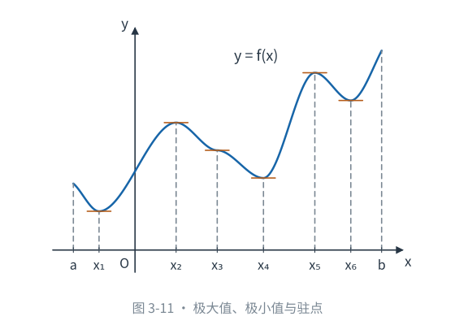

> 原书核对：[扫描第 166 页](../原书页面/up-166.png)。

<!-- /original-figure -->

<!--PG:167-->

$f(x_{3})$不是极值.

由本章第一节费马引理可知,如果函数$f(x)$在$x_{0}$处可导,且$f(x)$在$x_{0}$处取得极值,那么$f^{\prime}(x_{0})=0$.这就是可导函数取得极值的必要条件.现将此结论叙述成如下定理:

> [!theorem]+ 定理1（必要条件）
> 设函数$f(x)$在$x_{0}$处可导,且在$x_{0}$处取得极值,则$f^{\prime}(x_{0})=0$. ^t3-5-1

定理1就是说:可导函数$f(x)$的极值点必定是它的驻点.但反过来,函数的驻点却不一定是极值点.例如,$f(x)=x^{3}$的导数$f^{\prime}(x)=3x^{2}$,$f^{\prime}(0)=0$,因此$x=0$是这可导函数的驻点,但$x=0$却不是这函数的极值点.所以,函数的驻点只是可能的极值点.此外,函数在它的导数不存在的点处也可能取得极值.例如,函数$f(x)=|x|$在点$x=0$处不可导,但函数在该点取得极小值.

怎样判定函数在驻点或不可导的点处究竟是否取得极值?如果是的话,究竟取得极大值还是极小值?下面给出两个判定极值的充分条件:

> [!theorem]+ 定理2（第一充分条件）
> 设函数$f(x)$在$x_{0}$处连续,且在$x_{0}$的某去心邻域$\mathring{U}(x_{0},\delta)$内可导.
> (1) 若$x\in(x_{0}-\delta,x_{0})$时,$f^{\prime}(x)>0$,而$x\in(x_{0},x_{0}+\delta)$时,$f^{\prime}(x)<0$,则$f(x)$在$x_{0}$处取得极大值;
> (2) 若$x\in(x_{0}-\delta,x_{0})$时,$f^{\prime}(x)<0$,而$x\in(x_{0},x_{0}+\delta)$时,$f^{\prime}(x)>0$,则$f(x)$在$x_{0}$处取得极小值;
> (3) 若$x\in\mathring{U}(x_{0},\delta)$时,$f^{\prime}(x)$的符号保持不变,则$f(x)$在$x_{0}$处没有极值.
> ^t3-5-2

证 事实上,就情形(1)来说,根据函数单调性的判定法,函数$f(x)$在$(x_{0}-\delta,x_{0})$内单调增加,而在$(x_{0},x_{0}+\delta)$内单调减少,又由于函数$f(x)$在$x_{0}$处是连续的,故当$x\in\mathring{U}(x_{0},\delta)$时,总有$f(x)<f(x_{0})$.所以,$f(x_{0})$是$f(x)$的一个极大值(图3-12(a)).

类似地可论证情形(2)(图3-12(b))及情形(3)(图3-12(c)、(d)).

定理2也可简单地这样说:当$x$在$x_{0}$的邻近渐增地经过$x_{0}$时,如果$f^{\prime}(x)$的符号由正变负,那么$f(x)$在$x_{0}$处取得极大值;如果$f^{\prime}(x)$的符号由负变正,那么$f(x)$在$x_{0}$处取得极小值;如果$f^{\prime}(x)$的符号并不改变,那么$f(x)$在$x_{0}$处没有极值.

根据上面的两个定理,如果函数$f(x)$在所讨论的区间内连续,除个别点外处处可导,那么就可以按下列步骤来求$f(x)$在该区间内的极值点和相应的极值:

(1) 求出导数$f^{\prime}(x)$;

(2) 求出$f(x)$的全部驻点与不可导点;

(3) 考察$f^{\prime}(x)$的符号在每个驻点或不可导点的左、右邻近的情形,以确定该点是否为极值点;如果是极值点,进一步确定是极大值点还是极小值点;

<!--PG:168-->

**图3-12**  ^fig3_12

<!-- original-figure: up-168 3-12 -->
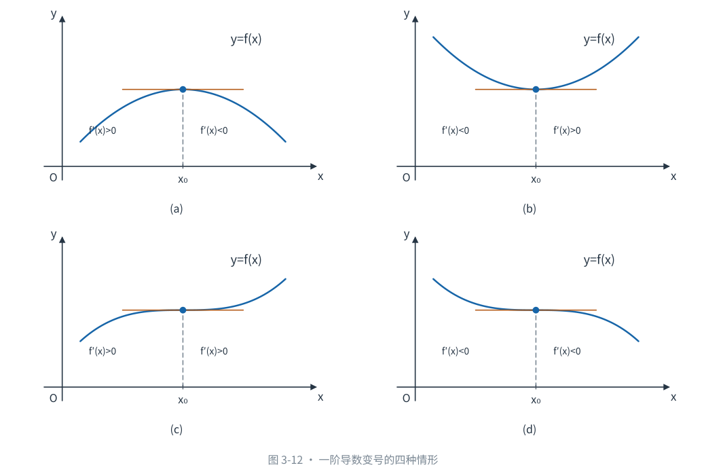

> 原书核对：[扫描第 168 页](../原书页面/up-168.png)。

<!-- /original-figure -->

(4) 求出各极值点的函数值，就得函数 $f(x)$ 的全部极值.

**例1** 求函数 $f(x)=(x-4)\sqrt[3]{(x+1)^2}$ 的极值. ^e3-5-1

解 (1) $f(x)$ 在 $(-∞,+∞)$ 内连续，除 $x=-1$ 外处处可导，且

$$
f'(x)=\frac{5(x-1)}{3\sqrt[3]{x+1}}
$$

(2) 令 $f'(x)=0$，得驻点 $x=1, x=-1$ 为 $f(x)$ 的不可导点；

(3) 在 $(-∞,-1)$ 内，$f'(x)>0$；在 $(-1,1)$ 内，$f'(x)<0$。故不可导点 $x=-1$ 是一个极大值点；又在 $(1,+∞)$ 内，$f'(x)>0$，故驻点 $x=1$ 是一个极小值点；

(4) 极大值为 $f(-1)=0$，极小值为 $f(1)=-3\sqrt[3]{4}$.

当函数 $f(x)$ 在驻点处的二阶导数存在且不为零时，也可以利用下述定理来判定 $f(x)$ 在驻点处取得极大值还是极小值.

> [!theorem]+ 定理3（第二充分条件）
> 设函数 $f(x)$ 在 $x_0$ 处具有二阶导数且 $f'(x_0)=0$，$f''(x_0) \neq 0$，则
> (1) 当 $f''(x_0)<0$ 时，函数 $f(x)$ 在 $x_0$ 处取得极大值；
> (2) 当 $f''(x_0)>0$ 时，函数 $f(x)$ 在 $x_0$ 处取得极小值.
> ^t3-5-3

证 在情形(1)，由于 $f''(x_0)<0$，按二阶导数的定义有

$$
f''(x_0)=\lim_{x\to x_0}\frac{f'(x)-f'(x_0)}{x-x_0}<0.
$$

根据函数极限的局部保号性，当 $x$ 在 $x_0$ 的足够小的去心邻域内时，

<!--PG:169-->

但$f'(x_0)=0$，所以上式即

$$
\frac{f'(x)-f'(x_0)}{x-x_0}<0.
$$

从而知道，对于这去心邻域内的 $x$ 来说，$f'(x)$ 与 $x-x_0$ 符号相反。因此，当 $x-x_0<0$ 即 $x<x_0$ 时，$f'(x)>0$；当 $x-x_0>0$ 即 $x>x_0$ 时，$f'(x)<0$。于是根据定理 2 知道，$f(x)$ 在点 $x_0$ 处取得极大值。

类似地可以证明情形(2).

定理 3 表明，如果函数 $f(x)$ 在驻点 $x_0$ 处的二阶导数 $f''(x_0) \neq 0$，那么该驻点 $x_0$ 一定是极值点，并且可以按二阶导数 $f''(x_0)$ 的符号来判定 $f(x_0)$ 是极大值还是极小值。但如果 $f''(x_0)=0$，那么定理 3 就不能应用。事实上，当 $f'(x_0)=0$，$f''(x_0)=0$ 时，$f(x)$ 在 $x_0$ 处可能有极大值，也可能有极小值，也可能没有极值。例如，$f_1(x)=-x^4$，$f_2(x)=x^4$，$f_3(x)=x^3$ 这三个函数在 $x=0$ 处就分别属于这三种情况。因此，如果函数在驻点处的二阶导数为零，那么可以用一阶导数在驻点左、右邻近的符号来判定；如果函数在驻点处有 $f''(x_0)=\cdots=f^{(n-1)}(x_0)=0$，$f^{(n)}(x_0) \neq 0$，那么也可利用具有佩亚诺余项的泰勒公式来讨论判定（参阅本节习题 4）。

**例2** 求函数 $f(x)=(x^2-1)^3+1$ 的极值. ^e3-5-2

解 $f'(x)=6x(x^2-1)^2$.

令 $f'(x)=0$，求得驻点 $x_1=-1, x_2=0, x_3=1$.

$$
f''(x)=6(x^2-1)(5x^2-1).
$$

因 $f''(0)=6>0$，故 $f(x)$ 在 $x=0$ 处取得极小值，极小值为 $f(0)=0$.

因 $f''(-1)=f''(1)=0$，故用定理 3 无法判别。考察一阶导数 $f'(x)$ 在驻点 $x_1=-1$ 及 $x_3=1$ 左、右邻近的符号：

当 $x$ 取 $-1$ 左侧邻近的值时，$f'(x) < 0$；当 $x$ 取 $-1$ 右侧邻近的值时，$f'(x) < 0$；因为 $f'(x)$ 的符号没有改变，所以 $f(x)$ 在 $x = -1$ 处没有极值。同理，$f(x)$ 在 $x = 1$ 处也没有极值（图 3-13）.

**图3-13**  ^fig3_13

<!-- original-figure: up-169 3-13 -->
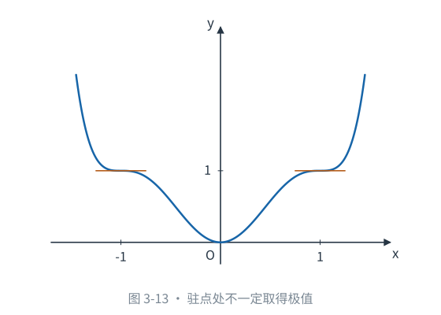

> 原书核对：[扫描第 169 页](../原书页面/up-169.png)。

<!-- /original-figure -->

## 二、最大值最小值问题

在工农业生产、工程技术及科学实验中，常常会遇到这样一类问题：在一定条件下，怎样使“产品最多”“用料最省”“成本最低”“效率最高”等问题，这类问题在数学上有时可归结为求某一函数（通常称为目标函数）的最大值或最小值问题。

<!--PG:170-->

假定函数$f(x)$在闭区间$[a,b]$上连续，在开区间$(a,b)$内除有限个点外可导，且至多有有限个驻点。在上述条件下，我们来讨论$f(x)$在$[a,b]$上的最大值和最小值的求法.

首先，由闭区间上连续函数的性质可知，$f(x)$在$[a,b]$上的最大值和最小值一定存在.

其次，如果最大值（或最小值）$f(x_{0})$在开区间$(a,b)$内的点$x_{0}$处取得，那么，按$f(x)$在开区间内除有限个点外可导且至多有有限个驻点的假定，可知$f(x_{0})$一定也是$f(x)$的极大值（或极小值），从而$x_{0}$一定是$f(x)$的驻点或不可导点.又$f(x)$的最大值和最小值也可能在区间的端点处取得.因此，可用如下方法求$f(x)$在$[a,b]$上的最大值和最小值.

(1) 求出$f(x)$在$(a,b)$内的驻点①及不可导点；

(2) 计算$f(x)$在上述驻点、不可导点处的函数值及$f(a)$，$f(b)$；

(3) 比较(2)中诸值的大小，其中最大的便是$f(x)$在$[a,b]$上的最大值，最小的便是$f(x)$在$[a,b]$上的最小值.

**例3** 求函数$f(x)=|x^{2}-3x+2|$在$[-3,4]$上的最大值与最小值. ^e3-5-3

解 $f(x)=\begin{cases} x^{2}-3x+2, & x \in [-3,1] \cup [2,4], \\ -x^{2}+3x-2, & x \in (1,2). \end{cases}$

$f'(x)=\begin{cases} 2x-3, & x \in (-3,1) \cup (2,4), \\ -2x+3, & x \in (1,2). \end{cases}$

在$(-3,4)$内，$f(x)$的驻点为$x=\frac{3}{2}$；不可导点为$x=1,x=2$.

由于$f(-3)=20$，$f(1)=0$，$f\left(\frac{3}{2}\right)=\frac{1}{4}$，$f(2)=0$，$f(4)=6$，比较可得$f(x)$在$x=-3$处取得它在$[-3,4]$上的最大值20，在$x=1$和$x=2$处取得它在$[-3,4]$上的最小值0.

**例4** 铁路线上$AB$段的距离为100 km.工厂$C$距$A$处为20 km，$AC$垂直于$AB$（图3-14）.为了运输需要，要在$AB$线上选定一点$D$向工厂修筑一条公路.已知铁路每千米货运的运费与公路上每千米货运的运费之比为3：5.为了使货物从供应站$B$运到工厂$C$的运费最省，问$D$点应选在何处？ ^e3-5-4

<!-- original-figure: up-170 3-14 -->
**图 3-14** ^fig3_14

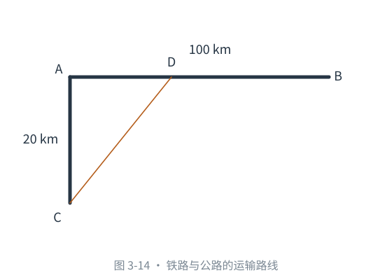

> 原书核对：[扫描第 170 页](../原书页面/up-170.png)。

<!-- /original-figure -->

解 设$AD=x$ km，则$DB=(100-x)$ km，

<!--PG:171-->

由于铁路上每千米货运的运费与公路上每千米货运的运费之比为3：5，因此我们不妨设铁路上每千米的运费为 $3k$，公路上每千米的运费为 $5k$（$k$ 为某个正数，因它与本题的解无关，所以不必定出）.设从供应站 $B$ 到工厂 $C$ 需要的总运费为 $y$，则

$$
y = 5k \cdot CD + 3k \cdot DB,
$$

即

$$
y = 5k\sqrt{400+x^2} + 3k(100 - x) \quad (0 \leqslant x \leqslant 100).
$$

现在，问题就归结为：$x$ 在 $[0,100]$ 内取何值时目标函数 $y$ 的值最小.

先求 $y$ 对 $x$ 的导数

$$
y' = k \left( \frac{5x}{\sqrt{400 + x^2}} - 3 \right).
$$

解方程 $y'=0$，得 $x=15$ km.

由于 $y|_{x=0}=400k, y|_{x=15}=380k, y\bigg|_{x=100}=500k\sqrt{1+\frac{1}{5^2}}$，其中以 $y\bigg|_{x=15}=380k$ 为最小，因此，当 $AD=x=15$ km 时，总运费为最省.

在求函数的最大值（或最小值）时，特别值得指出的是下述情形：$f(x)$ 在一个区间（有限或无限，开或闭）内可导且只有一个驻点 $x_0$，并且这个驻点 $x_0$ 是函数 $f(x)$ 的极值点，那么，当 $f(x_0)$ 是极大值时，$f(x_0)$ 就是 $f(x)$ 在该区间上的最大值（图 3-15(a)）；当 $f(x_0)$ 是极小值时，$f(x_0)$ 就是 $f(x)$ 在该区间上的最小值（图 3-15(b)）。在应用问题中往往遇到这样的情形。

(a) 

(b) 

**图3-15**  ^fig3_15

<!-- original-figure: up-171 3-15 -->
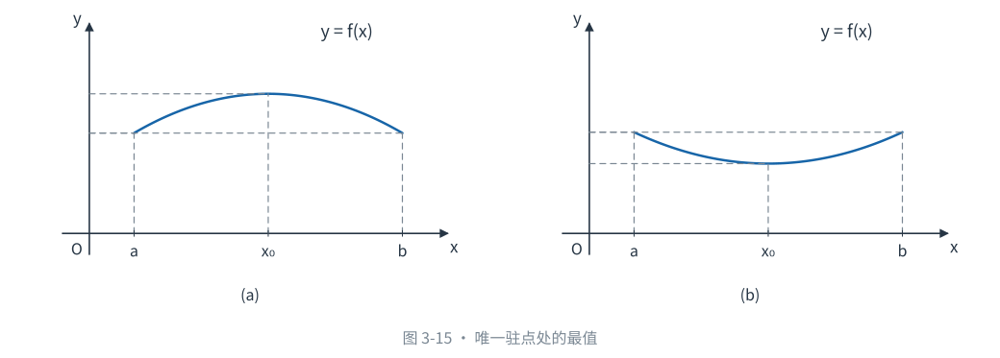

> 原书核对：[扫描第 171 页](../原书页面/up-171.png)。

<!-- /original-figure -->

**例5** 一束光线由空气中点 $A$ 经过水面折射后到达水中点 $B$（图3-16）。已知光在空气中和水中传播的速度分别是 $v_{1}$ 和 $v_{2}$，光线在介质中总是沿着耗时最少的路径传播。试确定光线传播的路径。 ^e3-5-5

<!-- original-figure: up-172 3-16 -->
**图 3-16** ^fig3_16

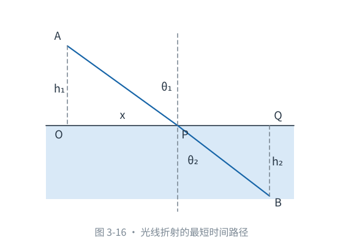

> 原书核对：[扫描第 172 页](../原书页面/up-172.png)。

<!-- /original-figure -->

解 设点 $A$ 到水面的垂直距离为 $AO = h_{1}$，点 $B$ 到水面的垂直距离为 $BQ = h_{2}$，$x$ 轴沿水面过点 $O$ 和 $Q$，$OQ$ 的长度为 $l$。

<!--PG:172-->

由于光线总是沿着耗时最少的路径传播，因此光线在同一均匀介质中必沿直线传播.设光线的传播路径与 $x$ 轴的交点为 $P, OP = x$，则光线从点 $A$ 到点 $B$ 的传播路径必为折线 $APB$，其所需要的传播时间为

$$
T(x) = \frac{\sqrt{h_{1}^{2}+x^{2}}}{v_{1}} + \frac{\sqrt{h_{2}^{2}+(l-x)^{2}}}{v_{2}}, \quad x \in [0, l].
$$

下面来确定 $x$ 满足什么条件时，$T(x)$ 在 $[0, l]$ 上取得最小值.

由于

$$
T'(x) = \frac{1}{v_{1}} \cdot \frac{x}{\sqrt{h_{1}^{2}+x^{2}}} - \frac{1}{v_{2}} \cdot \frac{l-x}{\sqrt{h_{2}^{2}+(l-x)^{2}}}, \quad x \in [0, l],
$$

$$
T''(x) = \frac{1}{v_{1}} \cdot \frac{h_{1}^{2}}{\left(h_{1}^{2}+x^{2}\right)^{\frac{3}{2}}} + \frac{1}{v_{2}} \cdot \frac{h_{2}^{2}}{\left[h_{2}^{2}+(l-x)^{2}\right]^{\frac{3}{2}}}>0, \quad x \in [0, l],
$$

$$
T'(0) < 0, \quad T'(l) > 0,
$$

又 $T'(x)$ 在 $[0, l]$ 上连续，故 $T'(x)$ 在 $(0, l)$ 内存在唯一零点 $x_0$，且 $x_0$ 是 $T(x)$ 在 $(0, l)$ 内的唯一极小值点，从而也是 $T(x)$ 在 $[0, l]$ 上的最小值点.

设 $x_0$ 满足 $T'(x) = 0$，即

$$
\frac{x_0}{v_1 \sqrt{h_1^2 + x_0^2}} = \frac{l - x_0}{v_2 \sqrt{h_2^2 + (l - x_0)^2}}.
$$

记

$$
\frac{x_0}{\sqrt{h_1^2 + x_0^2}} = \sin \theta_1, \quad \frac{l - x_0}{\sqrt{h_2^2 + (l - x_0)^2}} = \sin \theta_2,
$$

就得到

$$
\frac{\sin \theta_1}{v_1} = \frac{\sin \theta_2}{v_2}.
$$

这就是说，当点 $P$ 满足以上条件时，折线 $APB$ 就是光线的传播路径。上式就是光学中著名的**折射定律**，其中 $\theta_1, \theta_2$ 分别是光线的人射角和折射角（见图3-16）。

还要指出，实际问题中，往往根据问题的性质就可以断定可导函数 $f(x)$ 确有最大值或最小值，而且一定在定义区间内部取得。这时如果 $f(x)$ 在定义区间内部只有一个驻点 $x_0$，那么不必讨论 $f(x_0)$ 是不是极值，就可以断定 $f(x_0)$ 是最大值或最小值。

**例6** 把一根直径为 $d$ 的圆木锯成截面为矩形的梁（图3-17）。问矩形截面的高 $h$ 和宽 $b$ 应如何选择才能使梁的抗弯截面模量最大？ ^e3-5-6

<!-- original-figure: up-173 3-17 -->
**图 3-17** ^fig3_17

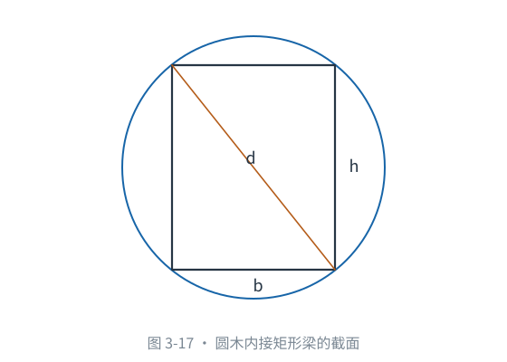

> 原书核对：[扫描第 173 页](../原书页面/up-173.png)。

<!-- /original-figure -->

解 由力学分析知道：矩形梁的抗弯截面模量为

<!--PG:173-->

由图3-17看出，$b$与$h$有下面的关系：

$$
h^{2}=d^{2}-b^{2},
$$

因而

$$
W=\frac{1}{6}(d^{2}b-b^{3}).
$$

这样，$W$就与$b$存在函数关系，$b$的变化范围是$(0,d)$。现在，

问题化为：$b$等于多少时目标函数 $W=W(b)$ 取最大值？为此，求 $W$ 对 $b$ 的导数

$$
W^{\prime}=\frac{1}{6}(d^{2}-3b^{2}).
$$

令 $W^{\prime}=0$，解得

$$
b=\sqrt{\frac{1}{3}}d.
$$

由于梁的最大抗弯截面模量一定存在，而且在$(0,d)$内部取得；现在，$W^{\prime}=0$在$(0,d)$内只有一个根$b=\sqrt{\frac{1}{3}}d$，所以，当$b=\sqrt{\frac{1}{3}}d$时，$W$的值最大。这时，

$$
h^{2}=d^{2}-b^{2}=d^{2}-\frac{1}{3}d^{2}=\frac{2}{3}d^{2},
$$

即

亦即

$$
d:h:b=\sqrt{3}:\sqrt{2}:1.
$$

**例7** 假设某工厂生产某产品 $x$ 万件的成本是 $C(x)=x^{3}-6x^{2}+15x$，售出该产品 $x$ 万件的收入是 $r(x)=9x$。问是否存在一个能取得最大利润的生产水平？如果存在的话，找出这个生产水平。 ^e3-5-7

解 由题意知，售出 $x$ 万件产品的利润是

$$
p(x) = r(x) - C(x).
$$

如果 $p(x)$ 取得最大值，那么它一定在使得 $p'(x)=0$ 的生产水平处获得。因此，令

即

$$
p'(x)=r'(x)-C'(x)=0,
$$

得

<!--PG:174-->

$x^{2} - 4x + 2 = 0.$

解得 $x = \frac{4 \pm \sqrt{8}}{2} = 2 \pm \sqrt{2}$，即

$x_{1} = 2 - \sqrt{2} \approx 0.586, \quad x_{2} = 2 + \sqrt{2} \approx 3.414.$

又

$p''(x) = -6x + 12, p''(x_{1}) > 0, \quad p''(x_{2}) < 0.$

故在 $x_{2} = 3.414$ 处达到最大利润，而在 $x_{1} = 0.586$ 处发生局部最大亏损.

在经济学中，称 $C'(x)$ 为边际成本，$r'(x)$ 为边际收入，$p'(x)$ 为边际利润. 上述结果表明：在给出最大利润的生产水平上，$r'(x) = C'(x)$，即边际收入等于边际成本.上面的结果也可以从图 3-18 的成本曲线和收入曲线中看出.

**图3-18**  ^fig3_18

<!-- original-figure: up-174 3-18 -->
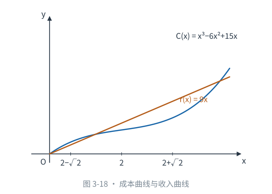

> 原书核对：[扫描第 174 页](../原书页面/up-174.png)。

<!-- /original-figure -->

## 习题 3-5

> [!tip]- 新增：这组习题的逐题详解
> [[习题3-5-详细解答|打开详细解答（18 道大题）]]。包含推导、适用条件，以及必要处可展开的注释。解答按扫描原题核对，发现的转写差异在对应题目旁说明。
> 想先自己试时，可以暂不展开；全部入口见 [[课后习题详细解答]]。
1. 求下列函数的极值：

(1) $y = 2x^{3} - 6x^{2} - 18x + 7$; (2) $y = x - \ln(1 + x)$; (3) $y = -x^{4} + 2x^{2}$;

(4) $y = x + \sqrt{1 - x}$; (5) $y = \frac{1 + 3x}{\sqrt{4 + 5x^{2}}}$; (6) $y = \frac{3x^{2} + 4x + 4}{x^{2} + x + 1}$;

(7) $y = e^{x} \cos x$; (8) $y = x^{\frac{1}{2}}$; (9) $y = 3 - 2(x + 1)^{\frac{1}{3}}$;

(10) $y = x + \tan x$.

2. 试证明：如果函数 $y = ax^{3} + bx^{2} + cx + d$ 满足条件 $b^{2} - 3ac < 0$，那么这个函数没有极值.

3. 试问 $a$ 为何值时，函数 $f(x) = a \sin x + \frac{1}{3} \sin 3x$ 在 $x = \frac{\pi}{3}$ 处取得极值？它是极大值还是极小值？并求此极值.

4. 设函数 $f(x)$ 在 $x_{0}$ 处有 $n$ 阶导数，且 $f'(x_{0}) = f''(x_{0}) = \cdots = f^{(n-1)}(x_{0}) = 0, f^{(n)}(x_{0}) \neq 0$，证明：

(1) 当 $n$ 为奇数时，$f(x)$ 在 $x_{0}$ 处不取得极值；

(2) 当 $n$ 为偶数时，$f(x)$ 在 $x_{0}$ 处取得极值，且当 $f^{(n)}(x_{0}) < 0$ 时，$f(x_{0})$ 为极大值，当 $f^{(n)}(x_{0}) > 0$ 时，$f(x_{0})$ 为极小值.

5. 试利用习题 4 的结论，讨论函数 $f(x) = e^{x} + e^{-x} + 2 \cos x$ 的极值.

6. 求下列函数的最大值、最小值：

(1) $y = 2x^{3} - 3x^{2}, -1 \leqslant x \leqslant 4$; (2) $y = x^{4} - 8x^{2} + 2, -1 \leqslant x \leqslant 3$; (3) $y = x + \sqrt{1 - x}, -5 \leqslant x \leqslant 1.$

7. 问函数 $y = 2x^{3} - 6x^{2} - 18x - 7 (1 \leqslant x \leqslant 4)$ 在何处取得最大值？并求出它的最大值.

8. 求下列函数在何处取得最小值或最大值：

<!--PG:175-->

(1) $y=x^{2}-\frac{54}{x}$($x<0$)，最小值； (2) $y=\frac{x}{x^{2}+1}$($x \geqslant 0$)，最大值.

9. 设函数 $f_{n}(x)=nx(1-x)^{n}$ ($n=1,2,3,\cdots$), $M(n)=\max_{x \in[0,1]} f_{n}(x)$，试求 $\lim_{n \to \infty} M(n)$.

10. 某车间靠墙壁要盖一间长方形小屋，现有存砖只够砌 20 m 长的墙壁。问应围成怎样的长方形才能使这间小屋的面积最大？

11. 要造一圆柱形油罐，体积为 $V$，问底半径 $r$ 和高 $h$ 各等于多少时，才能使表面积最小？这时底直径与高的比是多少？

12. 某地区防空洞的截面拟建成矩形加半圆（图 3-19）。截面的面积为 $5 \, m^{2}$。问底宽 $x$ 为多少时才能使截面的周长最小，从而使建造时所用的材料最省？

<!-- original-figure: up-175 3-19,3-20 -->
**图 3-19** ^fig3_19

**图 3-20** ^fig3_20

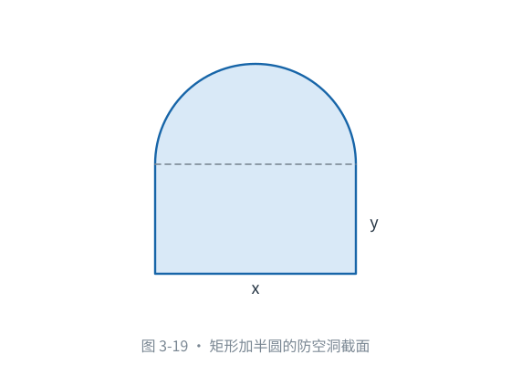

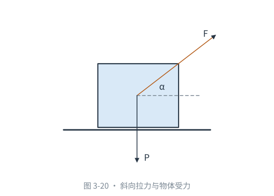

> 原书核对：[扫描第 175 页](../原书页面/up-175.png)。

<!-- /original-figure -->

13. 设有质量为 5 kg 的物体，置于水平面上，受力 $F$ 的作用而开始移动（图 3-20）。设摩擦系数 $\mu=0.25$，问力 $F$ 与水平线的交角 $\alpha$ 为多少时，才可使力 $F$ 的大小为最小？

14. 有一杠杆，支点在它的一端。在距支点 0.1 m 处挂一质量为 49 kg 的物体。加力 $F$ 于杠杆的另一端使杠杆保持水平（图 3-21）。如果杠杆的线密度为 5 kg/m，求最省力的杆长.

<!-- original-figure: up-175 3-21,3-22 -->
**图 3-21** ^fig3_21

**图 3-22** ^fig3_22

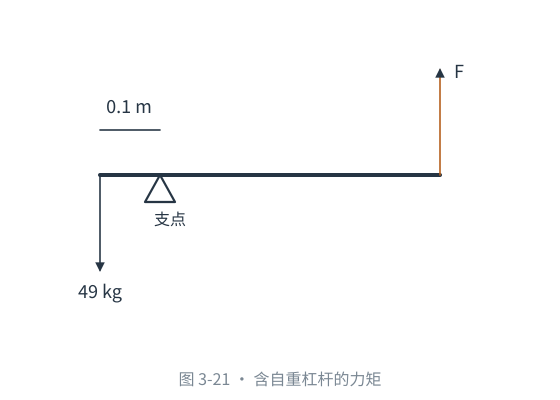

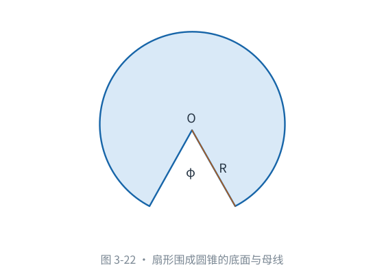

> 原书核对：[扫描第 175 页](../原书页面/up-175.png)。

<!-- /original-figure -->

15. 从一块半径为 $R$ 的圆铁片上剪去一个扇形做成一个漏斗（图 3-22）。问留下的扇形的圆心角 $\varphi$ 取多大时，做成的漏斗的容积最大？

16. 某吊车的车身高为 1.5 m，吊臂长 15 m。现在要把一个 6 m 宽、2 m 高的屋架（图 3-23（a）），水平地吊到 6 m 高的柱子上去（图 3-23（b）），问能否吊得上去？
17. 一房地产公司有50套公寓要出租。当月租金定为4000元时，公寓会全部租出去。当月租金每增加200元时，就会多一套公寓租不出去，而租出去的公寓平均每月需花费400元的维修费。试问房租定为多少可获得最大收入？

<!-- original-figure: up-176 3-23 -->
**图 3-23** ^fig3_23

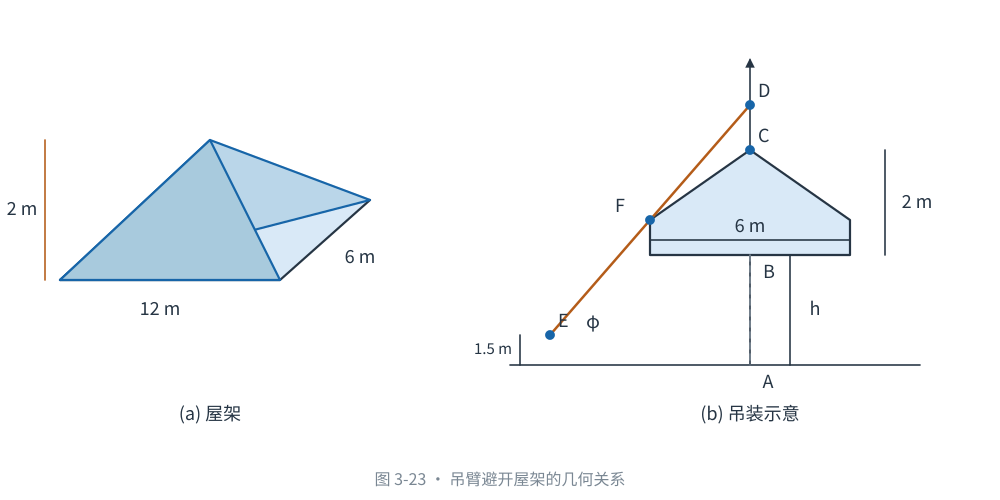

> 原书核对：[扫描第 176 页](../原书页面/up-176.png)。

<!-- /original-figure -->

18. 已知制作一个背包的成本为40元。如果每一个背包的售出价格为x元，售出的背包数由

$$
n = \frac{a}{x-40} + b(80-x)
$$

给出，其中a，b为正常数。问什么样的售出价格能带来最大利润？

> [!pdf]- 📄 本节原书页面（PDF 166–175 / 书页 149–158）
> ![[up-166.png]]
> ![[up-167.png]]
> ![[up-168.png]]
> ![[up-169.png]]
> ![[up-170.png]]
> ![[up-171.png]]
> ![[up-172.png]]
> ![[up-173.png]]
> ![[up-174.png]]
> ![[up-175.png]]

---
⬅️ [[3-4-函数的单调性与曲线的凹凸性|函数的单调性与曲线的凹凸性]] ｜ 📑 [[第三章-微分中值定理与导数的应用|本章目录]] ｜ ➡️ [[3-6-函数图形的描绘|函数图形的描绘]]
