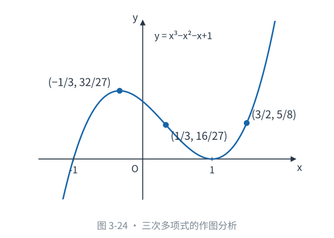
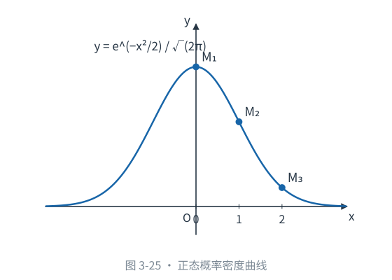
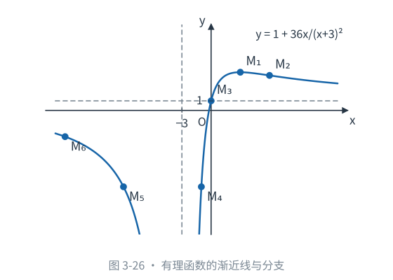

# 3-6 函数图形的描绘

## 自学入口：作图信息太多时，从哪里开始？

> [!info] 本次新增讲解
> 可直接读下面这一步，也可跳到“教材转写与已有批注”。想继续抠一个细节时，可以停在这里；练习和复盘均为可选。

**卡在符号或前提时再回看**：[[3-5-函数的极值与最大值最小值]]。

**可以先写这一行**：对 $f(x)=x+1/x$，先写定义域 $x\ne0$，把数轴在零点分开。

**为什么这样开始**：再算 $f'(x)=1-1/x^2$，零点为 $\pm1$。按 $-1,0,1$ 分区间检查符号，得到增减段；$x\to0$ 的行为和 $f(x)-x=1/x\to0$ 则补上竖直与斜渐近线。每一步都在缩小图形可能的形状。

**条件与边界**：函数没有定义的点不是极值点或拐点。二阶导数为零只是拐点候选，还要看凹凸是否改变。

> [!question]- 愿意时试一个小变化
> 上述函数在 $(0,1)$ 上增还是减？在 $(1,+\infty)$ 呢？

> [!tip]- 展开看启动线索与解答
> 前段 $f'<0$，递减；后段 $f'>0$，递增，因此 $(1,2)$ 是局部最低点。

**继续读**：下面的教材正文 ｜ [[自学入口与探索约定#卡住时怎样继续|卡住时的提示方式]] ｜ [[🧭 学习路线图|寻找关联问题]]。

## 教材转写与已有批注

> 下方保留现有转写、页标、题号和锚点；其中可能含先前批注及转换误差，未逐页对照扫描图校订。新增示范均在上方，不作为原书例题引用。

## 第六节 函数图形的描绘

借助于一阶导数的符号，可以确定函数图形在哪个区间上上升，在哪个区间上下降；借助于二阶导数的符号，可以确定函数图形在哪个区间上为凹，在哪个区间上为凸，在什么地方有拐点。知道了函数图形的升降、凹凸以及拐点后，也就可以掌握函数的性态，并把函数的图形画得比较准确。

现在，随着现代计算机技术的发展，借助于计算机和许多数学软件，可以方便地画出各种函数的图形。但是，如何识别机器作图中的误差、如何掌握图形上的关键点、如何选择作图的范围等，从而进行人工干预，仍然需要我们有运用微分学的方法描绘函数图形的基本知识。

利用导数描绘函数图形的一般步骤如下：

第一步 确定函数 $y = f(x)$ 的定义域及函数所具有的某些特性（如奇偶性、周期性等），并求出函数的一阶导数 $f'(x)$ 和二阶导数 $f''(x)$；

第二步 求出一阶导数 $f'(x)$ 和二阶导数 $f''(x)$ 在函数定义域内的全部零点，并求出函数 $f(x)$ 的间断点及 $f'(x)$ 和 $f''(x)$ 不存在的点，用这些点把函数的定义域划分成几个部分区间；

<!--PG:177-->

第三步 确定在这些部分区间内 $f'(x)$ 和 $f''(x)$ 的符号，并由此确定函数图形的升降、凹凸和拐点；

第四步 确定函数图形的水平、铅直渐近线以及其他变化趋势；

第五步 算出 $f'(x)$ 和 $f''(x)$ 的零点以及不存在的点所对应的函数值，定出图形上相应的点；为了把图形描绘得准确些，有时还需要补充一些点，然后结合第三、四步中得到的结果，连接这些点画出函数 $y=f(x)$ 的图形.

**例1** 画出函数 $y = x^{3} - x^{2} - x + 1$ 的图形. ^e3-6-1

解 （1）所给函数 $y=f(x)$ 的定义域为 $\left(-\infty,+\infty\right)$，而

$$
f^{\prime}(x)=3x^{2}-2x-1=(3x+1)(x-1),
$$

$$
f^{\prime \prime}(x)=6x-2=2(3x-1).
$$

(2) $f'(x)$ 的零点为 $x=-\frac{1}{3}$ 和 $x=1$；$f''(x)$ 的零点为 $x=\frac{1}{3}$。将点 $x=-\frac{1}{3}, x=\frac{1}{3}, x=1$ 由小到大排列，依次把定义域 $(-\infty,+\infty)$ 划分成四个部分区间

$$
\left(-\infty,-\frac{1}{3}\right], \quad \left[-\frac{1}{3}, \frac{1}{3}\right], \quad \left[\frac{1}{3}, 1\right], \quad [1,+\infty).
$$

(3) 在 $\left(-\infty, -\frac{1}{3}\right]$ 内，$f'(x)>0$，$f''(x)<0$，所以在 $\left(-\infty, -\frac{1}{3}\right]$ 上的曲线弧上升而且是凸的.

在 $\left(-\frac{1}{3}, \frac{1}{3}\right)$ 内，$f'(x) < 0$，$f''(x) < 0$，所以在 $\left[-\frac{1}{3}, \frac{1}{3}\right]$ 上的曲线弧下降而且是凸的.

同样，可以讨论在区间 $\left[\frac{1}{3}, 1\right]$ 及区间 $[1, +\infty)$ 上相应的曲线弧的升降和凹凸。为了明确起见，我们把所得的结论列成下表：

| x | (−∞, −1/3) | −1/3 | (−1/3, 1/3) | 1/3 | (1/3, 1) | 1 | (1, +∞) |
|---|---|---|---|---|---|---|---|
| f′(x) | + | 0 | − | − | − | 0 | + |
| f″(x) | − | − | − | 0 | + | + | + |
| y=f(x) 的图形 | 上升且凸 | | 下降且凸 | 拐点 | 下降且凹 | | 上升且凹 |

这里记号 √ 表示曲线弧上升而且是凸的，∧ 表示曲线弧下降而且是凸的，√ 表示曲线弧下降而且是凹的，∧ 表示曲线弧上升而且是凹的。

<!--PG:178-->

(4) 当 $x \to +\infty$ 时, $y \to +\infty$ ; 当 $x \to -\infty$ 时, $y \to -\infty$.

(5) 算出 $x=-\frac{1}{3}, x=\frac{1}{3}, x=1$ 处的函数值

$$
f \left(- \frac {1}{3}\right) = \frac {3 2}{2 7}, \quad f \left(\frac {1}{3}\right) = \frac {1 6}{2 7}, \quad f (1) = 0.
$$

从而得到函数 $y = x^3 - x^2 - x + 1$ 图形上的三个点

$$
\left(-\frac{1}{3}, \frac{32}{27}\right), \quad \left(\frac{1}{3}, \frac{16}{27}\right), \quad (1, 0).
$$

适当补充一些点.例如,计算出

$$
f(-1) = 0, \quad f(0) = 1, \quad f\left(\frac{3}{2}\right) = \frac{5}{8},
$$

就可补充描出点$(-1,0)$，点$(0,1)$和点$\left(\frac{3}{2}, \frac{5}{8}\right)$. 结合(3)、(4)中得到的结果，就可以画出

$$
y = x^{3} - x^{2} - x + 1
$$

**图3-24**  ^fig3_24

<!-- original-figure: up-178 3-24 -->

> 原书核对：[扫描第 178 页](../原书页面/up-178.png)。

<!-- /original-figure -->

**例2** 描绘函数  $y=\frac{1}{\sqrt{2\pi}}e^{-\frac{x^{2}}{2}}$  的图形. ^e3-6-2

解 (1) 所给函数 $f(x)=\frac{1}{\sqrt{2\pi}}\mathrm{e}^{-\frac{x^{2}}{2}}$ 的定义域为 $(-\infty,+\infty)$. 由于

$$
f(-x)=\frac{1}{\sqrt{2\pi}}\mathrm{e}^{-\frac{(-x)^{2}}{2}}=\frac{1}{\sqrt{2\pi}}\mathrm{e}^{-\frac{x^{2}}{2}}=f(x),
$$

所以$f(x)$是偶函数，它的图形关于y轴对称.因此可以只讨论$[0,+\infty)$上该函数的图形.求出

$$
f^{\prime}(x)=\frac{1}{\sqrt{2\pi}}\mathrm{e}^{-\frac{x^{2}}{2}}\cdot(-x)=-\frac{1}{\sqrt{2\pi}}x\mathrm{e}^{-\frac{x^{2}}{2}},
$$

$$
f ^ {\prime \prime} (x) = - \frac {1}{\sqrt {2 \pi}} [ e ^ {- \frac {x ^ {2}}{2}} + x e ^ {- \frac {x ^ {2}}{2}} \cdot (- x) ] = \frac {1}{\sqrt {2 \pi}} e ^ {- \frac {x ^ {2}}{2}} (x ^ {2} - 1).
$$

(2) 在$[0,+\infty)$上，$f'(x)$的零点为x=0；$f''(x)$的零点为x=1.用点x=1把$[0,+\infty)$划分成两个区间[0,1]和[1,+\infty).

(3) 在$(0,1)$内，$f'(x)<0$，$f''(x)<0$，所以在$[0,1]$上的曲线弧下降而且是凸的。在$(1,+\infty)$内，$f'(x)<0$，$f''(x)>0$，所以在$[1,+\infty)$上的曲线弧下降而且是凹的。上述的这些结果，可以列成下表：

<!--PG:179-->

| x | 0 | (0,1) | 1 | (1,+∞) |
|---|---|---|---|---|
| f'(x) | 0 | - | - | - |
| f''(x) | - | - | 0 | + |
| y=f(x)的图形 |  |  | 拐点 |  |

<!-- original-figure: up-179 3-25 -->
**图 3-25** ^fig3_25

> 原书核对：[扫描第 179 页](../原书页面/up-179.png)。

<!-- /original-figure -->

<!--PG:180-->

(4) 由于 $\lim_{x\to+\infty}f(x)=1,\lim_{x\to-3}f(x)=-\infty$，所以图形有一条水平渐近线 $y=1$ 和一条铅直渐近线 $x=-3.$

(5) 算出 $x=3,x=6$ 处的函数值：

$f(3)=4,\quad f(6)=\frac{11}{3},$

从而得到图形上的两个点

$M_{1}(3,4),\quad M_{2}\left(6,\frac{11}{3}\right).$

又由于

$f(0)=1,\quad f(-1)=-8,\quad f(-9)=-8,\quad f(-15)=-\frac{11}{4},$

得图形上的四个点

$M_{3}(0,1),\quad M_{4}(-1,-8),\quad M_{5}(-9,-8),\quad M_{6}\left(-15,-\frac{11}{4}\right).$

结合(3)、(4)中得到的结果，画出函数 $y=1+\frac{36x}{(x+3)^{2}}$ 的图形如图 3-26 所示.

**图3-26**  ^fig3_26

<!-- original-figure: up-180 3-26 -->

> 原书核对：[扫描第 180 页](../原书页面/up-180.png)。

<!-- /original-figure -->

## 习题3-6

> [!tip]- 新增：这组习题的逐题详解
> [[习题3-6-详细解答|打开详细解答（5 道大题）]]。包含推导、适用条件，以及必要处可展开的注释。解答按扫描原题核对，发现的转写差异在对应题目旁说明。
> 想先自己试时，可以暂不展开；全部入口见 [[课后习题详细解答]]。
描绘下列函数的图形：

1. $y = \frac{1}{5}(x^{4} - 6x^{2} + 8x + 7)$;

2. $y = \frac{x}{1+x^{2}}$;

3. $y = e^{-(x-1)^{2}}$;

> **📖 补录习题**（原书跨页，此前转录缺失）：

4. $y = x^{2} + \frac{1}{x}$;

5. $y = \frac{\cos x}{\cos 2x}$

> [!pdf]- 📄 本节原书页面（PDF 176–180 / 书页 159–163）
> ![[up-176.png]]
> ![[up-177.png]]
> ![[up-178.png]]
> ![[up-179.png]]
> ![[up-180.png]]

---
⬅️ [[3-5-函数的极值与最大值最小值|函数的极值与最大值最小值]] ｜ 📑 [[第三章-微分中值定理与导数的应用|本章目录]] ｜ ➡️ [[3-7-曲率|曲率]]
