# 3-7 曲率

## 自学入口：曲率与二阶导数为什么不能当成同一个量？

> [!info] 本次新增讲解
> 可直接读下面这一步，也可跳到“教材转写与已有批注”。想继续抠一个细节时，可以停在这里；练习和复盘均为可选。

**卡在符号或前提时再回看**：[[2-4-隐函数及由参数方程所确定的函数的导数　相关变化率]]。

**可以先写这一行**：对 $y=x^2$，先算 $y'=2x$、$y''=2$，代入曲率公式。

**为什么这样开始**：得 $K=2/(1+4x^2)^{3/2}$。二阶导数恒为 $2$，但曲率随位置变化，因为曲率衡量沿曲线前进时方向改变的快慢，需要同时考虑斜率对弧长的影响。

**条件与边界**：公式适用于相应的光滑曲线图形；$K=0$ 时不能把 $1/K$ 当作有限曲率半径。

> [!question]- 愿意时试一个小变化
> 比较抛物线在 $x=0$ 与 $x=1$ 处的曲率。

> [!tip]- 展开看启动线索与解答
> $K(0)=2$，$K(1)=2/5^{3/2}$，所以顶点处曲率更大。

**继续读**：下面的教材正文 ｜ [[自学入口与探索约定#卡住时怎样继续|卡住时的提示方式]] ｜ [[🧭 学习路线图|寻找关联问题]]。

## 教材转写与已有批注

> 下方保留现有转写、页标、题号和锚点；其中可能含先前批注及转换误差，未逐页对照扫描图校订。新增示范均在上方，不作为原书例题引用。

## 第七节 曲率

## 一、弧微分

作为曲率的预备知识,先介绍弧微分的概念.

设函数 $f(x)$ 在区间 $(a, b)$ 内具有连续导数. 在曲线 $y = f(x)$ 上取固定点 $M_{0}(x_{0}, y_{0})$ 作为度量弧长的基点 (图 3-27), 并规定依 $x$ 增大的方向作为曲线的正向. 对曲线上任一点 $M(x, y)$, 规定有向弧段 $\widehat{M_{0}M}$ 的值 $s$ (简称为弧 $s$) ①如下: $s$ 的绝对值等于这弧段的长度, 当有向弧段 $\widehat{M_{0}M}$ 的方向与曲线的正向一致时 $s > 0$, 相反时 $s < 0$. 显然, 弧 $s$ 与 $x$ 存在函数关系: $s = s(x)$, 而且 $s(x)$ 是 $x$ 的单调增加函数. 下面来求 $s(x)$ 的导数及微分.

**图3-27**  ^fig3_27

<!-- original-figure: up-181 3-27 -->
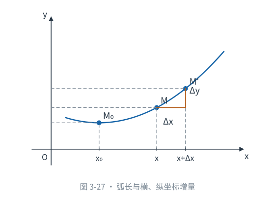

> 原书核对：[扫描第 181 页](../原书页面/up-181.png)。

<!-- /original-figure -->

设 $x, x+\Delta x$ 为 $(a, b)$ 内两个邻近的点，它们在曲线 $y=f(x)$ 上的对应点为 $M, M'$（图 3-27），并设对应于 $x$ 的增量为 $\Delta x$，弧 $s$ 的增量为 $\Delta s$，那么

$$
\Delta s = \widehat {M _ {0} M ^ {\prime}} - \widehat {M _ {0} M} = \widehat {M M ^ {\prime}}.
$$

于是

$$
\begin{array}{r l} \left(\frac {\Delta s}{\Delta x}\right) ^ {2} & = \left(\frac {\widehat {M M ^ {\prime}}}{\Delta x}\right) ^ {2} = \left(\frac {\widehat {M M ^ {\prime}}}{| M M ^ {\prime} |}\right) ^ {2} \cdot \frac {| M M ^ {\prime} | ^ {2}}{(\Delta x) ^ {2}} \\ & = \left(\frac {\widehat {M M ^ {\prime}}}{| M M ^ {\prime} |}\right) ^ {2} \cdot \frac {(\Delta x) ^ {2} + (\Delta y) ^ {2}}{(\Delta x) ^ {2}} = \left(\frac {\widehat {M M ^ {\prime}}}{| M M ^ {\prime} |}\right) ^ {2} \left[ 1 + \left(\frac {\Delta y}{\Delta x}\right) ^ {2} \right], \end{array}
$$

$$
\frac {\Delta s}{\Delta x} = \pm \sqrt {\left(\frac {\widehat {M M ^ {\prime}}}{| M M ^ {\prime} |}\right) ^ {2} \cdot \left[ 1 + \left(\frac {\Delta y}{\Delta x}\right) ^ {2} \right]}.
$$

① 有向弧段 $\widehat{M_0M}$ 的值也常记作 $\widehat{M_0M}$，即记号 $\widehat{M_0M}$ 既表示有向弧段，又表示有向弧段的值。

<!--PG:182-->

令 $\Delta x\to0$，取极限，由于 $\Delta x\to0$ 时，$M'\to M$，这时弧的长度与弦的长度之比的极限等于1，即

$$
\lim_{M' \to M} \frac{\left| \widehat{MM'} \right|}{|MM'|} = 1,
$$

又

$$
\lim_{\Delta x \to 0} \frac{\Delta y}{\Delta x} = y',
$$

因此得

$$
\frac{ds}{dx} = \pm \sqrt{1 + y'^2}.
$$

由于 $s = s(x)$ 是单调增加函数，从而根号前应取正号，于是有

$$
ds = \sqrt{1 + y'^2} dx.
$$

(7-1)

这就是弧微分公式.

## 二、曲率及其计算公式

我们直觉地认识到：直线不弯曲，半径较小的圆弯曲得比半径较大的圆厉害些，而其他曲线的不同部分有不同的弯曲程度，例如抛物线 $y = x^{2}$ 在顶点附近弯曲得比远离顶点的部分厉害些。

在工程技术中,有时需要研究曲线的弯曲程度.例如,船体结构中的钢梁、机床的转轴等,它们在荷载作用下要产生弯曲变形,在设计时对它们的弯曲必须有一定的限制,这就要定量地研究它们的弯曲程度.为此首先要讨论如何用数量来描述曲线的弯曲程度.

在图 3-28 中可以看出, 弧段  $\widehat{M_{1}M_{2}}$ 比较平直, 当动点沿这段弧从  $M_{1}$ 移动到  $M_{2}$ 时, 切线转过的角度  $\varphi_{1}$ 不大, 而弧段  $\widehat{M_{2}M_{3}}$ 弯曲得比较厉害, 角  $\varphi_{2}$ 就比较大.

<!-- original-figure: up-183 3-28,3-29 -->
**图 3-28** ^fig3_28

**图 3-29** ^fig3_29

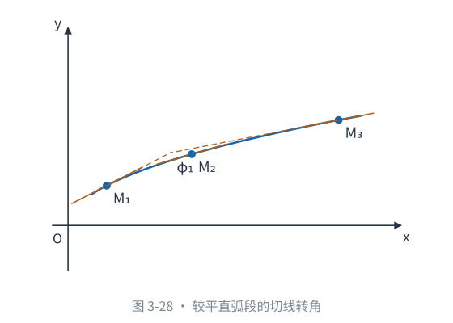

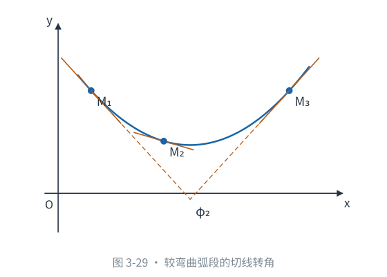

> 原书核对：[扫描第 183 页](../原书页面/up-183.png)。

<!-- /original-figure -->

但是，切线转过的角度的大小还不能完全反映曲线弯曲的程度。例如，从图3-29中可以看出，两段曲线弧 $\widehat{M_1M_2}$ 及 $\widehat{N_1N_2}$ 尽管切线转过的角度都是 $\varphi$，然而弯曲程度并不相同，短弧段比长弧段弯曲得厉害些。由此可见，曲线弧的弯曲程度还与弧段的长度有关。

按上面的分析，我们引入描述曲线弯曲程度的曲率概念如下：

设曲线 C 是光滑的①，在曲线 C 上选定一点 $M_{0}$ 作为度量弧 s 的基点。设曲线上点

① 当曲线上每一点处都具有切线，且切线随切点的移动而连续转动，这样的曲线称为光滑曲线。

<!--PG:183-->

$M$ 对应于弧 $s$，在点 $M$ 处切线的倾角为 $\alpha$ （这里假定曲线 $C$ 所在的平面上已设立了 $xOy$ 坐标系），曲线上另外一点 $M'$ 对应于弧 $s+\Delta s$，在点 $M'$ 处切线的倾角为 $\alpha+\Delta \alpha$ （图 3-30），则弧段 $\widehat{MM'}$ 的长度为 $|\Delta s|$，当动点从点 $M$ 移动到点 $M'$ 时切线转过的角度为 $|\Delta \alpha|$.

<!-- original-figure: up-183 3-30 -->
**图 3-30** ^fig3_30

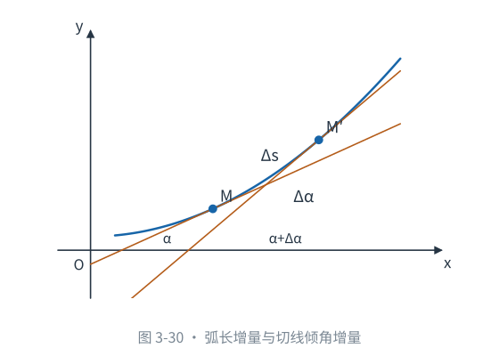

> 原书核对：[扫描第 183 页](../原书页面/up-183.png)。

<!-- /original-figure -->

我们用比值 $\frac{|\Delta \alpha|}{|\Delta s|}$，即单位弧段上切线转过的角度的大小来表达弧段 $\widehat{MM'}$ 的平均弯曲程度，把这比值叫做弧段 $\widehat{MM'}$ 的平均曲率，并记作 $\overline{K}$，即

$$
\overline{K} = \left| \frac{\Delta \alpha}{\Delta s} \right|.
$$

类似于从平均速度引进瞬时速度的方法，当 $\Delta s \to 0$ 时（即 $M' \to M$ 时），上述平均曲率的极限叫做曲线 $C$ 在点 $M$ 处的曲率，记作 $K$，即

$$
K = \lim_{\Delta s \to 0} \left| \frac{\Delta \alpha}{\Delta s} \right|.
$$

在 $\lim_{\Delta s \to 0} \frac{\Delta \alpha}{\Delta s} = \frac{\mathrm{d}\alpha}{\mathrm{d}s}$ 存在的条件下，$K$ 也可以表示为

$$
K = \left| \frac{\mathrm{d}\alpha}{\mathrm{d}s} \right|. \tag{7-2}
$$

对于直线来说，切线与直线本身重合，当点沿直线移动时，切线的倾角 $\alpha$ 不变（图3-31），$\Delta\alpha=0$，$\frac{\Delta\alpha}{\Delta s}=0$，从而 $K=\left|\frac{\mathrm{d}\alpha}{\mathrm{d}s}\right|=0$。这就是说，直线上任意点 $M$ 处的曲率都等于零，这与我们直觉认识到的“直线不弯曲”一致。

设圆的半径为 $a$，由图 3-32 可见圆在点 $M, M'$ 处的切线所夹的角 $\Delta\alpha$ 等于圆心角 $MDM'$。但 $\angle MDM' = \frac{\Delta s}{a}$，于是

<!--PG:184-->

$$
\frac {\Delta s}{\Delta \alpha} = \frac {a}{\Delta s} = - \frac {1}{a},
$$

从而

$$
K = \left| \frac {\mathrm{d} \alpha}{\mathrm{d} s} \right| = \frac {1}{a}.
$$

**图3-31**  ^fig3_31

<!-- original-figure: up-184 3-31,3-32 -->
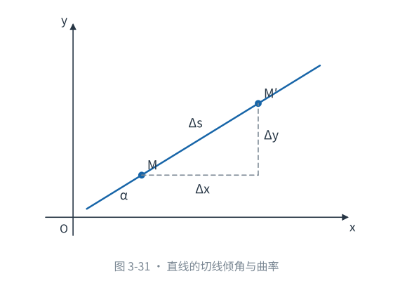

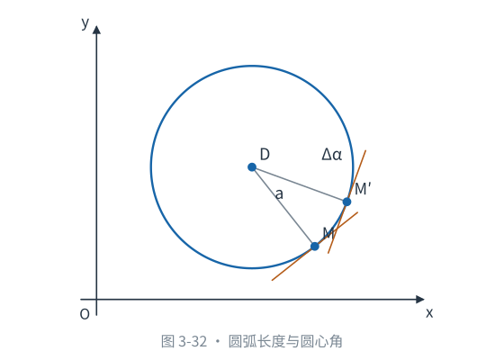

> 原书核对：[扫描第 184 页](../原书页面/up-184.png)。

<!-- /original-figure -->

**图3-32**  ^fig3_32

因为点 $M$ 是圆上任意取定的一点，上述结论表示圆上各点处的曲率都等于半径 $a$ 的倒数 $\frac{1}{a}$，这就是说，圆的弯曲程度到处一样，且半径越小曲率越大，即圆弯曲得越厉害。

在一般情况下，我们根据(7-2)式来导出便于实际计算曲率的公式.

设曲线的直角坐标方程是 $y = f(x)$，且 $f(x)$ 具有二阶导数（这时 $f'(x)$ 连续，从而曲线是光滑的）。因为 $\tan \alpha = y'$，所以

$$
\sec^ {2} \alpha \frac {\mathrm{d} \alpha}{\mathrm{d} x} = y ^ {\prime \prime},
$$

$$
\frac {\mathrm{d} \alpha}{\mathrm{d} x} = \frac {y ^ {\prime \prime}}{1 + \tan^ {2} \alpha} = \frac {- y ^ {\prime \prime}}{1 + y ^ {\prime 2}},
$$

于是

$$
\mathrm{d} \alpha = \frac {y ^ {\prime \prime}}{1 + y ^ {\prime 2}} \mathrm{d} x.
$$

又由(7-1)知道

$$
\mathrm{d} s = \sqrt {1 + y ^ {\prime 2}} \mathrm{d} x.
$$

从而，根据曲率 $K$ 的表达式(7-2)，有

$$
K = \frac {| y ^ {\prime \prime} |}{(1 + y ^ {\prime 2}) ^ {3 / 2}}. \tag{7-3}
$$

<!--PG:185-->

设曲线由参数方程

$$
\left\{\begin{array}{l}x=\varphi(t),\\ y=\psi(t)\end{array}\right.
$$

给出，则可利用由参数方程所确定的函数的求导法，求出 $y_{x}^{\prime}$ 及 $y_{x}^{\prime\prime}$，代入(7-3)便得

$$
K = \frac{\left|\varphi^{\prime}(t)\psi^{\prime\prime}(t)-\varphi^{\prime\prime}(t)\psi^{\prime}(t)\right|}{\left[\varphi^{\prime 2}(t)+\psi^{\prime 2}(t)\right]^{3 / 2}}.
$$

(7-4)

**例1** 计算等边双曲线 $xy = 1$ 在点 $(1,1)$ 处的曲率. ^e3-7-1

解 由 $y=\frac{1}{x}$，得

$$
y^{\prime}=-\frac{1}{x^{2}}, \quad y^{\prime\prime}=\frac{2}{x^{3}}.
$$

因此，

$$
y^{\prime}|_{x=1}=-1,\quad y^{\prime\prime}|_{x=1}=2.
$$

把它们代入公式(7-3)，便得曲线 $xy=1$ 在点 $(1,1)$ 处的曲率为

$$
K = \frac {2}{[ 1 + (- 1) ^ {2} ] ^ {3 / 2}} = \frac {\sqrt {2}}{2}.
$$

**例2** 抛物线 $y=ax^{2}+bx+c$ ($a\neq0$) 上哪一点处的曲率最大？ ^e3-7-2

解 由 $y=ax^{2}+bx+c$，得

$$
y^{\prime}=2ax+b,\quad y^{\prime\prime}=2a,
$$

代入公式(7-3)，得

$$
K = \frac {| 2 a |}{[ 1 + (2 a x + b) ^ {2} ] ^ {3 / 2}}.
$$

因为 $K$ 的分子是常数 $|2a|$，所以只要分母最小，$K$ 就最大。容易看出，当 $2ax+b=0$，即 $x=-\frac{b}{2a}$ 时，$K$ 的分母最小，因而 $K$ 有最大值 $|2a|$。而 $x=-\frac{b}{2a}$ 所对应的点为抛物线的顶点。因此，抛物线在顶点处的曲率最大。

在有些实际问题中， $|y'|$ 同 1 比较起来是很小的（有的工程技术书上把这种关系记成  $|y'| \ll 1$），可以忽略不计。这时，由

$$
1 + y ^ {\prime 2} \approx 1,
$$

而有曲率的近似计算公式

$$
K = \frac {| y ^ {\prime \prime} |}{(1 + y ^ {\prime 2}) ^ {3 / 2}} \approx | y ^ {\prime \prime} |.
$$

这就是说，当 $|y^{\prime}|\ll 1$ 时，曲率 $K$ 近似于 $|y^{\prime \prime}|$。经过这样简化之后，对一些复杂问题的计算和讨论就方便多了。

<!--PG:186-->

## 三、曲率圆与曲率半径

设曲线 $y=f(x)$ 在点 $M(x,y)$ 处的曲率为 $K(K \neq 0)$。在点 $M$ 处的曲线的法线上，在凹的一侧取一点 $D$，使 $|DM|=\frac{1}{K}=\rho$。以 $D$ 为圆心，$\rho$ 为半径作圆（图 3-33），这个圆叫做曲线在点 $M$ 处的曲率圆，曲率圆的圆心 $D$ 叫做曲线在点 $M$ 处的曲率中心，曲率圆的半径 $\rho$ 叫做曲线在点 $M$ 处的曲率半径。

<!-- original-figure: up-186 3-33 -->
**图 3-33** ^fig3_33

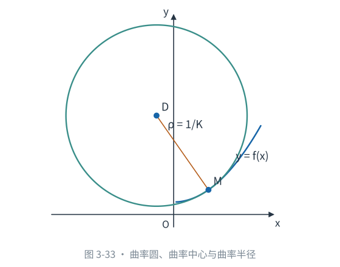

> 原书核对：[扫描第 186 页](../原书页面/up-186.png)。

<!-- /original-figure -->

按上述规定可知，曲率圆与曲线在点 $M$ 有相同的切线和曲率，且在点 $M$ 邻近有相同的凹向。因此，在实际问题中，常常用曲率圆在点 $M$ 邻近的一段圆弧来近似代替曲线弧，以使问题简化。

按上述规定，曲线在点 $M$ 处的曲率 $K(K \neq 0)$ 与曲线在点 $M$ 处的曲率半径 $\rho$ 有如下关系：

$$
\rho = \frac {1}{K}, \quad K = \frac {1}{\rho}.
$$

这就是说：曲线上一点处的曲率半径与曲线在该点处的曲率互为倒数。

**例3** 设工件内表面的截线为抛物线 $y=0.4x^{2}$ （图3-34）。现在要用砂轮磨削其内表面。问用直径多大的砂轮才比较合适？ ^e3-7-3

解 为了在磨削时不使砂轮与工件接触处附近的那部分工件磨去太多，砂轮的半径应不大于抛物线上各点处曲率半径中的最小值。由本节例2知道，抛物线在其顶点处的曲率最大，也就是说，抛物线在其顶点处的曲率半径最小。因此，只要求出抛物线 $y=0.4x^{2}$ 在顶点 $O(0,0)$ 处的曲率半径。由

**图3-34**  ^fig3_34

<!-- original-figure: up-186 3-34 -->
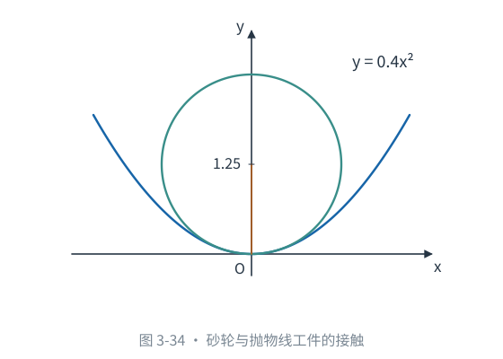

> 原书核对：[扫描第 186 页](../原书页面/up-186.png)。

<!-- /original-figure -->

<!--PG:187-->

所以选用砂轮的半径不得超过1.25单位长，即直径不得超过2.50单位长.

对于用砂轮磨削一般工件的内表面时，也有类似的结论，即选用的砂轮的半径不应超过这工件内表面的截线上各点处曲率半径中的最小值.

*四、曲率中心的计算公式 渐屈线与渐伸线

设已知曲线的方程是$y=f(x)$，且其二阶导数$y''$在点$x$不为零，则曲线在对应点$M(x,y)$的曲率中心$D(\alpha,\beta)$的坐标为

$$
\left\{\begin{array}{l}
\alpha=x-\frac{y'(1+y'^2)}{y''}, \\
\beta=y+\frac{1+y'^2}{y''}.
\end{array}\right. \tag{7-5}
$$

这是因为，曲线$y=f(x)$在点$M(x,y)$的曲率圆的方程为

$$
(\xi-\alpha)^2+(\eta-\beta)^2=\rho^2,
$$

其中$\xi,\eta$是曲率圆上的动点坐标，且

$$
\rho^2=\frac{1}{K^2}=\frac{(1+y'^2)^3}{y''^2}. \tag{7-6}
$$

因为点$M$在曲率圆上，所以

$$
(x-\alpha)^2+(y-\beta)^2=\rho^2; \tag{7-7}
$$

又因为曲线在点$M$的切线与曲率圆的半径$DM$相垂直（图3-33），所以

$$
y'=-\frac{x-\alpha}{y-\beta}. \tag{7-7}
$$

由式(7-6)和(7-7)消去$x-\alpha$，解出

$$
(y-\beta)^2=\frac{\rho^2}{1+y'^2}=\frac{(1+y'^2)^2}{y''^2}.
$$

由于当$y''>0$时曲线为凹弧，$y-\beta<0$；当$y''<0$时曲线为凸弧，$y-\beta>0$。总之，$y''$与$y-\beta$异号。因此取上式两边的平方根，得

$$
y-\beta=-\frac{1+y'^2}{y''},
$$

又

$$
x-\alpha=-y'(y-\beta)=\frac{y'(1+y'^2)}{y''}.
$$

从而有公式(7-5).

当点$(x,f(x))$沿曲线$C$移动时，相应的曲率中心$D$的轨迹曲线$G$称为曲线$C$的

<!--PG:188-->

渐屈线，而曲线 $C$ 称为曲线 $G$ 的渐伸线（图3-35）。所以曲线 $y=f(x)$ 的渐屈线的参数方程为

$$
\begin{cases}
\alpha = x - \dfrac{y'(1+y'^2)}{y''}, \\
\beta = y + \dfrac{1+y'^2}{y''},
\end{cases}
\tag{7-8}
$$

其中 $y = f(x)$, $y' = f'(x)$, $y'' = f''(x)$, $x$ 为参数，直角坐标系 $\alpha O\beta$ 与 $xOy$ 坐标系重合。

**图3-35**  ^fig3_35

<!-- original-figure: up-188 3-35 -->
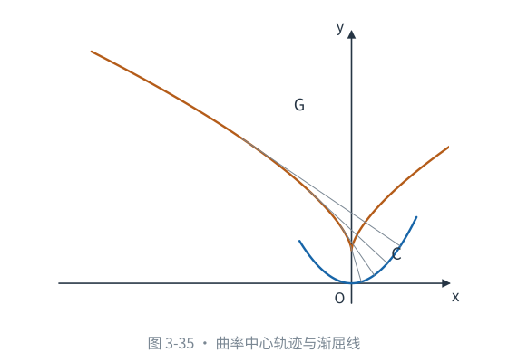

> 原书核对：[扫描第 188 页](../原书页面/up-188.png)。

<!-- /original-figure -->

**例4** 求摆线 ^e3-7-4

$$
\begin{cases}
x = a(t - \sin t), \\
y = a(1 - \cos t)
\end{cases}
$$

的渐屈线方程。

解 $\frac{\mathrm{d}x}{\mathrm{d}t} = a(1 - \cos t), \frac{\mathrm{d}y}{\mathrm{d}t} = a \sin t$，所以

$$
\frac{\mathrm{d}y}{\mathrm{d}x} = \frac{\sin t}{1 - \cos t},
$$

$$
\frac{\mathrm{d}^2 y}{\mathrm{d}x^2} = \frac{\frac{\mathrm{d}}{\mathrm{d}t} \left( \frac{\mathrm{d}y}{\mathrm{d}x} \right)}{\frac{\mathrm{d}x}{\mathrm{d}t}} = \frac{\frac{\cos t - 1}{(1 - \cos t)^2}}{a(1 - \cos t)} = -\frac{1}{a(1 - \cos t)^2}.
$$

将这些结果代入(7-8)式并化简，便得摆线的渐屈线的参数方程

$$
\left\{ \begin{array}{l} \alpha = a (t + \sin t), \\ \beta = a (\cos t - 1), \end{array} \right. \tag{7-9}
$$

其中 $t$ 为参数，直角坐标系 $\alpha O\beta$ 与 $xOy$ 坐标系重合。为了作出渐屈线 (7-9)，令 $t=\pi+\tau$，代入 (7-9) 式得

$$
\left\{ \begin{array}{l} \alpha - \pi a = a (\tau - \sin \tau), \\ \beta + 2 a = a (1 - \cos \tau), \end{array} \right.
$$

再令 $\alpha-\pi a=\xi,\beta+2a=\eta$，则得

$$
\left\{ \begin{array}{l} \xi = a (\tau - \sin \tau), \\ \eta = a (1 - \cos \tau). \end{array} \right. \tag{7-10}
$$

在新坐标系 $\xi O_{1}\eta$ 中，曲线（7-10）为一摆线，其中新坐标系 $\xi O_{1}\eta$ 由旧坐标系 $xOy$ 平移到新原点 $O_{1}(\pi a,-2a)$ 得到。由此可知摆线的渐屈线仍为一摆线，如图3-36所示。

<!--PG:189-->

**图3-36**  ^fig3_36

<!-- original-figure: up-189 3-36 -->
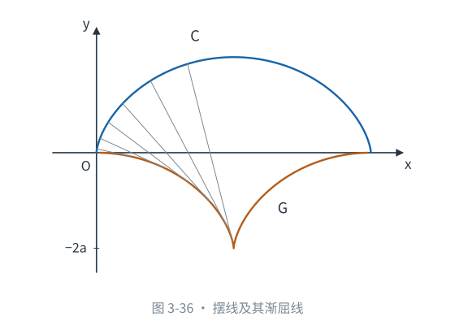

> 原书核对：[扫描第 189 页](../原书页面/up-189.png)。

<!-- /original-figure -->

### 习题3-7

> [!tip]- 新增：这组习题的逐题详解
> [[习题3-7-详细解答|打开详细解答（11 道大题）]]。包含推导、适用条件，以及必要处可展开的注释。解答按扫描原题核对，发现的转写差异在对应题目旁说明。
> 想先自己试时，可以暂不展开；全部入口见 [[课后习题详细解答]]。
1. 求椭圆  $4x^{2} + y^{2} = 4$  在点  $(0,2)$  处的曲率.

2. 求曲线  $y = \ln \sec x$  在点  $(x, y)$  处的曲率及曲率半径.

3. 求抛物线  $y = x^{2} - 4x + 3$  在其顶点处的曲率及曲率半径.

4. 求曲线  $x = a\cos^{3}t, y = a\sin^{3}t$  在  $t = t_{0}$  相应的点处的曲率.

5. 对数曲线  $y=\ln x$  上哪一点处的曲率半径最小？求出该点处的曲率半径.

6. 证明曲线 $y = a \mathrm{ch} \frac{x}{a}$ 在点 $(x, y)$ 处的曲率半径为 $\frac{y^2}{a}$.

7. 一飞机沿抛物线路径 $y=\frac{x^{2}}{10000}$ （y轴铅直向上，单位为m）做俯冲飞行。在坐标原点O处飞机的速度为v=200 m/s。飞行员体重G=70 kg。求飞机俯冲至最低点即原点O处时座椅对飞行员的反力。

8. 汽车连同载质量共5 t，在抛物线拱桥上行驶，速度为21.6 km/h，桥的跨度为10 m，拱的矢高为0.25 m（图3-37）。求汽车越过桥顶时对桥的压力。

**图3-37**  ^fig3_37

<!-- original-figure: up-189 3-37 -->
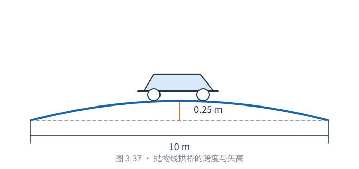

> 原书核对：[扫描第 189 页](../原书页面/up-189.png)。

<!-- /original-figure -->

9. 设 $R$ 为抛物线 $y = x^{2}$ 上任一点 $M(x, y)$ 处的曲率半径，$s$ 为该曲线上某一点 $M_{0}$ 到点 $M$ 的弧长，证明：$3R \frac{\mathrm{d}^{2} R}{\mathrm{d}s^{2}} - \left(\frac{\mathrm{d} R}{\mathrm{d}s}\right)^{2} - 9 = 0.$

10. 求曲线 $y=\tan x$ 在点 $\left(\frac{\pi}{4}, 1\right)$ 处的曲率圆方程.

11. 求抛物线 $y^{2}=2px$ 的渐屈线方程.

> [!pdf]- 📄 本节原书页面（PDF 181–189 / 书页 164–172）
> ![[up-181.png]]
> ![[up-182.png]]
> ![[up-183.png]]
> ![[up-184.png]]
> ![[up-185.png]]
> ![[up-186.png]]
> ![[up-187.png]]
> ![[up-188.png]]
> ![[up-189.png]]

---
⬅️ [[3-6-函数图形的描绘|函数图形的描绘]] ｜ 📑 [[第三章-微分中值定理与导数的应用|本章目录]] ｜ ➡️ [[3-8-方程的近似解|方程的近似解]]
