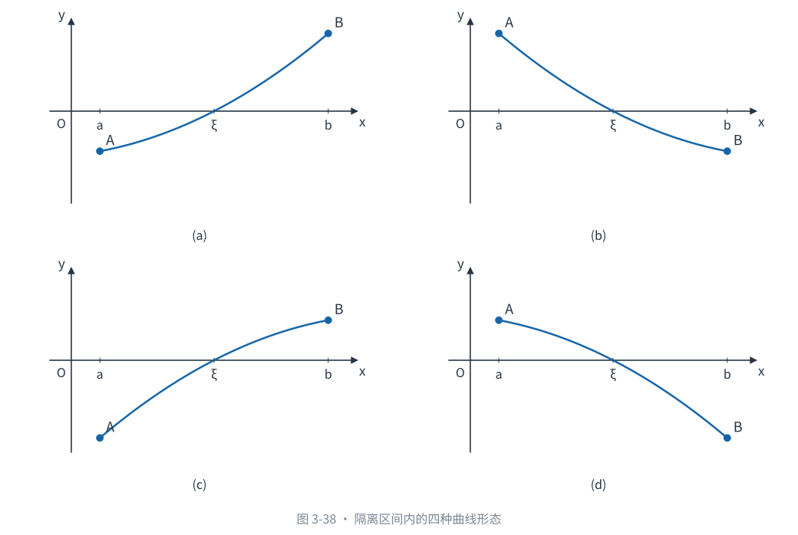
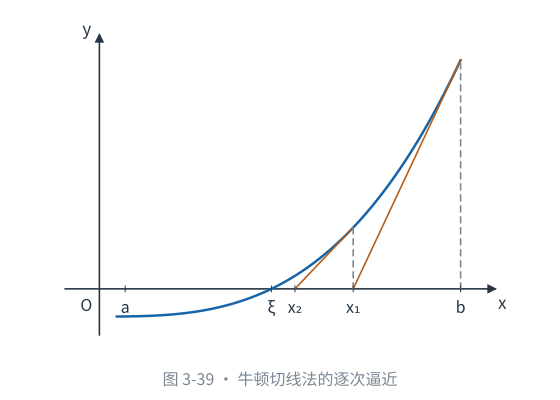
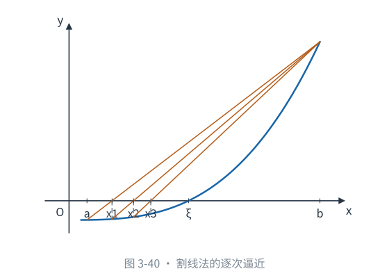

# 3-8 方程的近似解

## 自学入口：没有根的精确表达式，怎样可靠地接近它？

> [!info] 本次新增讲解
> 可直接读下面这一步，也可跳到“教材转写与已有批注”。想继续抠一个细节时，可以停在这里；练习和复盘均为可选。

**卡在符号或前提时再回看**：[[1-10-闭区间上连续函数的性质]] ｜ [[2-1-导数概念]]。

**可以先写这一行**：对 $f(x)=x^2-2$，先算 $f(1)=-1,f(2)=2$，确认连续且端点异号。

**为什么这样开始**：根在 $(1,2)$ 内。二分点 $1.5$ 的函数值为 $0.25$，所以保留异号区间 $[1,1.5]$。每一步都保住“根在区间里”这条证据；若用牛顿法，则由切线得到 $x_{k+1}=x_k-f(x_k)/f'(x_k)$，初值 $1.5$ 给出下一次 $17/12$。

**条件与边界**：牛顿法需分母非零，且不是任意初值都收敛；相邻迭代值很近也不自动等于已控制真实误差。

> [!question]- 愿意时试一个小变化
> 二分后再取 $1.25$，应保留哪半边？

> [!tip]- 展开看启动线索与解答
> $f(1.25)<0$，与 $f(1.5)>0$ 异号，保留 $[1.25,1.5]$。

**继续读**：下面的教材正文 ｜ [[自学入口与探索约定#卡住时怎样继续|卡住时的提示方式]] ｜ [[🧭 学习路线图|寻找关联问题]]。

## 教材转写与已有批注

> 下方保留现有转写、页标、题号和锚点；其中可能含先前批注及转换误差，未逐页对照扫描图校订。新增示范均在上方，不作为原书例题引用。

<!--PG:190-->

在科学技术问题中，经常会遇到求解高次代数方程或其他类型的方程的问题.要求得这类方程的实根的精确值，往往比较困难，因此就需要寻求方程的近似解.

求方程的近似解，可分两步来做.

第一步是确定根的大致范围.具体地说，就是确定一个区间 $[a,b]$，使所求的根是位于这个区间内的唯一实根.这一步工作称为根的隔离，区间 $[a,b]$ 称为所求实根的隔离区间.由于方程 $f(x)=0$ 的实根在几何上表示曲线 $y=f(x)$ 与 $x$ 轴交点的横坐标，因此为了确定根的隔离区间，可以先较精确地画出 $y=f(x)$ 的图形，然后从图上定出它与 $x$ 轴交点的大概位置.由于作图和读数的误差，这种做法得不出根的高精确度的近似值，但一般已可以确定出根的隔离区间.

第二步是以根的隔离区间的端点作为根的初始近似值，逐步改善根的近似值的精确度，直至求得满足精确度要求的近似解.完成这一步工作有多种方法，这里我们介绍三种常用的方法——二分法、切线法和割线法，按照这些方法，编出简单的程序，就可以在计算机上求出方程足够精确的近似解.

## 一、二分法

设 $f(x)$ 在区间 $[a,b]$ 上连续，$f(a)\cdot f(b)<0$，且方程 $f(x)=0$ 在 $(a,b)$ 内仅有一个实根 $\xi$，于是 $[a,b]$ 即是这个根的一个隔离区间.

取 $[a,b]$ 的中点 $\xi_{1}=\frac{a+b}{2}$，计算 $f(\xi_{1})$.

如果 $f(\xi_{1})=0$，那么 $\xi=\xi_{1}$;

如果 $f(\xi_{1})$ 与 $f(a)$ 同号，那么取 $a_{1}=\xi_{1}, b_{1}=b$，由 $f(a_{1}) \cdot f(b_{1})<0$，即知 $a_{1}<\xi<b_{1}$，且 $b_{1}-a_{1}=\frac{1}{2}(b-a)$；

如果 $f(\xi_{1})$ 与 $f(b)$ 同号，那么取 $a_{1}=a, b_{1}=\xi_{1}$，也有 $a_{1}<\xi<b_{1}$ 及 $b_{1}-a_{1}=\frac{1}{2}(b-a)$；

总之，当 $\xi \neq \xi_{1}$ 时，可求得 $a_{1} < \xi < b_{1}$，且 $b_{1} - a_{1} = \frac{1}{2}(b - a)$.

以 $[a_{1}, b_{1}]$ 作为新的隔离区间，重复上述做法，当 $\xi \neq \xi_{2} = \frac{1}{2}(a_{1} + b_{1})$ 时，可求得 $a_{2} < \xi < b_{2}$，且 $b_{2} - a_{2} = \frac{1}{2^{2}}(b - a)$.

<!--PG:191-->

如此重复 $n$ 次，可求得 $a_{n} < \xi < b_{n}$，且 $b_{n} - a_{n} = \frac{1}{2^{n}}(b - a)$. 由此可知，如果以 $a_{n}$ 或 $b_{n}$ 作为 $\xi$ 的近似值，那么其误差小于 $\frac{1}{2^{n}}(b - a)$.

**例1** 用二分法求方程 $x^{3} + 1.1x^{2} + 0.9x - 1.4 = 0$ 的实根的近似值，使误差不超过 $10^{-3}$①. ^e3-8-1

解 令 $f(x) = x^{3} + 1.1x^{2} + 0.9x - 1.4$，显然 $f(x)$ 在 $(-\infty, +\infty)$ 内连续.

由 $f'(x) = 3x^{2} + 2.2x + 0.9$，根据判别式 $B^{2} - 4AC = 2.2^{2} - 4 \times 3 \times 0.9 = -5.96 < 0$，知 $f'(x) > 0$. 故 $f(x)$ 在 $(-\infty, +\infty)$ 内单调增加，$f(x) = 0$ 至多有一个实根.

由 $f(0) = -1.4 < 0$，$f(1) = 1.6 > 0$，知 $f(x) = 0$ 在 $[0, 1]$ 内有唯一的实根. 取 $a = 0, b = 1, [0, 1]$ 即是一个隔离区间.

计算得

$$
\xi_{1} = 0.5, f(\xi_{1}) = -0.55 < 0, \text{故 } a_{1} = 0.5, b_{1} = 1;
$$

$$
\xi_2 = 0.75, f(\xi_2) = 0.32 > 0, \text{故 } a_2 = 0.5, b_2 = 0.75;
$$

$$
\xi_3 = 0.625, f(\xi_3) = -0.16 < 0, \text{故 } a_3 = 0.625, b_3 = 0.75;
$$

$$
\xi_4 = 0.687, f(\xi_4) = 0.062 > 0, \text{故 } a_4 = 0.625, b_4 = 0.687;
$$

$$
\xi_5 = 0.656, f(\xi_5) = -0.054 < 0, \text{故 } a_5 = 0.656, b_5 = 0.687;
$$

$$
\xi_6 = 0.672, f(\xi_6) = 0.005 > 0, \text{故 } a_6 = 0.656, b_6 = 0.672;
$$

$$
\xi_7 = 0.664, f(\xi_7) = -0.025 < 0, \text{故 } a_7 = 0.664, b_7 = 0.672;
$$

$$
\xi_8 = 0.668, f(\xi_8) = -0.010 < 0, \text{故 } a_8 = 0.668, b_8 = 0.672;
$$

$$
\xi_9 = 0.670, f(\xi_9) = -0.002 < 0, \text{故 } a_9 = 0.670, b_9 = 0.672;
$$

$$
\xi_{10} = 0.671, f(\xi_{10}) = 0.001 > 0, \text{故 } a_{10} = 0.670, b_{10} = 0.671.
$$

于是

$$
0.670 < \xi < 0.671.
$$

即 0.670 作为根的不足近似值，0.671 作为根的过剩近似值，其误差都小于  $10^{-3}$.

## 二、切线法

设 $f(x)$ 在 $[a,b]$ 上具有二阶导数，$f(a)\cdot f(b)<0$ 且 $f'(x)$ 及 $f''(x)$ 在 $[a,b]$ 上保持定号. 在上述条件下，方程 $f(x)=0$ 在 $(a,b)$ 内有唯一的实根 $\xi$，$[a,b]$ 为根的一个隔离区间. 此时，$y=f(x)$ 在 $[a,b]$ 上的图形 $\widehat{AB}$ 只有如图 3-38 所示的四种不同情形.

<!-- original-figure: up-192 3-38 -->
**图 3-38** ^fig3_38

> 原书核对：[扫描第 192 页](../原书页面/up-192.png)。

<!-- /original-figure -->

考虑用曲线弧一端的切线来代替曲线弧，从而求出方程实根的近似值.这种方法

① 按本例误差不超过 $10^{-3}$ 的要求，计算时只取 3 位小数.

<!--PG:192-->

叫做切线法.从图3-38中看出，如果在纵坐标与$f''(x)$同号的那个端点（此端点记作$(x_{0},f(x_{0}))$）处作切线，这切线与$x$轴的交点的横坐标$x_{1}$就比$x_{0}$更接近方程的根$\xi$.

下面以图3-38(a)：$f(a)<0$，$f(b)>0$，$f'(x)>0$，$f''(x)>0$的情形为例进行讨论.此时，因为$f(b)$与$f''(x)$同号，所以令$x_{0}=b$，在端点$(x_{0},f(x_{0}))$处作切线（图3-39），这切线的方程为

<!-- original-figure: up-192 3-39 -->
**图 3-39** ^fig3_39

> 原书核对：[扫描第 192 页](../原书页面/up-192.png)。

<!-- /original-figure -->

$$
y-f(x_{0})=f'(x_{0})(x-x_{0}).
$$

令$y=0$，从上式中解出$x$，就得到切线与$x$轴交点的横坐标为

$$
x_{1}=x_{0}-\frac{f(x_{0})}{f'(x_{0})},
$$

它比 $x_{0}$ 更接近方程的根 $\xi$.

再在点 $(x_{1}, f(x_{1}))$ 处作切线，可得根的近似值 $x_{2}$. 如此继续，一般地，在点 $(x_{n}, f(x_{n}))$ 处作切线，得根的近似值

$$
x _ {n + 1} = x _ {n} - \frac {f (x _ {n})}{f ^ {\prime} (x _ {n})}. \tag {8-1}
$$

如果 $f(a)$ 与 $f''(x)$ 同号，那么切线作在端点 $(a, f(a))$ 处（如图3-38情形（b）及（c）），可记 $x_0 = a$，仍按公式（8-1）计算切线与 $x$ 轴交点的横坐标.

<!--PG:193-->

**例2** 用切线法求方程 $x^{3}+1.1x^{2}+0.9x-1.4=0$ 的实根的近似值，使误差不超过 $10^{-3}$. ^e3-8-2

解 令 $f(x)=x^{3}+1.1x^{2}+0.9x-1.4$. 由例1知 $[0,1]$ 是根的一个隔离区间. $f(0)<0$, $f(1)>0$.

在 $[0,1]$ 上，

$f^{\prime}(x)=3x^{2}+2.2x+0.9>0,\quad f^{\prime\prime}(x)=6x+2.2>0,$

故 $f(x)$ 在 $[0,1]$ 上的图形属于图3-38中情形(a).按 $f^{\prime\prime}(x)$ 与 $f(1)$ 同号，所以令 $x_{0}=1$.

连续应用公式（8-1），得

$x_{1}=1-\frac{f(1)}{f^{\prime}(1)}\approx 0.738,$

$x_{2}=0.738-\frac{f(0.738)}{f^{\prime}(0.738)}\approx 0.674,$

$x_{3}=0.674-\frac{f(0.674)}{f^{\prime}(0.674)}\approx 0.671,$

$x_{4}=0.671-\frac{f(0.671)}{f^{\prime}(0.671)}\approx 0.671.$

至此，计算不能再继续.注意到 $f(x_{i})$ ($i=0,1,\cdots$) 与 $f^{\prime\prime}(x)$ 同号，知 $f(0.671)>0$，经计算可知 $f(0.670)<0$，于是有

$0.670<\xi<0.671.$

以 0.670 或 0.671 作为根的近似值，其误差都小于 $10^{-3}$.

三、割线法

利用切线法需要计算函数的导数，当 $f(x)$ 比较复杂时，计算 $f^{\prime}(x)$ 可能有困难.这时，可考虑用

$$
\frac{f(x_{n})-f(x_{n-1})}{x_{n}-x_{n-1}}
$$

来近似代替（8-1）式中的 $f^{\prime}(x_{n})$，这时的迭代公式成为

$$
x_{n+1}=x_{n}-\frac{x_{n}-x_{n-1}}{f(x_{n})-f(x_{n-1})}\cdot f(x_{n}), \tag{8-2}
$$

其中，$x_{0}, x_{1}$ 为初始值.迭代公式（8-2）的几何意义是用过点 $(x_{n-1}, f(x_{n-1}))$ 和点 $(x_{n}, f(x_{n}))$ 的割线来近似代替点 $(x_{n}, f(x_{n}))$ 处的切线，将这条割线与 $x$ 轴交点的横坐标作为新的近似值（见图3-40）.因此，这个方法叫做割线法或弦截法.

<!-- original-figure: up-193 3-40 -->
**图 3-40** ^fig3_40

> 原书核对：[扫描第 193 页](../原书页面/up-193.png)。

<!-- /original-figure -->

### 习题3-8

> [!tip]- 新增：这组习题的逐题详解
> [[习题3-8-详细解答|打开详细解答（4 道大题）]]。包含推导、适用条件，以及必要处可展开的注释。解答按扫描原题核对，发现的转写差异在对应题目旁说明。
> 想先自己试时，可以暂不展开；全部入口见 [[课后习题详细解答]]。
1. 试证明方程 $x^{3}-3x^{2}+6x-1=0$ 在区间 $(0,1)$ 内有唯一的实根，并用二分法求这个根的近似值，使误差不超过 0.01.

2. 试证明方程  $x^{5}+5x+1=0$  在区间  $(-1,0)$  内有唯一的实根，并用切线法求这个根的近似值，使误差不超过 0.01.

3. 用割线法求方程  $x^{3}+3x-1=0$  的近似根，使误差不超过 0.01.

4. 求方程 $x \lg x = 1$ 的近似根，使误差不超过 0.01.

> [!pdf]- 📄 本节原书页面（PDF 190–193 / 书页 173–176）
> ![[up-190.png]]
> ![[up-191.png]]
> ![[up-192.png]]
> ![[up-193.png]]

---
⬅️ [[3-7-曲率|曲率]] ｜ 📑 [[第三章-微分中值定理与导数的应用|本章目录]] ｜ ➡️ [[3-9-总习题3|总习题3]]
