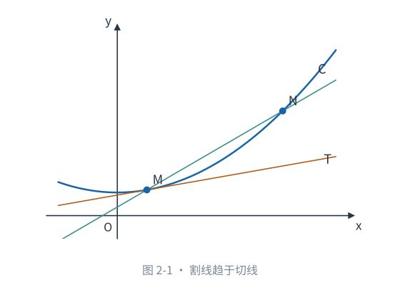
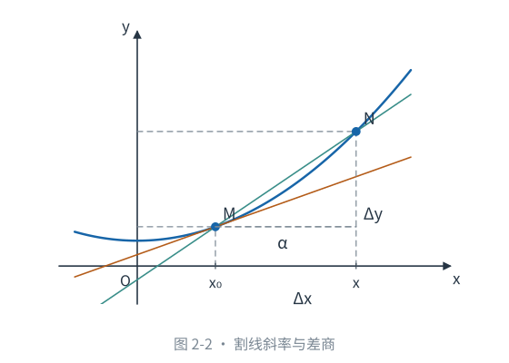
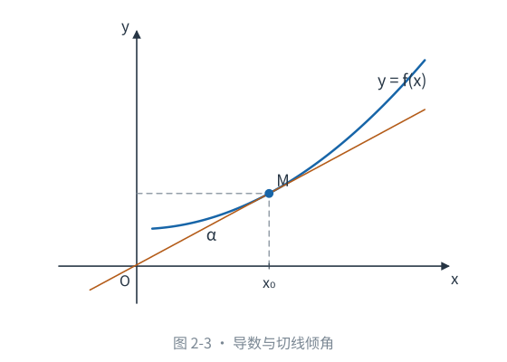
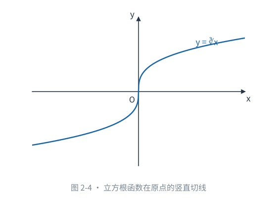
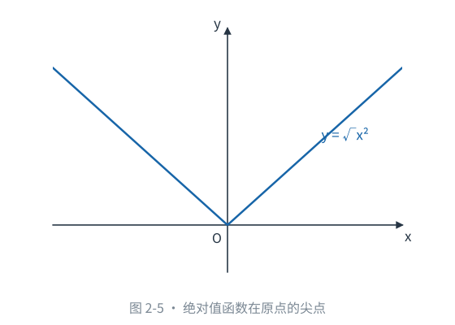

# 2-1 导数概念

## 自学入口：导数为什么要先除以增量，再让增量趋于零？

> [!info] 本次新增讲解
> 可直接读下面这一步，也可跳到“教材转写与已有批注”。想继续抠一个细节时，可以停在这里；练习和复盘均为可选。

**卡在符号或前提时再回看**：[[1-3-函数的极限]] ｜ [[1-8-函数的连续性与间断点]]。

**可以先写这一行**：对 $f(x)=x^2$ 在 $x_0=1$，先写 $f(1+h)-f(1)=2h+h^2$。

**为什么这样开始**：变化量本身趋于零，无法表达每单位输入变化带来的输出变化。对 $h\ne0$ 除以 $h$，得差商 $2+h$，再令 $h\to0$ 得 $f'(1)=2$。约去 $h$ 合法，是因为取极限时 $h$ 不等于零；并没有把 $0/0$ 算出来。

**条件与边界**：可导允许导数为零。准确关系是 $\Delta y=f'(x_0)h+o(h)$，并不要求 $\Delta y$ 与 $h$ 必须同阶。

> [!question]- 愿意时试一个小变化
> 用同样的方法求 $f(x)=x^2$ 在零点的导数。

> [!tip]- 展开看启动线索与解答
> $[f(h)-f(0)]/h=h\to0$，所以 $f'(0)=0$。此时 $\Delta y=h^2$ 比 $h$ 高阶。

**继续读**：下面的教材正文 ｜ [[自学入口与探索约定#卡住时怎样继续|卡住时的提示方式]] ｜ [[🧭 学习路线图|寻找关联问题]]。

## 教材转写与已有批注

> 下方保留现有转写、页标、题号和锚点；其中可能含先前批注及转换误差，未逐页对照扫描图校订。新增示范均在上方，不作为原书例题引用。

<!--PG:88-->

微分学是微积分的重要组成部分，它的基本概念是**导数与微分。**

本章中，我们主要讨论导数和微分的概念以及它们的计算方法。至于导数的应用，将在第三章讨论。

## 第一节 导数概念

> [!info]- 🧭 读正文前：这节在解决什么问题
> 1. **核心问题**：第一章学会了求极限，本节用极限工具把“平均变化率”（一段时间的平均速度、割线斜率）精确化为“瞬时变化率”（某一瞬间的速度、切线斜率）。
> 2. **定义长这样**：先算自变量增量 $\Delta x$ 引起的函数增量 $\Delta y$，再取比值 $\frac{\Delta y}{\Delta x}$ 在 $\Delta x \to 0$ 时的极限。若导数存在且有限，准确关系是 $\Delta y=f'(x_0)\Delta x+o(\Delta x)$；当导数为零时，增量可以是 $\Delta x$ 的高阶无穷小。
> 3. **前后衔接**：依赖第一章的极限运算与连续性概念；本节推导出的基本初等函数导数公式，是下一节学习四则与复合求导法则的“基石”。

### 一、引例

为了说明微分学的基本概念——导数，我们先讨论两个问题：速度问题和切线问题。这两个问题在历史上都与导数概念的形成有密切的关系。

#### 1. 直线运动的速度

设某质点沿直线运动。在直线上规定了原点、正方向和单位长度，使直线成为数轴。此外，再取定一个时刻作为测量时间的零点。设质点于时刻 t 在直线上的位置的坐标为 s（简称位置 s）。这样，该质点的运动完全由某个函数

$$
s = f(t)
$$

所确定。此函数对运动过程中所出现的 t 值有定义，称为位置函数。在最简单的情形，该质点所经过的路程与所花的时间成正比。就是说，无论取哪一段时间间隔，比值

$$
\frac{\text{经过的路程}}{\text{所花的时间}} \tag{1-1}
$$

总是相同的。这个比值就称为该质点的速度，并说该质点做匀速运动。如果运动不是匀速的，那么在运动的不同时间间隔内，比值（1-1）会有不同的值。这样，把比值（1-1）笼统地称为该质点的速度就不合适了，而需要按不同时刻来考虑。那么，这种非匀速运动

<!--PG:89-->

的质点在某一时刻（设为 $t_{0}$）的速度应如何理解而又如何求得呢？

首先取从时刻 $t_{0}$ 到 $t$ 这样一个时间间隔，在这段时间内，质点从位置 $s_{0}=f(t_{0})$ 移动到 $s=f(t)$。这时由 $(1-1)$ 式算得的比值

$$
\frac{s-s_{0}}{t-t_{0}} = \frac{f(t) - f(t_{0})}{t-t_{0}}
$$

（1-2）

可认为是质点在上述时间间隔内的平均速度。如果时间间隔选得较短，这个比值 $(1-2)$ 在实践中也可用来说明质点在时刻 $t_{0}$ 的速度。但对于质点在时刻 $t_{0}$ 的速度的精确概念来说，这样做是不够的，而更确切地应当这样：令 $t \to t_{0}$，取 $(1-2)$ 式的极限，如果这个极限存在，设为 $v$，即

$$
v = \lim_{t \to t_{0}} \frac{f(t) - f(t_{0})}{t - t_{0}}
$$

这时就把这个极限值 $v$ 称为质点在时刻 $t_{0}$ 的（瞬时）速度。

#### 2. 切线问题

圆的切线可定义为“与曲线只有一个交点的直线”。但是对于其他曲线，用“与曲线只有一个交点的直线”作为切线的定义就不一定合适。例如，对于抛物线 $y = x^{2}$，在原点 $O$ 处两个坐标轴都符合上述定义，但实际上只有 $x$ 轴是该抛物线在点 $O$ 处的切线。下面给出切线的定义。

设有曲线 $C$ 及 $C$ 上的一点 $M$（图 2-1），在点 $M$ 外另取 $C$ 上一点 $N$，作割线 $MN$。当点 $N$ 沿曲线 $C$ 趋于点 $M$ 时，如果割线 $MN$ 绕点 $M$ 旋转而趋于极限位置 $MT$，直线 $MT$ 就称为曲线 $C$ 在点 $M$ 处的切线。这里极限位置的含义是：只要弦长 $|MN|$ 趋于零，$\angle NMT$ 也趋于零。

<!-- original-figure: up-089 2-1,2-2 -->
**图 2-1** ^fig2_1

**图 2-2** ^fig2_2

> 原书核对：[扫描第 89 页](../原书页面/up-089.png)。

<!-- /original-figure -->

现在就曲线 $C$ 为函数 $y = f(x)$ 的图形的情形来讨论切线问题。设 $M(x_{0}, y_{0})$ 是曲线 $C$ 上的一个点（图 2-2），则 $y_{0} = f(x_{0})$。根据上述定义要定出曲线 $C$ 在点 $M$ 处的切线，只要定出切线的斜率就行了。为此，在点 $M$ 外另取 $C$ 上的一点 $N(x, y)$，于是割线 $MN$ 的斜率为

<!--PG:90-->

其中 $\varphi$ 为割线 $MN$ 的倾角。当点 $N$ 沿曲线 $C$ 趋于点 $M$ 时，$x \to x_0$。如果当 $x \to x_0$ 时，上式的极限存在，设为 $k$，即

$$
k = \lim_{x \to 0} \frac{f(x) - f(x_0)}{x - x_0}
$$

存在，那么此极限 $k$ 是割线斜率的极限，也就是**切线的斜率**。这里 $k = \tan \alpha$，其中 $\alpha$ 是切线 $MT$ 的倾角。于是，通过点 $M(x_0, f(x_0))$ 且以 $k$ 为斜率的直线 $MT$ 便是曲线 $C$ 在点 $M$ 处的切线。事实上，由 $\angle NMT = \varphi - \alpha$ 以及 $x \to x_0$ 时 $\varphi \to \alpha$，可见 $x \to x_0$ 时（这时 $|MN| \to 0$），$\angle NMT \to 0$。因此直线 $MT$ 确为曲线 $C$ 在点 $M$ 处的切线。

### 二、导数的定义

#### 1. 函数在一点处的导数与导函数

从上面所讨论的两个问题看出，非匀速直线运动的速度和切线的斜率都归结为如下的极限：

$$
\lim _ {x \to x _ {0}} \frac {f (x) - f (x _ {0})}{x - x _ {0}}, \tag{1-3}
$$

这里 $x-x_{0}$ 和 $f(x)-f(x_{0})$ 分别是函数 $y=f(x)$ 的自变量的增量 $\Delta x$ 和函数的增量 $\Delta y$：

$$
\Delta x = x - x _ {0}, \quad \Delta y = f (x) - f (x _ {0}) = f (x _ {0} + \Delta x) - f (x _ {0}).
$$

因 $x \to x_{0}$ 相当于 $\Delta x \to 0$，故（1-3）式也可写成

$$
\lim _ {\Delta x \rightarrow 0} \frac {\Delta y}{\Delta x} \quad \text {或} \quad \lim _ {\Delta x \rightarrow 0} \frac {f (x _ {0} + \Delta x) - f (x _ {0})}{\Delta x}.
$$

在自然科学和工程技术领域内，还有许多概念，例如电流强度、角速度、线密度等，都可归结为形如（1-3）式的数学形式。我们撇开这些量的具体意义，抓住它们在数量关系上的共性，就得出函数的导数概念。

> [!definition]+ 定义
> 设函数 $y=f(x)$ 在点 $x_{0}$ 的某个邻域内有定义，当自变量 $x$ 在 $x_{0}$ 处取得增量 $\Delta x$（点 $x_{0}+\Delta x$ 仍在该邻域内）时，相应地，因变量取得增量 $\Delta y=f(x_{0}+\Delta x)-f(x_{0})$；如果 $\Delta y$ 与 $\Delta x$ 之比当 $\Delta x\to0$ 时的极限存在，那么称函数 $y=f(x)$ 在点 $x_{0}$ 处可导，并称这个极限为函数 $y=f(x)$ 在点 $x_{0}$ 处的导数，记为 $f'(x_{0})$，即
> $$
> f ^ {\prime} (x _ {0}) = \lim _ {\Delta x \rightarrow 0} \frac {\Delta y}{\Delta x} = \lim _ {\Delta x \rightarrow 0} \frac {f (x _ {0} + \Delta x) - f (x _ {0})}{\Delta x}, \tag{1-4}
> $$
> 也可记作 $y^{\prime}|_{x=x_{0}}$，$\left.\frac{\mathrm{d}y}{\mathrm{d}x}\right|_{x=x_{0}}$ 或 $\left.\frac{\mathrm{d}f(x)}{\mathrm{d}x}\right|_{x=x_{0}}$。
> ^d2-1-1

<!--PG:91-->

函数 $f(x)$ 在点 $x_{0}$ 处可导有时也说成 $f(x)$ 在点 $x_{0}$ 处具有导数或导数存在。

导数的定义式（1-4）也可取不同的形式，常见的有

$$
f^{\prime}(x_{0}) = \lim_{h \to 0} \frac{f(x_{0}+h) - f(x_{0})}{h} \tag{1-5}
$$

和

$$
f^{\prime}(x_{0}) = \lim_{x \to x_{0}} \frac{f(x) - f(x_{0})}{x - x_{0}}. \tag{1-6}
$$

（1-5）式中的 $h$ 即自变量的增量 $\Delta x$。

在实际中，需要讨论各种具有不同意义的变量的变化“快慢”问题，在数学上就是所谓**函数的变化率问题**。导数概念就是函数变化率这一概念的精确描述。它撇开了自变量和因变量所代表的几何或物理等方面的特殊意义，纯粹从数量方面来刻画变化率的本质：因变量增量与自变量增量之比$\frac{\Delta y}{\Delta x}$是因变量 y 在以$x_{0}$和$x_{0}+\Delta x$为端点的区间上的平均变化率，而导数$f'(x_{0})$则是因变量 y 在点$x_{0}$处的变化率，它反映了因变量随自变量的变化而变化的快慢程度。

如果极限（1-4）不存在，就说函数 $y = f(x)$ 在点 $x_0$ 处不可导。如果不可导的原因是由于 $\Delta x \to 0$ 时，比式 $\frac{\Delta y}{\Delta x} \to \infty$，为了方便起见，也往往说函数 $y = f(x)$ 在点 $x_0$ 处的导数为无穷大。

上面讲的是函数在一点处可导。如果函数 $y=f(x)$ 在开区间 $I$ 内的每点处都可导，那么就称函数 $f(x)$ 在开区间 $I$ 内可导。这时，对于任一 $x\in I$，都对应着 $f(x)$ 的一个确定的导数值。这样就构成了一个新的函数，这个函数叫做原来函数 $y=f(x)$ 的导函数，记作 $y^{\prime}, f^{\prime}(x), \frac{\mathrm{d}y}{\mathrm{d}x}$ 或 $\frac{\mathrm{d}f(x)}{\mathrm{d}x}$。

在（1-4）式或（1-5）式中把 $x_{0}$ 换成 $x$，即得导函数的定义式

$$
y' = \lim_{\Delta x \to 0} \frac{f(x + \Delta x) - f(x)}{\Delta x}
$$

或

$$
f'(x) = \lim_{h \to 0} \frac{f(x+h) - f(x)}{h}.
$$

**注意** 在以上两式中，虽然 $x$ 可以取区间 $I$ 内的任何数值，但在极限过程中，$x$ 是常量，$\Delta x$ 或 $h$ 是变量。

显然，函数 $f(x)$ 在点 $x_0$ 处的导数 $f'(x_0)$ 就是导函数 $f'(x)$ 在点 $x = x_0$ 处的函数值，即

$$
f'(x_0) = f'(x)\mid_{x=x_0}.
$$

<!--PG:92-->

导函数 $f'(x)$ 简称导数，而 $f'(x_0)$ 是 $f(x)$ 在 $x_0$ 处的导数或导数 $f'(x)$ 在点 $x_0$ 处的值。

#### 2. 求导数举例

下面根据导数定义求一些简单函数的导数。

**例1** 求函数 $f(x)=C$ （$C$ 为常数）的导数。 ^e2-1-1

**解** $f'(x)=\lim_{h \to 0} \frac{f(x+h)-f(x)}{h}=\lim_{h \to 0} \frac{C-C}{h}=0$，即

$(C)'=0$。

这就是说，常数的导数等于零。

**例2** 求函数 $f(x)=x^n$ （$n \in \mathbb{N}_+$）的导数。 ^e2-1-2

> [!tip]- 💭 思路分析（先想再看解）
> - **卡点**：直接代入 $h=0$ 出现 $\frac{0}{0}$ 型未定式，必须消去分母中的因子 $h$。
> - **第一步**：利用二项式定理把 $(x+h)^n$ 展开，第一项 $x^n$ 恰好与后面的 $-x^n$ 抵消。
> - **同型参考**：与例 1 同样直接套用定义 ，属于多项式差商约分消零因子的基础套路。

**解** 当 $n=1$ 时，$f'(x)=\lim_{h \to 0} \frac{f(x+h)-f(x)}{h}=\lim_{h \to 0} \frac{(x+h)-x}{h}=1$；

当 $n>1$ 时，

$$
\begin{array}{l} f ^ {\prime} (x) = \lim _ {h \rightarrow 0} \frac {f (x + h) - f (x)}{h} = \lim _ {h \rightarrow 0} \frac {(x + h) ^ {n} - x ^ {n}}{h} \\ = \lim _ {h \rightarrow 0} \left[ n x ^ {n - 1} + \frac {n (n - 1)}{2} x ^ {n - 2} h + \dots + h ^ {n - 1} \right] = n x ^ {n - 1}. \\ \end{array}
$$

即

$$
(x ^ {n}) ^ {\prime} = \left\{ \begin{array}{l l} 1, & n = 1, \\ n x ^ {n - 1}, & n > 1. \end{array} \right.
$$

**例3** 求幂函数 $f(x)=x^{\mu}(\mu\in\mathbb{R})$ 的导数。 ^e2-1-3

> [!tip]- 💭 思路分析（先想再看解）
> - **卡点**：指数 $\mu$ 是任意实数，无法像例 2 那样用有限项二项式展开消去 $h$。
> - **第一步**：从分子中强行提取公因子 $x^\mu$，把差商改写成 $\frac{(1+h/x)^\mu - 1}{h/x}$ 的标准形态，从而对接第一章第九节的等价无穷小结论 $(1+u)^\mu - 1 \sim \mu u$。
> - **同型参考**：例 2 是本例在 $\mu \in \mathbb{N}_+$ 时的特例，本例把幂函数求导推广到了全体实数指数。

**解** 幂函数的定义域与常数 $\mu$ 有关，以下设 $x$ 在幂函数 $x^{\mu}$ 的定义域内且 $x \neq 0$，则

$$
\frac {f (x + h) - f (x)}{h} = \frac {(x + h) ^ {\mu} - x ^ {\mu}}{h} = x ^ {\mu - 1} \cdot \frac {\left(1 + \frac {h}{x}\right) ^ {\mu} - 1}{\frac {h}{x}}.
$$

利用第一章第九节例 7 的结果，便得

$$
f ^ {\prime} (x) = \lim _ {h \rightarrow 0} \frac {f (x + h) - f (x)}{h} = \mu x ^ {\mu - 1},
$$

即

$$
(x ^ {\mu}) ^ {\prime} = \mu x ^ {\mu - 1}.
$$

<!--PG:93-->

这就是幂函数的导数公式①。

利用这公式，可以很方便地求出幂函数的导数，例如：

当 $\mu=\frac{1}{2}$ 时，$y=x^{\frac{1}{2}}=\sqrt{x}$（$x>0$）的导数为

$$
(x^{\frac{1}{2}})^{\prime}=\frac{1}{2}x^{\frac{1}{2}-1}=\frac{1}{2}x^{-\frac{1}{2}},
$$

即

$$
(\sqrt{x})^{\prime}=\frac{1}{2\sqrt{x}};
$$

当 $\mu=-1$ 时，$y=x^{-1}=\frac{1}{x}$（$x\neq0$）的导数为

$$
(x^{-1})^{\prime}=(-1)x^{-1-1}=-x^{-2},
$$

即

$$
\left(\frac{1}{x}\right)^{\prime}=-\frac{1}{x^{2}}.
$$

**例4** 求函数 $f(x)=\sin x$ 的导数。 ^e2-1-4

> [!tip]- 💭 思路分析（先想再看解）
> - **卡点**：分子是 $\sin(x+h)-\sin x$，直接看难以和分母的 $h$ 约分。
> - **第一步**：用三角函数的和差化积公式，把分子变成乘积形式，制造出 $\sin\frac{h}{2}$ 因子，进而凑出第一重要极限 $\lim_{u\to 0}\frac{\sin u}{u}=1$。
> - **同型参考**：习题 2-1 第 5 题证明 $(\cos x)' = -\sin x$ 完全沿用此套路（只需换用余弦的和差化积公式）。

**解**

$$
\begin{array}{r l} f ^ {\prime} (x) & = \lim _ {h \rightarrow 0} \frac {f (x + h) - f (x)}{h} = \lim _ {h \rightarrow 0} \frac {\sin (x + h) - \sin x}{h} \\ & = \lim _ {h \rightarrow 0} \frac {1}{h} \cdot 2 \cos \left(x + \frac {h}{2}\right) \sin \frac {h}{2} = \lim _ {h \rightarrow 0} \cos \left(x + \frac {h}{2}\right) \cdot \frac {\sin \frac {h}{2}}{\frac {h}{2}} = \cos x, \end{array}
$$

即

$$
(\sin x) ^ {\prime} = \cos x.
$$

这就是说，正弦函数的导数是余弦函数。

用类似的方法，可求得

$$
(\cos x) ^ {\prime} = - \sin x,
$$

就是说，余弦函数的导数是负的正弦函数。

**例5** 求函数 $f(x)=a^{x}$（$a>0, a\neq1$）的导数。 ^e2-1-5

> [!tip]- 💭 思路分析（先想再看解）
> - **卡点**：变量 $h$ 处在指数位置，无法直接进行代数约分。
> - **第一步**：利用指数运算法则把 $a^{x+h}$ 拆成 $a^x \cdot a^h$，提取与 $h$ 无关的常数因子 $a^x$，剩下的部分正好是重要极限 $\lim_{h\to 0}\frac{a}{h}=\ln a$。
> - **同型参考**：与例 3 思路一致，都是先分离含 $x$ 的主部，再将剩余的 $h$ 极限归结为第一章的已知极限结论。

**解** $f'(x)=\lim_{h\to0}\frac{f(x+h)-f(x)}{h}=\lim_{h\to0}\frac{a^{x+h}-a^x}{h}=a^x\lim_{h\to0}\frac{a^h-1}{h}$。

利用第一章第九节例 6 的结果得

① 对 $x=0$ 时，若 $\mu>1$，则用导数定义直接计算得 $f'(0)=0$，而此时公式右端当 $x=0$ 时也为零，故公式对一切 $x$ 适用；若 $\mu=1$，则对一切 $x$ 有 $f'(x)=1$，而此时公式右端当 $x\neq0$ 时也为 1，当 $x=0$ 时，其值特别约定为 1，这样，公式对一切 $x$ 也适用。

<!--PG:94-->

$$
f^{\prime}(x) = a^{x} \ln a,
$$

即

$$
(a^{x})^{\prime} = a^{x} \ln a.
$$

这就是指数函数的导数公式。特别地，当 $a=e$ 时，因 $\ln e=1$，故有

$$
(e^{x})^{\prime}=e^{x}.
$$

上式表明，以 $e$ 为底的指数函数的导数就是它自己，这是以 $e$ 为底的指数函数的一个重要特性。

**例6** 求函数 $f(x)=\log_{a}x$（$a>0, a \neq 1$）的导数。 ^e2-1-6

> [!tip]- 💭 思路分析（先想再看解）
> - **卡点**：两个对数相减无法直接消去分母的 $h$。
> - **第一步**：利用对数性质将差化为商 $\log_a(1+\frac{h}{x})$，再配凑分母使之成为 $\frac{h}{x}$，转化为重要极限 $\lim_{u\to 0}\frac{\log_a(1+u)}{u}=\frac{1}{\ln a}$。
> - **同型参考**：与例 3、例 5 属于同一类“换元 $u=\frac{h}{x}$ 对接重要极限”的推导模板。

**解**

$$
\begin{array}{l} f ^ {\prime} (x) = \lim _ {h \rightarrow 0} \frac {f (x + h) - f (x)}{h} = \lim _ {h \rightarrow 0} \frac {\log_ {a} (x + h) - \log_ {a} x}{h} \\ = \lim _ {h \rightarrow 0} \frac {1}{h} \log_ {a} \frac {x + h}{x} = \lim _ {h \rightarrow 0} \frac {1}{x} \cdot \frac {x}{h} \log_ {a} \left(1 + \frac {h}{x}\right) = \frac {1}{x} \lim _ {h \rightarrow 0} \frac {\log_ {a} \left(1 + \frac {h}{x}\right)}{\frac {h}{x}}. \\ \end{array}
$$

作代换 $u=\frac{h}{x}$ 并利用第一章第九节例 5 的结果得

$$
f^{\prime}(x) = \frac{1}{x \ln a},
$$

即

$$
(\log_{a}x)^{\prime}=\frac{1}{x\ln a}.
$$

这就是对数函数的导数公式。特别地，当 $a=e$ 时，由上式得自然对数函数的导数公式

$$
(\ln x)^{\prime}=\frac{1}{x}.
$$

**例7** 求函数 $f(x)=|x|$ 在 $x=0$ 处的导数。 ^e2-1-7

> [!tip]- 💭 思路分析（先想再看解）
> - **卡点**：绝对值符号 $|h|$ 在 $h>0$ 和 $h<0$ 时表达式不同，不能直接去掉绝对值。
> - **第一步**：按 $h \to 0^-$ 和 $h \to 0^+$ 分两侧脱去绝对值，分别计算左、右极限并比较是否相等。
> - **同型参考**：引出后续“单侧导数”概念的母题；习题 2-1 第 7、16(1)、18 题均需采用这种分侧求导的策略。

**解**  $\lim_{h\to0}\frac{f(0+h)-f(0)}{h}=\lim_{h\to0}\frac{|h|-0}{h}=\lim_{h\to0}\frac{|h|}{h}.$

当 $h<0$ 时，$\frac{|h|}{h}=-1$，故 $\lim_{h\to0^{-}}\frac{|h|}{h}=-1$；

当 $h>0$ 时，$\frac{|h|}{h}=1$，故 $\lim_{h\to0^{+}}\frac{|h|}{h}=1$。

所以，$\lim_{h\to 0}\frac{f(0 + h) - f(0)}{h}$ 不存在，即函数 $f(x) = |x|$ 在 $x = 0$ 处不可导。

#### 3. 单侧导数

根据函数 $f(x)$ 在点 $x_{0}$ 处的导数 $f^{\prime}(x_{0})$ 的定义，导数

<!--PG:95-->

$$
f'(x_0) = \lim_{h \to 0} \frac{f(x_0 + h) - f(x_0)}{h}
$$

是一个极限，而极限存在的充分必要条件是左、右极限都存在且相等，因此 $f'(x_0)$ 存在即 $f(x)$ 在点 $x_0$ 处可导的充分必要条件是左、右极限

$\lim_{h \to 0^-} \frac{f(x_0 + h) - f(x_0)}{h}$ 及 $\lim_{h \to 0^+} \frac{f(x_0 + h) - f(x_0)}{h}$

都存在且相等。这两个极限分别称为函数 $f(x)$ 在点 $x_0$ 处的左导数和右导数，记作 $f'_-(x_0)$ 及 $f'_+(x_0)$，即

$$
f'_{-}(x_0) = \lim_{h \to 0^-} \frac{f(x_0 + h) - f(x_0)}{h},
$$

$$
f'_{+}(x_0) = \lim_{h \to 0^+} \frac{f(x_0 + h) - f(x_0)}{h}.
$$

现在可以说，函数 $f(x)$ 在点 $x_0$ 处可导的充分必要条件是左导数 $f'_{-}(x_0)$ 和右导数 $f'_{+}(x_0)$ 都存在且相等。

函数 $f(x)=|x|$ 在 $x=0$ 处的左导数 $f'_{-}(0)=-1$ 及右导数 $f'_{+}(0)=1$ 虽然都存在，但不相等，故 $f(x)=|x|$ 在 $x=0$ 处不可导。

左导数和右导数统称为单侧导数。

如果函数 $f(x)$ 在开区间 $(a, b)$ 内可导，且 $f_{+}^{\prime}(a)$ 及 $f_{-}^{\prime}(b)$ 都存在，那么就说 $f(x)$ 在闭区间 $[a, b]$ 上可导。

### 三、导数的几何意义

由第一目中切线问题的讨论以及第二目中导数的定义可知：函数 $y=f(x)$ 在点 $x_{0}$ 处的导数 $f^{\prime}(x_{0})$ 在几何上表示曲线 $y=f(x)$ 在点 $M(x_{0},f(x_{0}))$ 处的切线的斜率，即

$$
f^{\prime}(x_{0}) = \tan \alpha,
$$

其中 $\alpha$ 是切线的倾角（图 2-3）。

如果 $y=f(x)$ 在点 $x_{0}$ 处的导数为无穷大，那么这时曲线 $y=f(x)$ 的割线以垂直于 x 轴的直线 $x=x_{0}$ 为极限位置，即曲线 $y=f(x)$ 在点 $M(x_{0},f(x_{0}))$ 处具有垂直于 x 轴的切线 $x=x_{0}$（参看后面例 10）。

根据导数的几何意义并应用直线的点斜式方程，可知曲线 $y = f(x)$ 在点 $M(x_0, y_0)$ 处的切线方程为

$$
y - y_0 = f'(x_0)(x - x_0).
$$

**图2-3**  ^fig2_3

<!-- original-figure: up-095 2-3 -->

> 原书核对：[扫描第 95 页](../原书页面/up-095.png)。

<!-- /original-figure -->

过切点 $M(x_{0},y_{0})$ 且与切线垂直的直线叫做曲线 $y=f(x)$ 在点 $M$ 处的法线。如果 $f'(x_{0}) \neq 0$，法线的斜率为 $-\frac{1}{f'(x_{0})}$，从而法线方程为

<!--PG:96-->

**例8** 求等边双曲线 $y = \frac{1}{x}$ 在点 $\left(\frac{1}{2}, 2\right)$ 处的切线的斜率，并写出在该点处的切线方程和法线方程。 ^e2-1-8

> [!tip]- 💭 思路分析（先想再看解）
> - **卡点**：切线与法线方程都需要先知道斜率，且法线斜率与切线斜率互为负倒数。
> - **第一步**：先求导函数 $y'$，代入切点横坐标 $x=\frac{1}{2}$ 算出切线斜率 $k_1$，再用直线的点斜式写出两个方程。
> - **同型参考**：已知切点求切线的标准模板题，直接对应习题 2-1 第 13、14 题。

**解** 根据导数的几何意义知道，所求切线的斜率为

$k_{1} = y' \bigg|_{x=\frac{1}{2}}$。

由于 $y' = \left(\frac{1}{x}\right)' = -\frac{1}{x^2}$，于是

$k_{1} = -\frac{1}{x^2} \bigg|_{x=\frac{1}{2}} = -4$。

从而所求切线方程为

$y-2 = -4 \left( x-\frac{1}{2} \right)$，

即

$4x + y - 4 = 0$。

所求法线的斜率为

$k_{2} = -\frac{1}{k_{1}} = \frac{1}{4}$，

于是所求法线方程为

$y-2 = \frac{1}{4} \left( x-\frac{1}{2} \right)$，

即

$2x - 8y + 15 = 0$。

**例9** 求曲线 $y = x^{\frac{3}{2}}$ 的通过点 $(0, -4)$ 的切线方程。 ^e2-1-9

> [!tip]- 💭 思路分析（先想再看解）
> - **卡点**：题目给的 $(0,-4)$ 不在曲线上，不是切点，不能直接把 $x=0$ 代入导函数算斜率！
> - **第一步**：先设出未知切点 $(x_0, y_0)$，写出带参数的切线方程，再联立“切点在曲线上”与“切线过定点 $(0,-4)$”两个条件解出 $x_0, y_0$。
> - **同型参考**：与例 8 形成对比（例 8 已知切点，本题过曲线外一点），是几何应用中最易踩坑的变式。

**解** 设切点为 $(x_0, y_0)$，则切线的斜率为

$f'(x_0) = \frac{3}{2} \sqrt{x} \bigg|_{x=x_0} = \frac{3}{2} \sqrt{x_0}$。

于是所求切线方程可设为

$y-y_0 = \frac{3}{2} \sqrt{x_0}(x-x_0)$。

（1-7）

因切点 $(x_0, y_0)$ 在曲线 $y = x^{\frac{3}{2}}$ 上，故有

$y_0 = x_0^{\frac{3}{2}}$，

（1-8）

由已知切线 $(1-7)$ 通过点 $(0, -4)$，故有

<!--PG:97-->

$$
-4-y_{0}=\frac{3}{2}\sqrt{x_{0}}(0-x_{0}). \quad (1-9)
$$

求得方程（1-8）及（1-9）组成的方程组的解为 $x_{0}=4,y_{0}=8$，代入（1-7）式并化简，即得所求切线方程为

$$
3x-y-4=0.
$$

### 四、函数可导性与连续性的关系

设函数 $y=f(x)$ 在点 $x$ 处可导，即

$$
\lim_{\Delta x \to 0} \frac{\Delta y}{\Delta x} = f'(x)
$$

存在。由具有极限的函数与无穷小的关系知道，

$$
\frac{\Delta y}{\Delta x} = f'(x) + \alpha,
$$

其中 $\alpha$ 为当 $\Delta x \to 0$ 时的无穷小。上式两边同乘 $\Delta x$，得

$$
\Delta y = f'(x)\Delta x + \alpha \Delta x.
$$

由此可见，当 $\Delta x \to 0$ 时，$\Delta y \to 0$。这就是说，函数 $y=f(x)$ 在点 $x$ 处是连续的。所以，如果函数 $y=f(x)$ 在点 $x$ 处可导，那么函数在该点必连续。

另一方面，一个函数在某点连续却不一定在该点可导。举例说明如下：

**例10** 函数 $y=f(x)=\sqrt[3]{x}$ 在区间 $(-\infty,+\infty)$ 内连续，但在点 $x=0$ 处不可导。这是因为在点 $x=0$ 处有 ^e2-1-10

> [!tip]- 💭 思路分析（先想再看解）
> - **卡点**：函数在 $x=0$ 处明明连续，按定义算差商极限却得到 $+\infty$。
> - **第一步**：直接写出 $x=0$ 处的差商 $\frac{\sqrt[3]{h}}{h}=h^{-2/3}$，观察 $h\to 0$ 时极限为无穷大，从而判定不可导（几何上对应铅垂切线）。
> - **同型参考**：与例 7（尖点不可导）共同构成“连续推不出可导”的两大经典反例。

$$
\frac{f(0+h)-f(0)}{h} = \frac{\sqrt[3]{h}-0}{h} = \frac{1}{h^{2/3}},
$$

因而，$\lim_{h \to 0} \frac{f(0+h)-f(0)}{h} = \lim_{h \to 0} \frac{1}{h^{2/3}} = +\infty$，即导数为无穷大（注意，导数不存在）。这一事实在图形中表现为曲线 $y=\sqrt[3]{x}$ 在原点 $O$ 具有垂直于 $x$ 轴的切线 $x=0$（图 2-4）。

例 11 函数 $y=\sqrt{x^2}$（即 $y=|x|$）在 $(-\infty,+\infty)$ 内连续，但在例 7 中已经看到，这个函数在 $x=0$ 处不可导。曲线 $y=\sqrt{x^2}$ 在原点 $O$ 没有切线（图 2-5）。

**图2-4**  ^fig2_4

<!-- original-figure: up-097 2-4,2-5 -->

> 原书核对：[扫描第 97 页](../原书页面/up-097.png)。

<!-- /original-figure -->

**图2-5**  ^fig2_5

<!--PG:98-->

由以上讨论可知，函数在某点连续是函数在该点可导的必要条件，但不是充分条件。

## 习题2-1

> [!tip]- 新增：这组习题的逐题详解
> [[习题2-1-详细解答|打开详细解答（20 道大题）]]。包含推导、适用条件，以及必要处可展开的注释。解答按扫描原题核对，发现的转写差异在对应题目旁说明。
> 想先自己试时，可以暂不展开；全部入口见 [[课后习题详细解答]]。
1. 设物体绕定轴旋转，在时间间隔 $[0, t]$ 上转过角度 $\theta$，从而转角 $\theta$ 是 $t$ 的函数：$\theta = \theta(t)$。如果旋转是匀速的，那么称 $\omega = \frac{\theta}{t}$ 为该物体旋转的角速度。如果旋转是非匀速的，应怎样确定该物体在时刻 $t_0$ 的角速度？

2. 当物体的温度高于周围介质的温度时，物体就不断冷却。若物体的温度 $T$ 与时间 $t$ 的函数关系为 $T = T(t)$，应怎样确定该物体在时刻 $t$ 的冷却速度？

3. 设某工厂生产 x 件产品的成本为

 $C(x)=2000+100x-0.1x^{2}$ （元），

这函数 $C(x)$ 称为成本函数，成本函数 $C(x)$ 的导数 $C'(x)$ 在经济学中称为边际成本。试求：

(1) 当生产 100 件产品时的边际成本；

(2) 生产第 101 件产品的成本，并与（1）中求得的边际成本作比较，说明边际成本的实际意义。

4. 设函数 $f(x)=\frac{(x-1)(x-2)\cdots(x-n)}{(x+1)(x+2)\cdots(x+n)}$，求 $f'(1)$。

5. 证明 $(\cos x)' = -\sin x$。

6. 下列各题中均假定 $f'(x_{0})$ 存在，按照导数定义观察下列极限，指出 A 表示什么：

(1) $\lim_{\Delta x \to 0} \frac{f(x_{0}-\Delta x) - f(x_{0})}{\Delta x} = A;$

(2) $\lim_{x \to 0} \frac{f(x)}{x} = A$，其中 $f(0) = 0$，且 $f'(0)$ 存在；

(3) $\lim_{h \to 0} \frac{f(x_{0}+h)-f(x_{0}-h)}{h} = A$。

以下两题中给出了四个结论，从中选出一个正确的结论：

7. 设

$$f(x)=\left\{\begin{array}{ll}\frac{2}{3}x^{3},&x\leqslant1,\\ x^{2},&x>1,\end{array}\right.$$

则 $f(x)$ 在 $x=1$ 处的（ ）。

(A) 左、右导数都存在

(B) 左导数存在，右导数不存在

(C) 左导数不存在，右导数存在

(D) 左、右导数都不存在

8. 设 $f(x)$ 可导，$F(x)=f(x)(1+|\sin x|)$，则 $f(0)=0$ 是 $F(x)$ 在 $x=0$ 处可导的（ ）。

(A) 充分必要条件

(B) 充分条件但非必要条件

(C) 必要条件但非充分条件

(D) 既非充分条件又非必要条件
9. 求下列函数的导数：

(1) $ y = x^{4} $；(2) $ y = \sqrt[3]{x^{2}} $；(3) $ y = x^{1.6} $；(4) $ y = \frac{1}{\sqrt{x}} $；

(5) $ y = \frac{1}{x^{2}} $；(6) $ y = x^{3}\sqrt[5]{x} $；(7) $ y = \frac{x^{2}\sqrt[3]{x^{2}}}{\sqrt{x^{3}}} $。

10. 已知物体的运动规律为 $ s = t^{3} \text{ m} $，求这物体在 $ t = 2 \text{ s} $ 时的速度。

11. 试证明：

(1) 若 $ f(x) $ 为可导的奇函数，则 $ f'(x) $ 为偶函数；

(2) 若 $ f(x) $ 为可导的偶函数，则 $ f'(x) $ 为奇函数；

(3) 若 $ f(x) $ 为偶函数，且 $ f'(0) $ 存在，则 $ f'(0) = 0 $。

12. 求曲线 $ y = \sin x $ 在具有下列横坐标的各点处切线的斜率：
$ x = \frac{2}{3}\pi, \quad x = \pi $。

13. 求曲线 $ y = \cos x $ 上点 $ \left(\frac{\pi}{3}, \frac{1}{2}\right) $ 处的切线方程和法线方程。

14. 求曲线 $ y = e^{x} $ 在点 $ (0,1) $ 处的切线方程。

15. 在抛物线 $ y = x^{2} $ 上取横坐标为 $ x_{1} = 1 $ 及 $ x_{2} = 3 $ 的两点，作过这两点的割线。问该抛物线上哪一点的切线平行于这条割线？

16. 讨论下列函数在 $ x = 0 $ 处的连续性与可导性：

(1) $ y = |\sin x| $；

(2) $ y = \begin{cases} x^{2}\sin\frac{1}{x}, & x \neq 0, \\ 0, & x = 0. \end{cases} $

17. 设函数
$ f(x) = \begin{cases} x^{2}, & x \leqslant 1, \\ ax + b, & x > 1. \end{cases} $
为了使函数 $ f(x) $ 在 $ x = 1 $ 处连续且可导，$ a, b $ 应取什么值？

18. 已知 $ f(x) = \begin{cases} -x, & x < 0, \\ x^{2}, & x \geqslant 0, \end{cases} $ 求 $ f_{+}'(0) $ 及 $ f_{-}'(0) $，又 $ f'(0) $ 是否存在？

19. 已知 $ f(x) = \begin{cases} \sin x, & x < 0, \\ x, & x \geqslant 0, \end{cases} $ 求 $ f'(x) $。

20. 证明：双曲线 $ xy = a^{2} $ 上任一点处的切线与两坐标轴构成的三角形的面积都等于 $ 2a^{2} $。

> [!pdf]- 📄 本节原书页面（PDF 88–98 / 书页 71–81）
> ![[up-088.png]]
> ![[up-089.png]]
> ![[up-090.png]]
> ![[up-091.png]]
> ![[up-092.png]]
> ![[up-093.png]]
> ![[up-094.png]]
> ![[up-095.png]]
> ![[up-096.png]]
> ![[up-097.png]]
> ![[up-098.png]]

---
⬅️ [[1-11-总习题1|总习题1]] ｜ 📑 [[第二章-导数与微分|本章目录]] ｜ ➡️ [[2-2-函数的求导法则|函数的求导法则]]