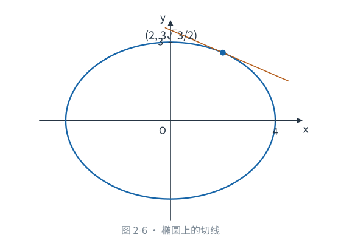
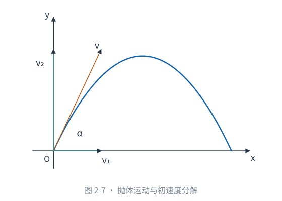
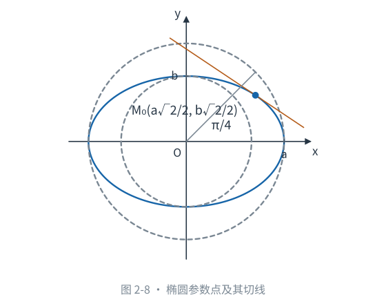
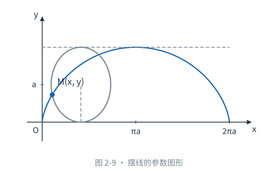

# 2-4 隐函数及由参数方程所确定的函数的导数　相关变化率

## 自学入口：方程没有把 $y$ 单独写出来，还能求导吗？

> [!info] 本次新增讲解
> 可直接读下面这一步，也可跳到“教材转写与已有批注”。想继续抠一个细节时，可以停在这里；练习和复盘均为可选。

**卡在符号或前提时再回看**：[[2-2-函数的求导法则]]。

**可以先写这一行**：对 $x^2+y^2=1$，先明确研究的是局部可导分支 $y=y(x)$，然后对等式两侧关于 $x$ 求导。

**为什么这样开始**：得 $2x+2yy'=0$。$y^2$ 的导数带 $y'$，因为 $y$ 也随 $x$ 变；在 $y\ne0$ 处解得 $y'=-x/y$。目标不是先解出整个函数，而是从已有约束中提取变化率关系。

**条件与边界**：$y=0$ 处不能除以 $y$，须另行讨论。参数方程公式 $dy/dx=y'(t)/x'(t)$ 同样要求分母非零。

> [!question]- 愿意时试一个小变化
> 在点 $(0,1)$，上式给出的切线斜率是多少？

> [!tip]- 展开看启动线索与解答
> $y'=-0/1=0$，切线是 $y=1$。

**继续读**：下面的教材正文 ｜ [[自学入口与探索约定#卡住时怎样继续|卡住时的提示方式]] ｜ [[🧭 学习路线图|寻找关联问题]]。

## 教材转写与已有批注

> 下方保留现有转写、页标、题号和锚点；其中可能含先前批注及转换误差，未逐页对照扫描图校订。新增示范均在上方，不作为原书例题引用。

## 第四节 隐函数及由参数方程所确定的函数的导数 相关变化率

> [!info]- 🧭 读正文前：这节在解决什么问题
> 1. **核心问题**：前两节要求函数必须写成 $y=f(x)$ 的显式才能求导，但实际中大量曲线由方程 $F(x,y)=0$（隐函数）或参数方程 $\begin{cases}x=\varphi(t)\\y=\psi(t)\end{cases}$ 给出，甚至根本解不出 $y=f(x)$。本节解决“不显化直接求导”的问题。
> 2. **方法长这样**：把隐函数中的 $y$ 看作中间变量 $y(x)$，方程两边同时对 $x$ 用链式法则求导，再把 $y'$ 当作未知数解出来；参数方程则是让 $y$ 和 $x$ 各自对参数 $t$ 求导再相除。
> 3. **前后衔接**：本质上是第二节“复合函数求导”与“反函数求导”的综合实战；掌握本节后，所有初等方程与运动轨迹的切线、变化率问题都能直接求解。

### 一、隐函数的导数

函数 $y = f(x)$ 表示两个变量 $y$ 与 $x$ 之间的对应关系，这种对应关系可以用各种不同方式表达。前面我们遇到的函数，例如 $y = \sin x, y = \ln x + \sqrt{1 - x^2}$ 等，这种函数表达方式的特点是：等号左端是因变量的符号，而右端是含有自变量的式子，当自变量取定义域内任一值时，由这式子能确定对应的函数值。用这种方式表达的函数叫做显函数。有些

<!--PG:116-->

函数的表达方式却不是这样，例如，方程

$$
x + y^{3} - 1 = 0
$$

表示一个函数，因为当变量 $x$ 在 $(-\infty, +\infty)$ 内取值时，变量 $y$ 有确定的值与之对应。例如，当 $x = 0$ 时，$y = 1$；当 $x = -1$ 时，$y = \sqrt[3]{2}$，等等。这样的函数称为隐函数。

一般地，如果变量 $x$ 和 $y$ 满足一个方程 $F(x, y) = 0$，在一定条件下，当 $x$ 取某区间内的任一值时，相应地总有满足这方程的唯一的 $y$ 值存在，那么就说方程 $F(x, y) = 0$ 在该区间内确定了一个隐函数。

把一个隐函数化成显函数，叫做隐函数的显化。例如从方程 $x + y^{3} - 1 = 0$ 解出 $y = \sqrt[3]{1 - x}$，就把隐函数化成了显函数。隐函数的显化有时是有困难的，甚至是不可能的。但在实际问题中，有时需要计算隐函数的导数，因此，我们希望有一种方法，不管隐函数能否显化，都能直接由方程算出它所确定的隐函数的导数。下面通过具体例子来说明这种方法。

**例1** 求由方程 $e^{y} + xy - e = 0$ 所确定的隐函数的导数 $\frac{dy}{dx}$。 ^e2-4-1

> [!tip]- 💭 思路分析（先想再看解）
> - **卡点**：方程里 $x$ 和 $y$ 混在一起解不出 $y=f(x)$，且 $xy$ 是乘积项，容易只对 $x$ 求导而漏掉 $y$ 的导数。
> - **第一步**：牢记 $y$ 是 $x$ 的函数，把方程看成关于 $x$ 的恒等式，两边同时对 $x$ 求导（$e^y$ 用复合求导得 $e^y y'$，$xy$ 用乘积法则得 $y+xy'$），最后把 $y'$ 当作未知数移项解出。
> - **同型参考**：隐函数求导的母题，直接对应习题 2-4 第 1(1)(3)(4) 题。

**解** 我们把方程两端分别对 $x$ 求导数①，注意 $y = y(x)$。方程左端对 $x$ 求导得

$$
\frac{d}{dx}(e^y + xy - e) = e^y \frac{dy}{dx} + y + x \frac{dy}{dx},
$$

方程右端对 $x$ 求导得

$$
(0)'=0.
$$

由于等式两端对 $x$ 的导数相等，所以

$$
\mathrm{e}^{y} \frac{\mathrm{d} y}{\mathrm{d} x} + y + x \frac{\mathrm{d} y}{\mathrm{d} x} = 0,
$$

从而

$$
\frac {\mathrm{d} y}{\mathrm{d} x} = - \frac {y}{x + \mathrm{e} ^ {y}} \quad (x + \mathrm{e} ^ {y} \neq 0).
$$

在这个结果中，分式中的 $y=y(x)$ 是由方程 $e^{y}+xy-e=0$ 所确定的隐函数。

**例2** 求由方程 $y^{5} + 2y - x - 3x^{7} = 0$ 所确定的隐函数在 $x = 0$ 处的导数 $\left.\frac{\mathrm{d}y}{\mathrm{d}x}\right|_{x=0}$。 ^e2-4-2

> [!tip]- 💭 思路分析（先想再看解）
> - **卡点**：只要求某一点（$x=0$）的导数值，如果先解出 $y'$ 的通式再代入，不仅多算一步，还容易忘记先求 $x=0$ 时对应的 $y$ 值。
> - **第一步**：两边对 $x$ 求导得到含 $x, y, y'$ 的关系式后，先将 $x=0$ 代入原方程算出 $y=0$，再把 $x=0, y=0$ 一起代回求导后的式子，直接解出 $y'(0)$。
> - **同型参考**：求特定点隐函数导数的省力技巧，配习题 2-4 第 2 题。

**解** 把方程两端分别对 $x$ 求导，由于方程两端的导数相等，所以

$$
5 y^{4} \frac{\mathrm{d} y}{\mathrm{d} x} + 2 \frac{\mathrm{d} y}{\mathrm{d} x} - 1 - 21 x^{6} = 0.
$$

由此得

① 假设方程 $F(x, y) = 0$ 确定一个函数 $y = y(x)$，把 $y = y(x)$ 代入方程便得恒等式 $F[x, y(x)] = 0$。因此，这里说的方程两端对 $x$ 求导，是指恒等式两端对 $x$ 求导。

<!--PG:117-->

**例3** 求椭圆 $\frac{x^2}{16}+\frac{y^2}{9}=1$ 在点 $\left(2, \frac{3}{2}\sqrt{3}\right)$ 处的切线方程（图 2-6）。 ^e2-4-3

**解** 由导数的几何意义知道，所求切线的斜率为 $k=y'\bigg|_{x=2}$。

椭圆方程的两端分别对 $x$ 求导，有

$$
\frac{x}{8}+\frac{2}{9}y \cdot \frac{\mathrm{d}y}{\mathrm{d}x}=0.
$$

从而

$$
\frac{\mathrm{d}y}{\mathrm{d}x}=-\frac{9x}{16y}.
$$

**图2-6**  ^fig2_6

<!-- original-figure: up-117 2-6 -->

> 原书核对：[扫描第 117 页](../原书页面/up-117.png)。

<!-- /original-figure -->

当 $x=2$ 时，$y=\frac{3}{2}\sqrt{3}$，代入上式得

$$
\left. \frac{\mathrm{d}y}{\mathrm{d}x} \right|_{x=2} = -\frac{\sqrt{3}}{4}.
$$

于是所求的切线方程为

$y-\frac{3}{2}\sqrt{3}=-\frac{\sqrt{3}}{4}(x-2)$，

即

$$
\sqrt{3}x+4y-8\sqrt{3}=0.
$$

**例4** 求由方程 $x-y+\frac{1}{2}\sin y=0$ 所确定的隐函数的二阶导数 $\frac{\mathrm{d}^{2}y}{\mathrm{d}x^{2}}$。 ^e2-4-4

> [!tip]- 💭 思路分析（先想再看解）
> - **卡点**：求二阶导数时直接把一阶导结果 $\frac{2}{2-\cos y}$ 对 $y$ 求导，忘记 $y$ 仍是 $x$ 的函数而漏乘 $y'$，或者算完不把 $y'$ 替换掉。
> - **第一步**：把 $\frac{dy}{dx}=\frac{2}{2-\cos y}$ 两边再次对 $x$ 求导，右侧按复合函数求导必乘 $\frac{dy}{dx}$，最后将刚算出的 $\frac{dy}{dx}$ 表达式回代化简。
> - **同型参考**：隐函数求二阶导的标准两步法（一阶求导解 $y'$ $\to$ 二次求导并回代），对应习题 2-4 第 4 题。

**解** 应用隐函数的求导方法，得

$$
1-\frac{\mathrm{d}y}{\mathrm{d}x}+\frac{1}{2}\cos y\cdot\frac{\mathrm{d}y}{\mathrm{d}x}=0,
$$

于是

$$
\frac{\mathrm{d}y}{\mathrm{d}x} = \frac{2}{2 - \cos y}.
$$

上式两端再对 $x$ 求导，得

$$
\frac{\mathrm{d}^2y}{\mathrm{d}x^2} = \frac{-2\sin y \frac{\mathrm{d}y}{\mathrm{d}x}}{(2 - \cos y)^2} = \frac{-4\sin y}{(2 - \cos y)^3}.
$$

<!--PG:118-->

上式右端分式中的 $y=y(x)$ 是由方程 $x-y+\frac{1}{2}\sin y=0$ 所确定的隐函数。

在某些场合，利用所谓对数求导法求导数比用通常的方法简便些。这种方法是先在 $y=f(x)$ 的两端取对数，然后再求出 $y$ 的导数。我们通过下面的例子来说明这种方法。

**例5** 求 $y=x^{\sin x}$（$x>0$）的导数。 ^e2-4-5

> [!tip]- 💭 思路分析（先想再看解）
> - **卡点**：底数 $x$ 和指数 $\sin x$ 都含有变量，既不能直接套幂函数求导公式，也不能直接套指数函数求导公式。
> - **第一步**：等式两边同时取自然对数 $\ln y = \sin x \ln x$，把指数拉下来变成乘积，再按隐函数求导法两边对 $x$ 求导（左端得 $\frac{y'}{y}$），最后乘回 $y$。
> - **同型参考**：所有幂指函数 $u(x)^{v(x)}$ 的通用解法，直接对应习题 2-4 第 5(1) 题。

**解** 这函数是幂指函数。为了求这函数的导数，可以先在等式两端取对数，得

$$
\ln y = \sin x \cdot \ln x.
$$

上式两端对 $x$ 求导，注意到 $y=y(x)$，得

$$
\frac {1}{y} y ^ {\prime} = \cos x \cdot \ln x + \sin x \cdot \frac {1}{x},
$$

于是

$$
y ^ {\prime} = y \left(\cos x \cdot \ln x + \frac {\sin x}{x}\right) = x ^ {\sin x} \left(\cos x \cdot \ln x + \frac {\sin x}{x}\right).
$$

对于一般形式的幂指函数

$$
y = u ^ {v} \quad (u > 0), \tag {4-1}
$$

如果 $u = u(x)$，$v = v(x)$ 都可导，那么可像例 5 那样利用对数求导法求出幂指函数（4-1）的导数，也可把幂指函数（4-1）表示为

$$
y = \mathrm{e} ^ {\mathrm{e} \ln u}.
$$

这样，便可直接求得

$$
y ^ {\prime} = \mathrm{e} ^ {\mathrm{e} \ln u} \left(v ^ {\prime} \cdot \ln u + v \cdot \frac {u ^ {\prime}}{u}\right) = u ^ {v} \left(v ^ {\prime} \cdot \ln u + \frac {v u ^ {\prime}}{u}\right).
$$

**例6** 求 $y=\sqrt{\frac{(x-1)(x-2)}{(x-3)(x-4)}}$ 的导数。 ^e2-4-6

> [!tip]- 💭 思路分析（先想再看解）
> - **卡点**：根号套分式，内部又是四个一次因式相乘除，硬用商和乘积法则求导会极其繁琐且极易算错。
> - **第一步**：利用对数“乘变加、除变减、幂提前”的性质，先取对数把复杂根式拆成四个简单对数的加减，再两边对 $x$ 求导。
> - **同型参考**：多因子乘除、开方求导的利器，配习题 2-4 第 5(2)(3)(4) 题。

**解** 先在等式两端取对数（假定 $x>4$），得

$$
\ln y = \frac {1}{2} [ \ln (x - 1) + \ln (x - 2) - \ln (x - 3) - \ln (x - 4) ],
$$

上式两端对 $x$ 求导，注意到 $y = y(x)$，得

$$
\frac {1}{y} y ^ {\prime} = \frac {1}{2} \left(\frac {1}{x - 1} + \frac {1}{x - 2} - \frac {1}{x - 3} - \frac {1}{x - 4}\right),
$$

于是

$$
\begin{array}{l} y ^ {\prime} = \frac {y}{2} \left(\frac {1}{x - 1} + \frac {1}{x - 2} - \frac {1}{x - 3} - \frac {1}{x - 4}\right). \end{array}
$$

当 $x<1$ 时，$y=\sqrt{\frac{(1-x)(2-x)}{(3-x)(4-x)}}$；

当 $2<x<3$ 时，$y=\sqrt{\frac{(x-1)(x-2)}{(3-x)(4-x)}}$，

<!--PG:119-->

用同样的方法可得与上面相同的结果。

### 二、由参数方程所确定的函数的导数

研究物体运动的轨迹时，常遇到参数方程。例如，研究抛射体的运动问题时，如果空气阻力忽略不计，那么抛射体的运动轨迹可表示为

$$
\begin{cases}
x = v_{1} t, \\
y = v_{2} t - \frac{1}{2} g t^{2}
\end{cases}
\tag{4-2}
$$

其中 $v_{1}$，$v_{2}$ 分别是抛射体初速度的水平、铅直分量，$g$ 是重力加速度，$t$ 是飞行时间，$x$ 和 $y$ 分别是飞行中抛射体在铅直平面上的位置的横坐标和纵坐标（图 2-7）。

<!-- original-figure: up-119 2-7 -->
**图 2-7** ^fig2_7

> 原书核对：[扫描第 119 页](../原书页面/up-119.png)。

<!-- /original-figure -->

在（4-2）式中，$x$，$y$ 都与 $t$ 存在函数关系。如果把对应于同一个 $t$ 值的 $y$ 与 $x$ 的值看作是对应的，那么这样就得到 $y$ 与 $x$ 之间的函数关系。消去（4-2）中的参数 $t$，有

$$
y = \frac{v_{2}}{v_{1}} x - \frac{g}{2v_{1}^{2}} x^{2}.
$$

这是因变量 $y$ 与自变量 $x$ 直接联系的式子，也是参数方程（4-2）所确定的函数的显式表示。

一般地，若参数方程

$$
\left\{
\begin{array}{l}
x = \varphi(t), \\
y = \psi(t)
\end{array}
\right.
\tag{4-3}
$$

确定 $y$ 与 $x$ 间的函数关系，则称此函数关系所表达的函数为由参数方程（4-3）所确定的函数。

在实际问题中，需要计算由参数方程（4-3）所确定的函数的导数。但从（4-3）中消去参数 $t$ 有时会有困难。因此，我们希望有一种方法能直接由参数方程（4-3）算出它所确定的函数的导数。下面就来讨论由参数方程（4-3）所确定的函数的求导方法。

在（4-3）式中，如果函数 $x=\varphi(t)$ 具有单调连续反函数 $t=\varphi^{-1}(x)$，且此反函数能与函数 $y=\psi(t)$ 构成复合函数，那么由参数方程（4-3）所确定的函数可以看成是由函数 $y=\psi(t), t=\varphi^{-1}(x)$ 复合而成的函数 $y=\psi[\varphi^{-1}(x)]$。现在，要计算这个复合函数的导数。为此再假定函数 $x=\varphi(t), y=\psi(t)$ 都可导，而且 $\varphi'(t) \neq 0$。于是根据复合函数的求导法则与反函数的求导法则，就有

$$
\frac{\mathrm{d} y}{\mathrm{d} x} = \frac{\mathrm{d} y}{\mathrm{d} t} \cdot \frac{\mathrm{d} t}{\mathrm{d} x} = \frac{\mathrm{d} y}{\mathrm{d} t} \cdot \frac{1}{\frac{\mathrm{d} x}{\mathrm{d} t}} = \frac{\psi'(t)}{\varphi'(t)},
$$

<!--PG:120-->

即

$$
\frac {\mathrm{d} y}{\mathrm{d} x} = \frac {\psi^ {\prime} (t)}{\varphi^ {\prime} (t)}. \tag {4-4}
$$

上式也可写成

$$
\frac {\mathrm{d} y}{\mathrm{d} x} = \frac {\frac {\mathrm{d} y}{\mathrm{d} t}}{\frac {\mathrm{d} x}{\mathrm{d} t}}.
$$

（4-4）式就是由参数方程（4-3）所确定的 $x$ 的函数的导数公式①。

如果 $x=\varphi(t)$，$y=\psi(t)$ 还是二阶可导的，那么从（4-4）式又可得到函数的二阶导数公式

$$
\frac {\mathrm{d} ^ {2} y}{\mathrm{d} x ^ {2}} = \frac {\mathrm{d}}{\mathrm{d} x} \left(\frac {\mathrm{d} y}{\mathrm{d} x}\right) = \frac {\mathrm{d}}{\mathrm{d} t} \left(\frac {\psi^ {\prime} (t)}{\varphi^ {\prime} (t)}\right) \cdot \frac {\mathrm{d} t}{\mathrm{d} x} = \frac {\psi^ {\prime \prime} (t) \varphi^ {\prime} (t) - \psi^ {\prime} (t) \varphi^ {\prime \prime} (t)}{\varphi^ {\prime 2} (t)} \cdot \frac {1}{\varphi^ {\prime} (t)},
$$

即

$$
\frac {\mathrm{d} ^ {2} y}{\mathrm{d} x ^ {2}} = \frac {\psi^ {\prime \prime} (t) \varphi^ {\prime} (t) - \psi^ {\prime} (t) \varphi^ {\prime \prime} (t)}{\varphi^ {\prime 3} (t)}. \tag {4-5}
$$

**例7** 已知椭圆的参数方程为 ^e2-4-7

> [!tip]- 💭 思路分析（先想再看解）
> - **卡点**：切线方程需要直角坐标 $(x_0, y_0)$ 和斜率 $\frac{dy}{dx}$，但题目只给了参数 $t=\frac{\pi}{4}$。
> - **第一步**：将 $t=\frac{\pi}{4}$ 代入参数方程算出切点坐标 $(x_0, y_0)$，再用参数求导公式 $\frac{dy}{dx}=\frac{dy/dt}{dx/dt}$ 算出导函数后代入 $t=\frac{\pi}{4}$ 得斜率。
> - **同型参考**：参数方程求切线/法线的标准模板，对应习题 2-4 第 8 题。

$$
\left\{ \begin{array}{l} x = a \cos t, \\ y = b \sin t, \end{array} \right.
$$

求椭圆在 $t=\frac{\pi}{4}$ 相应的点处的切线方程（图 2-8）。

**解** 当 $t=\frac{\pi}{4}$ 时，椭圆上的相应点 $M_{0}$ 的坐标是

$$
x _ {0} = a \cos \frac {\pi}{4} = \frac {\sqrt {2} a}{2},
$$

$$
y _ {0} = b \sin \frac {\pi}{4} = \frac {\sqrt {2} b}{2}.
$$

**图2-8**  ^fig2_8

<!-- original-figure: up-120 2-8 -->

> 原书核对：[扫描第 120 页](../原书页面/up-120.png)。

<!-- /original-figure -->

曲线在点 $M_{0}$ 的切线斜率为

① 作为 $x$ 的函数，$\frac{dy}{dx}$ 应表示为

$$
\left\{ \begin{array}{l} x = \varphi (t), \\ \frac {\mathrm{d} y}{\mathrm{d} x} = \frac {\psi^ {\prime} (t)}{\varphi^ {\prime} (t)}, \end{array} \right.
$$

但为了方便起见，通常把 $x = \varphi(t)$ 省去。后面的公式（4-5）也作类似的理解。

<!--PG:121-->

$$
\left. \frac {\mathrm{d} y}{\mathrm{d} x} \right| _ {t = \frac {\pi}{4}} = \frac {(b \sin t) ^ {\prime}}{(a \cos t) ^ {\prime}} \left| _ {t = \frac {\pi}{4}} = \frac {b \cos t}{- a \sin t} \right| _ {t = \frac {\pi}{4}} = - \frac {b}{a}.
$$

代入点斜式方程，即得椭圆在点 $M_{0}$ 处的切线方程

$$
y - \frac {\sqrt {2} b}{2} = - \frac {b}{a} \left(x - \frac {\sqrt {2} a}{2}\right).
$$

化简后得

$$
b x + a y - \sqrt {2} a b = 0.
$$

**例8** 已知抛射体的运动轨迹的参数方程为 ^e2-4-8

$$
\left\{ \begin{array}{l} x = v _ {1} t, \\ y = v _ {2} t - \frac {1}{2} g t ^ {2}, \end{array} \right.
$$

求抛射体在时刻 $t$ 的运动速度的大小和方向。

**解** 先求速度的大小。

由于速度的水平分量为

$$
\frac {\mathrm{d} x}{\mathrm{d} t} = v _ {1},
$$

铅直分量为

$$
\frac {\mathrm{d} y}{\mathrm{d} t} = v _ {2} - g t,
$$

所以抛射体运动速度的大小为

$$
v = \sqrt {\left(\frac {\mathrm{d} x}{\mathrm{d} t}\right) ^ {2} + \left(\frac {\mathrm{d} y}{\mathrm{d} t}\right) ^ {2}} = \sqrt {v _ {1} ^ {2} + (v _ {2} - g t) ^ {2}}.
$$

再求速度的方向，也就是轨迹的切线方向。

设 $\alpha$ 是切线的倾角，则根据导数的几何意义，得

$$
\tan \alpha = \frac {\frac {\mathrm{d} y}{\mathrm{d} t}}{\frac {\mathrm{d} y}{\mathrm{d} x}} = \frac {v _ {2} - g t}{v _ {1}}.
$$

在抛射体刚射出（即 $t=0$）时，

$$
\tan \alpha \Big | _ {t = 0} = \frac {\mathrm{d} y}{\mathrm{d} x} \Big | _ {t = 0} = \frac {v _ {2}}{v _ {1}};
$$

当 $t = \frac{v_{2}}{g}$ 时，

$$
\tan \alpha \Big | _ {t = \frac {v _ {2}}{g}} = \frac {\mathrm{d} y}{\mathrm{d} x} \Big | _ {t = \frac {v _ {2}}{g}} = 0,
$$

<!--PG:122-->

这时，运动方向是水平的，即抛射体达到最高点（图 2-7）。

**例9** 计算由摆线（图 2-9）的参数方程 ^e2-4-9

<!-- original-figure: up-122 2-9 -->
**图 2-9** ^fig2_9

> 原书核对：[扫描第 122 页](../原书页面/up-122.png)。

<!-- /original-figure -->

> [!tip]- 💭 思路分析（先想再看解）
> - **卡点**：算出 $\frac{dy}{dx}=\cot\frac{t}{2}$ 后，求二阶导 $\frac{d^2y}{dx^2}$ 时极易只对 $t$ 求导得到 $-\frac{1}{2}\csc^2\frac{t}{2}$，忘记分母还要再除以 $\frac{dx}{dt}$！
> - **第一步**：一阶导先用三角半角公式化简成 $\cot\frac{t}{2}$，二阶导严格执行链式法则 $\frac{d^2y}{dx^2} = \frac{d(y'_x)}{dt} \div \frac{dx}{dt}$。
> - **同型参考**：参数方程二阶导最高频易错题型，配习题 2-4 第 9、10 题。

$$
\left\{\begin{array}{l}
x=a(t-\sin t), \\
y=a(1-\cos t)
\end{array}\right.
$$

所确定的函数 $y=y(x)$ 的二阶导数。

$$
\frac{\mathrm{d}y}{\mathrm{d}x}=\frac{\frac{\mathrm{d}y}{\mathrm{d}t}}{\frac{\mathrm{d}x}{\mathrm{d}t}}=\frac{a\sin t}{a(1-\cos t)}=\frac{\sin t}{1-\cos t}=\cot \frac{t}{2} \quad (t\neq 2n\pi, n\in\mathbb{Z}).
$$

$$
\begin{array}{r l} \frac {\mathrm{d} ^ {2} y}{\mathrm{d} x ^ {2}} & = \frac {\mathrm{d}}{\mathrm{d} t} \left(\cot \frac {t}{2}\right) \cdot \frac {1}{\frac {\mathrm{d} x}{\mathrm{d} t}} = - \frac {1}{2 \sin^ {2} \frac {t}{2}} \cdot \frac {1}{a (1 - \cos t)} \\ & = - \frac {1}{a (1 - \cos t) ^ {2}} \quad (t \neq 2 n \pi , n \in \mathbb {Z}). \end{array}
$$

### 三、相关变化率

设 $x = x(t)$ 及 $y = y(t)$ 都是可导函数，而变量 $x$ 与 $y$ 间存在某种关系，从而变化率 $\frac{\mathrm{d}x}{\mathrm{d}t}$ 与 $\frac{\mathrm{d}y}{\mathrm{d}t}$ 间也存在一定关系。这两个相互依赖的变化率称为相关变化率。相关变化率问题就是研究这两个变化率之间的关系，以便从其中一个变化率求出另一个变化率。

**例10** 一气球从离开观察员 $500\text{ m}$ 处离地面铅直上升，当气球高度为 $500\text{ m}$ 时，其速率为 $140\text{ m/min}$（米/分）。求此时观察员视线的仰角增加的速率是多少？ ^e2-4-10

> [!tip]- 💭 思路分析（先想再看解）
> - **卡点**：题目给了瞬时高度 $500\text{ m}$ 和上升速率 $140\text{ m/min}$，新手容易在求导前就把 $h=500$ 代进去变成常数，导致求导全变成 $0$。
> - **第一步**：先画直角三角形写出任意时刻的动态关系式 $\tan\alpha = \frac{h}{500}$，两边同时对时间 $t$ 求导建立变化率方程，最后一步才代入瞬时值 $h=500$ 和 $\frac{dh}{dt}=140$。
> - **同型参考**：解决一切相关变化率问题的“先立式、再求导、后代值”三步口诀，对应习题 2-4 第 11–13 题。

**解** 设气球上升 $t\text{ s}$（秒）后，其高度为 $h$，观察员视线的仰角为 $\alpha$，则

$$
\tan \alpha = \frac {h}{5 0 0},
$$

其中 $\alpha$ 及 $h$ 都与 $t$ 存在可导的函数关系。上式两边对 $t$ 求导，得

$$
\sec^ {2} \alpha \cdot \frac {\mathrm{d} \alpha}{\mathrm{d} t} = \frac {1}{5 0 0} \cdot \frac {\mathrm{d} h}{\mathrm{d} t}.
$$

由已知条件，存在 $t_0$，使 $h \big|_{t=t_0} = 500 \, m$，$\left. \frac{\mathrm{d}h}{\mathrm{d}t} \right|_{t=t_0} = 140 \, \text{m/min}$。又 $\tan \alpha \big|_{t=t_0} = 1$，$\sec^2 \alpha \big|_{t=t_0} = 2$。代入上式得

$$
2 \frac {\mathrm{d} \alpha}{\mathrm{d} t} \Big | _ {t = t _ {0}} = \frac {1}{5 0 0} \cdot 1 4 0,
$$

<!--PG:123-->

所以

$$
\left. \frac{d\alpha}{dt} \right|_{t=t_0} = \frac{70}{500} = 0.14.
$$

即此时观察员视线的仰角增加的速率是 $0.14 \, rad/min$（弧度/分）。

## 习题 2-4

> [!tip]- 新增：这组习题的逐题详解
> [[习题2-4-详细解答|打开详细解答（13 道大题）]]。包含推导、适用条件，以及必要处可展开的注释。解答按扫描原题核对，发现的转写差异在对应题目旁说明。
> 想先自己试时，可以暂不展开；全部入口见 [[课后习题详细解答]]。
1. 求由下列方程所确定的隐函数的导数 $\frac{dy}{dx}$：

（1）$y^2 - 2xy + 9 = 0$；

（2）$x^3 + y^3 - 3axy = 0$；

（3）$xy = e^{xy}$；

（4）$y = 1 - xe^y$。

2. 求曲线 $x^{\frac{1}{3}} + y^{\frac{2}{3}} = a^{\frac{2}{3}}$ 在点 $\left(\frac{\sqrt{2}}{4}a, \frac{\sqrt{2}}{4}a\right)$ 处的切线方程和法线方程。

3. 设曲线 $C$ 的方程为 $x^2y - xy^2 = 2$，试找出 $C$ 上有水平切线和铅直切线的点。

4. 求由下列方程所确定的隐函数的二阶导数 $\frac{d^2y}{dx^2}$：

（1）$b^2x^2 + a^2y^2 = a^2b^2$；

（2）$y = \tan(x + y)$；

（3）$y = 1 + xe^y$；

（4）$y = -2x = (x - y)\ln(x - y)$。

5. 用对数求导法求下列函数的导数：

（1）$y = \left(\frac{x}{1+x}\right)^x$；

（2）$y = \sqrt[5]{\frac{x-5}{\sqrt[5]{x^2+2}}}$；

（3）$y = \frac{\sqrt{x+2}(3-x)^4}{(x+1)^5}$；

（4）$y = \sqrt{x \sin x \sqrt{1-e^2}}$。

6. 求下列参数方程所确定的函数的导数 $\frac{dy}{dx}$：

（1）$\begin{cases} x = a t^2, \\ y = b t^3 \end{cases}$；

（2）$\begin{cases} x = \theta (1 - \sin \theta), \\ y = \theta \cos \theta . \end{cases}$

7. 已知 $\begin{cases} x = e^{t} \sin t, \\ y = e^{t} \cos t, \end{cases}$ 求当 $t = \frac{\pi}{3}$ 时 $\frac{dy}{dx}$ 的值。

8. 写出下列曲线在所给参数值相应的点处的切线方程和法线方程：

（1）$\begin{cases} x = \sin t, \\ y = \cos 2t, \end{cases}$ 在 $t = \frac{\pi}{4}$ 处；

（2）$\begin{cases} x = \frac{3at}{1+t^2}, \\ y = \frac{3at^2}{1+t^2}, \end{cases}$ 在 $t = 2$ 处。

9. 求下列参数方程所确定的函数的二阶导数 $\frac{d^2y}{dx^2}$：

<!--PG:124-->

（1）$\begin{cases} x=\frac{t^{2}}{2}, \\ y=1-t; \end{cases}$ （2）$\begin{cases} x=a\cos t, \\ y=b\sin t; \end{cases}$

（3）$\begin{cases} x=3e^{-t}, \\ y=2e^{t}; \end{cases}$ （4）$\begin{cases} x=f'(t), \\ y=f(t)-f'(t), \end{cases}$ 设 $f''(t)$ 存在且不为零。

10. 求下列参数方程所确定的函数的三阶导数 $\frac{d^{3}y}{dx^{3}}$：

（1）$\begin{cases} x=1-t^{2}, \\ y=t-t^{3}; \end{cases}$ （2）$\begin{cases} x=\ln(1+t^{2}), \\ y=t-\arctan t. \end{cases}$

11. 落在平静水面上的石头，产生同心波纹。若最外一圈波纹半径的增大速率总是 $6\text{ m/s}$，问在 $2\text{ s}$ 末扰动水面面积增大的速率为多少？

12. 注水入深 $8\text{ m}$、上顶直径 $8\text{ m}$ 的正圆锥形容器中，其速率为 $4 m^{3}/min$。当水深为 $5\text{ m}$ 时，其表面上升的速率为多少？

13. 溶液自深 $18\text{ cm}$、顶直径 $12\text{ cm}$ 的正圆锥形漏斗中漏入一直径为 $10\text{ cm}$ 的圆柱形筒中。开始时漏斗中盛满了溶液。已知当溶液在漏斗中深为 $12\text{ cm}$ 时，其表面下降的速率为 $1\text{ cm/min}$。问此时圆柱形筒中溶液表面上升的速率为多少？

> [!pdf]- 📄 本节原书页面（PDF 115–124 / 书页 98–107）
> ![[up-115.png]]
> ![[up-116.png]]
> ![[up-117.png]]
> ![[up-118.png]]
> ![[up-119.png]]
> ![[up-120.png]]
> ![[up-121.png]]
> ![[up-122.png]]
> ![[up-123.png]]
> ![[up-124.png]]

---
⬅️ [[2-3-高阶导数|高阶导数]] ｜ 📑 [[第二章-导数与微分|本章目录]] ｜ ➡️ [[2-5-函数的微分|函数的微分]]