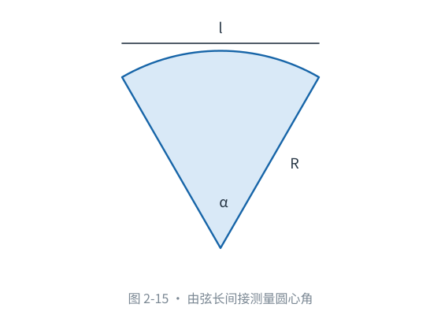
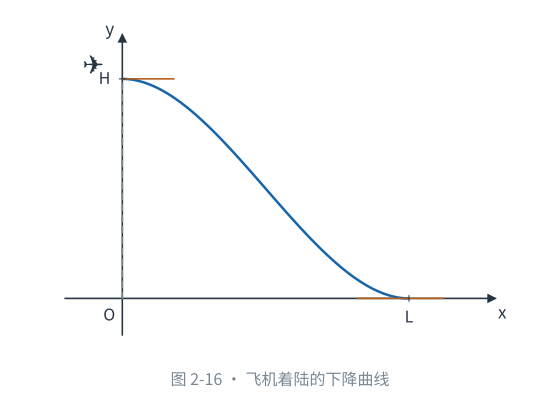

# 2-6 总习题2

## 自学入口：会套求导公式，却在分段点停住，怎么办？

> [!info] 本次新增讲解
> 可直接读下面这一步，也可跳到“教材转写与已有批注”。想继续抠一个细节时，可以停在这里；练习和复盘均为可选。

**可以先写这一行**：设 $f(x)=x^2$（$x\ge0$）、$f(x)=-x^2$（$x<0$）。求 $f'(0)$ 时先写定义中的差商 $f(h)/h$。

**为什么这样开始**：$h>0$ 时差商为 $h$，$h<0$ 时为 $-h$，两侧都趋于零，因此导数存在且为零。分段点正好是公式切换处，不能直接拿某一侧的导函数值替代定义。

**条件与边界**：先确认分段点函数值；若不连续，可直接判断不可导。这里的例子为新增练习。

> [!question]- 愿意时试一个小变化
> 若 $f(x)=|x|$，同一个启动步骤会得到什么？

> [!tip]- 展开看启动线索与解答
> 差商为 $|h|/h$，左右极限分别为 $-1$、$1$，因此零点不可导。

**继续读**：下面的教材正文 ｜ [[自学入口与探索约定#卡住时怎样继续|卡住时的提示方式]] ｜ [[🧭 学习路线图|寻找关联问题]]。

## 教材转写与已有批注

> 下方保留现有转写、页标、题号和锚点；其中可能含先前批注及转换误差，未逐页对照扫描图校订。新增示范均在上方，不作为原书例题引用。

> [!note] 正文入口
> 本文件可能从上一节的页尾开始。可用大纲跳到本节标题或“总习题”，页尾内容保留供核对。

<!--PG:136-->

> [!info]- 🔗 上半页是上一节习题的后半（内容已在上一节完整出现，此处不重复讲解）
> 直接往下看「总习题二」即可；需核对原书页面时，见本节末尾「📄 本节原书页面」折叠块。

7. 计算下列三角函数值的近似值：

(1) $\cos 29^\circ$；(2) $\tan 136^\circ$。

8. 计算下列反三角函数值的近似值：

(1) $\arcsin 0.5002$；(2) $\arccos 0.4995$。

9. 当 $|x|$ 较小时，证明下列近似公式：

(1) $\tan x \approx x$（$x$ 是角的弧度值）；(2) $\ln(1+x) \approx x$；

(3) $\sqrt[5]{1+x} \approx 1+\frac{1}{n}x$；(4) $e^x \approx 1+x$。

并计算 $\tan 45^\circ$ 和 $\ln 1.002$ 的近似值。

10. 计算下列各根式的近似值：

(1) $\sqrt[3]{996}$；(2) $\sqrt[6]{65}$。

*11. 计算球体体积时，要求精确度在 2% 以内。问这时测量直径 D 的相对误差不能超过多少？

*12. 某厂生产如图 2-15 所示的扇形板，半径 $R = 200$ mm，要求圆心角 $\alpha$ 为 55°。产品检验时，一般用测量弦长 l 的办法来间接测量圆心角 $\alpha$。如果测量弦长 l 时的误差 $\delta_l = 0.1$ mm，问由此而引起的圆心角测量误差 $\delta_\alpha$ 是多少？

**图2-15**  ^fig2_15

<!-- original-figure: up-136 2-15 -->

> 原书核对：[扫描第 136 页](../原书页面/up-136.png)。

<!-- /original-figure -->

## 总习题二

> [!tip]- 新增：这组习题的逐题详解
> [[总习题2-详细解答|打开详细解答（19 道大题）]]。包含推导、适用条件，以及必要处可展开的注释。解答按扫描原题核对，发现的转写差异在对应题目旁说明。
> 想先自己试时，可以暂不展开；全部入口见 [[课后习题详细解答]]。
1. 在“充分”“必要”和“充分必要”三者中选择一个正确的填入下列空格内：

> [!tip]- 💭 思路分析（先想再看解）
> - **题组范围**：第 1–7、15 题（导数概念、单侧导数与极限定义辨析）[cite: 6]。
> - **卡点**：面对分段点（第 6 题）、含振荡因子的函数（第 7 题）或仅知某点可导的抽象关系式（第 3、15 题），直接套用求导公式会失效或得出错误结论[cite: 6]。
> - **第一步**：凡涉及分段点可导性或抽象函数在一点的导数，一律退回定义 $\lim_{h\to 0}\frac{f(x_0+h)-f(x_0)}{h}$（分左右极限考察）；第 15 题先令 $x\to 0$ 求出 $f(1)$，再除以 $x$ 凑出 $f'(1)$ 的定义式并利用周期性转换到点 $(6, f(6))$[cite: 6]。

(1) $f(x)$ 在点 $x_{0}$ 可导是 $f(x)$ 在点 $x_{0}$ 连续的 ___ 条件，$f(x)$ 在点 $x_{0}$ 连续是 $f(x)$ 在点 $x_{0}$ 可导的 ___ 条件；

(2) $f(x)$ 在点 $x_{0}$ 的左导数 $f^{\prime}_{-}(x_{0})$ 及右导数 $f^{\prime}_{+}(x_{0})$ 都存在且相等是 $f(x)$ 在点 $x_{0}$ 可导的 ___ 条件；

(3) $f(x)$ 在点 $x_{0}$ 可导是 $f(x)$ 在点 $x_{0}$ 可微的 ___ 条件。

2. 设 $f(x)=x(x+1)(x+2)\cdots(x+n)$（$n \geqslant 2$），则 $f^{\prime}(0)=$ ___。

3. 下题中给出了四个结论，从中选出一个正确的结论：

设 $f(x)$ 在 $x=a$ 的某个邻域内有定义，则 $f(x)$ 在 $x=a$ 处可导的一个充分条件是（ ）。

(A) $\lim_{h \to \infty} h \left[ f\left(a+\frac{1}{h}\right)-f(a) \right]$ 存在。(B) $\lim_{h \to 0} \frac{f(a+2h)-f(a+h)}{h}$ 存在。

(C) $\lim_{h \to 0} \frac{f(a+h)-f(a-h)}{2h}$ 存在。(D) $\lim_{h \to 0} \frac{f(a)-f(a-h)}{h}$ 存在。

4. 设有一根细棒，取棒的一端作为原点，棒上任意点的坐标为 $x$，于是分布在区间 $[0, x]$ 上细棒的质量 $m$ 与 $x$ 存在函数关系 $m = m(x)$。应怎样确定细棒在点 $x_0$ 处的线密度（对于均匀细棒来说，单位长度细棒的质量叫做这细棒的线密度）？

<!--PG:137-->

5. 根据导数的定义，求 $f(x)=\frac{1}{x}$ 的导数。

6. 求下列函数 $f(x)$ 的 $f''(0)$ 及 $f'(0)$，又 $f'(0)$ 是否存在：

(1) $f(x)=\begin{cases} \sin x, & x<0, \\ \ln(1+x), & x \geqslant 0; \end{cases}$ (2) $f(x)=\begin{cases} \frac{x}{1+e^{\frac{1}{x}}}, & x \neq 0, \\ 0, & x=0. \end{cases}$

7. 讨论函数

$$
f(x)=\begin{cases} x\sin\frac{1}{x}, & x \neq 0, \\ 0, & x = 0 \end{cases}
$$

在 $x=0$ 处的连续性与可导性。

8. 求下列函数的导数：

> [!tip]- 💭 思路分析（先想再看解）
> - **题组范围**：第 8–10 题（复杂显函数求导与高阶导数）[cite: 6]。
> - **卡点**：直接对复杂表达式硬套四则与链式法则（如第 8(2) 题反三角套分式、第 8(5) 题幂指函数、第 10(2) 题分式求 $n$ 阶导），计算量剧增且极易算错符号[cite: 6]。
> - **第一步**：动笔求导前先做代数变形——第 8(2) 题先用三角恒等式化简，第 8(5) 题先取对数转化，第 10(2) 题先用多项式除法拆成 $-1+\frac{2}{1+x}$ 再套用基本 $n$ 阶导数公式[cite: 6]。

(1) $y=\arcsin(\sin x)$；(2) $y=\arctan \frac{1+x}{1-x}$；

(3) $y=\ln \tan \frac{x}{2}-\cos x \cdot \ln \tan x$；(4) $y=\ln(e^x+\sqrt{1+e^{2x}})$；(5) $y=\frac{1}{x^x} (x>0)$。

9. 求下列函数的二阶导数：

(1) $y=\cos^{2}x \cdot \ln x$；(2) $y=\frac{x}{\sqrt{1-x^{2}}}$。

*10. 求下列函数的 $n$ 阶导数：

(1) $y=\sqrt[n]{1+x}$；(2) $y=\frac{1-x}{1+x}$。

11. 设函数 $y=y(x)$ 由方程 $e^x + xy = e$ 所确定，求 $y''(0)$。

> [!tip]- 💭 思路分析（先想再看解）
> - **题组范围**：第 11–14、16 题（隐函数、参数方程求导与几何切线条件）[cite: 6]。
> - **卡点**：第 11 题隐函数二阶导容易忘记回代 $y'(0)$；第 12 题隐函数与参数方程混合，变量关系绕；第 13 题参数方程二阶导极易漏除以 $\frac{\mathrm{d}x}{\mathrm{d}\theta}$[cite: 6]。
> - **第一步**：第 11 题先代 $x=0$ 算出 $y(0)=1$，再逐阶求导回代；第 12 题先由 $t=0$ 算出对应 $x, y$ 值，再分别对 $t$ 求导后利用 $\frac{\mathrm{d}y}{\mathrm{d}x}=\frac{\mathrm{d}y/\mathrm{d}t}{\mathrm{d}x/\mathrm{d}t}$；第 16 题把“水平飞行”与“平稳着陆”翻译成起止点导数为零的条件列方程组[cite: 6]。

12. 设 $y = y(x)$ 是由方程 $\left\{ \begin{array}{l} e^x = 3t^2 + 2t + 1, \\ t \sin y - y + \frac{\pi}{2} = 0 \end{array} \right.$ 所确定，求 $\left.\frac{dy}{dx}\right|_{t=0}$。

13. 求下列由参数方程所确定的函数的一阶导数$\frac{dy}{dx}$及二阶导数$\frac{d^2y}{dx^2}$：

(1) $\begin{cases} x = a\cos^3\theta, \\ y = a\sin^3\theta; \end{cases}$ (2) $\begin{cases} x = \ln \sqrt{1 + t^2}, \\ y = \arctan t. \end{cases}$

14. 求曲线 $\begin{cases} x = 2e^t, \\ y = e^{-t} \end{cases}$ 在 $t=0$ 相应的点处的切线方程及法线方程。

15. 已知 $f(x)$ 是周期为 5 的连续函数，它在 $x=0$ 的某个邻域内满足关系式

$f(1+\sin x)-3f(1-\sin x)=8x+o(x)$，

且 $f(x)$ 在 $x=1$ 处可导，求曲线 $y=f(x)$ 在点 $(6, f(6))$ 处的切线方程。

16. 当正在高度 H 水平飞行的飞机开始向机场跑道下降时，如图 2-16 所示，从飞机到机场的水平地面距离为 L。假设

<!-- original-figure: up-137 2-16 -->
**图 2-16** ^fig2_16

> 原书核对：[扫描第 137 页](../原书页面/up-137.png)。

<!-- /original-figure -->

<!--PG:138-->

飞机下降的路径为三次函数 $y=ax^{3}+bx^{2}+cx+d$ 的图形，其中 $y|_{x=-b}=H, y|_{x=0}=0$。试确定飞机的降落路径。

17. 甲船以 6 km/h 的速率向东航行，乙船以 8 km/h 的速率向南航行。在中午 12:00，乙船位于甲船之北 16 km 处。问下午 1:00 两船相离的速率为多少？

> [!tip]- 💭 思路分析（先想再看解）
> - **题组范围**：第 17–19 题（相关变化率与微分近似计算）[cite: 6]。
> - **卡点**：第 17 题忽略两船航行方向垂直（构成直角三角形）以及出发 1 小时后的位置变化；第 18 题不会把 $1.02$ 拆成 $1+0.02$ 套近似公式；第 19 题混淆已知量 $\Delta T=0.05$ 与待求量 $\Delta l$[cite: 6]。
> - **第一步**：第 17 题设出发 $t$ 小时后两船距交点距离，用勾股定理列出动态距离方程 $s^2=(6t)^2+(16-8t)^2$ 再两边对 $t$ 求导；第 18、19 题直接写出微分关系 $\Delta y \approx f'(x_0)\Delta x$，第 19 题反解出 $\Delta l \approx \frac{\Delta T}{T'(l_0)}$[cite: 6]。

18. 利用函数的微分代替函数的增量求 $\sqrt[3]{1.02}$ 的近似值。

19. 已知单摆的振动周期 $T=2\pi \sqrt{\frac{l}{g}}$，其中 $g=980~cm/s^{2}$，$l$ 为摆长（单位为 cm）。设原摆长为 20 cm，为使周期 $T$ 增大 0.05 s，摆长约需加长多少？

> [!pdf]- 📄 本节原书页面（PDF 136–138 / 书页 119–121）
> ![[up-136.png]]
> ![[up-137.png]]
> ![[up-138.png]]

---
⬅️ [[2-5-函数的微分|函数的微分]] ｜ 📑 [[第二章-导数与微分|本章目录]] ｜ ➡️ [[3-1-微分中值定理|微分中值定理]]