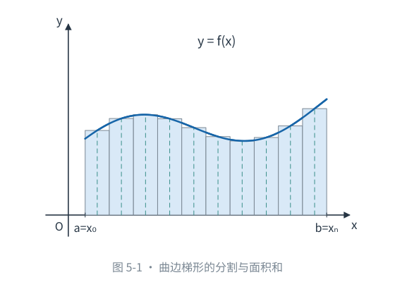
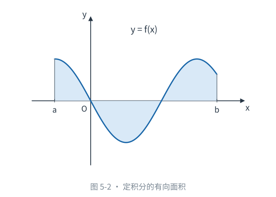
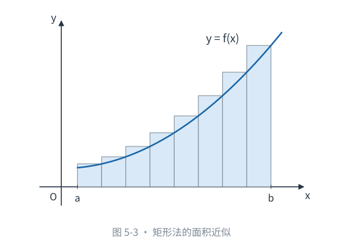
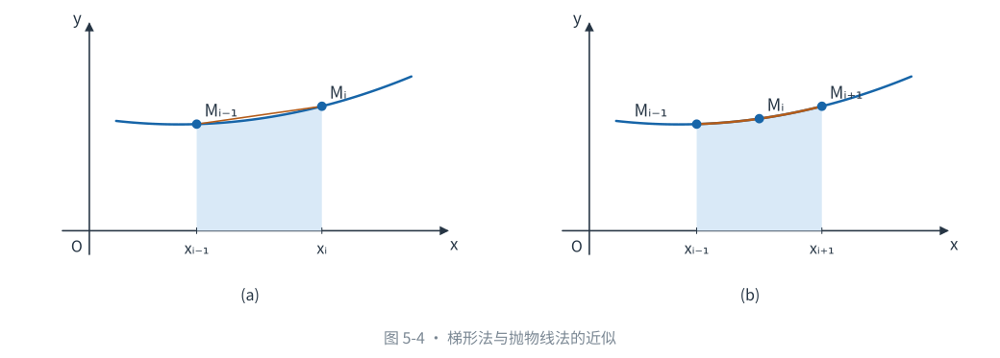

# 5-1 定积分的概念与性质

## 自学入口：定积分为什么是“先切小块再求和”？

> [!info] 本次新增讲解
> 可直接读下面这一步，也可跳到“教材转写与已有批注”。想继续抠一个细节时，可以停在这里；练习和复盘均为可选。

**卡在符号或前提时再回看**：[[1-2-数列的极限]] ｜ [[4-1-不定积分的概念与性质]]。

**可以先写这一行**：对 $f(x)=x$ 在 $[0,1]$，把区间等分成 $n$ 段，每段宽 $1/n$，取右端点高度 $k/n$。

**为什么这样开始**：矩形和为 $S_n=\sum_{k=1}^n(k/n)(1/n)=(n+1)/(2n)$，当 $n\to\infty$ 时趋于 $1/2$。我们把越来越细的近似之和的极限作为定积分；这一步还没有使用原函数。一般定义允许不等分和任意取样，可积时需得到同一个极限。

**条件与边界**：负函数值贡献负量，因此积分通常是带符号的累积，不自动等于几何面积。

> [!question]- 愿意时试一个小变化
> $\int_{-1}^1 x\,dx$ 为零，是否说明曲线与横轴之间没有面积？

> [!tip]- 展开看启动线索与解答
> 不是；左右带符号的贡献抵消。几何面积为 $\int_{-1}^1|x|dx=1$。

**继续读**：下面的教材正文 ｜ [[自学入口与探索约定#卡住时怎样继续|卡住时的提示方式]] ｜ [[🧭 学习路线图|寻找关联问题]]。

## 教材转写与已有批注

> 下方保留现有转写、页标、题号和锚点；其中可能含先前批注及转换误差，未逐页对照扫描图校订。新增示范均在上方，不作为原书例题引用。

<!--PG:236-->

本章讨论积分学的另一个基本问题——定积分问题.我们先从几何与力学问题出发引进定积分的定义,然后讨论它的性质与计算方法.关于定积分的应用,将在第六章讨论.

第一节 定积分的概念与性质

一、定积分问题举例

1. 曲边梯形的面积

设 $y = f(x)$ 在区间 $[a,b]$ 上非负、连续.由直线 $x = a, x = b, y = 0$ 及曲线 $y = f(x)$ 所围成的图形(图5-1)称为曲边梯形,其中曲线弧称为曲边.

我们知道,已知矩形的高和底,它的面积可按公式

$$
\text{矩形面积} = \text{高} \times \text{底}
$$

来定义和计算.而曲边梯形在底边上各点处的高 $f(x)$ 在区间 $[a,b]$ 上是变动的,故它的面积不能直接按上述公式来定义和计算.然而,由

**图5-1**  ^fig5_1

<!-- original-figure: up-236 5-1 -->

> 原书核对：[扫描第 236 页](../原书页面/up-236.png)。

<!-- /original-figure -->

于曲边梯形的高 $f(x)$ 在区间 $[a,b]$ 上是连续变化的,在很小一段区间上它的变化很小,近似于不变.因此,如果把区间 $[a,b]$ 划分为许多小区间,在每个小区间上用其中某一点处的高来近似代替同一个小区间上的窄曲边梯形的变高,那么,每个窄曲边梯形就可近似地看成这样得到的窄矩形.我们就以所有这些窄矩形面积之和作为曲边梯形

<!--PG:237-->

面积的近似值，并把区间$[a,b]$无限细分下去，即使每个小区间的长度都趋于零，这时所有窄矩形面积之和的极限就可定义为**曲边梯形的面积**.这个定义同时也给出了计算曲边梯形面积的方法，现详述于下：

在区间$[a,b]$中任意插入$n-1$个分点

$$
a = x_{0} < x_{1} < x_{2} < \cdots < x_{n-1} < x_{n} = b,
$$

把$[a,b]$分成$n$个小区间

$$
[x_{0},x_{1}], [x_{1},x_{2}], \cdots, [x_{n-1},x_{n}],
$$

它们的长度依次为

$$
\Delta x_{1} = x_{1} - x_{0}, \quad \Delta x_{2} = x_{2} - x_{1}, \quad \cdots, \quad \Delta x_{n} = x_{n} - x_{n-1}.
$$

经过每一个分点作平行于 y 轴的直线段，把曲边梯形分成 n 个窄曲边梯形。在每个小区间 $[x_{i-1}, x_i]$ 上任取一点 $\xi_i$，以 $[x_{i-1}, x_i]$ 为底、$f(\xi_i)$ 为高的窄矩形近似替代第 $i$ 个窄曲边梯形 ($i=1,2,\cdots,n$)，把这样得到的 $n$ 个窄矩形面积之和作为所求曲边梯形面积 $A$ 的近似值，即

$$
A \approx f(\xi_1) \Delta x_1 + f(\xi_2) \Delta x_2 + \cdots + f(\xi_n) \Delta x_n = \sum_{i=1}^{n} f(\xi_i) \Delta x_i.
$$

为了保证所有小区间的长度都无限缩小，我们要求小区间长度中的最大者趋于零，如记 $\lambda = \max\{\Delta x_1, \Delta x_2, \cdots, \Delta x_n\}$，则上述条件可表示为 $\lambda \to 0$。当 $\lambda \to 0$ 时（这时分段数 $n$ 无限增多，即 $n \to \infty$），取上述和式的极限，便得曲边梯形的面积

$$
A = \lim_{\lambda \to 0} \sum_{i=1}^{n} f(\xi_i) \Delta x_i.
$$

## 2. 变速直线运动的路程

设某物体做直线运动，已知速度 $v = v(t)$ 是时间间隔 $[T_1, T_2]$ 上 $t$ 的连续函数，且 $v(t) \geq 0$，计算在这段时间内物体所经过的路程 $s$。

我们知道，对于等速直线运动，有公式

$$
\text{路程} = \text{速度} \times \text{时间}.
$$

但是，在现在讨论的问题中，速度不是常量而是随时间变化的变量，因此，所求路程 s 不能直接按等速直线运动的路程公式来计算。然而，物体运动的速度函数 $v = v(t)$ 是连续变化的，在很短一段时间内，速度的变化很小，近似于等速。因此，如果把时间间隔分小，在小段时间内，以等速运动代替变速运动，那么，就可算出部分路程的近似值；再求和，得到整个路程的近似值；最后，通过对时间间隔无限细分的极限过程，这时所有部分路程的近似值之和的极限，就是所求变速直线运动的路程的精确值。

具体计算步骤如下：

在时间间隔 $[T_{1}, T_{2}]$ 内任意插入若干个分点

<!--PG:238-->

$$
T _ {1} = t _ {0} <  t _ {1} <  t _ {2} <  \dots <  t _ {n - 1} <  t _ {n} = T _ {2},
$$

把 $[T _ { 1 } , T _ { 2 } ]$ 分成 $n$ 个小时段

$$
\left[ t _ { 0 } , t _ { 1 } \right] , \quad \left[ t _ { 1 } , t _ { 2 } \right] , \quad \cdots , \quad \left[ t _ { n - 1 } , t _ { n } \right] ,
$$

各小时段时间的长依次为

$$
\Delta t _ {1} = t _ {1} - t _ {0}, \quad \Delta t _ {2} = t _ {2} - t _ {1}, \quad \dots , \quad \Delta t _ {n} = t _ {n} - t _ {n - 1}.
$$

相应地，在各段时间内物体经过的路程依次为

$$
\Delta s _ {1}, \quad \Delta s _ {2}, \quad \dots , \quad \Delta s _ {n}.
$$

在时间间隔 $[t_{i-1}, t_i]$ 上任取一个时刻 $\tau_i$ ($t_{i-1} \leqslant \tau_i \leqslant t_i$)，以 $\tau_i$ 时的速度 $v(\tau_i)$ 来代替 $[t_{i-1}, t_i]$ 上各个时刻的速度，得到部分路程 $\Delta s_i$ 的近似值，即

$$
\Delta s _ {i} \approx v (\tau_ {i}) \Delta t _ {i} (i = 1, 2, \dots , n).
$$

于是这 $n$ 段部分路程的近似值之和就是所求变速直线运动路程 $s$ 的近似值，即

$$
s \approx v (\tau_ {1}) \Delta t _ {1} + v (\tau_ {2}) \Delta t _ {2} + \dots + v (\tau_ {n}) \Delta t _ {n} = \sum_ {i = 1} ^ {n} v (\tau_ {i}) \Delta t _ {i}.
$$

记  $\lambda=\max\{\Delta t_{1},\Delta t_{2},\cdots,\Delta t_{n}\}$ ，当  $\lambda\to0$  时，取上述和式的极限，即得变速直线运动的路程

$$
s = \lim _ {\lambda \rightarrow 0} \sum_ {i = 1} ^ {n} v (\tau_ {i}) \Delta t _ {i}.
$$

## 二、定积分的定义

从上面两个例子可以看到：所要计算的量，即曲边梯形的面积 A 及变速直线运动的路程 s 的实际意义虽然不同，前者是几何量，后者是物理量，但是它们都由一个函数及其自变量的变化区间所决定，如：

曲边梯形的高度 $y=f(x)$ 及其底边上的点 x 的变化区间 $[a, b]$，

直线运动的速度 $v=v(t)$ 及时间 t 的变化区间 $[T_{1}, T_{2}]$.

其次，计算这些量的方法与步骤都是相同的，并且它们都归结为具有相同结构的一种特定和的极限，如

$$
\text {面积} A = \lim _ {\lambda \rightarrow 0} \sum_ {i = 1} ^ {n} f (\xi_ {i}) \Delta x _ {i},
$$

$$
\text {路程} s = \lim _ {\lambda \rightarrow 0} \sum_ {i = 1} ^ {n} v (\tau_ {i}) \Delta t _ {i}.
$$

抛开这些问题的具体意义，抓住它们在数量关系上共同的本质与特性加以概括，我们就可以抽象出下述定积分的定义：

> [!definition]+ 定义
> 设函数 $f(x)$ 在 $[a,b]$ 上有界，在 $[a,b]$ 中任意插入若干个分点
> $$
> a = x _ {0} <  x _ {1} <  x _ {2} <  \dots <  x _ {n - 1} <  x _ {n} = b,
> $$
> 把区间$[a,b]$分成$n$个小区间
> ^d5-1-1

<!--PG:239-->

$$
[x_{0},x_{1}],\quad[x_{1},x_{2}],\quad\cdots,\quad[x_{n-1},x_{n}],
$$

各个小区间的长度依次为

$$
\Delta x_{1}=x_{1}-x_{0}, \quad \Delta x_{2}=x_{2}-x_{1}, \quad \cdots, \quad \Delta x_{n}=x_{n}-x_{n-1}.
$$

在每个小区间 $[x_{i-1}, x_i]$ 上任取一点 $\xi_i$ ($x_{i-1} \leqslant \xi_i \leqslant x_i$)，作函数值 $f(\xi_i)$ 与小区间长度 $\Delta x_i$ 的乘积 $f(\xi_i) \Delta x_i (i = 1, 2, \cdots, n)$，并作出和

$$
S = \sum_{i=1}^{n} f(\xi_i) \Delta x_i. \tag{1-1}
$$

记 $\lambda = \max\{\Delta x_1, \Delta x_2, \cdots, \Delta x_n\}$，如果当 $\lambda \to 0$ 时，这和的极限总存在，且与闭区间 $[a, b]$ 的分法及点 $\xi_i$ 的取法无关，那么称这个极限 $I$ 为函数 $f(x)$ 在区间 $[a, b]$ 上的定积分（简称积分），记作 $\int_a^b f(x) \, dx$，即

$$
\int_{a}^{b} f(x) \, dx = I = \lim_{\lambda \to 0} \sum_{i=1}^{n} f(\xi_i) \Delta x_i, \tag{1-2}
$$

其中 $f(x)$ 叫做被积函数，$f(x)\mathrm{d}x$ 叫做被积表达式，$x$ 叫做积分变量，$a$ 叫做积分下限，$b$ 叫做积分上限，$[a,b]$ 叫做积分区间。

利用“$\varepsilon-\delta$”的说法，上述定积分的定义可以表述如下：

设有常数 $I$，如果对于任意给定的正数 $\varepsilon$，总存在一个正数 $\delta$，使得对于区间 $[a, b]$ 的任何分法，不论 $\xi_i$ 在 $[x_{i-1}, x_i]$ 中怎样选取，只要 $\lambda = \max\{\Delta x_1, \Delta x_2, \cdots, \Delta x_n\} < \delta$，总有

$$
\left| \sum_{i=1}^{n} f(\xi_i) \Delta x_i - I \right| < \varepsilon
$$

成立，那么称 $I$ 是 $f(x)$ 在区间 $[a, b]$ 上的定积分，记作 $\int_{a}^{b} f(x) \, dx$.

注意 当和式 $\sum_{i=1}^{n} f(\xi_i) \Delta x_i$ 的极限存在时，其极限 $I$ 仅与被积函数 $f(x)$ 及积分区间 $[a, b]$ 有关。如果既不改变被积函数 $f$，也不改变积分区间 $[a, b]$，而只把积分变量 $x$ 改写成其他字母，例如 $t$ 或 $u$，那么，这时和的极限 $I$ 不变，也就是定积分的值不变，即

$$
\int_{a}^{b} f(x) \, \mathrm{d}x = \int_{a}^{b} f(t) \, \mathrm{d}t = \int_{a}^{b} f(u) \, \mathrm{d}u.
$$

这就是说，定积分的值只与被积函数及积分区间有关，而与积分变量的记法无关。

和式  $\sum_{i=1}^{n} f(\xi_{i}) \Delta x_{i}$  通常称为  $f(x)$  的积分和. 如果  $f(x)$  在  $[a, b]$  上的定积分存在，那么就说  $f(x)$  在  $[a, b]$  上可积.

对于定积分，有这样一个重要问题：函数 $f(x)$ 在 $[a, b]$ 上满足怎样的条件，$f(x)$ 在 $[a, b]$ 上一定可积？这个问题我们不作深入讨论，而只给出以下两个充分条件：

> [!theorem]+ 定理1
> 设 $f(x)$ 在区间 $[a,b]$ 上连续，则 $f(x)$ 在 $[a,b]$ 上可积. ^t5-1-1

<!--PG:240-->

> [!theorem]+ 定理2
> 设 $f(x)$ 在区间 $[a,b]$ 上有界，且只有有限个间断点，则 $f(x)$ 在 $[a,b]$ 上可积. ^t5-1-2

利用定积分的定义，前面所讨论的两个实际问题可以分别表述如下：

曲线 $y = f(x)$ ($f(x) \geqslant 0$)、$x$ 轴及两条直线 $x = a, x = b$ 所围成的曲边梯形的面积 $A$ 等于函数 $f(x)$ 在区间 $[a,b]$ 上的定积分，即

$$
A = \int_{a}^{b} f(x) \, dx.
$$

物体以变速 $v = v(t)$ ($v(t) \geqslant 0$) 做直线运动，从时刻 $t = T_1$ 到时刻 $t = T_2$，这物体经过的路程 $s$ 等于函数 $v(t)$ 在区间 $[T_1, T_2]$ 上的定积分，即

$$
s = \int_{T_1}^{T_2} v(t) \, dt.
$$

下面讨论定积分的几何意义。在 $[a, b]$ 上 $f(x) \geqslant 0$ 时，我们已经知道，定积分 $\int_{a}^{b} f(x) \, dx$ 表示由曲线 $y = f(x)$，两条直线 $x = a, x = b$ 与 $x$ 轴所围成的曲边梯形的面积；在 $[a, b]$ 上 $f(x) \leqslant 0$ 时，由曲线 $y = f(x)$，两条直线 $x = a, x = b$ 与 $x$ 轴所围成的曲边梯形位于 $x$ 轴的下方，定积分

$$
\int_{a}^{b} f(x) \, dx
$$

表示上述曲边梯形面积的负值；在 $[a, b]$ 上 $f(x)$ 既取得正值又取得负值时，函数 $f(x)$ 的图形某些部分在 $x$ 轴的上方，而其他部分在 $x$ 轴下方（图 5-2），此时定积分 $\int_{a}^{b} f(x) \, dx$ 表示 $x$ 轴上方图形面积减去 $x$ 轴下方图形面积所得之差.

**图5-2**  ^fig5_2

<!-- original-figure: up-240 5-2 -->

> 原书核对：[扫描第 240 页](../原书页面/up-240.png)。

<!-- /original-figure -->

最后，举一个按定义计算定积分的例子.

**例1** 利用定义计算定积分 $\int_{0}^{1} x^{2} \mathrm{d}x.$ ^e5-1-1

解 因为被积函数 $f(x)=x^{2}$ 在积分区间 $[0,1]$ 上连续，而连续函数是可积的，所以积分与区间 $[0,1]$ 的分法及点 $\xi_{i}$ 的取法无关。因此，为了便于计算，不妨把区间 $[0,1]$ 分成 n 等份，分点为 $x_{i}=\frac{i}{n}, i=1,2,\cdots,n-1$。这样，每个小区间 $[x_{i-1}, x_{i}]$ 的长度 $\Delta x_{i}=\frac{1}{n}$，$i=1,2,\cdots,n$。取 $\xi_{i}=x_{i}, i=1,2,\cdots,n$。于是，得和式

$$
\sum_{i=1}^{n} f(\xi_i) \Delta x_i = \sum_{i=1}^{n} \xi_i^2 \Delta x_i = \sum_{i=1}^{n} x_i^2 \Delta x_i = \sum_{i=1}^{n} \left( \frac{i}{n} \right)^2 \cdot \frac{1}{n} = \frac{1}{n^3} \sum_{i=1}^{n} i^2
$$

<!--PG:241-->

$$
= \frac {1}{n ^ {3}} \cdot \frac {1}{6} n (n + 1) (2 n + 1) \text{①} = \frac {1}{6} \left(1 + \frac {1}{n}\right) \left(2 + \frac {1}{n}\right).
$$

当 $\lambda \to 0$ 即 $n \to \infty$ 时，取上式右端的极限。由定积分的定义，即得所要计算的积分为

$$
\int_ {0} ^ {1} x ^ {2} \mathrm{d} x = \lim _ {\lambda \rightarrow 0} \sum_ {i = 1} ^ {n} \xi_ {i} ^ {2} \Delta x _ {i} = \lim _ {n \rightarrow \infty} \frac {1}{6} \left(1 + \frac {1}{n}\right) \left(2 + \frac {1}{n}\right) = \frac {1}{3}.
$$

## 三、定积分的近似计算

从例1的计算过程中可以看到，对于任一确定的正整数n，积分和

$$
\sum_ {i = 1} ^ {n} f (\xi_ {i}) \Delta x _ {i} = \frac {1}{6} \left(1 + \frac {1}{n}\right) \left(2 + \frac {1}{n}\right)
$$

都是定积分  $\int_{0}^{1}x^{2}dx$  的近似值。当 n 取不同值时，可得到定积分  $\int_{0}^{1}x^{2}dx$  精度不同的近似值。一般说来，n 取得越大，近似程度越好。

下面就一般情形，讨论定积分的近似计算问题。设 $f(x)$ 在 $[a, b]$ 上连续，这时定积分 $\int_{a}^{b} f(x) \, dx$ 存在。如同例1，采取把区间 $[a, b]$ 等分的分法，即用分点 $a = x_0, x_1, x_2, \cdots, x_n = b$ 将 $[a, b]$ 分成 $n$ 个长度相等的小区域，每个小区间的长为

$$
\Delta x = \frac {b - a}{n},
$$

在小区间 $[x_{i-1}, x_i]$ 上，取 $\xi_i = x_{i-1}$，应有

① 利用恒等式 $(n+1)^{3}=n^{3}+3n^{2}+3n+1$，得

$$
\left\{ \begin{array}{l} (n + 1) ^ {3} - n ^ {3} = 3 n ^ {2} + 3 n + 1, \\ n ^ {3} - (n - 1) ^ {3} = 3 (n - 1) ^ {2} + 3 (n - 1) + 1, \\ \dots \dots \\ 3 ^ {3} - 2 ^ {3} = 3 \times 2 ^ {2} + 3 \times 2 + 1, \\ 2 ^ {3} - 1 ^ {3} = 3 \times 1 ^ {2} + 3 \times 1 + 1. \end{array} \right.
$$

把这 n 个等式两端分别相加，得

$$
(n + 1) ^ {3} - 1 = 3 (1 ^ {2} + 2 ^ {2} + \dots + n ^ {2}) + 3 (1 + 2 + \dots + n) + n.
$$

由于 $1+2+\cdots+n=\frac{1}{2}n(n+1)$，代入上式，得

$$
n ^ {3} + 3 n ^ {2} + 3 n = 3 (1 ^ {2} + 2 ^ {2} + \dots + n ^ {2}) + \frac {3}{2} n (n + 1) + n.
$$

整理后，得

$$
1 ^ {2} + 2 ^ {2} + \dots + n ^ {2} = \frac {1}{6} n (n + 1) (2 n + 1).
$$

<!--PG:242-->

$$
\int_ {a} ^ {b} f (x) \mathrm{d} x = \lim _ {n \to \infty} \frac {b - a}{n} \sum_ {i = 1} ^ {n} f (x _ {i - 1}),
$$

从而对于任一确定的正整数 $n$ ，有

$$
\int_ {a} ^ {b} f (x) \mathrm{d} x \approx \frac {b - a}{n} \sum_ {i = 1} ^ {n} f (x _ {i - 1}).
$$

记 $f(x_{i})=y_{i}$ （ $i=0,1,2,\cdots,n$ ），上式可记作

$$
\int_ {a} ^ {b} f (x) \mathrm{d} x \approx \frac {b - a}{n} (y _ {0} + y _ {1} + \dots + y _ {n - 1}). \tag{1-3}
$$

如果取 $\xi_{i}=x_{i}$，则可得近似公式

$$
\int_ {a} ^ {b} f (x) \mathrm{d} x \approx \frac {b - a}{n} (y _ {1} + y _ {2} + \dots + y _ {n}). \tag{1-4}
$$

以上求定积分近似值的方法称为**矩形法**，公式(1-3)、(1-4)称为矩形法公式。

矩形法的几何意义是：用窄条矩形的面积作为窄条曲边梯形面积的近似值。整体上用台阶形的面积作为曲边梯形面积的近似值。如图5-3所示。

求定积分近似值的方法，常用的还有梯形法和抛物线法（又称辛普森（Simpson）法），简单介绍如下：

**图5-3**  ^fig5_3

<!-- original-figure: up-242 5-3 -->

> 原书核对：[扫描第 242 页](../原书页面/up-242.png)。

<!-- /original-figure -->

和矩形法一样，将区间 $[a,b]n$ 等分。设 $f(x_{i})=y_{i}$，曲线 $y=f(x)$ 上的点 $(x_{i},y_{i})$ 记作 $M_{i} (i=0,1,2,\cdots,n)$。

梯形法的原理是：将曲线 $y=f(x)$ 上的小弧段 $\widehat{M_{i-1}M_i}$ 用直线段 $\overline{M_{i-1}M_i}$ 代替，也就是把窄条曲边梯形用窄条梯形代替（图 5-4(a)），由此得到定积分的近似值为

<!-- original-figure: up-243 5-4 -->
**图 5-4** ^fig5_4

> 原书核对：[扫描第 243 页](../原书页面/up-243.png)。

<!-- /original-figure -->

$$
\begin{array}{r l} \int_ {a} ^ {b} f (x) \mathrm{d} x & \approx \frac {b - a}{n} \left(\frac {y _ {0} + y _ {1}}{2} + \frac {y _ {1} + y _ {2}}{2} + \dots + \frac {y _ {n - 1} + y _ {n}}{2}\right) \\ & = \frac {b - a}{n} \left(\frac {y _ {0} + y _ {n}}{2} + y _ {1} + y _ {2} + \dots + y _ {n - 1}\right). \end{array} \tag{1-5}
$$

显然，梯形法公式(1-5)所得近似值就是矩形法公式(1-3)和(1-4)所得两个近似值的平均值。

抛物线法的原理是：将曲线 $y=f(x)$ 上的两个小弧段 $\widehat{M_{i-1}M_i}$ 和 $\widehat{M_iM_{i+1}}$ 合起来，用过 $M_{i-1}, M_i, M_{i+1}$ 三点的抛物线 $y=px^2+qx+r$ ($p \neq 0$) 代替（图 5-4(b)）。经推导可得，以此抛物线弧段为曲边、以 $[x_{i-1}, x_{i+1}]$ 为底的曲边梯形面积为

$$
\frac {1}{6} (y _ {i - 1} + 4 y _ {i} + y _ {i + 1}) \cdot 2 \Delta x = \frac {b - a}{3 n} (y _ {i - 1} + 4 y _ {i} + y _ {i + 1}).
$$

<!--PG:243-->

取 $n$ 为偶数，得到定积分的近似值为

$$
\begin{array}{r l} \int_ {a} ^ {b} f (x) \mathrm{d} x & \approx \frac {b - a}{3 n} [ (y _ {0} + 4 y _ {1} + y _ {2}) + (y _ {2} + 4 y _ {3} + y _ {4}) + \dots + (y _ {n - 2} + 4 y _ {n - 1} + y _ {n}) ] \\ & = \frac {b - a}{3 n} [ y _ {0} + y _ {n} + 4 (y _ {1} + y _ {3} + \dots + y _ {n - 1}) + 2 (y _ {2} + y _ {4} + \dots + y _ {n - 2}) ]. \end{array} \tag {1-6}
$$

**例2** 按梯形法公式(1-5)和抛物线法公式(1-6)计算定积分 $\int_{0}^{1}\frac{4}{1+x^2}\mathrm{d}x$ 的近似值（取 $n=10$，计算时取5位小数）. ^e5-1-2

解 计算 $y_{i}$ 并列表：

| i | xᵢ | yᵢ |
|---|---|---|
| 0 | 0.0 | 4.000 00 |
| 1 | 0.1 | 3.960 40 |
| 2 | 0.2 | 3.846 15 |
| 3 | 0.3 | 3.669 72 |
| 4 | 0.4 | 3.448 28 |
| 5 | 0.5 | 3.200 00 |
| 6 | 0.6 | 2.941 18 |
| 7 | 0.7 | 2.684 56 |
| 8 | 0.8 | 2.439 02 |
| 9 | 0.9 | 2.209 94 |
| 10 | 1.0 | 2.000 00 |

按梯形法公式(1-5)求得近似值为

$$
S _ {1} = 3. 1 3 9 9 3,
$$

按抛物线法公式(1-6)求得近似值为

$$
S _ {2} = 3. 1 4 1 5 9.
$$

### 习题5-1

> [!tip]- 新增：这组习题的逐题详解
> [[习题5-1-详细解答|打开详细解答（13 道大题）]]。包含推导、适用条件，以及必要处可展开的注释。解答按扫描原题核对，发现的转写差异在对应题目旁说明。
> 想先自己试时，可以暂不展开；全部入口见 [[课后习题详细解答]]。

1. 利用定积分的定义计算由抛物线 $y=x^{2}+1$、两直线 $x=a$、$x=b$ ($b>a$) 及 $x$ 轴所围成的图形的面积.

2. 利用定积分的定义计算下列积分：

(1) $\int_{a}^{b} x \, dx$ ($a < b$); (2) $\int_{0}^{1} e^{x} \, dx$.

3. 利用定积分的几何意义，证明下列等式：

(1) $\int_{0}^{1}2xdx = 1;$ (2) $\int_{0}^{1}\sqrt{1-x^{2}} \, dx=\frac{\pi}{4};$

(3) $\int_{-\pi}^{\pi}\sin x \, dx = 0;$ (4) $\int_{-\frac{\pi}{2}}^{\frac{\pi}{2}}\cos x \, dx=2\int_{0}^{\frac{\pi}{2}}\cos x \, dx.$

4. 利用定积分的几何意义，求下列积分：

(1) $\int_{0}^{1}x \, dx$ ($t>0$); (2) $\int_{-2}^{a}\left(\frac{x}{2}+3\right) \, dx;$

(3) $\int_{-1}^{2}|x|dx;$ (4) $\int_{-3}^{3}\sqrt{9-x^{2}}dx.$

5. 设 $a<b$，问 $a,b$ 取什么值时，积分 $\int_{a}^{b}(x-x^{2})dx$ 取得最大值？

6. 试从定积分的几何意义，说明以下等式成立：

$$
\int_{1}^{e}\ln x dx + \int_{0}^{1}e^{x}dx = e.
$$

7. 已知 $\ln 2 = \int_{0}^{1} \frac{1}{1+x} dx$，试用抛物线法公式 (1-6)，求出 $\ln 2$ 的近似值（取 $n=10$，计算时取 4 位小数）.

8. 设 $\int_{-1}^{1} 3f(x) \, dx = 18, \int_{-1}^{3} f(x) \, dx = 4, \int_{-1}^{3} g(x) \, dx = 3$. 求：

(1) $\int_{-1}^{1} f(x) \, dx;$ (2) $\int_{1}^{3} f(x) \, dx;$

(3) $\int_{3}^{-1} g(x) \, dx;$ (4) $\int_{-1}^{3} \frac{1}{5}[4f(x) + 3g(x)] \, dx.$

9. 证明定积分的性质：

(1) $\int_{a}^{b} k f(x) \, dx = k \int_{a}^{b} f(x) \, dx$ ($k$ 是常数); (2) $\int_{a}^{b} 1 \cdot dx = \int_{a}^{b} dx = b - a.$

10. 估计下列各积分的值：

(1) $\int_{1}^{a} (x^{2} + 1) \, dx;$ (2) $\int_{\frac{\pi}{4}}^{\frac{5}{4} + \pi} (1 + \sin^{2} x) \, dx;$

(3) $\int_{\frac{\pi}{\sqrt{3}}}^{\sqrt{3}} x \arctan x \, dx;$ (4) $\int_{2}^{0} e^{x^{2} - x} \, dx.$

11. 设 $f(x)$ 在 $[0,1]$ 上连续，证明 $\int_{0}^{1} f^{2}(x) \, dx \geqslant \left[\int_{0}^{1} f(x) \, dx\right]^{2}.$

12. 设 $f(x)$ 及 $g(x)$ 在 $[a,b]$ 上连续，证明：

(1) 若在 $[a,b]$ 上，$f(x) \geqslant 0$，且 $f(x) \neq 0$，则 $\int_{a}^{b} f(x) \, dx > 0$;

(2) 若在 $[a,b]$ 上，$f(x) \geqslant 0$，且 $\int_{a}^{b} f(x) \, dx = 0$，则在 $[a,b]$ 上 $f(x) \equiv 0$;

(3) 若在 $[a,b]$ 上，$f(x) \leqslant g(x)$，且 $\int_{a}^{b} f(x) \, dx = \int_{a}^{b} g(x) \, dx$，则在 $[a,b]$ 上 $f(x) \equiv g(x)$.

13. 根据定积分的性质及第 12 题的结论，说明下列各对积分中哪一个的值较大：

(1) $\int_{0}^{1} x^{2} \, dx$ 还是 $\int_{0}^{1} x^{3} \, dx?$ (2) $\int_{1}^{2} x^{2} \, dx$ 还是 $\int_{1}^{2} x^{3} \, dx?$

(3) $\int_{1}^{2} \ln x \, dx$ 还是 $\int_{1}^{2} (\ln x)^{2} \, dx?$ (4) $\int_{0}^{1} x \, dx$ 还是 $\int_{0}^{1} \ln (1+x) \, dx?$

(5) $\int_{0}^{1} e^{x} \, dx$ 还是 $\int_{0}^{1} (1+x) \, dx?$

> [!pdf]- 📄 本节原书页面（PDF 236–243 / 书页 219–226）
> ![[up-236.png]]
> ![[up-237.png]]
> ![[up-238.png]]
> ![[up-239.png]]
> ![[up-240.png]]
> ![[up-241.png]]
> ![[up-242.png]]
> ![[up-243.png]]

---
⬅️ [[4-6-总习题4|总习题4]] ｜ 📑 [[第五章-定积分|本章目录]] ｜ ➡️ [[5-2-微积分基本公式|微积分基本公式]]
