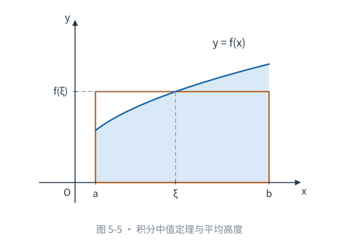
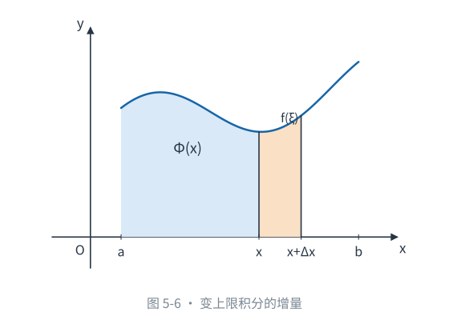
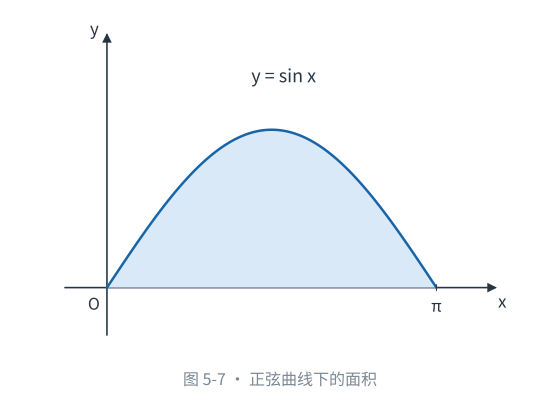
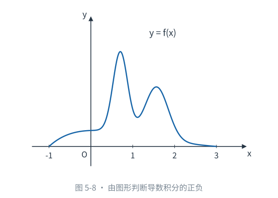

# 5-2 微积分基本公式

## 自学入口：积分与求原函数之间，究竟是谁把它们连起来？

> [!info] 本次新增讲解
> 可直接读下面这一步，也可跳到“教材转写与已有批注”。想继续抠一个细节时，可以停在这里；练习和复盘均为可选。

**卡在符号或前提时再回看**：[[5-1-定积分的概念与性质]] ｜ [[4-1-不定积分的概念与性质]]。

**可以先写这一行**：对 $G(x)=\int_0^x t^2dt$，先把 $G(x+h)-G(x)$ 写成 $\int_x^{x+h}t^2dt$。

**为什么这样开始**：再除以 $h$：它表示短区间上的平均函数值；由被积函数的连续性，$h\to0$ 时趋于 $x^2$。所以 $G'(x)=x^2$，累积函数成为原函数。这座桥才允许用 $F(b)-F(a)$ 计算定积分。

**条件与边界**：变上限公式要看被积函数在所讨论点的连续性；积分中的哑变量 $t$ 与上限 $x$ 角色不同。

> [!question]- 愿意时试一个小变化
> 若 $H(x)=\int_0^{x^2}t^2dt$，导数是什么？

> [!tip]- 展开看启动线索与解答
> 先对上限求导得 $(x^2)^2$，再乘上限的导数 $2x$，所以 $H'(x)=2x^5$。

**继续读**：下面的教材正文 ｜ [[自学入口与探索约定#卡住时怎样继续|卡住时的提示方式]] ｜ [[🧭 学习路线图|寻找关联问题]]。

## 教材转写与已有批注

> 下方保留现有转写、页标、题号和锚点；其中可能含先前批注及转换误差，未逐页对照扫描图校订。新增示范均在上方，不作为原书例题引用。

> [!note] 正文入口
> 本文件可能从上一节的页尾开始。可用大纲跳到本节标题或“总习题”，页尾内容保留供核对。

<!--PG:244-->

本例所给积分的精确值为

$$
\int_{0}^{1} \frac{4}{1 + x^2} \mathrm{d}x = \pi = 3.1415926 \cdots,
$$

用 $S_2$ 作为所给积分的近似值，误差小于 $10^{-5}$。

计算定积分的近似值的方法很多，这里不再作介绍。随着计算机应用的普及，定积分的近似计算已变得更为方便，现在已有很多现成的数学软件可用于定积分的近似计算。

## 四、定积分的性质

为了以后计算及应用方便起见，对定积分作以下两点补充规定：

(1) 当 $b = a$ 时，$\int_{a}^{a} f(x) \, dx = 0$;

(2) 当 $a > b$ 时，$\int_{a}^{b} f(x) \, dx = -\int_{b}^{a} f(x) \, dx.$

由上式可知，交换定积分的上、下限时，定积分的绝对值不变而符号相反。

下面讨论定积分的性质。下列各性质中积分上、下限的大小，如不特别指明，均不加限制，并假定各性质中所出现的被积函数在积分区间上都是可积的。

> [!property]+ 性质1
> 设 $\alpha$ 与 $\beta$ 均为常数，则
> $$
> \int_{a}^{b}[\alpha f(x) + \beta g(x)]\,dx = \alpha \int_{a}^{b}f(x)\,dx + \beta \int_{a}^{b}g(x)\,dx.
> $$
> ^d5-2-1

证

$$
\begin{array}{l} \int_ {a} ^ {b} [ \alpha f (x) + \beta g (x) ] \mathrm {d} x = \lim _ {\lambda \rightarrow 0} \sum_ {i = 1} ^ {n} [ \alpha f (\xi_ {i}) + \beta g (\xi_ {i}) ] \Delta x _ {i} \\ = \lim _ {\lambda \rightarrow 0} \alpha \sum_ {i = 1} ^ {n} f (\xi_ {i}) \Delta x _ {i} + \lim _ {\lambda \rightarrow 0} \beta \sum_ {i = 1} ^ {n} g (\xi_ {i}) \Delta x _ {i} \\ = \alpha \int_ {a} ^ {b} f (x) \mathrm {d} x + \beta \int_ {a} ^ {b} g (x) \mathrm {d} x. \\ \end{array}
$$

对于任意有限个函数的线性组合，性质1 也是成立的.

> [!property]+ 性质2
> 设 $a<c<b$，则
> $$
> \int_{a}^{b} f(x) \, \mathrm{d}x = \int_{a}^{c} f(x) \, \mathrm{d}x + \int_{c}^{b} f(x) \, \mathrm{d}x.
> $$
> ^d5-2-2

证 因为函数 $f(x)$ 在区间 $[a,b]$ 上可积，所以不论把 $[a,b]$ 怎样分，积分和的极限总是不变的。因此，在分区间时，可以使 $c$ 永远是个分点。那么，$[a,b]$ 上的积分和等于 $[a,c]$ 上的积分和加 $[c,b]$ 上的积分和，记为

$$
\sum_{[a,b]} f(\xi_i) \Delta x_i = \sum_{[a,c]} f(\xi_i) \Delta x_i + \sum_{[c,b]} f(\xi_i) \Delta x_i.
$$

令 $\lambda \to 0$，上式两端同时取极限，即得

<!--PG:245-->

$$
\int_{a}^{b}f(x)\,\mathrm{d}x = \int_{a}^{c}f(x)\,\mathrm{d}x + \int_{c}^{b}f(x)\,\mathrm{d}x.
$$

这个性质表明定积分对于积分区间具有**可加性**.

按定积分的补充规定，我们有：不论 $a,b,c$ 的相对位置如何，总有等式

$$
\int_{a}^{b} f(x) \, \mathrm{d}x = \int_{a}^{c} f(x) \, \mathrm{d}x + \int_{c}^{b} f(x) \, \mathrm{d}x
$$

成立.例如,当 $a < b < c$ 时,由于

$$
\int_{a}^{c} f(x) \, \mathrm{d}x = \int_{a}^{b} f(x) \, \mathrm{d}x + \int_{b}^{c} f(x) \, \mathrm{d}x,
$$

于是得

$$
\int_{a}^{b} f(x) \, \mathrm{d}x = \int_{a}^{c} f(x) \, \mathrm{d}x - \int_{b}^{c} f(x) \, \mathrm{d}x = \int_{a}^{c} f(x) \, \mathrm{d}x + \int_{c}^{b} f(x) \, \mathrm{d}x.
$$

> [!property]+ 性质3
> 如果在区间  $[a, b]$  上  $f(x) \equiv 1$ ，那么
> $$
> \int_{a}^{b} 1 \, \mathrm{d}x = \int_{a}^{b} \mathrm{d}x = b - a.
> $$
> 这个性质的证明请读者自己完成.
> ^d5-2-3

> [!property]+ 性质4
> 如果在区间 $[a, b]$ 上 $f(x) \geqslant 0$，那么
> $$
> \int_{a}^{b} f(x) \, \mathrm{d}x \geqslant 0 \quad (a < b).
> $$
> ^d5-2-4

证 因为 $f(x) \geqslant 0$，所以

$$
f(\xi_i) \geqslant 0 \quad (i=1,2,\cdots,n).
$$

又由于  $\Delta x_{i} \geqslant 0 (i=1,2,\cdots,n)$ ，因此

$$
\sum_{i=1}^{n} f(\xi_i) \Delta x_i \geqslant 0,
$$

令 $\lambda = \max\{\Delta x_1, \Delta x_2, \cdots, \Delta x_n\} \to 0$，便得要证的不等式.

> [!note]+ 推论1
> 如果在区间 $[a, b]$ 上 $f(x) \leqslant g(x)$，那么.
> $$
> \int_{a}^{b} f(x) \mathrm{d}x \leqslant \int_{a}^{b} g(x) \mathrm{d}x \quad (a < b).
> $$
> ^t5-2-1

证 因为 $g(x) - f(x) \geqslant 0$，由性质 4 得

$$
\int_{a}^{b} [g(x) - f(x)] \, \mathrm{d}x \geqslant 0.
$$

再利用性质1，便得要证的不等式.

> [!note]+ 推论2
> $\left|\int_{a}^{b}f(x)\mathrm{d}x\right|\leqslant\int_{a}^{b}|f(x)|\mathrm{d}x\quad(a<b).$ ^t5-2-2

证 因为

$$
-|f(x)| \leqslant f(x) \leqslant |f(x)|,
$$

所以由推论1及性质1可得

<!--PG:246-->

$$
-\int_{a}^{b}|f(x)|\mathrm{d}x \leqslant \int_{a}^{b}f(x)\mathrm{d}x \leqslant \int_{a}^{b}|f(x)|\mathrm{d}x,
$$

即

$$
\left|\int_{a}^{b} f(\cdot) \mathrm{d} x\right| \leqslant \int_{a}^{b}|f(x)| \mathrm{d} x.
$$

> [!property]+ 性质5
> 设 $M$ 及 $m$ 分别是函数 $f(x)$ 在区间 $[a, b]$ 上的最大值及最小值，则
> $$
> m (b - a) \leqslant \int_ {a} ^ {b} f (x) \mathrm{d} x \leqslant M (b - a) \quad (a <  b).
> $$
> ^d5-2-5

证 因为 $m \leqslant f(x) \leqslant M$，所以由性质 4 的推论 1，得

$$
\int_{a}^{b} m \mathrm{d}x \leqslant \int_{a}^{b} f(x) \mathrm{d}x \leqslant \int_{a}^{b} M \mathrm{d}x.
$$

再由性质1及性质3，即得所要证的不等式.

这个性质说明，由被积函数在积分区间上的最大值及最小值，可以估计积分值的大致范围。例如，定积分 $\int_{\frac{1}{2}}^{1} x^4 \, dx$，它的被积函数 $f(x) = x^4$ 在积分区间 $\left[\frac{1}{2}, 1\right]$ 上是单调增加的，于是有最小值 $m = \left(\frac{1}{2}\right)^4 = \frac{1}{16}$、最大值 $M = (1)^4 = 1$。由性质5，得

$$
\frac {1}{1 6} \times \left(1 - \frac {1}{2}\right) \leqslant \int_ {\frac {1}{2}} ^ {1} x ^ {4} \mathrm{d} x \leqslant 1 \times \left(1 - \frac {1}{2}\right),
$$

即

$$
\frac {1}{3 2} \leqslant \int_ {\frac {1}{2}} ^ {1} x ^ {4} \mathrm{d} x \leqslant \frac {1}{2}.
$$

> [!property]+ 性质6（定积分中值定理）
> 如果函数 $f(x)$ 在积分区间 $[a,b]$ 上连续，那么在 $[a,b]$ 上至少存在一个点 $\xi$，使下式成立：
> $$
> \int_{a}^{b} f(x) \mathrm{d}x = f(\xi)(b - a) \quad (a \leqslant \xi \leqslant b).
> $$
> 这个公式叫做积分中值公式①.
> ^d5-2-6

证 把性质5中的不等式各边除以b-a，得

$$
m \leqslant \frac{1}{b-a} \int_{a}^{b} f(x) \, \mathrm{d}x \leqslant M.
$$

这表明，确定的数值 $\frac{1}{b-a} \int_{a}^{b} f(x) \, dx \in [m, M]$。根据闭区间上连续函数的介值定理（第一章第十节定理3）的推论，在 $[a, b]$ 上至少存在一点 $\xi$，使得函数 $f(x)$ 在点 $\xi$ 处的值与这个确定的数值相等，即应有

① 可以证明 $\xi \in (a, b)$，参阅本章第二节例 6.

<!--PG:247-->

$$
\frac {1}{b - a} \int_ {a} ^ {b} f (x) \mathrm{d} x = f (\xi) \quad (a \leqslant \xi \leqslant b).
$$

两端各乘 $b - a$，即得所要证的等式。

显然，积分中值公式

$$
\int_ {a} ^ {b} f (x) \mathrm{d} x = f (\xi) (b - a) \quad (\xi \text {在} a \text {与} b \text {之间})
$$

不论 $a < b$ 或 $a > b$ 都是成立的.

积分中值公式有如下的几何解释：在区间 $[a, b]$ 上至少存在一点 $\xi$，使得以区间 $[a, b]$ 为底边、以曲线 $y = f(x)$ 为曲边的曲边梯形的面积等于同一底边而高为 $f(\xi)$ 的一个矩形的面积（图 5-5）。

按积分中值公式所得

**图5-5**  ^fig5_5

<!-- original-figure: up-247 5-5 -->

> 原书核对：[扫描第 247 页](../原书页面/up-247.png)。

<!-- /original-figure -->

称为函数 $f(x)$ 在区间 $[a,b]$ 上的平均值.例如按图 5-5，$f(\xi)$ 可看作图中曲边梯形的平均高度.又如物体以变速 $v(t)$ 做直线运动，在时间区间 $[T_{1},T_{2}]$ 上经过的路程为 $\int_{T_{1}}^{T_{2}}v(t)\mathrm{d}t$ ，因此，

$$
v (\xi) = \frac {1}{T _ {2} - T _ {1}} \int_ {T _ {1}} ^ {T _ {2}} v (t) \mathrm{d} t, \quad \xi \in [ T _ {1}, T _ {2} ]
$$

便是运动物体在 $[T_{1}, T_{2}]$ 这段时间内的平均速度.

## 习题5-1

*1. 利用定积分的定义计算由抛物线 $y=x^{2}+1$、两直线 $x=a$、$x=b$ ($b>a$) 及 $x$ 轴所围成的图形的面积.

*2. 利用定积分的定义计算下列积分：

(1) $\int_{a}^{b} x \, dx$ ($a < b$); (2) $\int_{0}^{1} e^{x} \, dx$.

3. 利用定积分的几何意义，证明下列等式：

(1) $\int_{0}^{1}2xdx = 1;$ (2) $\int_{0}^{1}\sqrt{1-x^{2}} \, dx=\frac{\pi}{4};$

(3) $\int_{-\pi}^{\pi}\sin x \, dx = 0;$ (4) $\int_{-\frac{\pi}{2}}^{\frac{\pi}{2}}\cos x \, dx=2\int_{0}^{\frac{\pi}{2}}\cos x \, dx.$

4. 利用定积分的几何意义，求下列积分：

(1) $\int_{0}^{1}x \, dx$ ($t>0$); (2) $\int_{-2}^{a}\left(\frac{x}{2}+3\right) \, dx;$

<!--PG:248-->

(3) $\int_{-1}^{2}|x|dx;$ (4) $\int_{-3}^{3}\sqrt{9-x^{2}}dx.$

5. 设 $a<b$，问 $a,b$ 取什么值时，积分 $\int_{a}^{b}(x-x^{2})dx$ 取得最大值？

6. 试从定积分的几何意义，说明以下等式成立：

$$
\int_{1}^{e}\ln x dx + \int_{0}^{1}e^{x}dx = e.
$$

7. 已知 $\ln 2 = \int_{0}^{1} \frac{1}{1+x} dx$，试用抛物线法公式 (1-6)，求出 $\ln 2$ 的近似值（取 $n=10$，计算时取 4 位小数）.

8. 设 $\int_{-1}^{1} 3f(x) \, dx = 18, \int_{-1}^{3} f(x) \, dx = 4, \int_{-1}^{3} g(x) \, dx = 3$. 求：

(1) $\int_{-1}^{1} f(x) \, dx;$ (2) $\int_{1}^{3} f(x) \, dx;$

(3) $\int_{3}^{-1} g(x) \, dx;$ (4) $\int_{-1}^{3} \frac{1}{5}[4f(x) + 3g(x)] \, dx.$

9. 证明定积分的性质：

(1) $\int_{a}^{b} k f(x) \, dx = k \int_{a}^{b} f(x) \, dx$ ($k$ 是常数); (2) $\int_{a}^{b} 1 \cdot dx = \int_{a}^{b} dx = b - a.$

10. 估计下列各积分的值：

(1) $\int_{1}^{a} (x^{2} + 1) \, dx;$ (2) $\int_{\frac{\pi}{4}}^{\frac{5}{4} + \pi} (1 + \sin^{2} x) \, dx;$

(3) $\int_{\frac{\pi}{\sqrt{3}}}^{\sqrt{3}} x \arctan x \, dx;$ (4) $\int_{2}^{0} e^{x^{2} - x} \, dx.$

11. 设 $f(x)$ 在 $[0,1]$ 上连续，证明 $\int_{0}^{1} f^{2}(x) \, dx \geqslant \left[\int_{0}^{1} f(x) \, dx\right]^{2}.$

12. 设 $f(x)$ 及 $g(x)$ 在 $[a,b]$ 上连续，证明：

(1) 若在 $[a,b]$ 上，$f(x) \geqslant 0$，且 $f(x) \neq 0$，则 $\int_{a}^{b} f(x) \, dx > 0$;

(2) 若在 $[a,b]$ 上，$f(x) \geqslant 0$，且 $\int_{a}^{b} f(x) \, dx = 0$，则在 $[a,b]$ 上 $f(x) \equiv 0$;

(3) 若在 $[a,b]$ 上，$f(x) \leqslant g(x)$，且 $\int_{a}^{b} f(x) \, dx = \int_{a}^{b} g(x) \, dx$，则在 $[a,b]$ 上 $f(x) \equiv g(x)$.

13. 根据定积分的性质及第 12 题的结论，说明下列各对积分中哪一个的值较大：

(1) $\int_{0}^{1} x^{2} \, dx$ 还是 $\int_{0}^{1} x^{3} \, dx?$ (2) $\int_{1}^{2} x^{2} \, dx$ 还是 $\int_{1}^{2} x^{3} \, dx?$

(3) $\int_{1}^{2} \ln x \, dx$ 还是 $\int_{1}^{2} (\ln x)^{2} \, dx?$ (4) $\int_{0}^{1} x \, dx$ 还是 $\int_{0}^{1} \ln (1+x) \, dx?$

(5) $\int_{0}^{1} e^{x} \, dx$ 还是 $\int_{0}^{1} (1+x) \, dx?$

<!--PG:249-->

第二节 微积分基本公式

在第一节中有一个应用定积分的定义计算积分的例子。从这个例子我们看到，被积函数虽然是简单的幂函数 $f(x)=x^2$，但直接按定义来计算它的定积分已经不是很容易的事。如果被积函数是其他复杂的函数，其困难就更大了。因此，我们必须寻求计算定积分的新方法。

下面先从实际问题中寻找解决问题的线索。为此，我们对变速直线运动中遇到的位置函数 $s(t)$ 及速度函数 $v(t)$ 之间的联系作进一步的研究。

一、变速直线运动中位置函数与速度函数之间的联系

有一物体在一直线上运动。在这直线上取定原点、正方向及长度单位，使它成一数轴。设时刻 $t$ 时物体所在位置为 $s(t)$，速度为 $v(t)$ （为了讨论方便起见，可以设 $v(t) \geqslant 0$）。

从第一节知道：物体在时间间隔 $[T_1, T_2]$ 内经过的路程可以用速度函数 $v(t)$ 在 $[T_1, T_2]$ 上的定积分

$$
\int_{T_1}^{T_2} v(t) \, dt
$$

来表达；另一方面，这段路程又可以通过位置函数 $s(t)$ 在区间 $[T_1, T_2]$ 上的增量

$$
s(T_2) - s(T_1)
$$

来表达。由此可见，位置函数 $s(t)$ 与速度函数 $v(t)$ 之间有如下关系：

$$
\int_{T_1}^{T_2} v(t) \, dt = s(T_2) - s(T_1).
$$

因为 $s'(t) = v(t)$，即位置函数 $s(t)$ 是速度函数 $v(t)$ 的原函数，所以关系式（2-1）表示，速度函数 $v(t)$ 在区间 $[T_1, T_2]$ 上的定积分等于 $v(t)$ 的原函数 $s(t)$ 在区间 $[T_1, T_2]$ 上的增量

$$
s(T_2) - s(T_1).
$$

上述从变速直线运动的路程这个特殊问题中得出来的关系，在一定条件下具有普遍性。事实上，我们将在第三目中证明，如果函数 $f(x)$ 在区间 $[a, b]$ 上连续，那么，$f(x)$ 在区间 $[a, b]$ 上的定积分就等于 $f(x)$ 的原函数（设为 $F(x)$）在区间 $[a, b]$ 上的增量

$$
F(b) - F(a).
$$

二、积分上限的函数及其导数

设函数 $f(x)$ 在区间 $[a, b]$ 上可积，并且设 $x$ 为 $[a, b]$ 上的一点。我们来考察 $f(x)$ 在

<!--PG:250-->

部分区间$[a,x]$上的定积分

$$
\int_{a}^{x}f(x)\,\mathrm{d}x.
$$

首先，由于$f(x)$在$[a,x]$上仍旧可积，因此这个定积分存在。这里，$x$既表示定积分的上限，又表示积分变量。因为定积分与积分变量的记法无关，所以，为了明确起见，可以把积分变量改用其他符号，例如用$t$表示，则上面的定积分可以写成

$$
\int_{a}^{x} f(t) \, \mathrm{d}t.
$$

如果上限 $x$ 在区间 $[a, b]$ 上任意变动，那么对于每一个取定的 $x$ 值，定积分有一个对应值，所以它在 $[a, b]$ 上定义了一个函数，记作 $\Phi(x)$：

$$
\Phi(x) = \int_{a}^{x} f(t) \, dt \quad (a \leqslant x \leqslant b).
$$

这个函数 $\Phi(x)$ 具有下面定理 1 所指出的重要性质。

> [!theorem]+ 定理1
> 如果函数 $f(x)$ 在区间 $[a, b]$ 上连续，那么积分上限的函数
> $$
> \Phi(x) = \int_{a}^{x} f(t) \, dt
> $$
> 在 $[a,b]$ 上可导，并且它的导数
> $$
> \Phi'(x) = \frac{\mathrm{d}}{\mathrm{d}x} \int_{a}^{x} f(t) \, \mathrm{d}t = f(x) \quad (a \leqslant x \leqslant b).
> $$
> (2-2)
> ^t5-2-3

证 若 $x \in (a, b)$，设 $x$ 获得增量 $\Delta x$，其绝对值足够地小，使得 $x + \Delta x \in (a, b)$，则 $\Phi(x)$（图 5-6，图中 $\Delta x > 0$）在 $x + \Delta x$ 处的函数值为

$$
\Phi(x + \Delta x) = \int_{a}^{x + \Delta x} f(t) \, dt.
$$

由此得函数的增量

$$
\begin{array}{r l} \Delta \Phi & = \Phi (x + \Delta x) - \Phi (x) \\ & = \int_ {a} ^ {x + \Delta x} f (t) \mathrm{d} t - \int_ {a} ^ {x} f (t) \mathrm{d} t \\ & = \int_ {a} ^ {x} f (t) \mathrm{d} t + \int_ {x} ^ {x + \Delta x} f (t) \mathrm{d} t - \int_ {a} ^ {x} f (t) \mathrm{d} t \\ & = \int_ {x} ^ {x + \Delta x} f (t) \mathrm{d} t. \end{array}
$$

**图5-6**  ^fig5_6

<!-- original-figure: up-250 5-6 -->

> 原书核对：[扫描第 250 页](../原书页面/up-250.png)。

<!-- /original-figure -->

再应用积分中值定理，即有等式

$$
\Delta \Phi = f (\xi) \Delta x,
$$

这里，$\xi$ 在 $x$ 与 $x + \Delta x$ 之间. 把上式两端各除以 $\Delta x$，得函数增量与自变量增量的比值

$$
\frac {\Delta \Phi}{\Delta x} = f (\xi).
$$

由于假设 $f(x)$ 在 $[a,b]$ 上连续，而 $\Delta x \to 0$ 时，$\xi \to x$，因此 $\lim_{\Delta x \to 0} f(\xi) = f(x)$。于是，令

<!--PG:251-->

$\Delta x \rightarrow 0$ 对上式两端取极限时，左端的极限也应该存在且等于$f(x)$.这就是说，函数$\Phi(x)$的导数存在，并且

$$
\Phi'(x) = f(x).
$$

若 $x=a$，取 $\Delta x > 0$，则同理可证 $\Phi_{+}'(a) = f(a)$；若 $x=b$，取 $\Delta x < 0$，则同理可证 $\Phi_{-}'(b) = f(b)$.

定理1证毕.

这个定理指出了一个重要结论：连续函数 $f(x)$ 取变上限 $x$ 的定积分然后求导，其结果还原为 $f(x)$ 本身。联想到原函数的定义，就可以从定理 1 推知 $\Phi(x)$ 是连续函数 $f(x)$ 的一个原函数。因此，我们引出如下的原函数存在定理：

> [!theorem]+ 定理2
> 如果函数 $f(x)$ 在区间 $[a, b]$ 上连续，那么函数
> $$
> \Phi (x) = \int_ {a} ^ {x} f (t) \mathrm{d} t \tag{2-3}
> $$
> 就是 $f(x)$ 在 $[a,b]$ 上的一个原函数.
> ^t5-2-4

这个定理的重要意义是：一方面肯定了连续函数的原函数是存在的，另一方面初步地揭示了积分学中的定积分与原函数之间的联系。因此，我们就有可能通过原函数来计算定积分。

## 三、牛顿-莱布尼茨公式

现在我们根据定理2来证明一个重要定理——微积分基本定理，它给出了用原函数计算定积分的公式。

> [!theorem]+ 定理3（微积分基本定理）
> 如果函数 $F(x)$ 是连续函数 $f(x)$ 在区间 $[a,b]$ 上的一个原函数，那么
> $$
> \int_ {a} ^ {b} f (x) \mathrm{d} x = F (b) - F (a). \tag{2-4}
> $$
> ^t5-2-5

证 已知函数 $F(x)$ 是连续函数 $f(x)$ 的一个原函数，又根据定理 2 知道，积分上限的函数

$$
\Phi (x) = \int_ {a} ^ {x} f (t) \mathrm{d} t
$$

也是 $f(x)$ 的一个原函数.于是这两个原函数之差 $F(x)-\Phi(x)$ 在 $[a,b]$ 上必定是某一个常数 $C$（第四章第一节），即

$$
F (x) - \Phi (x) = C \quad (a \leqslant x \leqslant b). \tag{2-5}
$$

在上式中令 $x=a$，得 $F(a)-\Phi(a)=C$。又由 $\Phi(x)$ 的定义式 (2-3) 及上节定积分的补充规定 (1) 可知 $\Phi(a)=0$，因此，$C=F(a)$。以 $F(a)$ 代入 (2-5) 式中的 $C$，以 $\int_{a}^{x} f(t) \, dt$ 代入 (2-5) 式中的 $\Phi(x)$，可得

<!--PG:252-->

在上式中令 $x=b$，就得到所要证明的公式(2-4).

由上节定积分的补充规定(2)可知，(2-4)式对 $a>b$ 的情形同样成立.

为了方便起见，以后把 $F(b)-F(a)$ 记成 $[F(x)]_{a}^{b}$，于是(2-4)式又可写成

$$
\int_{a}^{b} f(x) \, dx = [F(x)]_{a}^{b}.
$$

公式(2-4)叫做牛顿(Newton)-莱布尼茨(Leibniz)公式①，也叫做微积分基本公式.这个公式进一步揭示了定积分与被积函数的原函数或不定积分之间的联系.它表明：一个连续函数在区间$[a,b]$上的定积分等于它的任一个原函数在区间$[a,b]$上的增量.这就给定积分提供了一个有效而简便的计算方法，大大简化了定积分的计算步骤.

下面我们举几个应用公式(2-4)来计算定积分的简单例子.

**例1** 计算第一节中的定积分 $\int_{0}^{1} x^{2} dx$. ^e5-2-1

解 由于 $\frac{x^{3}}{3}$ 是 $x^{2}$ 的一个原函数，所以按牛顿-莱布尼茨公式，有

$$
\int_{0}^{1} x^{2} \mathrm{d} x = \left[ \frac{x^{3}}{3} \right]_{0}^{1} = \frac{1^{3}}{3} - \frac{0^{3}}{3} = \frac{1}{3} - 0 = \frac{1}{3}.
$$

**例2** 计算 $\int_{-1}^{\sqrt{3}}\frac{dx}{1+x^{2}}.$ ^e5-2-2

解 由于 $\arctan x$ 是 $\frac{1}{1+x^{2}}$ 的一个原函数，所以

$$
\int_{-1}^{\sqrt{3}} \frac{\mathrm{d}x}{1+x^{2}} = [\arctan x]_{-1}^{\sqrt{3}} = \arctan \sqrt{3} - \arctan (-1) = \frac{\pi}{3} - \left(-\frac{\pi}{4}\right) = \frac{7}{12}\pi.
$$

**例3** 计算 $\int_{-2}^{-1}\frac{\mathrm{d}x}{x}.$ ^e5-2-3

解 当 $x<0$ 时，$\frac{1}{x}$ 的一个原函数是 $\ln|x|$，现在积分区间是 $[-2,-1]$，所以按牛顿-莱布尼茨公式，有

$$
\int_{-2}^{-1} \frac{\mathrm{d}x}{x} = [\ln |x|]_{-2}^{-1} = \ln 1 - \ln 2 = -\ln 2.
$$

① 牛顿(Isaac Newton, 1643—1727) 英国数学家、物理学家，微积分的奠基者。牛顿的微积分学说最早的公开表述是在1687年出版的巨著《自然哲学之数学原理》中。

莱布尼茨(Gottfried Wilhelm Leibniz, 1646—1716) 德国数学家，微积分的另一个奠基者。微积分基本定理的陈述最早出现在莱布尼茨1677年的一篇手稿中。

<!--PG:253-->

通过例3，我们应该特别注意：公式(2-4)中的函数 $F(x)$ 必须是 $f(x)$ 在该积分区间 $[a,b]$ 上的原函数.

**例4** 计算正弦曲线 $y=\sin x$ 在 $[0,\pi]$ 上与 $x$ 轴所围成的平面图形（图5-7）的面积. ^e5-2-4

解 这图形是曲边梯形的一个特例.它的面积

$$
A=\int_{0}^{\pi}\sin x\mathrm{d}x.
$$

**图5-7**  ^fig5_7

<!-- original-figure: up-253 5-7 -->

> 原书核对：[扫描第 253 页](../原书页面/up-253.png)。

<!-- /original-figure -->

由于 $-\cos x$ 是 $\sin x$ 的一个原函数，所以

$$
A=\int_{0}^{\pi}\sin x\mathrm{d}x=[-\cos x]_{0}^{\pi}=-(-1)-(-1)=2.
$$

**例5** 汽车以 $36 \, km/h$ 速度沿直线行驶，到某处需要减速停车。设汽车以等加速度 $a=-5 \, m/s^{2}$ 刹车。问从开始刹车到停车，汽车驶过了多少距离？ ^e5-2-5

解 首先要算出从开始刹车到停车经过的时间。设开始刹车的时刻为 $t=0$，此时汽车速度

$$
v_{0}=36 \, km/h=\frac{36 \times 1000}{3600} \, m/s=10 \, m/s.
$$

刹车后汽车减速行驶，其速度为

$$
v(t)=v_{0}+at=10-5t.
$$

当汽车停住时，速度 $v(t)=0$，故从

$$
v(t)=10-5t=0
$$

解得

$$
t=\frac{10}{5}=2(s).
$$

于是在这段时间内，汽车所驶过的距离为

$$
s=\int_{0}^{2}v(t)\mathrm{d}t=\int_{0}^{2}(10-5t)\mathrm{d}t=\left[10t-5\times\frac{t^{2}}{2}\right]_{0}^{2}=10(\mathrm{~m}),
$$

即在刹车后，汽车需驶过 10 m 才能停住.

**例6** 证明积分中值定理: 若函数 $f(x)$ 在闭区间 $[a, b]$ 上连续，则在开区间 $(a, b)$ 内至少存在一点 $\xi$，使 ^e5-2-6

$$
\int_ {a} ^ {b} f (x) \mathrm{d} x = f (\xi) (b - a) (a <  \xi <  b).
$$

证 因 $f(x)$ 连续，故它的原函数存在，设为 $F(x)$，即设在 $[a,b]$ 上 $F'(x)=f(x)$. 根据牛顿-莱布尼茨公式，有

$$
\int_ {a} ^ {b} f (x) \mathrm{d} x = F (b) - F (a).
$$

<!--PG:254-->

显然函数 $F(x)$ 在区间 $[a, b]$ 上满足微分中值定理的条件，因此按微分中值定理，在开区间 $(a, b)$ 内至少存在一点 $\xi$，使

$$
F(b) - F(a) = F'(\xi)(b-a), \quad \xi \in (a, b),
$$

故

$$
\int_{a}^{b} f(x) \mathrm{d}x = f(\xi)(b-a), \quad \xi \in (a, b).
$$

本例的结论是上一节所述积分中值定理的改进。从本例的证明中不难看出积分中值定理与微分中值定理的联系。

下面再举几个应用公式(2-2)的例子。

**例7** 设 $f(x)$ 在 $[0, +\infty)$ 内连续且 $f(x) > 0$. 证明函数

$$
F(x) = \frac{\int_{0}^{x} tf(t) \, dt}{\int_{0}^{x} f(t) \, dt}
$$

在 $(0, +\infty)$ 内为单调增加函数. ^e5-2-7

证 由公式(2-2)，得

$$
\frac{\mathrm{d}}{\mathrm{d}x} \int_{0}^{x} t f(t) \, \mathrm{d}t = x f(x), \quad \frac{\mathrm{d}}{\mathrm{d}x} \int_{0}^{x} f(t) \, \mathrm{d}t = f(x).
$$

故

$$
F'(x) = \frac{x f(x) \int_{0}^{x} f(t) \, \mathrm{d}t - f(x) \int_{0}^{x} t f(t) \, \mathrm{d}t}{\left[\int_{0}^{x} f(t) \, \mathrm{d}t\right]^2} = \frac{f(x) \int_{0}^{x} (x - t) f(t) \, \mathrm{d}t}{\left[\int_{0}^{x} f(t) \, \mathrm{d}t\right]^2}.
$$

按假设，当 $0 < t < x$ 时 $f(t) > 0$，$(x - t)f(t) > 0$，按例6所述积分中值定理可知

$$
\int_{0}^{x} f(t) \, \mathrm{d}t > 0, \quad \int_{0}^{x} (x - t)f(t) \, \mathrm{d}t > 0,
$$

所以 $F'(x) > 0$ ($x > 0$)，从而 $F(x)$ 在 $(0, +\infty)$ 内为单调增加函数。

**例8** 求 $\lim_{x\to 0}\frac{\int_{-\cos x}^{1}\mathrm{e}^{-t^2}\mathrm{d}t}{x^2}$. ^e5-2-8

解 易知这是一个 $\frac{0}{0}$ 型的未定式，我们利用洛必达法则来计算。分子可写成

$$
-\int_{1}^{\cos x}\mathrm{e}^{-t^2}\mathrm{d}t,
$$

它是以 $\cos x$ 为上限的积分，作为 $x$ 的函数可看成是以 $u = \cos x$ 为中间变量的复合函数，故由公式(2-2)有

<!--PG:255-->

$$
\frac {\mathrm{d}}{\mathrm{d} x} \int_ {\cos x} ^ {1} \mathrm{e} ^ {- t ^ {2}} \mathrm{d} t = - \frac {\mathrm{d}}{\mathrm{d} x} \int_ {1} ^ {\cos x} \mathrm{e} ^ {- t ^ {2}} \mathrm{d} t = - \frac {\mathrm{d}}{\mathrm{d} u} \int_ {1} ^ {u} \mathrm{e} ^ {- t ^ {2}} \mathrm{d} t \Bigg | _ {u = \cos x} \cdot (\cos x) ^ {\prime}
$$

$$
= - \mathrm{e} ^ {- \cos^ {2} x} \cdot (- \sin x) = \sin x \mathrm{e} ^ {- \cos^ {2} x}.
$$

因此

$$
\lim _ {x \rightarrow 0} \frac {\int_ {\cos x} ^ {1} \mathrm{e} ^ {- t ^ {2}} \mathrm{d} t}{x ^ {2}} = \lim _ {x \rightarrow 0} \frac {\sin x \mathrm{e} ^ {- \cos^ {2} x}}{2 x} = \frac {1}{2 \mathrm{e}}.
$$

## 习题5-2

> [!tip]- 新增：这组习题的逐题详解
> [[习题5-2-详细解答|打开详细解答（17 道大题）]]。包含推导、适用条件，以及必要处可展开的注释。解答按扫描原题核对，发现的转写差异在对应题目旁说明。
> 想先自己试时，可以暂不展开；全部入口见 [[课后习题详细解答]]。

1. 试求函数 $y = \int_{0}^{x} \sin t \, dt$ 当 $x = 0$ 及 $x = \frac{\pi}{4}$ 时的导数.

2. 求由参数表达式 $x = \int_{0}^{1} \sin u \, du, y = \int_{0}^{1} \cos u \, du$ 所确定的函数对 $x$ 的导数 $\frac{dy}{dx}$.

3. 求由 $\int_{0}^{y} e^{t} dt + \int_{0}^{x} \cos t dt = 0$ 所确定的隐函数对 $x$ 的导数 $\frac{dy}{dx}$.

4. 当 $x$ 为何值时，函数 $I(x) = \int_{0}^{x} t e^{-t^2} dt$ 有极值？

5. 计算下列各导数：

(1) $\frac{\mathrm{d}}{\mathrm{d}x}\int_{0}^{x^{2}}\sqrt{1+t^{2}}\mathrm{d}t;$ (2) $\frac{\mathrm{d}}{\mathrm{d}x}\int_{x^{2}}^{x^{3}}\frac{\mathrm{d}t}{\sqrt{1+t^{4}}};$ (3) $\frac{\mathrm{d}}{\mathrm{d}x}\int_{\sin x}^{\cos x}\cos\left(\pi t^{2}\right)\mathrm{d}t.$

6. 证明 $f(x)=\int_{1}^{x}\sqrt{1+t^{2}} \mathrm{d}t$ 在 $[-1,+\infty)$ 上是单调增加函数，并求 $(f^{-1})^{\prime}(0)$.

7. 设 $f(x)=\int_{0}^{x}\left(\int_{\sin t}^{1}\sqrt{1+u^{4}}\mathrm{d}u\right)\mathrm{d}t$ ，求 $f^{\prime\prime}\left(\frac{\pi}{3}\right)$.

8. 设  $f(x)$  具有三阶连续导数， $y=f(x)$  的图形如图 5-8 所示. 问下列积分中的哪一个积分值为负？

<!-- original-figure: up-255 5-8 -->
**图 5-8** ^fig5_8

> 原书核对：[扫描第 255 页](../原书页面/up-255.png)。

<!-- /original-figure -->

(A) $\int_{-1}^{x}f(x)\mathrm{d}x$  (B) $\int_{-1}^{x}f'(x)\mathrm{d}x$ 

(C) $\int_{-1}^{3}f''(x)\mathrm{d}x$  (D) $\int_{-1}^{3}f'''(x)\mathrm{d}x$

9. 计算下列各定积分：

(1)  $\int_{0}^{x}(3x^{2}-x+1)\mathrm{d}x;$ 

(2)  $\int_{1}^{2}\left(x^{2}+\frac{1}{x^{4}}\right)\mathrm{d}x;$ 

(3)  $\int_{4}^{9}\sqrt{x}(1+\sqrt{x})\mathrm{d}x;$ 

(4)  $\int_{\frac{1}{\sqrt{3}}}^{\frac{\sqrt{3}}{2}}\frac{\mathrm{d}x}{1+x^{2}};$

<!--PG:256-->

(5) $\int_{-\frac{1}{2}}^{\frac{1}{2}}\frac{dx}{\sqrt{1-x^{2}}}$; (6) $\int_{0}^{\sqrt{3}a}\frac{dx}{a^{2}+x^{2}}$;

(7) $\int_{0}^{1}\frac{dx}{\sqrt{4-x^{2}}}$; (8) $\int_{-1}^{0}\frac{3x^{4}+3x^{2}+1}{x^{2}+1}dx$;

(9) $\int_{-\epsilon-1}^{-2}\frac{dx}{1+x}$; (10) $\int_{0}^{\frac{\pi}{4}}\tan^{2}\theta d\theta$;

(11) $\int_{0}^{2\pi}|\sin x|dx$; (12) $\int_{0}^{2}f(x)dx$, 其中 $f(x)=\begin{cases}x+1,&x\leqslant 1,\\ \frac{1}{2}x^{2},&x>1.\end{cases}$

10. 设 $k\in \mathbb{N}_{+}$,试证下列各题：

(1) $\int_{-\pi}^{\pi}\cos kxdx=0$; (2) $\int_{-\pi}^{\pi}\sin kxdx=0$;

(3) $\int_{-\pi}^{\pi}\cos^{2}kxdx=\pi$; (4) $\int_{-\pi}^{\pi}\sin^{2}kxdx=\pi$.

11. 设 $k,l\in \mathbb{N}_{+}$, 且 $k\neq l$.证明：

(1) $\int_{-\pi}^{\pi}\cos kx\sin lxdx=0$; (2) $\int_{-\pi}^{\pi}\cos kx\cos lxdx=0$;

(3) $\int_{-\pi}^{\pi}\sin kx\sin lxdx=0$.

12. 求下列极限：

(1) $\lim_{x\to 0}\frac{\int_{0}^{\pi}\cos t^{2}dt}{x}$; (2) $\lim_{x\to 0}\frac{\left(\int_{0}^{\pi}e^{t^{2}}dt\right)^{2}}{\int_{0}^{\pi}te^{2t^{2}}dt}$.

13. 设

$$f(x)=\begin{cases}x^{2}, & x\in [0,1),\\ x,& x\in [1,2].\end{cases}$$

求 $\Phi(x)=\int_{0}^{x}f(t)dt$ 在 $[0,2]$ 上的表达式,并讨论 $\Phi(x)$ 在 $(0,2)$ 内的连续性.

14. 设

$$f(x)=\begin{cases}\frac{1}{2}\sin x,&0\leqslant x\leqslant \pi,\\ 0,&x<0或 x>\pi.\end{cases}$$

求 $\Phi(x)=\int_{0}^{x}f(t)dt$ 在 $(-\infty,+\infty)$ 内的表达式.

15. 设 $f(x)$ 在 $[a,b]$ 上连续，在 $(a,b)$ 内可导且 $f^{\prime}(x)\leqslant 0$,

$$F(x)=\frac{1}{x-a}\int_{a}^{x}f(t)dt.$$

证明在 $(a,b)$ 内有 $F^{\prime}(x)\leqslant 0$.

16. 以下积分上限的函数：

$$S(x)=\int_{0}^{x}\sin \frac{\pi t^{2}}{2}dt,\quad x\in(-\infty,+\infty)$$

<!--PG:257-->

称为菲涅耳(Fresnel)积分,在光学中有重要应用.

(1) 证明: $S(x)$ 为奇函数;

(2) 求出 $S(x)$ 的极小值点.

17. 设 $f(x)$ 在 $[0,+\infty)$ 内连续,且 $\lim_{x\to+\infty}f(x)=1$. 证明函数

$$
y = e^{-x}\int_{0}^{\infty}e^{t}f(t)\,dt
$$

满足方程 $\frac{dy}{dx}+y=f(x)$, 并求 $\lim_{x\to+\infty}y(x)$.

> [!pdf]- 📄 本节原书页面（PDF 244–257 / 书页 227–240）
> ![[up-244.png]]
> ![[up-245.png]]
> ![[up-246.png]]
> ![[up-247.png]]
> ![[up-248.png]]
> ![[up-249.png]]
> ![[up-250.png]]
> ![[up-251.png]]
> ![[up-252.png]]
> ![[up-253.png]]
> ![[up-254.png]]
> ![[up-255.png]]
> ![[up-256.png]]
> ![[up-257.png]]

---
⬅️ [[5-1-定积分的概念与性质|定积分的概念与性质]] ｜ 📑 [[第五章-定积分|本章目录]] ｜ ➡️ [[5-3-定积分的换元法和分部积分法|定积分的换元法和分部积分法]]
