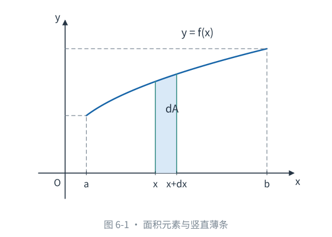

# 6-1 定积分的元素法

## 自学入口：应用题里“用积分”太抽象，具体先写哪一行？

> [!info] 本次新增讲解
> 可直接读下面这一步，也可跳到“教材转写与已有批注”。想继续抠一个细节时，可以停在这里；练习和复盘均为可选。

**卡在符号或前提时再回看**：[[5-2-微积分基本公式]]。

**可以先写这一行**：一根长为 $1$ 的细棒，位置 $x$ 处线密度为 $\lambda(x)=1+x$。先把“求总质量”拆成“小段质量约为密度乘长度”。

**为什么这样开始**：在 $x$ 附近取宽 $\Delta x$ 的短段，$\Delta m\approx(1+x)\Delta x$，对应微元写为 $dm=(1+x)dx$；累加得 $m=\int_0^1(1+x)dx=3/2$。先写局部关系，是为了把情景压缩成一个可积表达式。

**条件与边界**：单位也能检查关系：线密度乘长度才是质量。实际密度模型及变量区间须由题目给出。

> [!question]- 愿意时试一个小变化
> 若线密度改为 $\lambda(x)=2x$，哪一行需要改？

> [!tip]- 展开看启动线索与解答
> 局部关系改为 $dm=2x dx$，故 $m=\int_0^12x dx=1$。

**继续读**：下面的教材正文 ｜ [[自学入口与探索约定#卡住时怎样继续|卡住时的提示方式]] ｜ [[🧭 学习路线图|寻找关联问题]]。

## 教材转写与已有批注

> 下方保留现有转写、页标、题号和锚点；其中可能含先前批注及转换误差，未逐页对照扫描图校订。新增示范均在上方，不作为原书例题引用。

<!--PG:284-->

第六章定积分的应用

本章中我们将应用前面学过的定积分理论来分析和解决一些几何、物理中的问题，其目的不仅在于建立计算这些几何、物理量的公式，更重要的还在于介绍运用元素法将一个量表达成为定积分的分析方法。

第一节 定积分的元素法

在定积分的应用中，经常采用所谓元素法。为了说明这种方法，我们先回顾一下第五章中讨论过的曲边梯形的面积问题。

设 $f(x)$ 在区间 $[a, b]$ 上连续且 $f(x) \geqslant 0$，求以曲线 $y = f(x)$ 为曲边、底为 $[a, b]$ 的曲边梯形的面积 $A$. 把这个面积 $A$ 表示为定积分

$$
A = \int_{a}^{b} f(x) \, dx
$$

的步骤是

(1) 用任意一组分点把区间 $[a, b]$ 分成长度为 $\Delta x_{i} (i=1,2,\cdots,n)$ 的 $n$ 个小区间，相应地把曲边梯形分成 $n$ 个窄曲边梯形，第 $i$ 个窄曲边梯形的面积设为 $\Delta A_{i}$，于是有

$$
A = \sum_{i=1}^{n} \Delta A_{i};
$$

(2) 计算  $\Delta A_{i}$  的近似值

$$
\Delta A_{i} \approx f(\xi_{i}) \Delta x_{i} \quad (x_{i-1} \leqslant \xi_{i} \leqslant x_{i});
$$

(3) 求和，得 A 的近似值

$$
A \approx \sum_{i=1}^{n} f(\xi_i) \Delta x_i;
$$

(4) 求极限, 记  $\lambda = \max\left\{\Delta x_{1}, \Delta x_{2}, \cdots, \Delta x_{n}\right\}$ , 得

<!--PG:285-->

$$
A = \lim _{A \rightarrow 0} \sum_{i=1}^{n} f\left(\xi_{i}\right) \Delta x_{i}=\int_{a}^{b} f(x) \mathrm{d} x.
$$

在上述问题中我们注意到，所求量（即面积 A）与区间 $[a, b]$ 有关。如果把区间 $[a, b]$ 分成许多部分区间，那么所求量相应地分成许多部分量（即 $\Delta A_{i}$），而所求量等于所有部分量之和（即 $A = \sum_{i=1}^{n} \Delta A_{i}$），这一性质称为所求量对于区间 $[a, b]$ 具有可加性。此外，以 $f(\xi_{i}) \Delta x_{i}$ 近似代替部分量 $\Delta A_{i}$ 时，要求它们只相差一个比 $\Delta x_{i}$ 高阶的无穷小，以使和式 $\sum_{i=1}^{n} f(\xi_{i}) \Delta x_{i}$ 的极限是 A 的精确值，从而 A 可以表示为定积分

$$
A = \int_{a}^{b} f(x) \, dx.
$$

在引出 $A$ 的积分表达式的四个步骤中，主要的是第二步，这一步是要确定 $\Delta A_{i}$ 的近似值 $f(\xi_{i}) \Delta x_{i}$，使得

$$
A = \lim _ {A \rightarrow 0} \sum_ {i = 1} ^ {n} f (\xi_ {i}) \Delta x _ {i} = \int_ {a} ^ {b} f (x) \mathrm{d} x.
$$

在实用上，为了简便起见，省略下标 $i$，用 $\Delta A$ 表示任一小区间 $[x, x + \mathrm{d}x]$ 上的窄曲边梯形的面积，这样，

$$
A = \sum \Delta A.
$$

取 $[x, x + \mathrm{d}x]$ 的左端点 $x$ 为 $\xi$，以点 $x$ 处的函数值 $f(x)$ 为高、$\mathrm{d}x$ 为底的矩形的面积 $f(x) \mathrm{d}x$ 为 $\Delta A$ 的近似值（如图 6-1 阴影部分所示），即

$$
\Delta A \approx f(x) \mathrm{d}x.
$$

上式右端 $f(x)$ dx 叫做面积元素，记为 $\mathrm{d}A = f(x)\mathrm{d}x$。于是

$$
A \approx \sum f(x) \, dx,
$$

**图6-1**  ^fig6_1

<!-- original-figure: up-285 6-1 -->

> 原书核对：[扫描第 285 页](../原书页面/up-285.png)。

<!-- /original-figure -->

因此

$$
A = \lim \sum f(x) \mathrm{d} x = \int_{a}^{b} f(x) \mathrm{d} x.
$$

一般地，如果某一实际问题中的所求量 U 符合下列条件：

(1) U 是与一个变量 x 的变化区间  $[a, b]$  有关的量；

(2) U 对于区间 $[a, b]$ 具有可加性，就是说，如果把区间 $[a, b]$ 分成许多部分区间，那么 U 相应地分成许多部分量，而 U 等于所有部分量之和；

(3) 部分量 $\Delta U_{i}$ 的近似值可表示为 $f(\xi_{i})\Delta x_{i}$，

那么就可考虑用定积分来表达这个量 U。通常写出这个量 U 的积分表达式的步骤是

1) 根据问题的具体情况，选取一个变量例如 x 为积分变量，并确定它的变化区间

> [!pdf]- 📄 本节原书页面（PDF 284–285 / 书页 267–268）
> ![[up-284.png]]
> ![[up-285.png]]

---
⬅️ [[5-6-总习题5|总习题5]] ｜ 📑 [[第六章-定积分的应用|本章目录]] ｜ ➡️ [[6-2-定积分在几何学上的应用|定积分在几何学上的应用]]
