# 6-2 定积分在几何学上的应用

## 自学入口：面积题先找积分公式，还是先看每一条小长条？

> [!info] 本次新增讲解
> 可直接读下面这一步，也可跳到“教材转写与已有批注”。想继续抠一个细节时，可以停在这里；练习和复盘均为可选。

**卡在符号或前提时再回看**：[[6-1-定积分的元素法]]。

**可以先写这一行**：求 $y=x$ 与 $y=x^2$ 围成的面积，先解交点 $x=x^2$，得 $x=0,1$。

**为什么这样开始**：在 $[0,1]$ 上 $x\ge x^2$，竖条高度为 $x-x^2$、宽为 $dx$，所以 $A=\int_0^1(x-x^2)dx=1/6$。交点提供上下限，比较上下曲线提供高度，两件事都有来源。

**条件与边界**：上下关系变化时应分段或用绝对值；旋转体积还需确定旋转轴与截面，不能把面积公式直接照搬。

> [!question]- 愿意时试一个小变化
> 若同一区域绕 $x$ 轴旋转，竖截面的面积是什么？

> [!tip]- 展开看启动线索与解答
> 外半径为 $x$、内半径为 $x^2$，圆环截面面积为 $\pi(x^2-x^4)$，体积为 $2\pi/15$。

**继续读**：下面的教材正文 ｜ [[自学入口与探索约定#卡住时怎样继续|卡住时的提示方式]] ｜ [[🧭 学习路线图|寻找关联问题]]。

## 教材转写与已有批注

> 下方保留现有转写、页标、题号和锚点；其中可能含先前批注及转换误差，未逐页对照扫描图校订。新增示范均在上方，不作为原书例题引用。

## 第二节 定积分在几何学上的应用

一、平面图形的面积

1. 直角坐标情形

在第五章中我们已经知道，由曲线 $y = f(x)$（$f(x) \geqslant 0$）及直线 $x = a, x = b$（$a < b$）与 $x$ 轴所围成的曲边梯形的面积 $A$ 是定积分

$$A = \int_{a}^{b} f(x)dx,$$

其中被积表达式 $f(x)dx$ 就是直角坐标下的面积元素，它表示高为 $f(x)$、底为 $dx$ 的一个矩形面积。

应用定积分，不但可以计算曲边梯形面积，还可以计算一些比较复杂的平面图形的面积。

**例1** 计算由两条抛物线：$y^2 = x, y = x^2$ 所围成的图形的面积。 ^e6-2-1

解 这两条抛物线所围成的图形如图 6-2 所示。为了具体定出图形的所在范围，先求出这两条抛物线的交点。为此，解方程组

<!-- original-figure: up-286 6-2 -->
**图 6-2** ^fig6_2

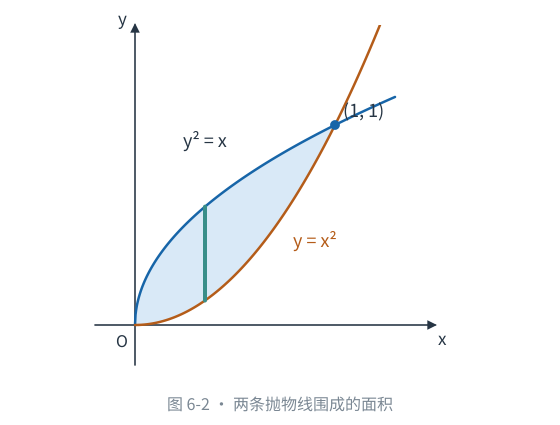

> 原书核对：[扫描第 286 页](../原书页面/up-286.png)。

<!-- /original-figure -->

① 这里 $\Delta U$ 与 $f(x)dx$ 相差一个比 $dx$ 高阶的无穷小。

<!--PG:287-->

得到两个解

$$
x=0, \quad y=0 \quad \text{及} \quad x=1, y=1.
$$

即这两抛物线的交点为(0,0)及(1,1)，从而知道这图形在直线$x=0$与$x=1$之间.

取横坐标x为积分变量，它的变化区间为[0,1].相应于[0,1]上的任一小区间$[x,x+dx]$的窄条的面积近似于高为$\sqrt{x}-x^{2}$、底为dx的窄矩形的面积，从而得到面积元素

$$
\mathrm{d} A = (\sqrt{x} - x^{2}) \mathrm{d} x.
$$

以 $(\sqrt{x} - x^{2})\mathrm{d}x$ 为被积表达式，在闭区间 $[0,1]$ 上作定积分，便得所求面积为

$$
A = \int_{0}^{1} (\sqrt{x} - x^2) \, dx = \left[ \frac{2}{3} x^{\frac{3}{2}} - \frac{x^3}{3} \right]_{0}^{1} = \frac{1}{3}.
$$

**例2** 计算抛物线 $y^{2}=2x$ 与直线 $y=x-4$ 所围成的图形的面积. ^e6-2-2

解 这个图形如图6-3所示。为了定出这图形所在的范围，先求出所给抛物线和直线的交点。解方程组

$$
\left\{ \begin{array}{l} y ^ {2} = 2 x, \\ y = x - 4, \end{array} \right.
$$

得交点 $(2,-2)$ 和 $(8,4)$，从而知道这图形在直线 $y=-2$ 及 $y=4$ 之间.

**图6-3**  ^fig6_3

<!-- original-figure: up-287 6-3 -->
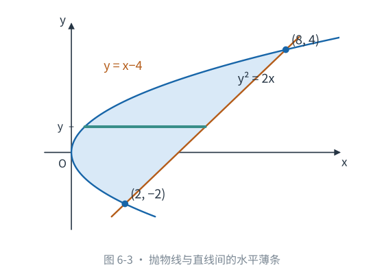

> 原书核对：[扫描第 287 页](../原书页面/up-287.png)。

<!-- /original-figure -->

现在，选取纵坐标 $y$ 为积分变量，它的变化区间为 $[-2,4]$ （读者可以思考一下，取横坐标 $x$ 为积分

变量，有什么不方便的地方）。相应于 $[-2,4]$ 上任一小区间 $[y,y+dy]$ 的窄条面积近似于高为 $dy$、底为 $(y+4)-\frac{1}{2}y^{2}$ 的窄矩形的面积，从而得到面积元素

$$
\mathrm{d} A = \left(y + 4 - \frac {1}{2} y ^ {2}\right) \mathrm{d} y.
$$

以 $\left(y + 4 - \frac{1}{2} y^2\right)\mathrm{d}y$ 为被积表达式，在闭区间 $[-2,4]$ 上作定积分，便得所求的面积为

$$
A = \int_{-2}^{4} \left(y + 4 - \frac{1}{2} y^2\right) \mathrm{d}y = \left[ \frac{y^2}{2} + 4y - \frac{y^3}{6} \right]_{-2}^{4} = 18.
$$

由例2可以看到，积分变量选得适当，可使计算方便。

**例3** 求椭圆 $\frac{x^2}{a^2} +\frac{y^2}{b^2} = 1$ 所围成的图形的面积. ^e6-2-3

<!--PG:288-->

解 该椭圆关于两坐标轴都对称（图6-4），所以椭圆所围成的图形的面积为

$$
A = 4A_{1},
$$

其中 $A_{1}$ 为该椭圆在第一象限部分与两坐标轴所围图形的面积，因此

$$
A = 4 A _ {1} = 4 \int_ {0} ^ {a} y \mathrm{d} x.
$$

利用椭圆的参数方程

$$
\left\{ \begin{array}{l} x = a \cos t, \\ y = b \sin t \end{array} \right. (0 \leqslant t \leqslant \frac {\pi}{2}),
$$

**图6-4**  ^fig6_4

<!-- original-figure: up-288 6-4 -->
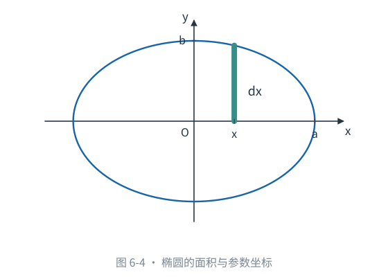

> 原书核对：[扫描第 288 页](../原书页面/up-288.png)。

<!-- /original-figure -->

应用定积分换元法，令 $x=a\cos t$，则

$$
y = b \sin t, \quad \mathrm{d} x = - a \sin t \mathrm{d} t.
$$

当 $x$ 由 0 变到 $a$ 时，$t$ 由 $\frac{\pi}{2}$ 变到 0，所以

$$
\begin{array}{l} A = 4 \int_ {\frac {\pi}{2}} ^ {0} b \sin t (- a \sin t) \mathrm{d} t = - 4 a b \int_ {\frac {\pi}{2}} ^ {0} \sin^ {2} t \mathrm{d} t \\ = 4 a b \int_ {0} ^ {\frac {\pi}{2}} \sin^ {2} t \mathrm{d} t = 4 a b \cdot \frac {1}{2} \cdot \frac {\pi}{2} = \pi a b. \end{array}
$$

当 $a = b$ 时，就得到大家所熟悉的圆面积的公式 $A = \pi a^{2}$.

## 2. 极坐标情形

某些平面图形，用极坐标来计算它们的面积比较方便。

设由曲线 $\rho=\rho(\theta)$ 及射线 $\theta=\alpha, \theta=\beta$ 围成一图形（简称为曲边扇形），现在要计算它的面积（图6-5）。这里，$\rho(\theta)$ 在 $[\alpha,\beta]$ 上连续，且 $\rho(\theta)\geq0, 0<\beta-\alpha\leq2\pi$。

由于当 $\theta$ 在 $[\alpha, \beta]$ 上变动时，极径 $\rho=\rho(\theta)$ 也随之变动，因此所求图形的面积不能直接利用扇形面积的公式 $A=\frac{1}{2}R^{2}\theta$ 来计算。

**图6-5**  ^fig6_5

<!-- original-figure: up-288 6-5 -->
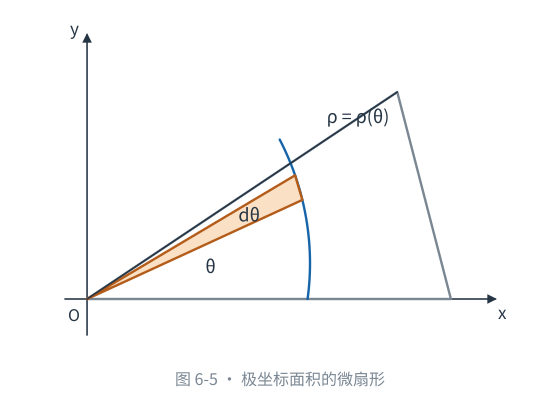

> 原书核对：[扫描第 288 页](../原书页面/up-288.png)。

<!-- /original-figure -->

取极角 $\theta$ 为积分变量，它的变化区间为 $[\alpha, \beta]$。相应于任一小区间 $[\theta, \theta + \mathrm{d}\theta]$ 的窄曲边扇形的面积可以用半径为 $\rho = \rho(\theta)$、中心角为 $\mathrm{d}\theta$ 的扇形的面积来近似代替，从而得到这窄曲边扇形面积的近似值，即曲边扇形的面积元素

$$
\mathrm{d} A = \frac {1}{2} [ \rho (\theta) ] ^ {2} \mathrm{d} \theta .
$$

以 $\frac{1}{2} [\rho (\theta)]^2\mathrm{d}\theta$ 为被积表达式，在闭区间 $[\alpha, \beta]$ 上作定积分，便得所求曲边扇形的面

<!--PG:289-->

积为

$$
A = \int _ { a } ^ { \beta } \frac { 1 } { 2 } [ \rho ( \theta ) ] ^ { 2 } \, \mathrm { d } \theta .
$$

**例4** 计算阿基米德螺线 ^e6-2-4

$$
\rho = a \theta \quad ( a > 0 )
$$

上相应于 $\theta$ 从 0 变到 $2\pi$ 的一段弧与极轴所围成的图形（图 6-6）的面积.

解 在指定的这段螺线上，$\theta$ 的变化区间为 $[0,2\pi]$。相应于 $[0,2\pi]$ 上任一小区间 $[\theta,\theta+\mathrm{d}\theta]$ 的窄曲边扇形的面积近似于半径为 $a\theta$、圆心角为 $\mathrm{d}\theta$ 的扇形的面积，从而得到面积元素

$$
\mathrm{d} A = \frac {1}{2} (a \theta) ^ {2} \mathrm{d} \theta .
$$

于是所求面积为

$$
A = \int_ {0} ^ {2 \pi} \frac {a ^ {2}}{2} \theta^ {2} \mathrm{d} \theta = \frac {a ^ {2}}{2} \left[ \frac {\theta^ {3}}{3} \right] _ {0} ^ {2 \pi} = \frac {4}{3} a ^ {2} \pi^ {3}.
$$

**图6-6**  ^fig6_6

<!-- original-figure: up-289 6-6 -->
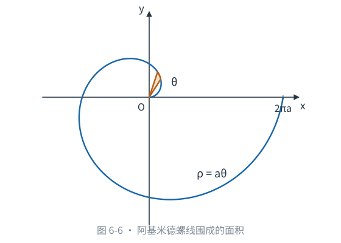

> 原书核对：[扫描第 289 页](../原书页面/up-289.png)。

<!-- /original-figure -->

**例5** 计算心形线 ^e6-2-5

$$
\rho = a (1 + \cos \theta) \quad (a > 0)
$$

所围成的图形的面积.

解 心形线所围成的图形如图6-7所示.这个图形对称于极轴，因此所求图形的面积A是极轴以上部分图形面积 $A_{1}$ 的2倍.

对于极轴以上部分的图形，$\theta$ 的变化区间为 $[0, \pi]$。相应于 $[0, \pi]$ 上任一小区间 $[\theta, \theta + d\theta]$ 的窄曲边扇形的面积近似于半径为 $a(1 + \cos \theta)$、圆心角为 $d\theta$ 的扇形的面积。从而得到面积元素

$$
\mathrm{d} A = \frac {1}{2} a ^ {2} (1 + \cos \theta) ^ {2} \mathrm{d} \theta ,
$$

**图6-7**  ^fig6_7

<!-- original-figure: up-289 6-7 -->
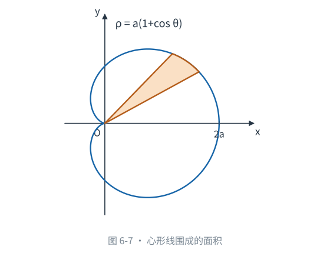

> 原书核对：[扫描第 289 页](../原书页面/up-289.png)。

<!-- /original-figure -->

于是

例题精讲

6-1

$$
A _ {1} = \int_ {0} ^ {\pi} \frac {1}{2} a ^ {2} (1 + \cos \theta) ^ {2} \mathrm{d} \theta = \frac {a ^ {2}}{2} \int_ {0} ^ {\pi} (1 + 2 \cos \theta + \cos^ {2} \theta) \mathrm{d} \theta
$$

释疑解难

$$
= \frac {a ^ {2}}{2} \int_ {0} ^ {\pi} \left(\frac {3}{2} + 2 \cos \theta + \frac {1}{2} \cos 2 \theta\right) d \theta
$$

$$
= \frac {a ^ {2}}{2} \left[ \frac {3}{2} \theta + 2 \sin \theta + \frac {1}{4} \sin 2 \theta \right] _ {0} ^ {\pi} = \frac {3}{4} \pi a ^ {2},
$$

因而所求面积为

<!--PG:290-->

$$
A = 2 A _ {1} = \frac {3}{2} \pi a ^ {2}.
$$

## 二、体积

## 1. 旋转体的体积

旋转体就是由一个平面图形绕这平面内一条直线旋转一周而成的立体.这直线叫做旋转轴.圆柱、圆锥、圆台、球可以分别看成是由矩形绕它的一条边、直角三角形绕它的直角边、直角梯形绕它的直角腰、半圆绕它的直径旋转一周而成的立体,所以它们都是旋转体.

上述旋转体都可以看作是由连续曲线 $y=f(x)$，直线 x=a, x=b 及 x 轴所围成的曲边梯形绕 x 轴旋转一周而成的立体. 现在我们考虑用定积分来计算这种旋转体的体积.

取横坐标 $x$ 为积分变量，它的变化区间为 $[a, b]$. 相应于 $[a, b]$ 上的任一小区间 $[x, x+dx]$ 的窄曲边梯形绕 $x$ 轴旋转而成的薄片的体积近似于以 $f(x)$ 为底半径、$dx$ 为高的扁圆柱体的体积（图 6-8），即体积元素

$$
d V = \pi [ f (x) ] ^ {2} d x.
$$

**图6-8**  ^fig6_8

<!-- original-figure: up-290 6-8 -->
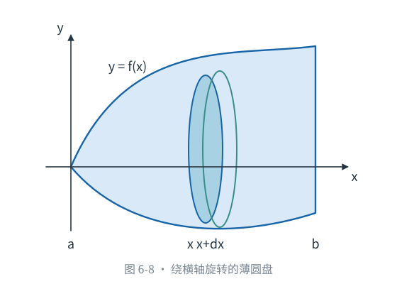

> 原书核对：[扫描第 290 页](../原书页面/up-290.png)。

<!-- /original-figure -->

以 $\pi [f(x)]^2 dx$ 为被积表达式，在闭区间 $[a,b]$ 上作定积分，便得所求旋转体体积为

$$
V = \int_ {a} ^ {b} \pi [ f (x) ] ^ {2} \mathrm{d} x.
$$

**例6** 连接坐标原点 $O$ 及点 $P(h,r)$ 的直线、直线 $x = h$ 及 $x$ 轴围成一个直角三角形（图6-9）。将它绕 $x$ 轴旋转一周构成一个底半径为 $r$、高为 $h$ 的圆锥体。计算这圆锥体的体积. ^e6-2-6

<!-- original-figure: up-290 6-9 -->
**图 6-9** ^fig6_9

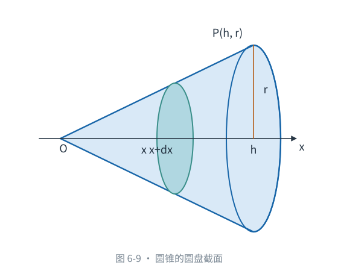

> 原书核对：[扫描第 290 页](../原书页面/up-290.png)。

<!-- /original-figure -->

解 过原点 $O$ 及点 $P(h,r)$ 的直线方程为

$$
y = \frac {r}{h} x.
$$

取横坐标 $x$ 为积分变量，它的变化区间为 $[0, h]$. 圆锥体中相应于 $[0, h]$ 上任一小区间 $[x, x + dx]$ 的薄片的体积近似于底半径为 $\frac{r}{h} x$、高为 $dx$ 的扁圆柱体的体积，即体积元素

<!--PG:291-->

$$
\mathrm{d} V = \pi \left[ \frac {r}{h} x \right] ^ {2} \mathrm{d} x.
$$

于是所求圆锥体的体积为

$$
V = \int_ {0} ^ {h} \pi \left(\frac {r}{h} x\right) ^ {2} \mathrm{d} x = \frac {\pi r ^ {2}}{h ^ {2}} \left[ \frac {x ^ {3}}{3} \right] _ {0} ^ {h} = \frac {\pi r ^ {2} h}{3}.
$$

**例7** 计算由椭圆 ^e6-2-7

$$
\frac {x ^ {2}}{a ^ {2}} + \frac {y ^ {2}}{b ^ {2}} = 1
$$

所围成的图形绕 x 轴旋转一周而成的旋转体（叫做旋转椭球体）的体积.

解 这个旋转椭球体也可以看作是由半个椭圆

及 x 轴围成的图形绕 x 轴旋转一周而成的立体.

取 $x$ 为积分变量，它的变化区间为 $[-a, a]$。旋转椭球体中相应于 $[-a, a]$ 上任一小区间 $[x, x + dx]$ 的薄片的体积，近似于底半径为 $\frac{b}{a} \sqrt{a^2 - x^2}$、高为 $dx$ 的扁圆柱体的体积（图 6-10），即体积元素

$$
\mathrm{d} V = \frac {\pi b ^ {2}}{a ^ {2}} (a ^ {2} - x ^ {2}) \mathrm{d} x.
$$

于是所求旋转椭球体的体积为

$$
\begin{array}{r l} V & = \int_ {- a} ^ {a} \pi \frac {b ^ {2}}{a ^ {2}} (a ^ {2} - x ^ {2}) \mathrm{d} x = \frac {2 \pi b ^ {2}}{a ^ {2}} \int_ {0} ^ {a} (a ^ {2} - x ^ {2}) \mathrm{d} x \\ & = 2 \pi \frac {b ^ {2}}{a ^ {2}} \left[ a ^ {2} x - \frac {x ^ {3}}{3} \right] _ {0} ^ {a} = \frac {4}{3} \pi a b ^ {2}. \end{array}
$$

**图6-10**  ^fig6_10

<!-- original-figure: up-291 6-10 -->
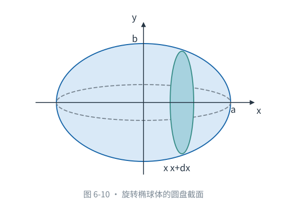

> 原书核对：[扫描第 291 页](../原书页面/up-291.png)。

<!-- /original-figure -->

当 $a = b$ 时，旋转椭球体就成为半径为 $a$ 的球，它的体积为 $\frac{4}{3}\pi a^3$。

用与上面类似的方法可以推出：由曲线 $x=\varphi(y)$，直线 $y=c, y=d$ ($c<d$) 与 y 轴所围成的曲边梯形，绕 y 轴旋转一周而成的旋转体（图 6-11）的体积为

$$
V = \pi \int_ {c} ^ {d} [ \varphi (y) ] ^ {2} \mathrm{d} y,
$$

**例8** 计算由摆线 $x=a(t-\sin t), y=a(1-\cos t)$ 相应于 $0 \leqslant t \leqslant 2\pi$ 的一拱与直线 $y=0$ 所围成的图形分别绕 $x$ 轴、$y$ 轴旋转而成的旋转体的体积. ^e6-2-8

解 按旋转体的体积公式，所述图形绕 $x$ 轴旋转而成的旋转体的体积为

$$
V _ {x} = \int_ {0} ^ {2 \pi a} \pi y ^ {2} (x) \mathrm{d} x = \pi \int_ {0} ^ {2 \pi} a ^ {2} (1 - \cos t) ^ {2} \cdot a (1 - \cos t) \mathrm{d} t
$$

<!--PG:292-->

$$
= \pi a^{3} \int_{0}^{2\pi} (1-3\cos t + 3\cos^{2} t - \cos^{3} t) \, dt = 5\pi^{2} a^{3}.
$$

所述图形绕 $y$ 轴旋转而成的旋转体的体积可看成平面图形 $OABC$ 与 $OBC$（图6-12）分别绕 $y$ 轴旋转而成的旋转体的体积之差。因此所求的体积为

$$
\begin{array}{l} V _ {y} = \int_ {0} ^ {2 a} \pi x _ {2} ^ {2} (y) d y - \int_ {0} ^ {2 a} \pi x _ {1} ^ {2} (y) d y \\ = \pi \int_ {2 \pi} ^ {\pi} a ^ {2} (t - \sin t) ^ {2} \cdot a \sin t d t - \pi \int_ {0} ^ {\pi} a ^ {2} (t - \sin t) ^ {2} \cdot a \sin t d t \\ = - \pi a ^ {3} \int_ {0} ^ {2 \pi} (t - \sin t) ^ {2} \sin t d t = 6 \pi^ {3} a ^ {3}. \\ \end{array}
$$

**图6-11**  ^fig6_11

<!-- original-figure: up-292 6-11,6-12 -->
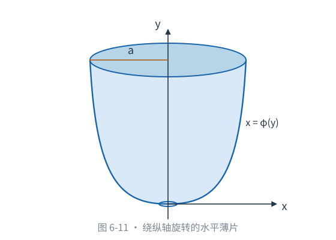

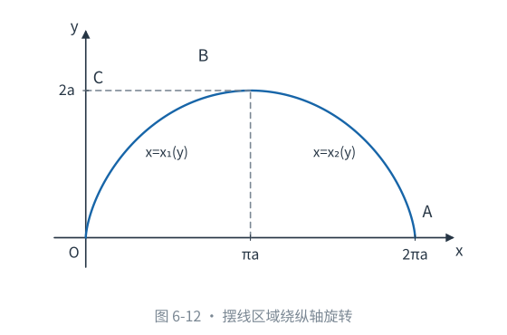

> 原书核对：[扫描第 292 页](../原书页面/up-292.png)。

<!-- /original-figure -->

**图6-12**  ^fig6_12

## 2. 平行截面面积为已知的立体的体积

从计算旋转体体积的过程中可以看出：如果一个立体不是旋转体，但却知道该立体上垂直于一定轴的各个截面的面积，那么，这个立体的体积也可以用定积分来计算。

如图6-13所示，取上述定轴为 $x$ 轴，并设该立体在过点 $x=a, x=b$ 且垂直于 $x$ 轴的两个平面之间。以 $A(x)$ 表示过点 $x$ 且垂直于 $x$ 轴的截面面积。假定 $A(x)$ 为已知的 $x$ 的连续函数。这时，取 $x$ 为积分变量，它的变化区间为 $[a, b]$；立体中相应于 $[a, b]$ 上任一小区间 $[x, x+\mathrm{d}x]$ 的一薄片的体积，近似于底面积为 $A(x)$、高为 $\mathrm{d}x$ 的扁柱体的体积，即体积元素

<!-- original-figure: up-293 6-13,6-14 -->
**图 6-13** ^fig6_13

**图 6-14** ^fig6_14

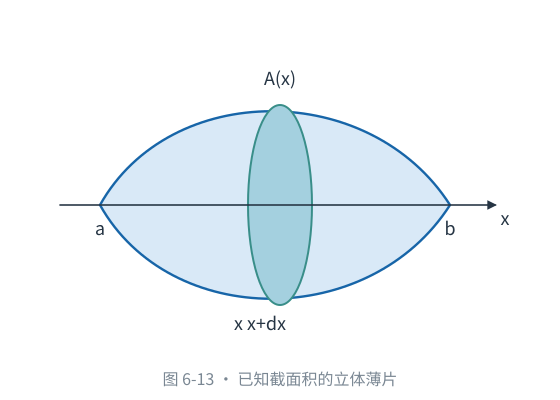

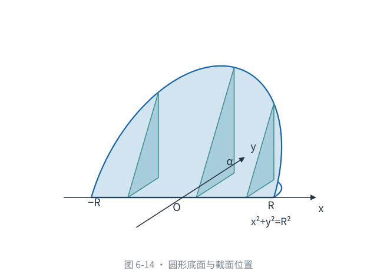

> 原书核对：[扫描第 293 页](../原书页面/up-293.png)。

<!-- /original-figure -->

$$
\mathrm{d}V = A(x)\,\mathrm{d}x.
$$

以 $A(x)\mathrm{d}x$ 为被积表达式，在闭区间 $[a,b]$ 上作定积分，便得所求立体的体积

$$
V = \int_ {a} ^ {b} A (x) \mathrm{d} x.
$$

**例9** 一平面经过半径为 $R$ 的圆柱体的底圆中心，并与底面交成角 $\alpha$（图6-14）.计算这平面截圆柱体所得立体的体积. ^e6-2-9

<!--PG:293-->

解 取这平面与圆柱体的底面的交线为 $x$ 轴，底面上过圆中心、且垂直于 $x$ 轴的直线为 $y$ 轴. 那么，底圆的方程为 $x^{2}+y^{2}=R^{2}$. 立体中过 $x$ 轴上的点 $x$ 且垂直于 $x$ 轴的截面是一个直角三角形. 它的两条直角边的长分别为 $y$ 及 $y\tan \alpha$, 即 $\sqrt{R^{2}-x^{2}}$ 及 $\sqrt{R^{2}-x^{2}}\tan \alpha$. 因而截面积为 $A(x)=\frac{1}{2}(R^{2}-x^{2})\tan \alpha$, 于是所求立体体积为

$$
V=\int_{-R}^{R}\frac{1}{2}(R^{2}-x^{2})\tan \alpha \mathrm{d}x=\int_{0}^{R}(R^{2}-x^{2})\tan \alpha \mathrm{d}x
$$

$$
=\tan \alpha \left[ R^{2}x-\frac{1}{3}x^{3} \right]_{0}^{R}=\frac{2}{3}R^{3}\tan \alpha.
$$

**例10** 求以半径为 $R$ 的圆为底、平行且等于底圆直径的线段为顶、高为 $h$ 的正劈锥体的体积. ^e6-2-10

解 取底圆所在的平面为 $xOy$ 平面，圆心 $O$ 为原点，并使 $x$ 轴与正劈锥的顶平行（图 6-15）. 底圆的方程为 $x^{2}+y^{2}=R^{2}$. 过 $x$ 轴上的点 $x(-R\leqslant x\leqslant R)$ 作垂直于 $x$ 轴的平面，截正劈锥体得等腰三角形. 这截面的面积为

<!-- original-figure: up-293 6-15 -->
**图 6-15** ^fig6_15

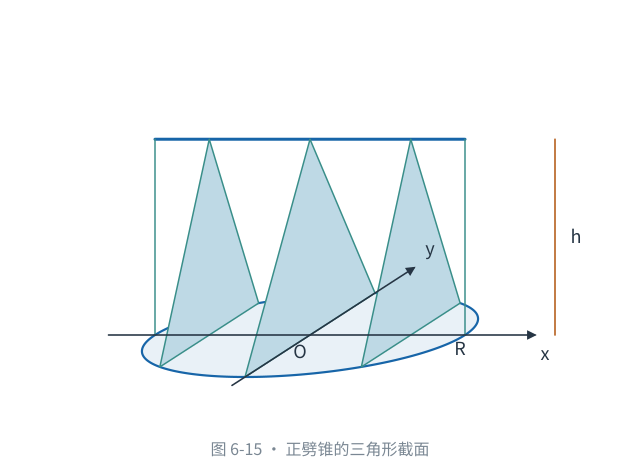

> 原书核对：[扫描第 293 页](../原书页面/up-293.png)。

<!-- /original-figure -->

$$
A(x)=hy=h\sqrt{R^{2}-x^{2}}
$$

于是所求正劈锥体的体积为

$$
\begin{array}{l} V = \int_ {- R} ^ {R} A (x) \mathrm{d} x = h \int_ {- R} ^ {R} \sqrt {R ^ {2} - x ^ {2}} \mathrm{d} x = 2 h \int_ {0} ^ {R} \sqrt {R ^ {2} - x ^ {2}} \mathrm{d} x \\ = 2 R ^ {2} h \int_ {0} ^ {\frac {\pi}{2}} \sin^ {2} \theta \mathrm{d} \theta = \frac {\pi R ^ {2} h}{2}. \end{array}
$$

由此可知正劈锥体的体积等于同底同高的圆柱体体积的一半。

## 三、平面曲线的弧长

我们知道，圆的周长可以利用圆的内接正多边形的周长当边数无限增多时的极限来确定。现在用类似的方法来建立平面的连续曲线弧长的概念，从而应用定积分来计

<!--PG:294-->

算弧长.

设 $A,B$ 是曲线弧的两个端点.在弧 $\widehat{AB}$ 上依次任取分点 $A=M_{0},M_{1},M_{2},\cdots,M_{i-1},M_{i},\cdots,M_{n-1},M_{n}=B$,并依次连接相邻的分点得一折线（图6-16).当分点的数目无限增加且每个小段 $\widehat{M_{i-1}M_{i}}$ 都缩向一点时,如果此折线的长 $\sum_{i=1}^{n}|M_{i-1}M_{i}|$ 的极限存在,那么称此极限为曲线弧 $\widehat{AB}$ 的弧长,并称此曲线弧 $\widehat{AB}$ 是可求长的.

对光滑的曲线弧(参看第165页上的脚注),有如下结论:

**图6-16**  ^fig6_16

<!-- original-figure: up-294 6-16 -->
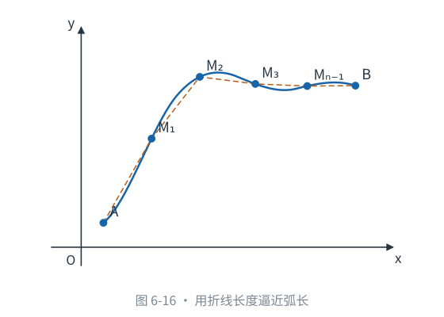

> 原书核对：[扫描第 294 页](../原书页面/up-294.png)。

<!-- /original-figure -->

> [!theorem]+ 定理
> 光滑曲线弧是可求长的. ^t6-2-1

这个定理我们不加证明.由于光滑曲线弧是可求长的,故可应用定积分来计算弧长.下面我们利用定积分的元素法来讨论平面光滑曲线弧长的计算公式.

设曲线弧由参数方程

$$
\left\{ \begin{array}{l l} x = \varphi (t), \\ y = \psi (t) \end{array} \right. (\alpha \leqslant t \leqslant \beta)
$$

给出，其中 $\varphi(t), \psi(t)$ 在 $[\alpha, \beta]$ 上具有连续导数，且 $\varphi'(t), \psi'(t)$ 不同时为零。现在来计算这曲线弧的长度。

取参数 $t$ 为积分变量，它的变化区间为 $[\alpha, \beta]$。相应于 $[\alpha, \beta]$ 上任一小区间 $[t, t + dt]$ 的小弧段的长度 $\Delta s$ 近似等于对应的弦的长度 $\sqrt{(\Delta x)^2 + (\Delta y)^2}$，因为

$$
\Delta x = \varphi (t + \mathrm{d} t) - \varphi (t) \approx \mathrm{d} x = \varphi^ {\prime} (t) \mathrm{d} t,
$$

$$
\Delta y = \psi (t + \mathrm{d} t) - \psi (t) \approx \mathrm{d} y = \psi^ {\prime} (t) \mathrm{d} t,
$$

所以，$\Delta s$ 的近似值（弧微分）即弧长元素为

$$
\mathrm{d} s = \sqrt {(\mathrm{d} x) ^ {2} + (\mathrm{d} y) ^ {2}} = \sqrt {\varphi^ {\prime 2} (t) (\mathrm{d} t) ^ {2} + \psi^ {\prime 2} (t) (\mathrm{d} t) ^ {2}} = \sqrt {\varphi^ {\prime 2} (t) + \psi^ {\prime 2} (t)} \mathrm{d} t.
$$

于是所求弧长为

$$
s = \int_ {\alpha} ^ {\beta} \sqrt {\varphi^ {\prime 2} (t) + \psi^ {\prime 2} (t)} \mathrm{d} t.
$$

当曲线弧由直角坐标方程

$$
y = f (x) \quad (a \leqslant x \leqslant b)
$$

给出，其中 $f(x)$ 在 $[a,b]$ 上具有一阶连续导数，这时曲线弧有参数方程

$$
\left\{ \begin{array}{l l} x = x, \\ y = f (x) \end{array} \right. \quad (a \leqslant x \leqslant b),
$$

从而所求的弧长为

<!--PG:295-->

$$
s = \int_{a}^{b} \sqrt{1 + y'^2} \, dx.
$$

当曲线弧由极坐标方程

$$
\rho = \rho(\theta) \quad (\alpha \leqslant \theta \leqslant \beta)
$$

给出，其中 $\rho(\theta)$ 在 $[\alpha, \beta]$ 上具有连续导数，则由直角坐标与极坐标的关系可得

$$
\left\{ \begin{array}{l} x = x (\theta) = \rho (\theta) \cos \theta , \\ y = y (\theta) = \rho (\theta) \sin \theta \end{array} \right. \quad (\alpha \leqslant \theta \leqslant \beta),
$$

这就是以极角 $\theta$ 为参数的曲线弧的参数方程。于是，弧长元素为

$$
\mathrm{d}s = \sqrt{x'^2(\theta) + y'^2(\theta)} \, \mathrm{d}\theta = \sqrt{\rho^2(\theta) + \rho'^2(\theta)} \, \mathrm{d}\theta,
$$

从而所求弧长为

$$
s = \int_{a}^{\theta} \sqrt{\rho^2(\theta) + \rho'^2(\theta)} \, \mathrm{d}\theta.
$$

**例11** 计算曲线 $y=\frac{2}{3}x^{\frac{3}{2}}$ 上相应于 $a\leqslant x\leqslant b$ 的一段弧 (图 6-17) 的长度. ^e6-2-11

解 因 $y^{\prime}=x^{\frac{1}{2}}$，从而弧长元素

$$
\mathrm{d}s=\sqrt{1+\left(x^{\frac{1}{2}}\right)^2}\,\mathrm{d}x=\sqrt{1+x}\,\mathrm{d}x.
$$

因此，所求弧长为

$$
s = \int_{a}^{b} \sqrt{1 + x} \, dx = \left[ \frac{2}{3}(1 + x)^{\frac{3}{2}} \right]_{a}^{b} = \frac{2}{3} \left[ (1 + b)^{\frac{3}{2}} - (1 + a)^{\frac{3}{2}} \right].
$$

**图6-17**  ^fig6_17

<!-- original-figure: up-295 6-17,6-18 -->
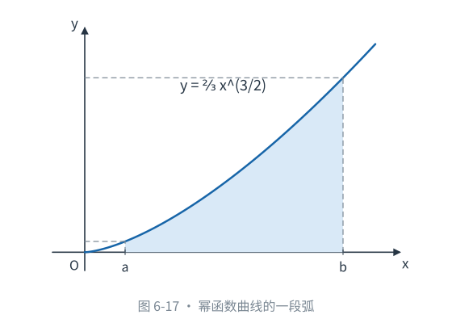

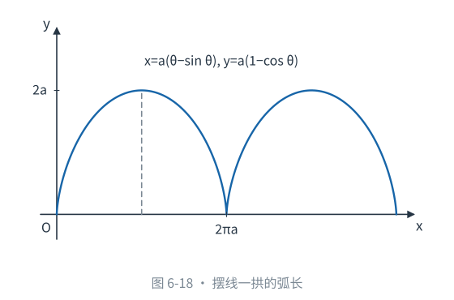

> 原书核对：[扫描第 295 页](../原书页面/up-295.png)。

<!-- /original-figure -->

**图6-18**  ^fig6_18

**例12** 计算摆线(图 6-18) ^e6-2-12

$$
\begin{cases}
x = a(\theta - \sin \theta), \\
y = a(1 - \cos \theta)
\end{cases}
$$

的一拱 $(0 \leqslant \theta \leqslant 2\pi)$ 的长度.

解 弧长元素为

$$
\begin{array}{r l} \mathrm{d}s & = \sqrt{a^2(1 - \cos \theta)^2 + a^2 \sin^2 \theta} \, \mathrm{d}\theta \\ & = a \sqrt{2(1 - \cos \theta)} \, \mathrm{d}\theta = 2a \sin \frac{\theta}{2} \, \mathrm{d}\theta. \end{array}
$$

<!--PG:296-->

从而，所求弧长

$$
s = \int_{0}^{2\pi} 2a \sin \frac{\theta}{2} d\theta = 2a \left[ -2 \cos \frac{\theta}{2} \right]_{0}^{2\pi} = 8a.
$$

**例13** 求阿基米德螺线 $\rho = a\theta$ ($a > 0$) 相应于 $0 \leqslant \theta \leqslant 2\pi$ 一段（图 6-19）的弧长. ^e6-2-13

解 弧长元素为

**图6-19**  ^fig6_19

<!-- original-figure: up-296 6-19 -->
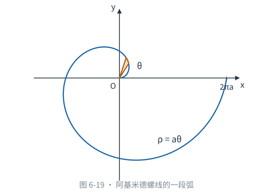

> 原书核对：[扫描第 296 页](../原书页面/up-296.png)。

<!-- /original-figure -->

$$
\mathrm{d} s = \sqrt {a ^ {2} \theta^ {2} + a ^ {2}} \mathrm{d} \theta = a \sqrt {1 + \theta^ {2}} \mathrm{d} \theta ,
$$

于是所求弧长为

$$
s = a \int_ {0} ^ {2 \pi} \sqrt {1 + \theta^ {2}} \mathrm{d} \theta = \frac {a}{2} [ 2 \pi \sqrt {1 + 4 \pi^ {2}} + \ln (2 \pi + \sqrt {1 + 4 \pi^ {2}}) ].
$$

## 习题6-2

> [!tip]- 新增：这组习题的逐题详解
> [[习题6-2-详细解答|打开详细解答（30 道大题）]]。包含推导、适用条件，以及必要处可展开的注释。解答按扫描原题核对，发现的转写差异在对应题目旁说明。
> 想先自己试时，可以暂不展开；全部入口见 [[课后习题详细解答]]。

1. 求图 6-20 中各阴影部分的面积.

**图6-20**  ^fig6_20

<!-- original-figure: up-296 6-20 -->
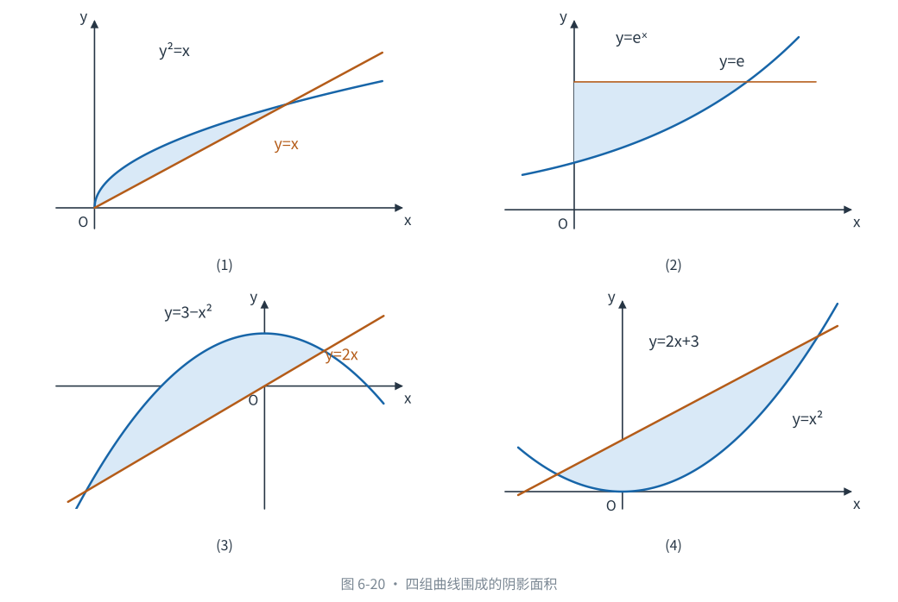

> 原书核对：[扫描第 296 页](../原书页面/up-296.png)。

<!-- /original-figure -->

2. 求由下列各组曲线所围成的图形的面积：

(1) $y=\frac{1}{2}x^{2}$ 与 $x^{2}+y^{2}=8$ （两部分都要计算）；

<!--PG:297-->

(2) $y = \frac{1}{x}$ 与直线 $y = x$ 及 $x = 2$;

(3) $y = e^{x}, y = e^{-x}$ 与直线 $x = 1$;

(4) $y = \ln x, y$ 轴与直线 $y = \ln a, y = \ln b$ ($b > a > 0$).

3. 求抛物线 $y = -x^{2} + 4x - 3$ 及其在点 $(0, -3)$ 和 $(3, 0)$ 处的切线所围成的图形的面积.

4. 求抛物线 $y^{2} = 2px$ 及其在点 $\left(\frac{p}{2}, p\right)$ 处的法线所围成的图形的面积.

5. 试求 $a, b$ 的值，使得由曲线 $y = \cos x$ ($0 \leqslant x \leqslant \frac{\pi}{2}$) 与两坐标轴所围成的图形的面积被曲线 $y = a \sin x$ 与 $y = b \sin x$ 三等分.

6. 求由下列各曲线所围成的图形的面积：

(1) $\rho = 2a \cos \theta$; (2) $x = a \cos^{3} t, y = a \sin^{3} t$; (3) $\rho = 2a (2 + \cos \theta)$.

7. 求由摆线 $x = a(t - \sin t), y = a(1 - \cos t)$ 的一拱 ($0 \leqslant t \leqslant 2\pi$) 与横轴所围成的图形的面积.

8. 求对数螺线 $\rho = ae^{\theta}$ ($-\pi \leqslant \theta \leqslant \pi$) 及射线 $\theta = \pi$ 所围成的图形的面积.

9. 求下列各曲线所围成图形的公共部分的面积：

(1) $\rho = 3\cos \theta$ 及 $\rho = 1 + \cos \theta$; (2) $\rho = \sqrt{2}\sin \theta$ 及 $\rho^{2} = \cos 2\theta$.

10. 求位于曲线 $y = e^{x}$ 下方、该曲线过原点的切线的左方以及 x 轴上方之间的图形的面积.

11. 在区间 $[1, e]$ 上求一点 $\xi$，使得图 6-21 中所示的阴影部分的面积最小.

12. 已知抛物线 $y = px^{2} + qx$ (其中 $p < 0, q > 0$) 在第一象限内与直线 $x + y = 5$ 相切，且此抛物线与 x 轴所围成的图形的面积为 A. 问 p 和 q 为何值时，A 达到最大值，并求出此最大值.

13. 由 $y = x^{3}, x = 2, y = 0$ 所围成的图形分别绕 x 轴及 y 轴旋转，计算所得两个旋转体的体积.

14. 把星形线 $x^{2/3} + y^{2/3} = a^{2/3}$ 所围成的图形绕 x 轴旋转（图6-22），计算所得旋转体的体积.

15. 用积分方法证明图 6-23 中球缺的体积为

$$
V = \pi H^2 \left( R - \frac{H}{3} \right).
$$

**图6-21**  ^fig6_21

<!-- original-figure: up-297 6-21,6-22,6-23 -->
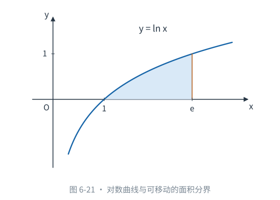

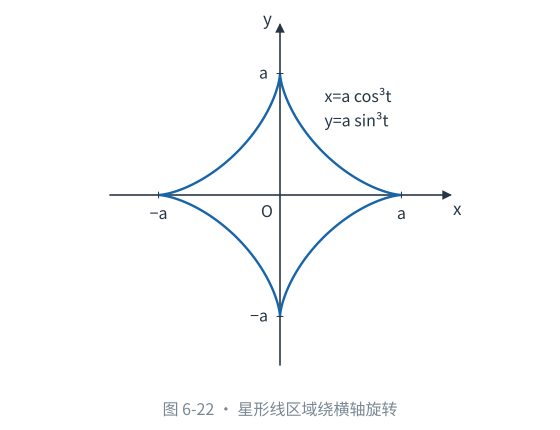

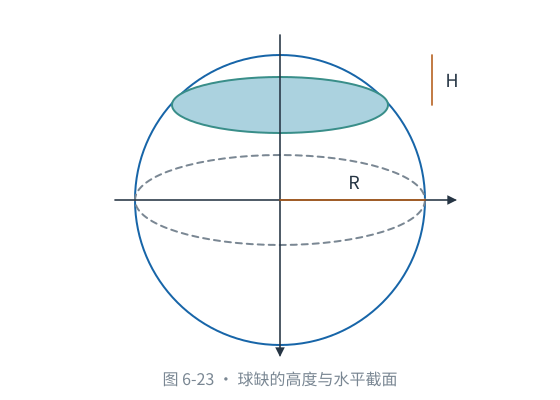

> 原书核对：[扫描第 297 页](../原书页面/up-297.png)。

<!-- /original-figure -->

**图6-22**  ^fig6_22

**图6-23**  ^fig6_23

16. 求下列已知曲线所围成的图形按指定的轴旋转所产生的旋转体的体积：

(1) $y = x^{2}, x = y^{2}$，绕 $y$ 轴；

(2) $y = \arcsin x, x = 1, y = 0$，绕 $x$ 轴；

<!--PG:298-->

(3) $x^{2}+(y-5)^{2}=16$, 绕 $x$ 轴;

(4) 摆线 $x=a(t-\sin t)$, $y=a(1-\cos t)$ 的一拱, $y=0$, 绕直线 $y=2a$.

17. 求圆盘 $x^{2}+y^{2} \leqslant a^{2}$ 绕 $x=-b$ ($b>a>0$) 旋转所成旋转体的体积.

18. 设有一截锥体，其高为 $h$，上、下底均为椭圆，椭圆的轴长分别为 $2a, 2b$ 和 $2A, 2B$，求这截锥体的体积.

19. 计算底面是半径为 $R$ 的圆，而垂直于底面上一条固定直径的所有截面都是等边三角形的立体体积（图6-24）.

20. 证明：由平面图形 $0 \leqslant a \leqslant x \leqslant b, 0 \leqslant y \leqslant f(x)$ 绕 $y$ 轴旋转所成的旋转体的体积为

$$
V = 2 \pi \int_{a}^{b} x f(x) \mathrm{d}x.
$$

21. 利用题 20 的结论和方法，计算曲线 $y = \sin x$ ($0 \leqslant x \leqslant \pi$) 和 $x$ 轴所围成的图形按下列方式所得旋转体的体积：

(1) 绕 $y$ 轴旋转；

(2) 绕直线 $x=-\pi$ 旋转.

22. 设由抛物线 $y=2x^2$ 和直线 $x=a, x=2$ 及 $y=0$ 所围成的平面图形为 $D_1$，由抛物线 $y=2x^2$ 和直线 $x=a$ 及 $y=0$ 所围成的平面图形为 $D_2$，其中 $0<a<2$（图 6-25）.

(1) 试求 $D_{1}$ 绕 $x$ 轴旋转而成的旋转体体积 $V_{1}, D_{2}$ 绕 $y$ 轴旋转而成的旋转体体积 $V_{2}$;

(2) 问当 $a$ 为何值时，$V_{1}+V_{2}$ 取得最大值？试求此最大值.

23. 计算曲线  $y = \ln x$  上相应于  $\sqrt{3} \leqslant x \leqslant 2\sqrt{2}$  的一段弧的长度.

**图6-24**  ^fig6_24

<!-- original-figure: up-298 6-24,6-25 -->
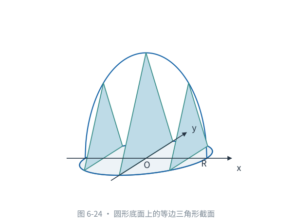

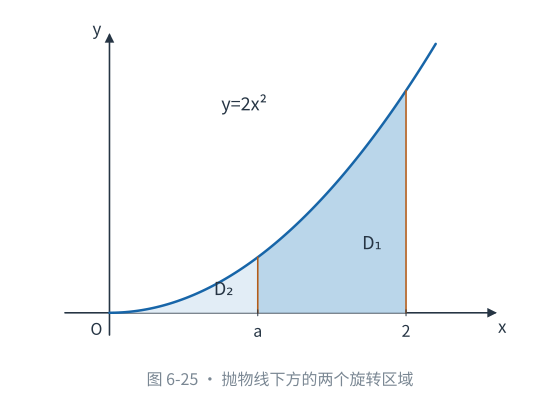

> 原书核对：[扫描第 298 页](../原书页面/up-298.png)。

<!-- /original-figure -->

**图6-25**  ^fig6_25

24. 计算半立方抛物线 $y^{2} = \frac{2}{3}(x - 1)^{3}$ 被抛物线 $y^{2} = \frac{x}{3}$ 截得的一段弧的长度.

25. 计算抛物线 $y^{2} = 2px$ ($p > 0$) 从顶点到这曲线上的一点 $M(x, y)$ 的弧长.

26. 计算星形线 $x=a\cos^{3}t, y=a\sin^{3}t$ (图 6-26) 的全长.

<!-- original-figure: up-299 6-26,6-27 -->
**图 6-26** ^fig6_26

**图 6-27** ^fig6_27

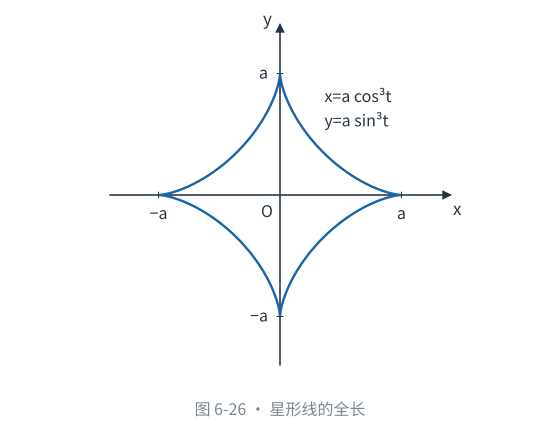

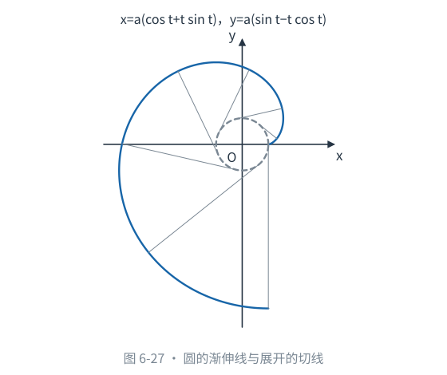

> 原书核对：[扫描第 299 页](../原书页面/up-299.png)。

<!-- /original-figure -->

27. 将绕在圆（半径为 $a$）上的细线放开拉直，使细线与圆周始终相切（图 6-27），细线端点画出的轨迹叫做圆的渐伸线，它的方程为

$$
x = a (\cos t + t \sin t), y = a (\sin t - t \cos t).
$$

计算该曲线上相应于 $0 \leqslant t \leqslant \pi$ 的一段弧的长度.
28. 在摆线 $x=a(t-\sin t)$，$y=a(1-\cos t)$ 上求分摆线第一拱成 1：3 的点的坐标.

29. 求对数螺线 $\rho=e^{a\theta}$ 相应于 $0 \leqslant \theta \leqslant \varphi$ 的一段弧长.

30. 求曲线 $\rho \theta = 1$ 相应于 $\frac{3}{4} \leqslant \theta \leqslant \frac{4}{3}$ 的一段弧长.

> [!pdf]- 📄 本节原书页面（PDF 286–298 / 书页 269–281）
> ![[up-286.png]]
> ![[up-287.png]]
> ![[up-288.png]]
> ![[up-289.png]]
> ![[up-290.png]]
> ![[up-291.png]]
> ![[up-292.png]]
> ![[up-293.png]]
> ![[up-294.png]]
> ![[up-295.png]]
> ![[up-296.png]]
> ![[up-297.png]]
> ![[up-298.png]]

---
⬅️ [[6-1-定积分的元素法|定积分的元素法]] ｜ 📑 [[第六章-定积分的应用|本章目录]] ｜ ➡️ [[6-3-定积分在物理学上的应用|定积分在物理学上的应用]]
