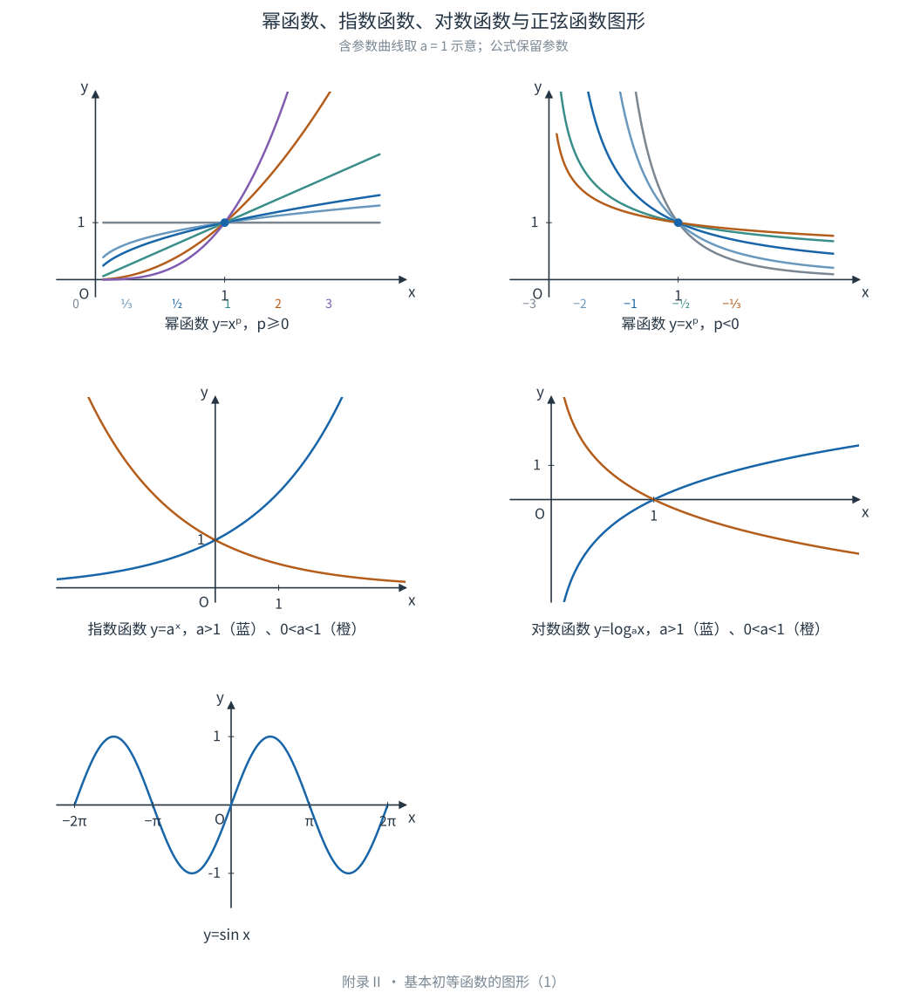
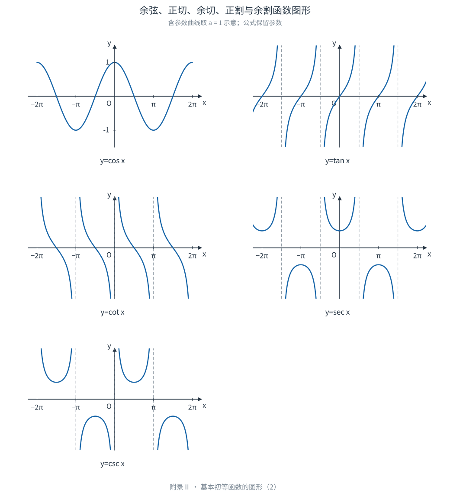
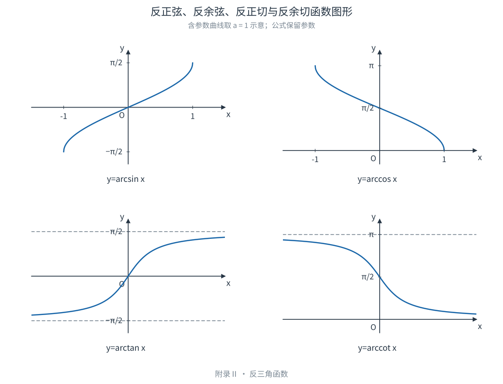

# 附录II 基本初等函数的图形

## 补回的原书图表

以下为依据原书公式重绘的 SVG 图表。含参数曲线取 a = 1 示意，保留原书公式；每张图后附原扫描页。

### 原书第 364 页

[核对原书扫描第 381 页](原书页面/up-381.png)

### 原书第 365 页

[核对原书扫描第 382 页](原书页面/up-382.png)

### 原书第 366 页

[核对原书扫描第 383 页](原书页面/up-383.png)

## 已有 OCR 转写

以下保留原有转写；图形及公式的对应关系请对照上方原书图表。

## 附录Ⅱ 基本初等函数的图形

幂函数

指数函数

对数函数

三角函数

$y = \cos x$

$y = \tan x$

$y = \cot x$

$y = \sec x$

$y = \csc x$

反三角函数

$y = \arcsin x$

$y = \arccos x$

$y = \arctan x$

$y = \operatorname{arccot} x$