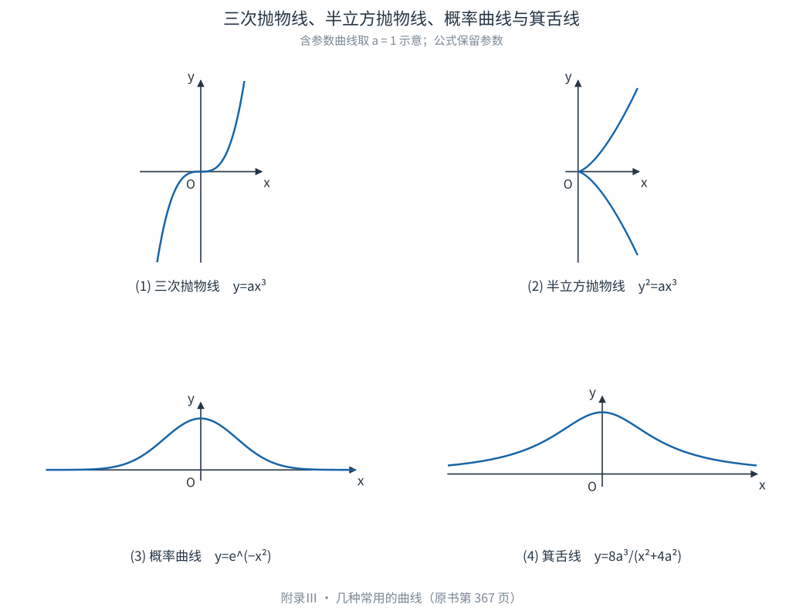
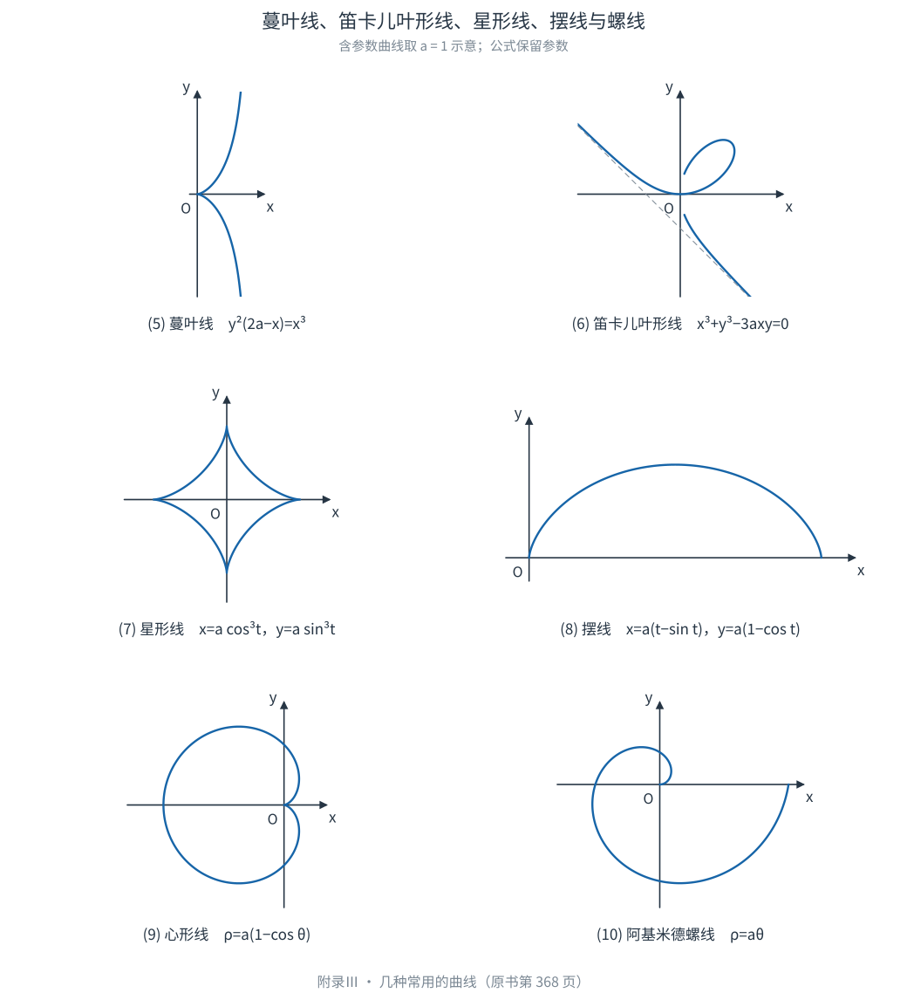
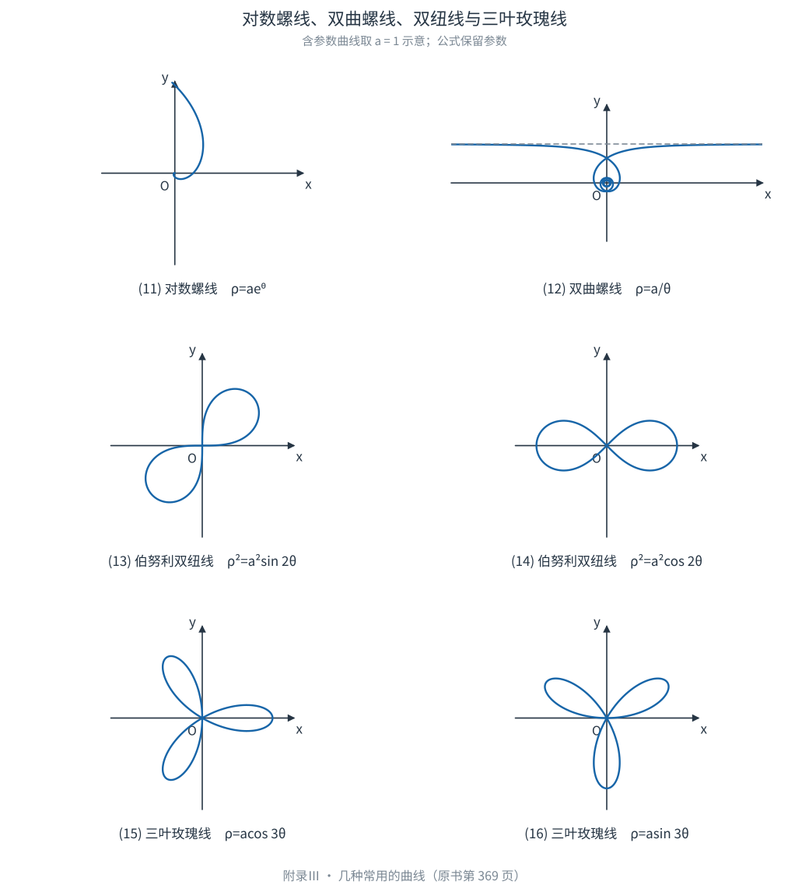
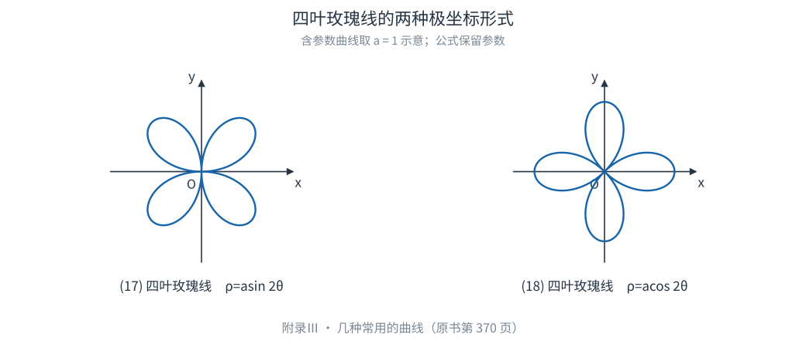

# 附录III 几种常用的曲线

## 补回的原书图表

以下为依据原书公式重绘的 SVG 图表。含参数曲线取 a = 1 示意，保留原书公式；每张图后附原扫描页。

### 原书第 367 页

[核对原书扫描第 384 页](原书页面/up-384.png)

### 原书第 368 页

[核对原书扫描第 385 页](原书页面/up-385.png)

### 原书第 369 页

[核对原书扫描第 386 页](原书页面/up-386.png)

### 原书第 370 页

[核对原书扫描第 387 页](原书页面/up-387.png)

## 已有 OCR 转写

以下保留原有转写；图形及公式的对应关系请对照上方原书图表。

附录Ⅲ几种常用的曲线

（1）三次抛物线

$y=ax^{3}$

(2) 半立方抛物线

$y^{2}=ax^{3}$

（3）概率曲线

$y=e^{-x^{2}}$

(4) 箕舌线

$y=\frac{8a^{3}}{x^{2}+4a^{2}}$

(5) 蔓叶线

(6) 笛卡儿叶形线

$$
y^{2}(2a-x)=x^{3}
$$

$$
x^{3}+y^{3}-3axy=0
$$

$$
x=\frac{3at}{1+t^{3}}, \quad y=\frac{3at^{2}}{1+t^{3}}
$$

(7) 星形线(内摆线的一种)

(8) 摆线

$$
\frac{2}{x^{3} + y^{3}} = a^{\frac{2}{3}}
\begin{cases}
x = a \cos^{3} \theta \\
y = a \sin^{3} \theta
\end{cases}
$$

(9) 心形线(外摆线的一种)

(10) 阿基米德螺线

$$
x^{2}+y^{2}+ax=a\sqrt{x^{2}+y^{2}}
$$

$$
\rho=a(1-\cos \theta)
$$

(11) 对数螺线

(12) 双曲螺线

(13) 伯努利双纽线

(14) 伯努利双纽线

(15) 三叶玫瑰线

(16) 三叶玫瑰线

(17) 四叶玫瑰线

(18) 四叶玫瑰线